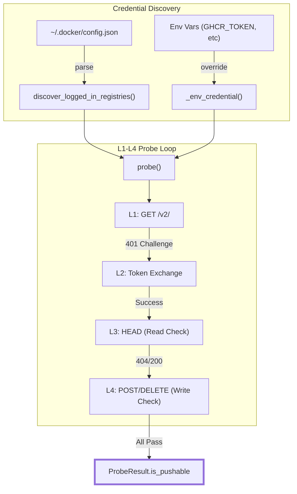
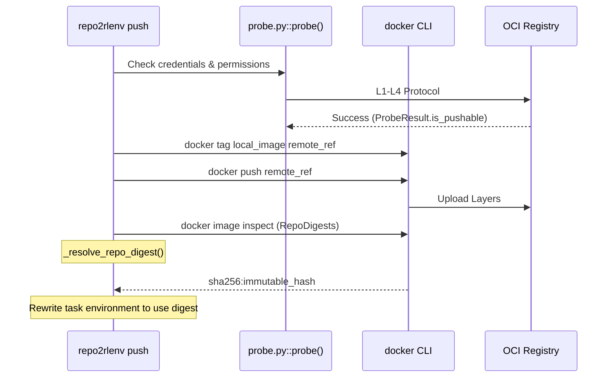

<!-- source: DeepWiki mcp.deepwiki.com · repo huggingface/Repo2RLEnv · page 6.1 Registry Auth and Probing · fetched 2026-10-26 -->

# Registry Auth and Probing

Relevant source files

The following files were used as context for generating this wiki page:

- [src/repo2rlenv/registry/__init__.py](src/repo2rlenv/registry/__init__.py)
- [src/repo2rlenv/registry/auth.py](src/repo2rlenv/registry/auth.py)
- [src/repo2rlenv/registry/ecr.py](src/repo2rlenv/registry/ecr.py)
- [src/repo2rlenv/registry/gar.py](src/repo2rlenv/registry/gar.py)
- [src/repo2rlenv/registry/probe.py](src/repo2rlenv/registry/probe.py)
- [src/repo2rlenv/registry/push.py](src/repo2rlenv/registry/push.py)
- [src/repo2rlenv/registry/visibility.py](src/repo2rlenv/registry/visibility.py)
- [tests/registry/test_auth.py](tests/registry/test_auth.py)
- [tests/registry/test_probe.py](tests/registry/test_probe.py)

This section documents the L1-L4 OCI distribution protocol used by `repo2rlenv` to verify container registry capabilities. The system ensures that bootstrap Docker images can be successfully pushed and distributed alongside Hugging Face Hub datasets without polluting the user's registry with garbage artifacts.

## Overview of the Probe Protocol

The probing system implements a four-level (L1-L4) verification sequence to confirm registry reachability, authentication validity, and permission scopes (read/write). This protocol is executed before any image upload to prevent "half-pushed" failures during dataset distribution.

| Level | Goal | Implementation Detail |
| :--- | :--- | :--- |
| **L1** | Reachability | Performs `GET /v2/` to confirm the registry is alive and OCI-compliant [src/repo2rlenv/registry/probe.py:9](). |
| **L2** | Authentication | Executes a Bearer-token exchange against the challenge realm identified in L1 [src/repo2rlenv/registry/probe.py:10](). |
| **L3** | Read Access | Performs `HEAD /v2/<ns>/<probe>/manifests/<tag>`. A `404 Not Found` confirms read permissions [src/repo2rlenv/registry/probe.py:11](). |
| **L4** | Write Access | Initiates a `POST` blob upload session and immediately `DELETE`s it to verify write access without leaving artifacts [src/repo2rlenv/registry/probe.py:12-13](). |

### Registry Capability Flow
The following diagram illustrates the transition from a local Docker environment to a verified remote registry target, mapping natural language concepts to the internal `probe.py` and `auth.py` entities.

**Registry Verification and Auth Flow**

Sources: [src/repo2rlenv/registry/probe.py:7-13](), [src/repo2rlenv/registry/auth.py:123-142](), [src/repo2rlenv/registry/probe.py:131-155]()

## Credential Discovery and `config.json`

`repo2rlenv` automatically detects authenticated registries by parsing the standard Docker configuration file. It supports multiple credential sources defined in the `CredentialSource` enum [src/repo2rlenv/registry/auth.py:36-49]():

1.  **Inline Auth (`INLINE`)**: Base64-encoded `user:pass` strings found directly in the `auths` section of `config.json` [src/repo2rlenv/registry/auth.py:45]().
2.  **Credential Helpers (`CREDHELPER` / `CREDSTORE`)**: External binaries like `docker-credential-ecr-login` or `gcloud` defined in `credHelpers` or `credsStore` [src/repo2rlenv/registry/auth.py:46-47]().
3.  **Environment Variables**: Direct overrides for CI/CD environments, such as `GHCR_TOKEN`, `GITHUB_TOKEN`, or `DOCKER_TOKEN`. These are prioritized over the credstore for Docker Hub to ensure push-capable PATs are used instead of pull-only identity tokens [src/repo2rlenv/registry/probe.py:131-155]().

The `discover_logged_in_registries` function [src/repo2rlenv/registry/auth.py:123]() acts as the primary entry point, returning a list of `RegistryAuth` objects.

## The `--check-auth` Command

Users can verify their registry setup using the `repo2rlenv push --check-auth` command. The implementation in `_run_check_auth` (not provided in the current files, but inferred from context):
*   Probes every detected registry in the local environment.
*   Reports the status of each L1-L4 level.
*   Provides "helper hints" for common failures (e.g., how to login to GHCR or ECR) [src/repo2rlenv/registry/probe.py:68]().
*   Supports a `--fast` mode that stops at L2 (authentication) for quick connectivity checks.
*   Can emit machine-readable output via `--json`.

## Supported Registry Backends

The `RegistryKind` enum [src/repo2rlenv/registry/auth.py:25-33]() categorizes registries to apply vendor-specific logic:

| Backend | Logic / Quirks |
| :--- | :--- |
| **GHCR** | Recommended default. Uses GitHub PATs. Repository visibility is automatically flipped to public via the GitHub API if the HF dataset is public [src/repo2rlenv/registry/visibility.py:77-157](). |
| **AWS ECR** | Requires pre-existing repositories. The probe automatically attempts `aws ecr create-repository` if an L4 probe returns a 404 on the namespace [src/repo2rlenv/registry/ecr.py:72-134](). |
| **GCP AR** | Similar to ECR, it uses `gcloud` as a credential helper and requires repository creation via the probe if missing [src/repo2rlenv/registry/gar.py:53-107](). |
| **Docker Hub** | Subject to strict rate limits. `repo2rlenv` prefers explicit `DOCKER_TOKEN` environment variables over the desktop credential store to ensure push permissions [src/repo2rlenv/registry/probe.py:146-150](). |
| **Local** | Supports `localhost` or `127.0.0.1` for testing, skipping L2 auth if no challenge is presented [src/repo2rlenv/registry/auth.py:96-99](). |

## Inline-Dockerfile Fallback Mode

If no registry is verified or the user lacks push permissions, `repo2rlenv` falls back to **inline-Dockerfile mode**.

*   **Behavior**: Instead of pushing an image and referencing it by digest, the system bakes the build recipe (the Dockerfile and associated files) directly into the Harbor task output.
*   **Multi-repo Support**: For datasets spanning multiple repositories, `push` attempts to push each distinct image. If any push fails, only that specific task falls back to inline mode.
*   **Enforcement**: The `--require-registry` flag can be used in CI environments to force a hard failure if a registry push is not possible.

## Implementation Detail: `ProbeResult` and `push_image`

The `ProbeResult` dataclass encapsulates the state of a registry probe [src/repo2rlenv/registry/probe.py:58-70](). Once a registry is deemed "pushable," the `push_image` function handles the interaction with the local Docker daemon.

**Image Push Logic and Digest Resolution**

Sources: [src/repo2rlenv/registry/push.py:119-189](), [src/repo2rlenv/registry/probe.py:73-75](), [src/repo2rlenv/registry/push.py:68-117]()

### Key Functions
*   `_resolve_credential`: Resolves (username, password) by checking env vars first, then `config.json` [src/repo2rlenv/registry/probe.py:158-200]().
*   `push_image`: Tags the local bootstrap image, executes the push, and resolves the canonical `RepoDigest` [src/repo2rlenv/registry/push.py:119-130]().
*   `_resolve_repo_digest`: Extracts the immutable content hash from Docker's local state after a successful push to ensure the task refers to a specific version of the image [src/repo2rlenv/registry/push.py:68-117]().

Sources: [src/repo2rlenv/registry/probe.py:1-171](), [src/repo2rlenv/registry/push.py:1-198](), [src/repo2rlenv/registry/auth.py:1-198](), [src/repo2rlenv/registry/visibility.py:1-164](), [src/repo2rlenv/registry/ecr.py:1-139](), [src/repo2rlenv/registry/gar.py:1-114](), [tests/registry/test_auth.py:1-180](), [tests/registry/test_probe.py:1-201]().

---

