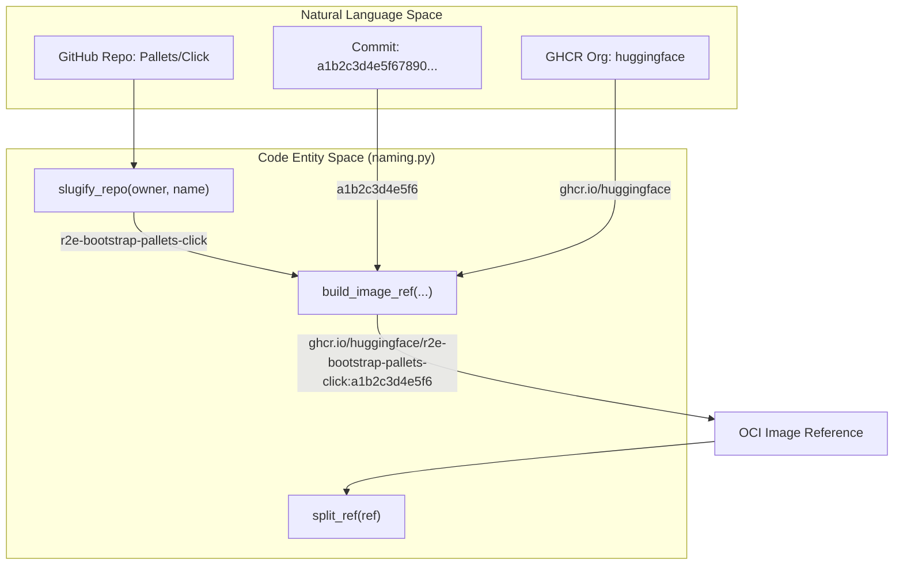
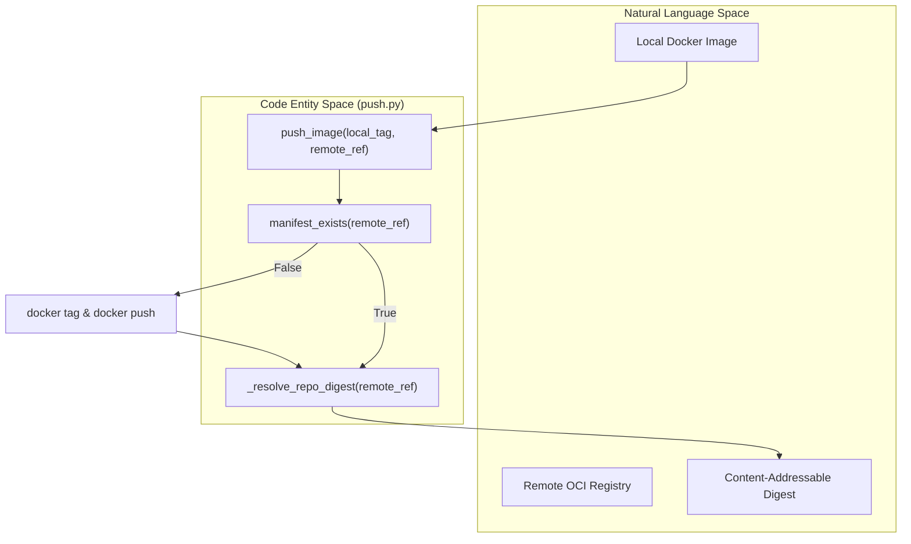
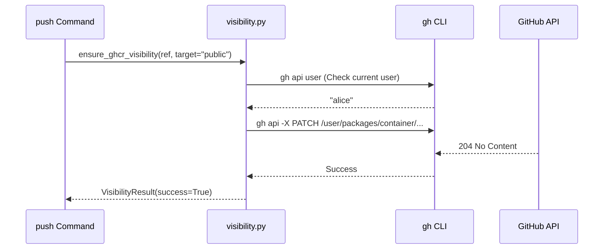

<!-- source: DeepWiki mcp.deepwiki.com · repo huggingface/Repo2RLEnv · page 6.2 Cloud Registry Backends · fetched 2026-10-26 -->

# Cloud Registry Backends

Relevant source files

The following files were used as context for generating this wiki page:

- [src/repo2rlenv/registry/ecr.py](src/repo2rlenv/registry/ecr.py)
- [src/repo2rlenv/registry/gar.py](src/repo2rlenv/registry/gar.py)
- [src/repo2rlenv/registry/naming.py](src/repo2rlenv/registry/naming.py)
- [src/repo2rlenv/registry/probe.py](src/repo2rlenv/registry/probe.py)
- [src/repo2rlenv/registry/push.py](src/repo2rlenv/registry/push.py)
- [src/repo2rlenv/registry/visibility.py](src/repo2rlenv/registry/visibility.py)
- [tests/registry/test_naming.py](tests/registry/test_naming.py)

The `Repo2RLEnv` system utilizes OCI container registries to distribute the Docker environments (bootstrap images) required for executing RL tasks. While GitHub Container Registry (GHCR) is the primary target, the system provides specialized backends for Amazon Elastic Container Registry (ECR) and Google Artifact Registry (GAR) to handle their unique requirements regarding repository creation and visibility.

### Image Naming and Reference Construction

The `naming.py` module enforces OCI-compliant naming conventions for bootstrap images. It generates a deterministic image reference based on the repository owner, name, commit SHA, and an optional options hash (representing non-default bootstrap configurations).

*   **Default Prefix**: `r2e-bootstrap` [src/repo2rlenv/registry/naming.py:22-22]().
*   **Slugification**: Repository names and owners are converted to lowercase, and non-alphanumeric characters are collapsed into single dashes to satisfy OCI path component constraints [src/repo2rlenv/registry/naming.py:29-45]().
*   **Tagging Strategy**: The tag consists of the first 12 characters of the commit SHA, optionally suffixed with an 8-character options hash (e.g., `a1b2c3d4e5f6-7d8e9f01`) [src/repo2rlenv/registry/naming.py:48-84]().

#### Entity Mapping: Naming and Resolution

The following diagram shows how high-level repository concepts are mapped to OCI-compliant strings by the naming module.

Title: Naming and Reference Construction

**Sources:** [src/repo2rlenv/registry/naming.py:29-101](), [tests/registry/test_naming.py:20-164]()

---

### Image Push and Digest Resolution

The `push.py` module orchestrates the transfer of local images to remote registries using the `docker` CLI. It implements an idempotency check to avoid redundant uploads and resolves the canonical `RepoDigest` for precise task pinning.

*   **Idempotency**: Before pushing, the system calls `manifest_exists`, which uses `docker manifest inspect` to check if the tag is already present on the remote [src/repo2rlenv/registry/push.py:53-65]().
*   **Digest Resolution**: After a successful push, `_resolve_repo_digest` parses `docker image inspect` output to find the registry-qualified SHA256 hash. It specifically handles Docker Hub's behavior of omitting the host prefix by re-attaching `index.docker.io` where necessary [src/repo2rlenv/registry/push.py:68-116]().
*   **Error Handling**: The `push_image` function verifies the local image exists via `docker image inspect --format {{.Id}}` before attempting a tag or push [src/repo2rlenv/registry/push.py:139-147]().

Title: Push Logic and Digest Resolution

**Sources:** [src/repo2rlenv/registry/push.py:119-190](), [src/repo2rlenv/registry/push.py:53-65](), [src/repo2rlenv/registry/push.py:68-116](), [src/repo2rlenv/registry/push.py:139-147]()

---

### Amazon ECR Backend (`ecr.py`)

Unlike GHCR, Amazon ECR requires that a repository be explicitly created before a `docker push` can occur. The `ecr.py` backend automates this by shelling out to the `aws` CLI.

*   **Auto-Creation**: `ensure_ecr_repository` checks for the existence of the repository and creates it if missing [src/repo2rlenv/registry/ecr.py:72-132]().
*   **Public vs. Private**: The module distinguishes between private ECR (`<acct>.dkr.ecr.<region>.amazonaws.com`) and ECR Public (`public.ecr.aws/<alias>`) [src/repo2rlenv/registry/ecr.py:36-70]().
*   **Region Handling**: ECR Public is hardcoded to `us-east-1` per AWS requirements, while private ECR parses the region directly from the host portion of the image reference [src/repo2rlenv/registry/ecr.py:82-119]().

**Sources:** [src/repo2rlenv/registry/ecr.py:1-132]()

---

### Google Artifact Registry Backend (`gar.py`)

Similar to ECR, Google Artifact Registry (GAR) requires the repository (the "bucket" for images) to exist within a specific project and location before blobs are accepted.

*   **Reference Parsing**: `_parse_gar_ref` extracts the location, project, and repository name from the GAR URI format: `<location>-docker.pkg.dev/<project>/<repo>/<image>` [src/repo2rlenv/registry/gar.py:34-51]().
*   **Idempotent Creation**: `ensure_gar_repository` uses `gcloud artifacts repositories describe` to check for existence and `create` with `--repository-format=docker` if it is missing [src/repo2rlenv/registry/gar.py:53-105]().

**Sources:** [src/repo2rlenv/registry/gar.py:1-112]()

---

### GHCR Visibility Management

GHCR defaults new packages to `private`. To support public dataset distribution, `Repo2RLEnv` includes a visibility manager that uses the GitHub REST API (via the `gh` CLI) to toggle package settings.

*   **Namespace Routing**: The module detects whether the target is a user namespace or an organization namespace to select the correct API endpoint (`/user/packages/...` vs `/orgs/<org>/packages/...`) [src/repo2rlenv/registry/visibility.py:106-112]().
*   **Best-Effort PATCH**: If the user lacks the `write:packages` scope, the system catches the error, provides a manual URL for the user to update settings via the browser, and proceeds [src/repo2rlenv/registry/visibility.py:129-155]().

#### Data Flow: Visibility Update

Title: GHCR Visibility Sequence

**Sources:** [src/repo2rlenv/registry/visibility.py:76-156]()

---

### Backend Comparison Table

| Feature | GHCR | AWS ECR | Google GAR |
| :--- | :--- | :--- | :--- |
| **Auto-Repo Creation** | Native (on push) | Scripted (`ecr.py`) | Scripted (`gar.py`) |
| **CLI Dependency** | `gh` (for visibility) | `aws` | `gcloud` |
| **Auth Mechanism** | `docker login` | `aws ecr get-login-password` | `gcloud auth configure-docker` |
| **Visibility Control** | Programmatic PATCH | Console/CLI | Console/CLI |
| **Token TTL** | Long-lived (PAT) | 12 Hours | Variable |

**Sources:** [src/repo2rlenv/registry/ecr.py:1-9](), [src/repo2rlenv/registry/gar.py:1-5](), [src/repo2rlenv/registry/visibility.py:1-13]()

---

