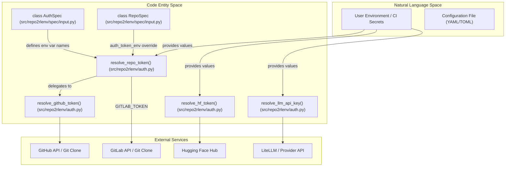
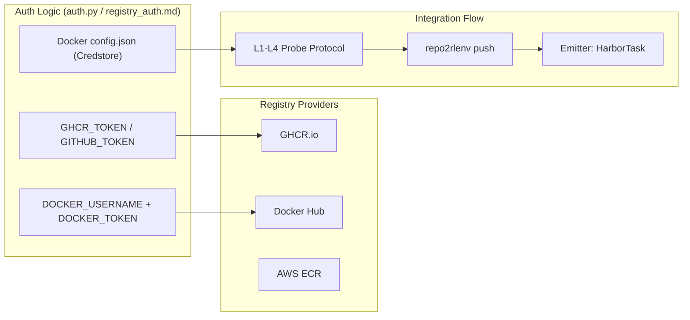

<!-- source: DeepWiki mcp.deepwiki.com · repo huggingface/Repo2RLEnv · page 7 Authentication and External Integrations · fetched 2026-10-26 -->

# Authentication and External Integrations

Relevant source files

The following files were used as context for generating this wiki page:

- [docs/reference/AUTH.md](docs/reference/AUTH.md)
- [src/repo2rlenv/auth.py](src/repo2rlenv/auth.py)
- [src/repo2rlenv/llm.py](src/repo2rlenv/llm.py)
- [src/repo2rlenv/spec/input.py](src/repo2rlenv/spec/input.py)
- [tests/test_auth.py](tests/test_auth.py)
- [tests/test_sources.py](tests/test_sources.py)

Repo2RLEnv interacts with a variety of external services to mine data, synthesize instructions, and distribute datasets. To ensure seamless operation across local developer machines and CI/CD environments, the system employs a layered credential resolution strategy. It prioritizes local developer tools (like the `gh` CLI) while allowing explicit overrides via environment variables for automated workflows.

### Credential Resolution Overview

The system manages four primary categories of external integrations:
1.  **Source Control (GitHub/GitLab/Local):** Used for repository mining, PR filtering, and cloning.
2.  **Dataset Distribution (Hugging Face Hub):** Used for pushing and pulling generated datasets.
3.  **Inference (LLM Providers):** Used for instruction synthesis, reward judging, and the bootstrap agent.
4.  **Container Registries (OCI):** Used for distributing pre-built Docker environments.

The following diagram illustrates how the `AuthSpec` configuration and `auth.py` logic bridge the gap between user environment variables and the internal pipeline requirements.

**Authentication Flow: Environment to Code Entities**

**Sources:** [src/repo2rlenv/auth.py:17-123](), [src/repo2rlenv/spec/input.py:55-60](), [src/repo2rlenv/spec/input.py:164-167]()

---

### GitHub and Hugging Face Auth

GitHub authentication is critical for the initial mining phase of most pipelines. Repo2RLEnv implements a four-step resolution chain in `resolve_github_token` [src/repo2rlenv/auth.py:17-46]():
1.  **Explicit Config:** Checks `repo.auth_token_env` for a specific variable name [src/repo2rlenv/auth.py:26-30]().
2.  **CLI Token:** Attempts to fetch a token via `gh auth token` if the `gh` CLI is installed [src/repo2rlenv/auth.py:31-41]().
3.  **Standard Env:** Checks the `$GITHUB_TOKEN` (or `$GH_TOKEN`) environment variable [src/repo2rlenv/auth.py:46-46]().
4.  **Anonymous:** Falls back to unauthenticated access (suitable for public repos only).

The system also supports **GitLab** (via `GITLAB_TOKEN`) and **Local** sources (no token required) [src/repo2rlenv/auth.py:106-123](). The `SourceKind` and `Capability` models in `sources.py` ensure that pipelines only attempt to run against sources that provide the necessary data (e.g., `pr_diff` requires `Capability.PULL_REQUESTS`) [tests/test_sources.py:104-111]().

Hugging Face authentication is managed via the `huggingface_hub` SDK, resolving from either the `HF_TOKEN` environment variable or the local cache populated by `huggingface-cli login` [src/repo2rlenv/auth.py:48-61]().

For more details on token scoping and private repository handling, see [GitHub and Hugging Face Auth](#7.1).

**Sources:** [src/repo2rlenv/auth.py:17-61](), [src/repo2rlenv/auth.py:106-123](), [tests/test_sources.py:104-111](), [docs/reference/AUTH.md:7-66]()

---

### LLM Integration (LiteLLM)

Repo2RLEnv uses **LiteLLM** as a universal bridge to various providers (Anthropic, OpenAI, Together, etc.). The `resolve_llm_api_key` function maps provider names to their standard environment variable defaults (e.g., `ANTHROPIC_API_KEY`) [src/repo2rlenv/auth.py:76-88]().

This integration is used for:
*   **Instruction Synthesis:** Generating `instruction.md` from PR diffs or issue descriptions.
*   **Bootstrap Agent:** Building Docker environments via a ReAct-style loop.
*   **LLM-as-Judge:** Scoring the semantic correctness of patches in the `pr_diff` pipeline.

For details on cost tracking, model fallbacks, and budget caps, see [LLM Integration (LiteLLM)](#7.2).

**Sources:** [src/repo2rlenv/auth.py:76-88](), [docs/reference/AUTH.md:98-111]()

---

### Container Registry Integration

When pushing `_runtime` datasets, Repo2RLEnv must distribute the underlying Docker images. The system supports multiple OCI backends including **GHCR**, **Docker Hub**, **AWS ECR**, and **Google Artifact Registry** [docs/reference/AUTH.md:112-122]().

The `registry` module manages the "Prepare for Push" lifecycle:
1.  **Discovery:** Finding logged-in registries via `docker/config.json` or env vars like `GHCR_TOKEN` [docs/reference/AUTH.md:114-120]().
2.  **Probing:** Verifying read/write permissions using the L1-L4 probe protocol.
3.  **Rewriting:** Modifying `task.toml` to point to the new remote image reference.

**Registry Auth Resolution Map**

**Sources:** [docs/reference/AUTH.md:112-122]()

For details on the L1-L4 probe protocol and cloud-specific setup, see [Registry Auth and Probing](#6.1).

---

