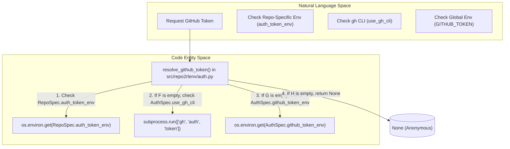
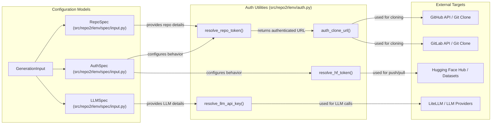

<!-- source: DeepWiki mcp.deepwiki.com · repo huggingface/Repo2RLEnv · page 7.1 GitHub and Hugging Face Auth · fetched 2026-10-26 -->

# GitHub and Hugging Face Auth

Relevant source files

The following files were used as context for generating this wiki page:

- [docs/reference/AUTH.md](docs/reference/AUTH.md)
- [src/repo2rlenv/auth.py](src/repo2rlenv/auth.py)
- [src/repo2rlenv/bootstrap/docker.py](src/repo2rlenv/bootstrap/docker.py)
- [src/repo2rlenv/bootstrap/runner.py](src/repo2rlenv/bootstrap/runner.py)
- [src/repo2rlenv/github.py](src/repo2rlenv/github.py)
- [src/repo2rlenv/gitlab.py](src/repo2rlenv/gitlab.py)
- [src/repo2rlenv/llm.py](src/repo2rlenv/llm.py)
- [src/repo2rlenv/provider.py](src/repo2rlenv/provider.py)
- [src/repo2rlenv/sources.py](src/repo2rlenv/sources.py)
- [src/repo2rlenv/spec/input.py](src/repo2rlenv/spec/input.py)
- [tests/test_auth.py](tests/test_auth.py)
- [tests/test_e2e_public.py](tests/test_e2e_public.py)
- [tests/test_gitlab.py](tests/test_gitlab.py)
- [tests/test_sources.py](tests/test_sources.py)

This page documents the authentication mechanisms used by Repo2RLEnv to interact with external services. The system is designed to prioritize security and ease of use by leveraging existing CLI tools (like `gh` and `huggingface-cli`) while providing flexible overrides for CI/CD environments.

## GitHub Token Resolution Chain

Repo2RLEnv implements a source-aware resolution chain for GitHub tokens, primarily managed by `resolve_repo_token` [src/repo2rlenv/auth.py:106-123]() and `resolve_github_token` [src/repo2rlenv/auth.py:17-46](). This ensures that the system can operate in various environments, from a developer's local machine to multi-tenant CI runners.

| Priority | Source | Description |
| :--- | :--- | :--- |
| **1. Explicit Env** | `RepoSpec.auth_token_env` | The name of an environment variable specific to this repository [src/repo2rlenv/auth.py:26-29](). |
| **2. CLI Token** | `gh auth token` | If `AuthSpec.use_gh_cli` is true, the system shells out to the GitHub CLI [src/repo2rlenv/auth.py:31-43](). |
| **3. Standard Env** | `GITHUB_TOKEN` | The default environment variable defined in `AuthSpec.github_token_env` [src/repo2rlenv/auth.py:46-46](). |
| **4. Anonymous** | `None` | If no token is found, requests are made without authentication (subject to rate limits) [src/repo2rlenv/auth.py:46-46](). |

### Implementation Details

The `_run_gh` function in `src/repo2rlenv/github.py` [src/repo2rlenv/github.py:43-82]() manages the execution of GitHub CLI commands. If a token is resolved, it is passed via the `GH_TOKEN` environment variable to the subprocess [src/repo2rlenv/github.py:50-50]() to ensure the CLI uses the correct credentials.

### Source-Aware Resolution

Repo2RLEnv distinguishes between GitHub, GitLab, and Local sources [src/repo2rlenv/sources.py:33-38]():
- **GitHub:** Follows the resolution chain above [src/repo2rlenv/auth.py:123-123]().
- **GitLab:** Checks `repo.auth_token_env` then falls back to `$GITLAB_TOKEN` [src/repo2rlenv/auth.py:118-122]().
- **Local:** No token is resolved, and no `gh` shell-out occurs [src/repo2rlenv/auth.py:115-116]().

### Private Repository Support

For private repositories, the `auth_clone_url` function [src/repo2rlenv/auth.py:91-102]() transforms standard HTTPS URLs into authenticated URLs by injecting the token:
- **GitHub:** Uses `https://x-access-token:<token>@github.com/...` [src/repo2rlenv/auth.py:98-99]().
- **GitLab:** Uses `https://oauth2:<token>@gitlab.com/...` [src/repo2rlenv/auth.py:100-101]().

This authenticated URL is used during the initial clone operation by `_shallow_clone_at_ref` [src/repo2rlenv/bootstrap/runner.py:168-168](). For `_runtime` pipelines, the same generation-time token can be supplied as a Docker build argument (`--build-arg GITHUB_TOKEN=$GITHUB_TOKEN`) to allow cloning private repositories inside the Docker image at build time. The token is then immediately removed from `git config` to prevent persistence in the image layers [docs/reference/AUTH.md:70-77]().

**Sources:** [src/repo2rlenv/auth.py:17-46](), [src/repo2rlenv/auth.py:91-123](), [src/repo2rlenv/bootstrap/runner.py:168-168](), [src/repo2rlenv/github.py:43-82](), [src/repo2rlenv/sources.py:33-38](), [docs/reference/AUTH.md:7-77]().

## Hugging Face Auth

Authentication for the Hugging Face Hub is primarily used by the `push` and `pull` commands. Resolution is handled by `resolve_hf_token` [src/repo2rlenv/auth.py:49-61]().

1.  **CLI Cache:** If `AuthSpec.use_hf_cli` is enabled, the system checks for a token at `~/.cache/huggingface/token` [src/repo2rlenv/auth.py:52-58]().
2.  **Environment Variable:** Falls back to the variable named in `AuthSpec.hf_token_env` (defaulting to `HF_TOKEN`) [src/repo2rlenv/auth.py:60-60]().

**Sources:** [src/repo2rlenv/auth.py:49-61](), [docs/reference/AUTH.md:94-97]().

## LLM API Key Resolution

LLM authentication is managed via `resolve_llm_api_key` [src/repo2rlenv/auth.py:76-89](). It maps provider names to their standard environment variables.

| Provider | Default Env Var |
| :--- | :--- |
| `anthropic` | `ANTHROPIC_API_KEY` |
| `openai` | `OPENAI_API_KEY` |
| `huggingface` | `HF_TOKEN` |
| `together` | `TOGETHER_API_KEY` |
| `groq` | `GROQ_API_KEY` |

Users can override these defaults by setting `llm.api_key_env` in the configuration or using `--llm-key-env VAR` CLI flag [src/repo2rlenv/llm.py:90-95](). For self-hosted models, a placeholder key "EMPTY" is used if the provider requires a key string, otherwise `None` is passed to LiteLLM to handle its own resolution (e.g., `HOSTED_VLLM_API_KEY` for `hosted_vllm/` models) [src/repo2rlenv/llm.py:106-106]().

**Sources:** [src/repo2rlenv/auth.py:67-89](), [src/repo2rlenv/llm.py:90-106](), [docs/reference/AUTH.md:98-111]().

## Auth Data Flow Diagrams

### Natural Language to Code Entity Space: GitHub Auth Resolution
This diagram maps the logical steps of GitHub authentication to the specific code entities responsible for the resolution.

**Sources:** [src/repo2rlenv/auth.py:17-46](), [src/repo2rlenv/github.py:43-62](), [docs/reference/AUTH.md:44-52]().

### Authentication Component Interaction
This diagram shows how the `AuthSpec` and `RepoSpec` configuration models drive the behavior of the authentication utility functions.

**Sources:** [src/repo2rlenv/auth.py:1-123](), [src/repo2rlenv/spec/input.py:55-60](), [src/repo2rlenv/spec/input.py:163-179](), [src/repo2rlenv/llm.py:1-255](), [src/repo2rlenv/github.py:1-291](), [src/repo2rlenv/gitlab.py:1-134](), [src/repo2rlenv/sources.py:1-69](), [src/repo2rlenv/bootstrap/runner.py:20-20]().

## Configuration: AuthSpec

The `AuthSpec` model (defined in `src/repo2rlenv/spec/input.py` and used in `auth.py` [src/repo2rlenv/auth.py:10]()) defines the behavior of the authentication subsystem.

| Field | Type | Default | Description |
| :--- | :--- | :--- | :--- |
| `github_token_env` | `str` | `"GITHUB_TOKEN"` | Env var to read if other methods fail. |
| `hf_token_env` | `str` | `"HF_TOKEN"` | Env var for Hugging Face Hub operations. |
| `use_gh_cli` | `bool` | `True` | Whether to attempt `gh auth token`. |
| `use_hf_cli` | `bool` | `True` | Whether to attempt reading HF cache files. |

**Sources:** [src/repo2rlenv/auth.py:10-11](), [docs/reference/AUTH.md:43-52]().

---

