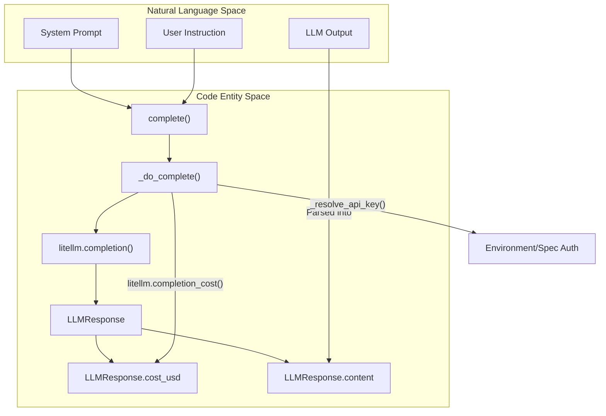
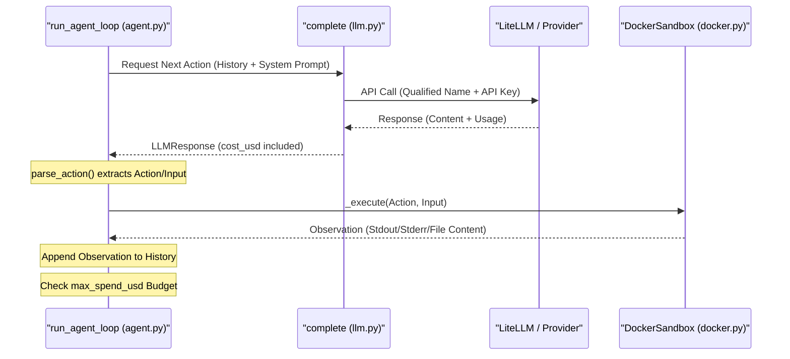

<!-- source: DeepWiki mcp.deepwiki.com · repo huggingface/Repo2RLEnv · page 7.2 LLM Integration (LiteLLM) · fetched 2026-10-26 -->

# LLM Integration (LiteLLM)

Relevant source files

The following files were used as context for generating this wiki page:

- [src/repo2rlenv/auth.py](src/repo2rlenv/auth.py)
- [src/repo2rlenv/llm.py](src/repo2rlenv/llm.py)
- [tests/test_auth.py](tests/test_auth.py)
- [tests/test_cli_llm_flags.py](tests/test_cli_llm_flags.py)
- [tests/test_llm_local.py](tests/test_llm_local.py)

The `repo2rlenv` system integrates with Large Language Models (LLMs) primarily through a centralized wrapper around the **LiteLLM** library. This integration provides a unified interface for multiple providers (Anthropic, OpenAI, Hugging Face, etc.), handles automated failover for transient errors, tracks token usage costs in USD, and enforces budget constraints during expensive operations like environment bootstrapping.

### Provider and Model Resolution

The core logic resides in `src/repo2rlenv/llm.py` [src/repo2rlenv/llm.py:1-6](), which acts as the single entry point for all LLM interactions within the synthesis pipelines and the bootstrap agent.

The system uses `LLMSpec` [src/repo2rlenv/spec/input.py:100-110]() to define model requirements. Resolution follows these steps:
1.  **API Key Lookup**: The `_resolve_api_key` function [src/repo2rlenv/llm.py:77-113]() determines the API key to use. It prioritizes `LLMSpec.api_key_env` [src/repo2rlenv/llm.py:89-96](), then handles custom `endpoint` scenarios [src/repo2rlenv/llm.py:97-106](), and finally falls back to provider-default environment variables (e.g., `ANTHROPIC_API_KEY`) via `resolve_llm_api_key` [src/repo2rlenv/auth.py:76-88](). A placeholder key `_PLACEHOLDER_API_KEY` [src/repo2rlenv/llm.py:22-22]() is used for `LLM_KEY_ENV_DEFAULTS` providers when an `endpoint` is specified but no explicit `api_key_env` is given [src/repo2rlenv/llm.py:106-106]().
2.  **Model Qualification**: Models are identified by a `qualified_name` (e.g., `anthropic/claude-3-5-sonnet-20240620`) [src/repo2rlenv/llm.py:157-157]().
3.  **Temperature Support**: Some modern reasoning models (e.g., GPT-o1, Claude Opus 4.7+) reject the `temperature` parameter. The wrapper uses a regex check `_NO_TEMPERATURE_RE` [src/repo2rlenv/llm.py:26-30]() to strip this parameter when necessary to prevent API errors [src/repo2rlenv/llm.py:167-168]().
4.  **Endpoint Customization**: For self-hosted backends or local inference, `LLMSpec.endpoint` allows overriding the base URL [src/repo2rlenv/llm.py:169-170]().
5.  **Provider Check**: The `check_provider` function [src/repo2rlenv/llm.py:116-134]() validates that all providers in the `LLMSpec` fallback chain are known to LiteLLM, raising an error early if not [src/repo2rlenv/llm.py:126-134]().

### LLM Call Flow and Data Structure

Every successful call returns an `LLMResponse` object, which encapsulates the generated text alongside detailed metadata.

**LLM Completion Data Flow**

Sources: [src/repo2rlenv/llm.py:48-55](), [src/repo2rlenv/llm.py:77-113](), [src/repo2rlenv/llm.py:137-183]()

### Transient Error Fallback Chain

To ensure robust pipeline execution, the `complete()` function implements a recursive fallback mechanism. If a primary model fails due to transient issues (e.g., rate limits or 5xx server errors), the system automatically attempts the request using a secondary model defined in `spec.fallback`. The `_is_failover_eligible` function [src/repo2rlenv/llm.py:58-74]() determines if an exception warrants a retry on a fallback model.

| Error Type | Failover Eligible? | Reason |
| :--- | :--- | :--- |
| `InternalServerError` | **Yes** | 5xx Upstream/Overloaded |
| `RateLimitError` | **Yes** | 429 Quota limits |
| `Timeout` | **Yes** | Network/Inference hang |
| `BadRequestError` | **No** | Config bug (invalid params) |
| `AuthenticationError` | **No** | Missing/Invalid API Key |

The recursion is capped at a depth of 3 levels to prevent infinite loops in cases of circular fallback configurations [src/repo2rlenv/llm.py:206-207]().

Sources: [src/repo2rlenv/llm.py:58-74](), [src/repo2rlenv/llm.py:199-213]()

### Cost Tracking and Budgeting

Cost management is critical during the **Bootstrap** phase, where an LLM agent might perform dozens of iterations to configure a Docker environment.

1.  **Cost Estimation**: After each completion, the wrapper calls `litellm.completion_cost()` to calculate the USD value of the tokens consumed [src/repo2rlenv/llm.py:211-211]().
2.  **Cumulative Tracking**: The `AgentOutcome` and `AgentTurn` classes (defined in `src/repo2rlenv/bootstrap/agent.py`) aggregate these costs throughout an agentic loop.
3.  **Budget Cap**: The `run_agent_loop` function (in `src/repo2rlenv/bootstrap/agent.py`) checks the `max_spend_usd` parameter at every iteration. If the `total_cost` exceeds the budget, the agent terminates immediately with a `success=False` outcome.

### Integration in Bootstrap Agent

The `run_agent_loop` uses the LLM to drive a ReAct-style cycle. It maps LLM "Actions" (BASH, READ_FILE, LIST_DIR) to sandbox executions and feeds "Observations" back into the prompt history. The agent uses `system_prompt` and `initial_user_prompt` (defined in `src/repo2rlenv/bootstrap/prompts.py`) to seed the context.

**Bootstrap Agent LLM Interaction**

Sources: [src/repo2rlenv/llm.py:137-183](), [src/repo2rlenv/llm.py:199-213]()

---

