<!-- source: DeepWiki mcp.deepwiki.com · repo huggingface/Repo2RLEnv · page 8 Tasksmith Agentic Authoring · fetched 2026-10-26 -->

# Tasksmith Agentic Authoring

<details>
<summary>Relevant source files</summary>

The following files were used as context for generating this wiki page:

- [docs/pipelines/tasksmith.md](docs/pipelines/tasksmith.md)
- [docs/release_notes/HISTORY.md](docs/release_notes/HISTORY.md)
- [pyproject.toml](pyproject.toml)
- [src/repo2rlenv/locking.py](src/repo2rlenv/locking.py)
- [src/repo2rlenv/pipelines/recipes/history/worker.py](src/repo2rlenv/pipelines/recipes/history/worker.py)
- [src/repo2rlenv/quality/loop/runner.py](src/repo2rlenv/quality/loop/runner.py)
- [src/repo2rlenv/tasksmith/batch.py](src/repo2rlenv/tasksmith/batch.py)
- [src/repo2rlenv/tasksmith/runner.py](src/repo2rlenv/tasksmith/runner.py)
- [uv.lock](uv.lock)

</details>


Tasksmith is a LangGraph-driven workflow designed to automate the creation of Harbor-compliant tasks from merged GitHub Pull Requests (PRs). It orchestrates a series of agentic stages to investigate a PR, bootstrap a remote environment, design a task with a private verifier, and conduct bounded review and repair cycles. This page provides a high-level overview of the Tasksmith system, its core components, and how they interact. For detailed information on each aspect, please refer to the linked child pages.

The Tasksmith system is an optional dependency, enabled by installing the `tasksmith` extra [pyproject.toml:69-72]().

## Tasksmith Workflow Overview

The Tasksmith workflow is structured as a series of stages, each handled by an LLM agent (Pi or OpenCode) or a deterministic process. The overall goal is to transform a merged PR into a high-quality, verifiable Harbor task. The process includes:

1.  **Intake**: Pinning GitHub metadata, head, base, and complete diff of the PR.
2.  **Investigation**: An LLM agent reads source code, manifests, and tests to profile dependencies and testing requirements.
3.  **Environment Bootstrap**: Based on the profile, a remote Docker environment is built, including dependency prefixes and the repository image. This step can leverage existing bootstraps or trigger a new native Modal image build for GPU tasks.
4.  **Design**: An LLM agent designs the human request, maps requirements to tests, and optionally creates private behavioral tests.
5.  **Construction**: Deterministic steps reverse the PR's source patch and run healthy and defective tests to establish fail-to-pass and pass-to-pass evidence.
6.  **Emission**: An owned Harbor exporter creates the task, including an offline learner and a separate private verifier, with the actual PR head as the oracle.
7.  **Quality Loop**: A multi-stage review and repair process, involving static analysis, baseline/oracle execution, and semantic probes, ensures the task's soundness and legitimate rollout.

The workflow is designed to be resumable, with artifacts retained at each stage, allowing for efficient iteration and repair.

### Tasksmith Workflow Diagram

```mermaid
flowchart TD
    PR["Fixed PR panel"] --> PIN["Intake • GitHub metadata<br/>Pin head, base and complete diff"]
    PIN --> INVEST["Pi / OpenCode • investigate<br/>Read source, manifests, conftest and tests"]
    INVEST --> PROFILE["Typed Profile<br/>CPU or requested L4 count,<br/>dependencies, private paths and tests"]
    PROFILE -->|CPU| BOOT["Existing bootstrap • remote Docker<br/>Build dependency prefix and repository image"]
    PROFILE -->|GPU| NATIVE["Native Modal image build<br/>Pinned snapshot, CUDA checks,<br/>private and public readiness"]
    NATIVE --> HEAD
    CACHE[("Dependency image cache<br/>Shared provider worker")] <--> BOOT
    BOOT --> HEAD{"Merged-head tests<br/>pass offline?"}
    HEAD -->|"No • bounded profile correction"| INVEST
    HEAD -->|Yes| PUBLIC{"Filtered learner workspace<br/>builds successfully?"}
    PUBLIC -->|No| INVEST
    PUBLIC -->|Yes| DESIGN["Pi / OpenCode • design<br/>Human request, requirement/test mapping,<br/>optional private behavioral tests"]
    DESIGN --> CONTRAST["Deterministic construction<br/>Reverse the PR source patch<br/>Run healthy and defective tests"]
    CONTRAST --> CHECK{"Fail-to-pass and<br/>pass-to-pass evidence?"}
    CHECK -->|"No • bounded design correction"| DESIGN
    CHECK -->|Yes| EMIT["Owned Harbor exporter<br/>Offline learner + separate private verifier<br/>Oracle from actual PR head"]
    EMIT --> REVIEW["Quality loop • static review<br/>Instruction, verifier, leakage"]
    PIN -. "Private PR intent and diff" .-> REVIEW
    REVIEW --> EXEC["Baseline + oracle + semantic probes<br/>Sonnet learner rollout"]
    EXEC --> DECIDE{"Sound task and verifier<br/>with legitimate rollout?"}
    DECIDE -->|"Repairable • bounded"| REPAIR["Targeted component repair<br/>Re-run invalidated checks"]
    REPAIR --> REVIEW
    DECIDE -->|Yes| TASK["Usable Harbor revision<br/>Evidence, lineage and cost report"]
    DECIDE -->|"Limit or unresolved defect"| RETAIN["Retained candidate<br/>Explicit failure and next diagnosis"]
Sources: [docs/pipelines/tasksmith.md:12-39]()
```

## Tasksmith Stages and Runner

The Tasksmith workflow is orchestrated by a LangGraph-based runner [src/repo2rlenv/tasksmith/runner.py]() that manages the state transitions between stages. Each stage (investigate, design, construct, review/repair) has defined inputs, outputs, and deterministic checks to ensure correctness and guide the agent's behavior. State objects are defined in `src/repo2rlenv/tasksmith/models.py`. The runner handles readiness and reuse logic, bootstrap matrix and smoke checks, and build log handling.

For a detailed explanation of the stage graph, the `runner.py` and `native_stages.py` implementations, state objects, and bootstrap processes, see [Tasksmith Stages and Runner](#8.1).

Sources: [src/repo2rlenv/tasksmith/runner.py](), [src/repo2rlenv/tasksmith/models.py](), [docs/pipelines/tasksmith.md:41-57]()

## Coding Runtimes (pi and opencode)

Tasksmith leverages Node.js-based coding runtimes, `pi.mjs` and `opencode.mjs`, for the agentic investigation and design stages. These runtimes provide the environment for the LLM agents to interact with the codebase, read files, and generate code. The `tasksmith install-runtime` command manages the installation and pinning of `package.json` dependencies for these runtimes. Mock server Node.js test suites are used in CI to validate their functionality.

For more information on the `pi.mjs` and `opencode.mjs` runtimes, their dependency management, and testing, see [Coding Runtimes (pi and opencode)](#8.2).

Sources: [docs/release_notes/HISTORY.md:28](), [docs/pipelines/tasksmith.md:56]()

## Parallel Campaigns and Batch Runs

Tasksmith supports parallel execution of jobs through campaigns, enabling batch processing and matrix runs. The `campaign init` command initializes a budget and workspace for a campaign [src/repo2rlenv/tasksmith/batch.py:69-93](). Controller ownership locks, implemented in `src/repo2rlenv/locking.py`, ensure safe concurrent operation across multiple workers. This allows for efficient scaling of Tasksmith's task authoring capabilities.

For guidance on setting up and managing parallel Tasksmith campaigns, including budget management and locking mechanisms, see [Parallel Campaigns and Batch Runs](#8.3).

Sources: [src/repo2rlenv/tasksmith/batch.py](), [src/repo2rlenv/locking.py](), [docs/pipelines/tasksmith.md:82]()

## Running a Tasksmith Job

To run a Tasksmith job for a single PR, you typically follow these steps:

1.  **Install dependencies**: Ensure the `tasksmith`, `daytona`, and `harbor` extras are installed.
    ```bash
    uv sync --extra tasksmith --extra daytona --extra harbor
    ```
2.  **Install runtime**: Install the Node.js coding runtimes.
    ```bash
    uv run repo2rlenv tasksmith install-runtime
    ```
3.  **Build wheel**: Build the `repo2rlenv` wheel.
    ```bash
    uv build --wheel
    ```
4.  **Initialize campaign budget**: Set up a budget for the execution.
    ```bash
    uv run repo2rlenv campaign init workspace/tasksmith --budget-usd 50
    ```
5.  **Run Tasksmith**: Execute the Tasksmith workflow for a given PR.
    ```bash
    uv run repo2rlenv tasksmith run examples/tasksmith-pr.json \
      --options examples/tasksmith-options.json \
      --campaign workspace/tasksmith \
      --output workspace/tasksmith/run \
      --runtime-wheel dist/repo2rlenv-0.9.1-py3-none-any.whl \
      --env-file .env
    ```
6.  **Show results**: View the results of the run.
    ```bash
    uv run repo2rlenv tasksmith show workspace/tasksmith/run --json
    ```

The `max_stage_attempts` and `quality.max_repairs` options [docs/pipelines/tasksmith.md:89-90]() allow bounding the iterative correction cycles during profiling, design, and quality review.

Sources: [docs/pipelines/tasksmith.md:59-92]()

## Tasksmith and Code Entities

The following diagram illustrates how natural language concepts in the Tasksmith workflow map to specific code entities within the `repo2rlenv` codebase.

### Tasksmith Natural Language to Code Entity Mapping

```mermaid
graph TD
    subgraph "Natural Language Space"
        NL_PR["Merged PR"]
        NL_Investigate["Investigate Stage"]
        NL_Design["Design Stage"]
        NL_Bootstrap["Bootstrap Environment"]
        NL_QualityLoop["Quality Loop"]
        NL_TaskOutput["Harbor Task Output"]
        NL_Campaign["Campaign Management"]
        NL_Locking["Controller Locking"]
    end

    subgraph "Code Entity Space"
        CE_Panel["Panel (repo2rlenv.tasksmith.models.Panel)"]
        CE_Runner["Tasksmith Runner (repo2rlenv.tasksmith.runner.Tasksmith)"]
        CE_State["State (repo2rlenv.tasksmith.runner.State)"]
        CE_AuthorArtifact["Author Artifact (repo2rlenv.tasksmith.author.artifact)"]
        CE_AuthorBudget["Author Budget (repo2rlenv.tasksmith.author.budget)"]
        CE_PiMJS["pi.mjs (Node.js runtime)"]
        CE_OpenCodeMJS["opencode.mjs (Node.js runtime)"]
        CE_BootstrapSystem["Bootstrap System (repo2rlenv.bootstrap.*)"]
        CE_QualityLoopRunner["QualityLoop (repo2rlenv.quality.loop.runner.QualityLoop)"]
        CE_HarborEmitter["Harbor Emitter (repo2rlenv.execution.lifecycle.save_record)"]
        CE_BudgetLedger["BudgetLedger (repo2rlenv.campaigns.budget.BudgetLedger)"]
        CE_LockFile["lock_file (repo2rlenv.locking.lock_file)"]
        CE_BatchPlan["BatchPlan (repo2rlenv.tasksmith.batch.BatchPlan)"]
        CE_Candidate["Candidate (repo2rlenv.tasksmith.batch.Candidate)"]
    end

    NL_PR --> CE_Panel
    NL_Investigate --> CE_Runner
    NL_Investigate --> CE_State
    NL_Investigate --> CE_PiMJS
    NL_Investigate --> CE_OpenCodeMJS
    NL_Design --> CE_Runner
    NL_Design --> CE_State
    NL_Design --> CE_PiMJS
    NL_Design --> CE_OpenCodeMJS
    NL_Bootstrap --> CE_BootstrapSystem
    NL_QualityLoop --> CE_QualityLoopRunner
    NL_QualityLoop --> CE_AuthorBudget
    NL_TaskOutput --> CE_HarborEmitter
    NL_TaskOutput --> CE_AuthorArtifact
    NL_Campaign --> CE_BudgetLedger
    NL_Campaign --> CE_BatchPlan
    NL_Campaign --> CE_Candidate
    NL_Locking --> CE_LockFile
    CE_Runner --> CE_BudgetLedger
    CE_Runner --> CE_LockFile
    CE_Runner --> CE_QualityLoopRunner
    CE_Runner --> CE_BootstrapSystem
    CE_Runner --> CE_AuthorArtifact
    CE_Runner --> CE_AuthorBudget
    CE_BatchPlan --> CE_Candidate
```


Sources: [src/repo2rlenv/tasksmith/models.py](), [src/repo2rlenv/tasksmith/runner.py](), [src/repo2rlenv/tasksmith/author/artifact.py](), [src/repo2rlenv/tasksmith/author/budget.py](), [src/repo2rlenv/quality/loop/runner.py](), [src/repo2rlenv/campaigns/budget.py](), [src/repo2rlenv/locking.py](), [src/repo2rlenv/tasksmith/batch.py]()

## Verifier and Learner Separation

A critical aspect of Tasksmith is the strict separation between the learner's workspace and the private verifier. Task construction reverses the PR's source changes, providing a "defective" state for the learner, while retaining the merged reference privately for the oracle. The learner receives a filtered source without Git history, private tests, or answer-bearing files. The verifier, on the other hand, operates in a separate, fresh offline container and only sees allowlisted submitted Python source. This ensures that the learner cannot "cheat" by accessing the solution or private test cases.

Sources: [docs/pipelines/tasksmith.md:93-105]()

---

