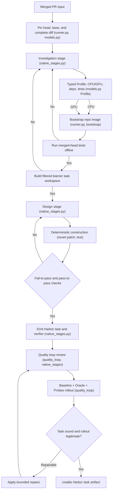
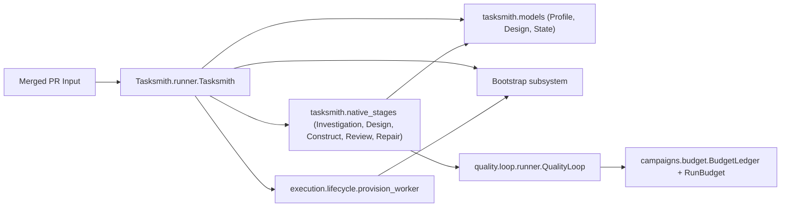
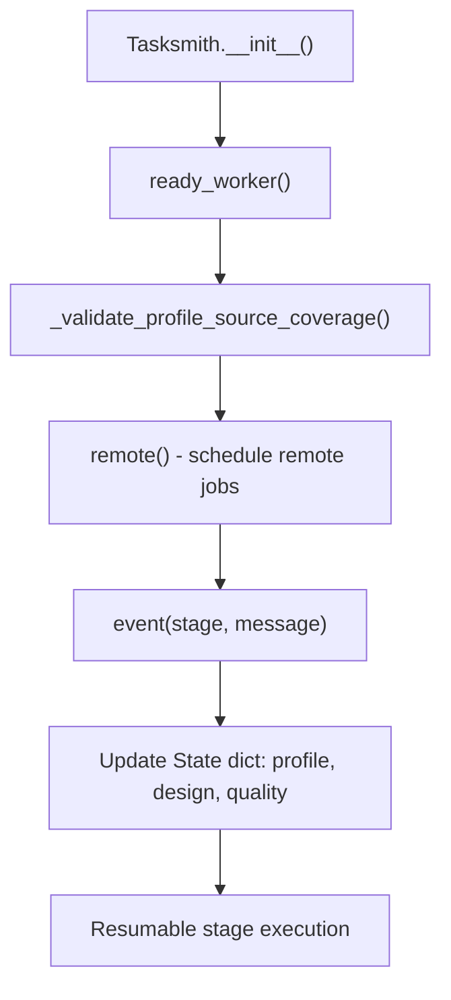

<!-- source: DeepWiki mcp.deepwiki.com · repo huggingface/Repo2RLEnv · page 8.1 Tasksmith Stages and Runner · fetched 2026-10-26 -->

# 8.1 Tasksmith Stages and Runner

<details>
<summary>Relevant source files</summary>

The following files were used as context for generating this wiki page:

- [docs/pipelines/tasksmith.md](docs/pipelines/tasksmith.md)
- [docs/release_notes/HISTORY.md](docs/release_notes/HISTORY.md)
- [pyproject.toml](pyproject.toml)
- [src/repo2rlenv/locking.py](src/repo2rlenv/locking.py)
- [src/repo2rlenv/pipelines/recipes/history/worker.py](src/repo2rlenv/pipelines/recipes/history/worker.py)
- [src/repo2rlenv/quality/loop/runner.py](src/repo2rlenv/quality/loop/runner.py)
- [src/repo2rlenv/tasksmith/batch.py](src/repo2rlenv/tasksmith/batch.py)
- [src/repo2rlenv/tasksmith/runner.py](src/repo2rlenv/tasksmith/runner.py)
- [uv.lock](uv.lock)

</details>


This section provides a detailed technical overview of the Tasksmith subsystem within the Repo2RLEnv codebase. Tasksmith is an agentic authoring framework that transforms a merged Pull Request (PR) into a validated, Harbor-compliant reinforcement learning environment task. It orchestrates multiple stages—investigation, design, construction, review, and repair—leveraging LangGraph-driven workflows, remote execution backends, and built-in bootstrap logic.

We cover the core stage graph, the runner (`runner.py`), native stages (`native_stages.py`), the stateful models (`models.py`), logic for readiness and reuse, the bootstrap matrix and smoke checks, and handling of build logs. This is a foundational leaf page describing Tasksmith’s interaction with the LangGraph agent system and its tightly integrated remote execution environment.

---

## 1. Purpose and Scope

Tasksmith orchestrates the controlled synthesis of RL environment tasks from PRs. This involves:

- **Stage graph:** Sequential and bounded stages of investigation, design, construction, quality review, and repair cycles.
- **Runner.py:** A class-driven orchestrator that manages stateful execution of the stage graph, worker provisioning, budget tracking, and resumable progress.
- **Native stages:** Implementation of key stages with LLM-driven investigation and design, deterministic construction checks, and review/repair loops.
- **State models:** Typed Pydantic models capturing progression state, profiling, design data, and final task artifacts.
- **Readiness and reuse:** Logic to determine when bootstrap images or tasks can be reused, enabling efficiency.
- **Bootstrap matrix:** Multi-dimensional readiness checks for CPU vs. GPU environments, smoke test gating.
- **Build log handling:** Parsing and validation of offline builds for deterministic correctness.

The core design is to treat Tasksmith as a durable, partially resumable state machine controlled via LangGraph with external LLM and execution adapters.

---

## 2. Tasksmith Stage Graph

The Tasksmith workflow is modeled as a multi-stage graph, capturing each phase of the PR-to-task lifecycle:

- **Investigate:** Analyze PR source, manifest, and tests; produce a dependency and test profile.
- **Design:** Generate a human request, requirement mapping, and optionally private behavioral tests.
- **Construct:** Deterministically build the task by reversing the PR source patch, running fail-to-pass and pass-to-pass checks.
- **Review/Repair:** Quality loop reviewing generated task and verifier, running bounded trials, and applying targeted repairs if needed.

Below is the canonical flow extracted and adapted from documentation and diagrams:



This stage graph enforces bounded iteration via maximum attempts for profile corrections and design loops to accommodate model corrections during authoring.

Sources:  
- `docs/pipelines/tasksmith.md:1-79`  
- `src/repo2rlenv/tasksmith/runner.py:82-166`  
- `src/repo2rlenv/tasksmith/native_stages.py: (implementation)`  
- `src/repo2rlenv/tasksmith/models.py: (data models)`

---

## 3. Core Orchestration: `runner.py`

### 3.1 `Tasksmith` Class

Implemented in `src/repo2rlenv/tasksmith/runner.py` (lines 82-166 approx), the `Tasksmith` class is the primary orchestrator for running the stage graph on a given PR directory and campaign budget.

Key responsibilities:

- **Initialization:** Takes a working directory, campaign path, options (including provider and resource config), and a runtime wheel path. It prepares a budget ledger bound to the campaign and initializes bookkeeping state.
- **Worker management:** Lazy provisioning and reusing specialized remote workers (e.g., Docker containers) according to configured CPU and memory parameters. Worker lifecycle includes provisioning, preparing the runtime environment, and termination.
- **Remote execution:** Uploads stage inputs and schedules remote jobs with deterministic identity hashing to ensure reproducibility and avoid re-running identical state.
- **Event logging:** Emits JSONL event logs in the working directory tracing progress and status messages.
- **State management:** Maintains a typed dictionary state with entries for source data, profile, readiness, design, constructed task, quality checks, and failure diagnostics.
- **Validation:** Checks that PR source coverage aligns with specified profile source paths; throws errors if omitted or hidden files are detected.

Example snippet from `ready_worker` method (schematic):

```python
def ready_worker(self):
    if self.worker is not None:
        return
    check_runtime_wheel(self.wheel)
    self.worker, self.receipt = provision_worker(WorkerSpec(...))
    self.event("worker", f"Remote {self.options.provider} worker ready")
    prepare_docker(self.worker)
    self.python = runtime_python(install_runtime(self.worker, self.wheel, self.directory / "runtime"))
```

This method ensures that the runtime wheel is installed on the remote worker and ready for task execution.

### 3.2 State Transitions

Each stage of the workflow updates the internal `state` dictionary typing `State` (`TypedDict`) capturing:

- `source`, `profile`, `ready`, `design`, `constructed`, `quality`: per-stage output data in dict form
- `profile_attempt` and `design_attempt`: counters for bounded iteration
- `failure`: optional dict for error conditions
- `status`: current state label string

The runner uses these states to resume partially completed runs and conditionally invoke only outstanding stages.

Sources:  
- `src/repo2rlenv/tasksmith/runner.py:42-166`  
- `src/repo2rlenv/tasksmith/models.py: (State models)` 

---

## 4. Native Stage Implementations - `native_stages.py`

The native stages module implements the principal stages in the graph as asynchronous tasks composing LLM calls and remote execution.

### 4.1 Investigation Stage

- Reads merged PR source, manifest files, conftest, and tests.
- Produces a profile identifying CPU/GPU requirements, dependencies, and a filtered set of private and public tests.
- Validates coverage of PR source paths vs. specified profiles.
- Returns a rich `Profile` object that downstream stages consume.

### 4.2 Design Stage

- Generates a human-readable task instruction describing the PR's purpose.
- Maps requirements and tests to behavioral specifications.
- Creates optional private behavioral tests for verification.
- Runs bounded model correction loops to ensure design consistency.
- Produces a `Design` data object containing the human request, requirement-to-test mapping, and private behavioral test code snippets.

### 4.3 Construct Stage

- Deterministically reconstructs the task by reverting the PR's source patch on the codebase snapshot.
- Runs fail-to-pass (F2P) and pass-to-pass (P2P) test sequences to verify patch correctness.
- Ensures the task maintains adjacent test behavior.
- Issues errors or corrective feedback triggering design reiterations if checks fail.

### 4.4 Review and Repair Stages

- Wraps the generated task and verifier in a quality loop.
- Executes baseline, oracle, and probe semantic trials in bounded rollouts.
- Reviews results for leakage, failures, evidence inconsistencies.
- Applies targeted repairs up to configured max repair attempts.
- Finalizes usable Harbor task revisions with full evidence and lineage.

These stages interface closely with the `quality.loop` subsystem to ensure rigorous correctness.

Sources:  
- `src/repo2rlenv/tasksmith/native_stages.py`  
- `src/repo2rlenv/tasksmith/models.py:Design, Profile`  
- `docs/pipelines/tasksmith.md:23-39`

---

## 5. Tasksmith Models – `models.py`

Typed models implemented with Pydantic provide clear contracts for the data passed between stages and the Tasksmith system's internal state.

Key models include:

| Model       | Role / Contents                                                                        |
|-------------|---------------------------------------------------------------------------------------|
| `Profile`   | CPU/GPU environment profile including resource counts, dependencies, test sets.      |
| `Design`    | Human task instruction, requirement mappings, private behavioral test definitions.   |
| `Options`   | Configuration options for `Tasksmith` runs (provider, timeouts, resource allocations).|
| `Panel`     | Data about the PR panel including pinned head, base commits, diffs, metadata.        |
| `State`     | Internal runtime state dictionary with optional sub-dictionaries for all stage results.|

These models enforce validation logic such as source path coverage and test path exclusivity, ensuring correctness before further processing.

Sources:  
- `src/repo2rlenv/tasksmith/models.py`

---

## 6. Readiness and Reuse Logic

Tasksmith employs a deterministic identity digest strategy to decide when previously built bootstrap images, tasks, or quality runs can be reused rather than recomputed. This involves hashing the input data, runtime wheel signature, and worker identity to produce content-addressed keys.

- Remote effects checkpoints are stored under stage-specific directories with unique keyed filenames.
- If a stage’s effect output exists and the input digest matches, Tasksmith avoids re-running that stage.
- Bounded iteration counters (`profile_attempt`, `design_attempt`) limit forced reruns.
- Reuse dramatically improves performance when regenerating tasks with unchanged inputs or during bounded repair cycles.

Bootstrap readiness matrices are maintained to track CPU vs. GPU-ready images. Smoke test checks gate GPU-native builds before enabling GPU use in later stages.

Sources:  
- `src/repo2rlenv/tasksmith/runner.py:130-160`  
- `docs/pipelines/tasksmith.md:18-28`

---

## 7. Bootstrap Matrix and Smoke Checks

Tasksmith leverages the bootstrap subsystem to create repository images that serve as isolated sandboxes performing PR builds and tests.

- The bootstrap matrix records environments with CPU-only or GPU-enabled builds.
- GPU builds require passing smoke checks which validate CUDA availability and private/public readiness.
- Tasksmith stages query and update this matrix after builds.
- Errors during bootstrap or smoke checks trigger fallback to CPU-only images or re-investigation stage runs.
- This matrix supports correct scheduling and task provenance for downstream learners/verifiers.

Sources:  
- `docs/pipelines/tasksmith.md:18-28`  
- `src/repo2rlenv/tasksmith/runner.py:98-150`

---

## 8. Build Log Handling

Tasksmith captures build logs and test execution results from remote workers to verify deterministic behavior:

- Logs and JSON result files are downloaded and parsed.
- Logs are checked for expected test passes, failures, and error conditions.
- Any anomalies cause stage failures and initiate bounded repair cycles.
- Log parsing dispatches to various polyglot parsers depending on the test framework in use.
- These logs feed into the quality loop’s reward and probe evaluation system.

Artifact handling is integrated with the lifecycle and locking subsystems to guarantee concurrency-safe reproducible runs.

Sources:  
- `src/repo2rlenv/tasksmith/runner.py:150-166`  
- `src/repo2rlenv/quality/loop/runner.py`  

---

## 9. Mapping Natural Language Concepts to Code Entities

### Diagram 1: Tasksmith Workflow to Key Code Modules



### Diagram 2: Runtime and State Interaction in `runner.py`



These diagrams help bridge the conceptual stage flow and entities to the actual Python classes and functions responsible for their implementation.

---

# Summary

Tasksmith provides a finely controlled agentic authoring framework that leverages LangGraph orchestration, carefully typed state models, and robust remote execution to convert merged PRs into validated Harbor tasks. Its staged investigation-design-construct-review-repair graph ensures repeatability and quality control with bounded iteration and reuse logic. The runner subsystem coordinates remote workers, manages budgets, and handles lifecycle events and build logs to enable deterministic task generation for RL environments.

---

# References and Sources

- `docs/pipelines/tasksmith.md:1-105`  
- `src/repo2rlenv/tasksmith/runner.py:1-166`  
- `src/repo2rlenv/tasksmith/models.py`  
- `src/repo2rlenv/tasksmith/native_stages.py`  
- `src/repo2rlenv/quality/loop/runner.py`  
- `src/repo2rlenv/execution/lifecycle.py`  

This completes the technical detailed documentation of the Tasksmith Stages and Runner subsystem in Repo2RLEnv.

---

