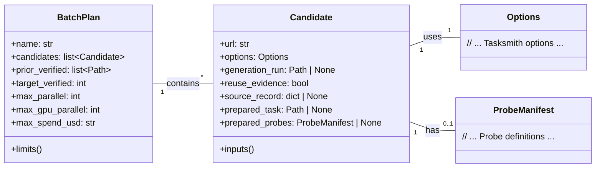
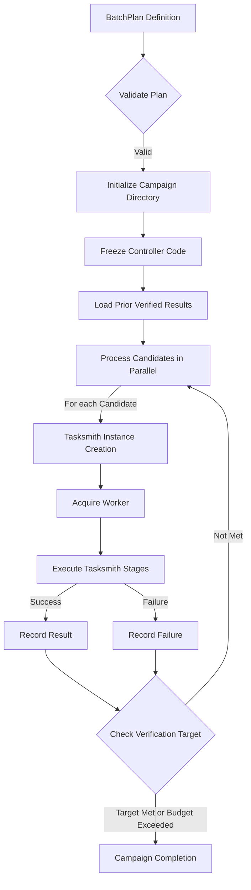

<!-- source: DeepWiki mcp.deepwiki.com · repo huggingface/Repo2RLEnv · page 8.3 Parallel Campaigns and Batch Runs · fetched 2026-10-26 -->

# Parallel Campaigns and Batch Runs

<details>
<summary>Relevant source files</summary>

The following files were used as context for generating this wiki page:

- [src/repo2rlenv/locking.py](src/repo2rlenv/locking.py)
- [src/repo2rlenv/pipelines/recipes/history/worker.py](src/repo2rlenv/pipelines/recipes/history/worker.py)
- [src/repo2rlenv/quality/loop/runner.py](src/repo2rlenv/quality/loop/runner.py)
- [src/repo2rlenv/tasksmith/batch.py](src/repo2rlenv/tasksmith/batch.py)
- [src/repo2rlenv/tasksmith/runner.py](src/repo2rlenv/tasksmith/runner.py)
- [tests/test_locking.py](tests/test_locking.py)
- [tests/test_posix_only_imports.py](tests/test_posix_only_imports.py)

</details>


This page details the mechanisms for executing Tasksmith jobs in parallel, managing batch runs, initializing campaigns, and ensuring safe concurrent operations through controller ownership locks. It provides guidance on setting up and operating parallel campaigns.

## Batch Execution of Tasksmith Jobs

Tasksmith supports batch execution of jobs, allowing multiple Pull Request (PR) candidates to be processed concurrently within a defined campaign. This is managed through the `BatchPlan` and `Candidate` models [src/repo2rlenv/tasksmith/batch.py:73-92]().

A `BatchPlan` defines a campaign with a unique `name`, a list of `candidates` (GitHub PR URLs), and various limits such as `max_parallel` jobs, `max_gpu_parallel` jobs, and `max_spend_usd` [src/repo2rlenv/tasksmith/batch.py:73-82](). Each `Candidate` specifies a GitHub PR `url`, `options` for Tasksmith, and optional paths for `generation_run` or `prepared_task` for reusing prior evidence [src/repo2rlenv/tasksmith/batch.py:39-50]().

The batch process ensures that PR URLs are unique within a plan and that spending limits are positive and finite [src/repo2rlenv/tasksmith/batch.py:85-91]().

### Batch Plan and Candidate Structure


**Diagram 1: BatchPlan and Candidate Data Models**
Sources: [src/repo2rlenv/tasksmith/batch.py:39-92]()

### Campaign Initialization

A campaign is initialized by creating a `BatchPlan` and executing it. The `Tasksmith` class is instantiated with a `directory`, `campaign` path, `options`, and a `wheel` file [src/repo2rlenv/tasksmith/runner.py:82-84](). It uses a `BudgetLedger` associated with the campaign path to track spending [src/repo2rlenv/tasksmith/runner.py:86]().

The `_controller_identity` function freezes the owned controller code and prompts by hashing all relevant Python, Markdown, and JavaScript files within the `repo2rlenv` root [src/repo2rlenv/tasksmith/batch.py:114-122](). This ensures that the exact version of the controller code used for a campaign is recorded. The `_freeze_controller` function then copies these files from the runtime wheel to a destination, verifying their integrity and preventing any unsafe paths or symlinks [src/repo2rlenv/tasksmith/batch.py:125-163]().

### Campaign Execution Flow


**Diagram 2: High-Level Campaign Execution Flow**
Sources: [src/repo2rlenv/tasksmith/batch.py:1-163](), [src/repo2rlenv/tasksmith/runner.py:82-86]()

## Controller Ownership Locks (`locking.py`)

To ensure safe concurrent access to shared resources and prevent race conditions during parallel campaign execution, `repo2rlenv` employs file-based locking mechanisms provided by the `locking.py` module.

The `lock_file` function [src/repo2rlenv/locking.py:11-38]() provides an exclusive lock on an open file handle. This lock persists until the file handle is closed. It supports both POSIX `fcntl.flock` semantics and Windows `msvcrt.locking`.

### Locking Mechanism

- **POSIX Systems**: Uses `fcntl.flock` with `LOCK_EX` for exclusive locking. `LOCK_NB` is used for non-blocking attempts, otherwise it blocks indefinitely [src/repo2rlenv/locking.py:20-23]().
- **Windows Systems**: Uses `msvcrt.locking` to lock byte zero of the file. It retries with a short sleep interval if the lock is contended, mimicking the indefinite wait of POSIX `flock` when `blocking=True` [src/repo2rlenv/locking.py:25-38]().

This mechanism is crucial for:
- **Shared Worker Checkouts**: Preventing multiple processes from corrupting a shared Git repository clone [src/repo2rlenv/pipelines/recipes/history/worker.py:133-148]().
- **Controller Receipts**: Ensuring atomic updates to campaign state and budget ledgers.
- **Preventing Concurrent Worker Provisioning**: The `Tasksmith` runner checks for existing unresolved worker receipts before provisioning a new worker, preventing double allocation [src/repo2rlenv/tasksmith/runner.py:109-113]().

### `lock_file` Usage Example

```python
import tempfile
from pathlib import Path
from repo2rlenv.locking import lock_file

# Create a temporary lock file
lock_path = Path(tempfile.gettempdir()) / "my_campaign.lock"

# Acquire the lock
with lock_path.open("a") as handle:
    lock_file(handle, blocking=True)
    print(f"Process {os.getpid()} acquired the lock.")
    # Perform critical section operations
    # ...
    print(f"Process {os.getpid()} releasing the lock.")
# Lock is automatically released when 'handle' is closed
```

### `locking.py` Implementation Details

```mermaid
flowchart TD
    A["lock_file(handle, blocking)"] --> B{sys.platform == "win32"?};
    B -- No --> C["fcntl.flock(handle, fcntl.LOCK_EX | (0 if blocking else fcntl.LOCK_NB))"];
    B -- Yes --> D["handle.seek(0)"];
    D --> E{Loop};
    E --> F["msvcrt.locking(handle.fileno(), msvcrt.LK_NBLCK, 1)"];
    F -- Success --> G[Return];
    F -- OSError --> H{Error is EACCES, EAGAIN, EDEADLK?};
    H -- No --> I[Raise OSError];
    H -- Yes --> J{blocking?};
    J -- No --> K[Raise BlockingIOError];
    J -- Yes --> L["time.sleep(0.1)"];
    L --> E;
```
**Diagram 3: `lock_file` Function Logic**
Sources: [src/repo2rlenv/locking.py:11-38]()

The `test_locking.py` suite [tests/test_locking.py:1-113]() thoroughly tests the `lock_file` functionality, including non-blocking attempts, release on process death, blocking waits, and interoperability with existing `flock` calls on POSIX systems. It uses subprocesses to simulate concurrent access and verify correct locking behavior.

## Parallel Campaign Operation Guidance

Operating parallel campaigns requires careful consideration of resource allocation, budget management, and error handling.

### Resource Management

- **`max_parallel` and `max_gpu_parallel`**: These parameters in `BatchPlan` control the maximum number of concurrent Tasksmith jobs. Adjust these based on available compute resources (CPU, memory, GPU) and API rate limits for external services (e.g., LLMs, GitHub) [src/repo2rlenv/tasksmith/batch.py:79-80]().
- **Worker Specifications**: Each Tasksmith instance provisions a worker based on `WorkerSpec` [src/repo2rlenv/tasksmith/runner.py:115-121](). Configure `worker_cpus`, `worker_memory_mb`, and `worker_snapshot` in `Options` to match the requirements of the tasks.
- **Budget Allocation**: The `BudgetLedger` [src/repo2rlenv/campaigns/budget.py]() tracks spending. Set `max_spend_usd` in `BatchPlan` and `max_spend_usd` in `Options` to prevent overspending [src/repo2rlenv/tasksmith/batch.py:81](), [src/repo2rlenv/tasksmith/runner.py:88](). The `RunBudget` class manages reservations and settlements against the ledger [src/repo2rlenv/quality/loop/client.py:19-20]().

### Resumption and Fault Tolerance

- **Resumable Stages**: Tasksmith stages are designed to be resumable. If a campaign is interrupted, it can often pick up from where it left off, leveraging existing artifacts and worker receipts.
- **Event Logging**: Each Tasksmith instance logs events to `events.jsonl` within its directory [src/repo2rlenv/tasksmith/runner.py:97-100](), aiding in debugging and understanding campaign progress.
- **Artifact Retention**: Intermediate artifacts, such as `generation_run` and `prepared_task`, can be reused for subsequent runs or for debugging specific candidates [src/repo2rlenv/tasksmith/batch.py:42-45]().

### Monitoring and Debugging

- **Campaign Directory Structure**: Each campaign creates a structured directory to store plans, results, logs, and frozen controller code.
- **Quality Loop Results**: The `LoopResult` [src/repo2rlenv/quality/loop/models.py:30-31]() captures the outcome of the quality loop for each task, including `bundle_hash` and `quality_sha256` for verification [src/repo2rlenv/tasksmith/batch.py:100-111]().
- **Verified Results**: The `verified_result` function [src/repo2rlenv/tasksmith/batch.py:94-111]() checks if a result is usable, ensuring it has bound controls, probes, and a judged rollout status of "verified".

Sources:
- [src/repo2rlenv/tasksmith/batch.py:1-163]()
- [src/repo2rlenv/tasksmith/runner.py:82-125]()
- [src/repo2rlenv/locking.py:11-38]()
- [src/repo2rlenv/pipelines/recipes/history/worker.py:133-148]()
- [src/repo2rlenv/quality/loop/client.py:19-20]()
- [src/repo2rlenv/quality/loop/models.py:30-31]()
- [tests/test_locking.py:1-113]()

---

