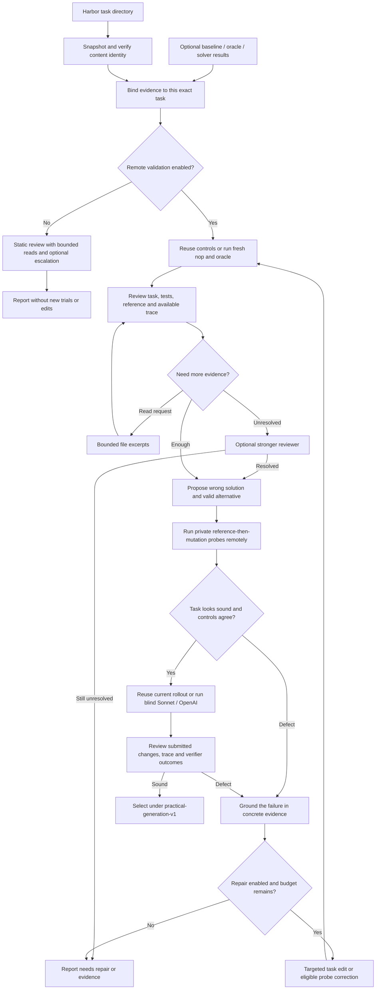
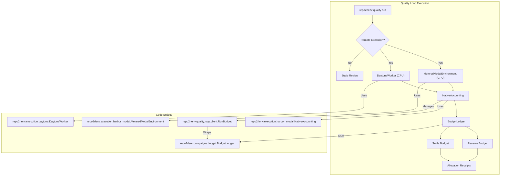

<!-- source: DeepWiki mcp.deepwiki.com · repo huggingface/Repo2RLEnv · page 9 Quality Loop · fetched 2026-10-26 -->

# Quality Loop

Relevant source files

The following files were used as context for generating this wiki page:

- [docs/pipelines/quality_loop.md](docs/pipelines/quality_loop.md)
- [requirements-docs.txt](requirements-docs.txt)
- [src/repo2rlenv/execution/harbor_modal.py](src/repo2rlenv/execution/harbor_modal.py)
- [src/repo2rlenv/execution/harbor_offline.py](src/repo2rlenv/execution/harbor_offline.py)
- [src/repo2rlenv/quality/loop/native_recovery.py](src/repo2rlenv/quality/loop/native_recovery.py)
- [tests/test_daytona_worker_contract.py](tests/test_daytona_worker_contract.py)
- [tests/test_harbor_offline.py](tests/test_harbor_offline.py)
- [tests/test_native_modal_accounting.py](tests/test_native_modal_accounting.py)

The `repo2rlenv quality run` command is central to ensuring the quality and reliability of generated Harbor tasks. It provides a structured approach to review, validate, and repair tasks, leveraging evidence-bound processes, private probes, and repair cycles. This system is designed to complement initial generation controls by providing a deeper, semantic quality check.

This page offers a high-level overview of the quality loop, its components, and how they interact. For detailed information on specific aspects, please refer to the child pages.

## Execution Flow

The quality loop orchestrates a series of steps to review and potentially repair a Harbor task. It begins by snapshotting and verifying the content identity of a given task. Depending on whether remote validation is enabled, it either proceeds with static review or initiates remote trials, including running "nop" (no-operation) and "oracle" controls. The process involves reviewing the task, its tests, and available traces, and can escalate to stronger reviewers or run private reference-then-mutation probes if more evidence is needed. If defects are found, and repair is enabled and budgeted, targeted edits or probe corrections are applied, leading to further review cycles. Ultimately, sound tasks are selected under the `practical-generation-v1` label taxonomy.

The diagram below illustrates the high-level execution and decision points within the quality loop.

Sources: [docs/pipelines/quality_loop.md:13-41]()

The `repo2rlenv quality run` command can operate in review-only mode, which makes model calls but does not create a worker or perform remote trials. When `--run-rollout` or `--repair` flags are used, remote execution is enabled. For CPU tasks, a single worker and its runtime/Docker build cache are reused throughout the loop. GPU tasks automatically select native Modal environments based on their Harbor resource declarations [docs/pipelines/quality_loop.md:43-52]().

## Review, Probes, and Labels

The quality loop incorporates a comprehensive review process that includes static analysis, remote validation, and the use of private probes. This ensures that tasks are not only structurally sound but also semantically correct and free from leakage. The process involves authoring context, draft review, and the generation of Python evidence. `probe_behavior` and `probe_audit` mechanisms are used to scrutinize task behavior and adherence to policies. Verifier policies guide the validation, and rollout evidence provides concrete data for evaluation. The `practical-generation-v1` label taxonomy is used to categorize and track the quality of tasks.

For a detailed explanation of the review process, probe mechanisms, and the label taxonomy, see [Review, Probes, and Labels](#9.1).

Sources: [docs/pipelines/quality_loop.md:8-9]()

## Recovery and Publication

The quality loop also includes robust mechanisms for recovery and publication of repaired tasks. The `native_recovery.py` module handles the resumption of verifier processes, especially in cases where initial allocations were denied [src/repo2rlenv/quality/loop/native_recovery.py:1-3](). This involves the careful management of evidence trees and receipts to ensure that all actions are traceable and verifiable. `probe_recovery` allows for the re-evaluation of probes. Once tasks are repaired and validated, they can be published, and detailed reports are generated to document the quality assessment and repair process.

For an in-depth look at how the system handles verifier resumption, evidence management, and the publication of repaired tasks, see [Recovery and Publication](#9.2).

Sources: [src/repo2rlenv/quality/loop/native_recovery.py:1-3]()

## Budgeting and Accounting

The quality loop integrates with the campaign budgeting system to manage costs associated with remote execution and LLM calls. Each `quality run` operates within a defined budget, and costs are tracked using a `BudgetLedger` [tests/test_native_modal_accounting.py:12-13](). This ensures that resource consumption is controlled and transparent.

Sources: [tests/test_native_modal_accounting.py:12-13](), [src/repo2rlenv/execution/harbor_modal.py:32-37](), [src/repo2rlenv/execution/daytona.py:37-40]()

The `MeteredModalEnvironment` [src/repo2rlenv/execution/harbor_modal.py:80]() and `DaytonaWorker` [tests/test_daytona_worker_contract.py:10]() are key components for remote execution, ensuring that resource usage is accounted for. The system also handles cases of denied verifier allocations, allowing for resumption without re-dispatching the entire agent [src/repo2rlenv/quality/loop/native_recovery.py:119-120]().

Sources: [docs/pipelines/quality_loop.md:100-104](), [tests/test_native_modal_accounting.py:12-13](), [src/repo2rlenv/execution/harbor_modal.py:80](), [src/repo2rlenv/quality/loop/native_recovery.py:119-120]()

---

