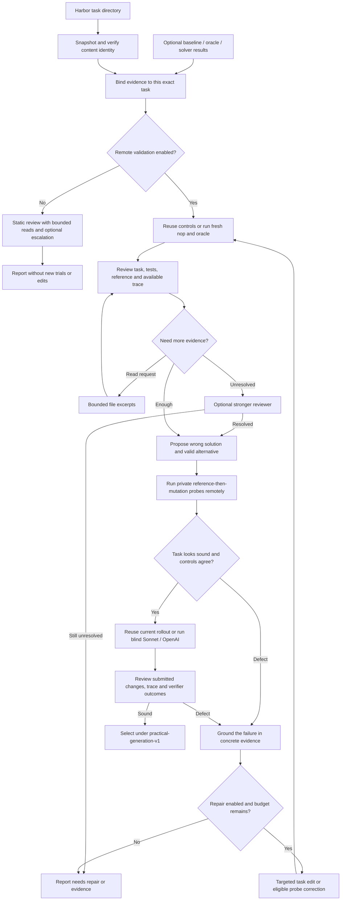
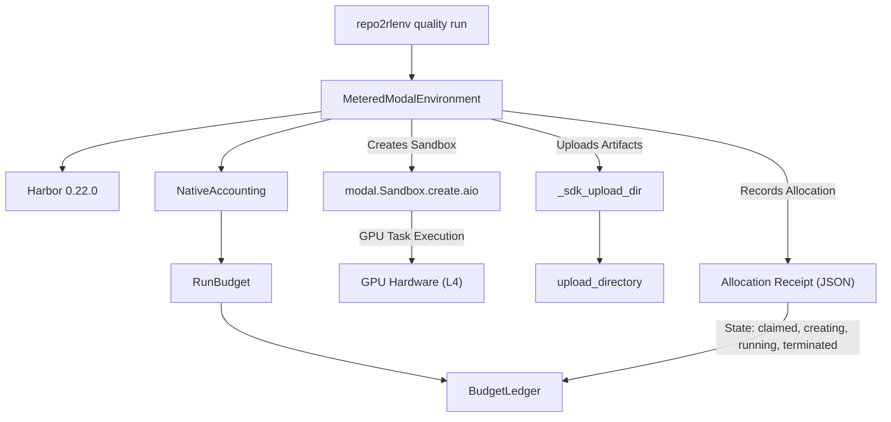
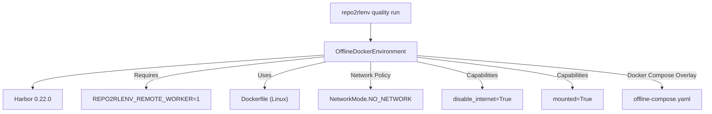
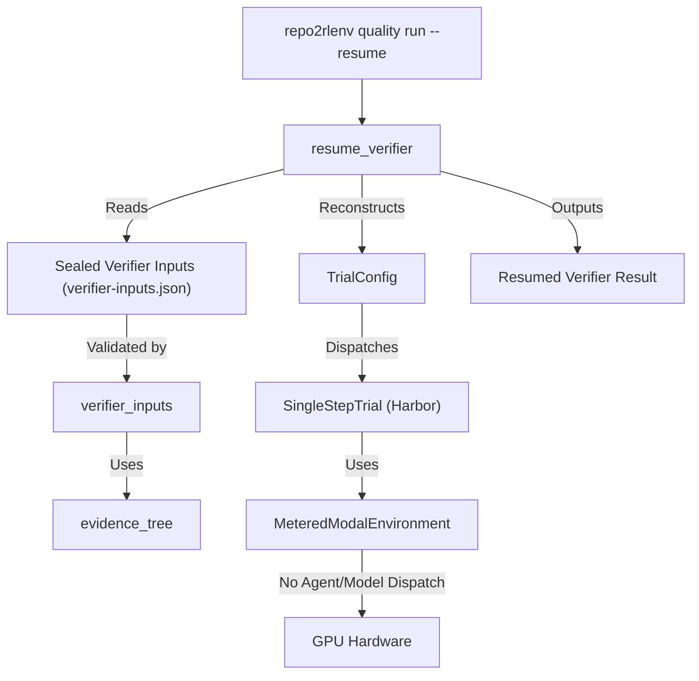

<!-- source: DeepWiki mcp.deepwiki.com · repo huggingface/Repo2RLEnv · page 9.1 Review, Probes, and Labels · fetched 2026-10-26 -->

# Review, Probes, and Labels

<details>
<summary>Relevant source files</summary>

The following files were used as context for generating this wiki page:

- [docs/pipelines/quality_loop.md](docs/pipelines/quality_loop.md)
- [requirements-docs.txt](requirements-docs.txt)
- [src/repo2rlenv/execution/harbor_modal.py](src/repo2rlenv/execution/harbor_modal.py)
- [src/repo2rlenv/execution/harbor_offline.py](src/repo2rlenv/execution/harbor_offline.py)
- [src/repo2rlenv/quality/loop/native_recovery.py](src/repo2rlenv/quality/loop/native_recovery.py)
- [tests/test_daytona_worker_contract.py](tests/test_daytona_worker_contract.py)
- [tests/test_harbor_offline.py](tests/test_harbor_offline.py)
- [tests/test_native_modal_accounting.py](tests/test_native_modal_accounting.py)

</details>


This page details the `repo2rlenv quality run` command, which facilitates the review, validation, and repair of existing Harbor tasks. It covers the static and remote review workflows, the role of authoring context, draft review processes, Python evidence collection, and the use of `probe_behavior` and `probe_audit` for deeper inspection. The page also explains verifier policies, rollout evidence, and the `practical-generation-v1` label taxonomy used for task evaluation.

## Quality Loop Execution and Decisions

The `repo2rlenv quality run` command orchestrates a sophisticated workflow for assessing and potentially repairing Harbor tasks. This process involves several stages, from initial content verification to remote validation, evidence gathering, probing, and targeted repairs. The overall flow is designed to ensure semantic quality beyond what generation controls alone can provide.

The command can operate in review-only mode, which involves model calls but no worker creation, or it can engage remote workers for validation, probing, and repair. CPU-bound tasks reuse a single worker and its runtime/Docker build cache throughout the loop. GPU tasks automatically select native Modal environments based on their Harbor resource declarations, requiring L4 GPUs with networking disabled.


**Diagram: Quality Loop Execution Flow**

Sources:
- [docs/pipelines/quality_loop.md:13-41]()

### Command Usage

To use the quality loop, first install necessary extras and build the runtime wheel:
```bash
uv sync --extra modal --extra harbor
uv build --wheel
```

Initialize a campaign ledger or use an existing one:
```bash
repo2rlenv campaign init ./workspace/my-campaign --budget-usd 25
```

Review a task with a previously collected solver trial:
```bash
repo2rlenv quality run ./tasks/example \
  --campaign ./workspace/my-campaign \
  --out ./workspace/reviews/example \
  --rollout ./jobs/example/trial/result.json \
  --review-model openai/gpt-6-astra
```

To run controls, review, probes, solver, and up to three targeted repairs:
```bash
repo2rlenv quality run ./tasks/example \
  --campaign ./workspace/my-campaign \
  --out ./workspace/reviews/example-repaired \
  --repair --provider modal \
  --runtime-wheel ./dist/repo2rlenv-0.9.1-py3-none-any.whl \
  --review-model anthropic/claude-sonnet-4-6 \
  --repair-model anthropic/claude-opus-4-6 \
  --solver-model anthropic/claude-sonnet-4-6 \
  --max-repairs 3 --max-spend-usd 15
```

For CPU tasks, `--provider daytona` can be used. `--run-rollout` evaluates without editing. `--resume` reuses completed, identical model requests and trial evidence, refusing changed inputs or settings.

Sources:
- [docs/pipelines/quality_loop.md:53-139]()

## Remote Worker Environments

The quality loop leverages remote worker environments for executing tasks, probes, and repairs. These environments are managed by different providers like Modal and Daytona, each with specific characteristics and accounting mechanisms.

### Modal Environments (`MeteredModalEnvironment`)

For GPU tasks, `MeteredModalEnvironment` [src/repo2rlenv/execution/harbor_modal.py:80]() is used. This environment ensures budgeted, permanently offline native Modal execution for Harbor GPU trials. It adds durable allocation receipts, single dispatch, and confirmed cleanup. It requires Harbor version `0.22.0` [src/repo2rlenv/execution/harbor_modal.py:87-88]() and operates within a controller budget context [src/repo2rlenv/execution/harbor_modal.py:89-91]().

Key characteristics:
- **Offline**: GPU trials must be offline, with `NetworkMode.NO_NETWORK` [src/repo2rlenv/execution/harbor_modal.py:103-105]().
- **No Secrets/Volumes**: Sandboxes cannot receive controller secrets or shared volumes [src/repo2rlenv/execution/harbor_modal.py:107-110]().
- **GPU Configuration**: Requires one or two L4 devices (`L4:1` or `L4:2`) [src/repo2rlenv/execution/harbor_modal.py:111-112]().
- **Bounded Timeout**: Sandboxes need a timeout between 60 and 1800 seconds [src/repo2rlenv/execution/harbor_modal.py:113-114]().
- **Budgeting**: Allocations are claimed and reserved against a `RunBudget` [src/repo2rlenv/execution/harbor_modal.py:127-149]().
- **Accounting**: `NativeAccounting` [src/repo2rlenv/execution/harbor_modal.py:32]() tracks budget and environment usage. `compute_estimate` [src/repo2rlenv/execution/harbor_modal.py:45]() calculates conservative allocation costs.


**Diagram: MeteredModalEnvironment Interaction**

Sources:
- [src/repo2rlenv/execution/harbor_modal.py:1-293]()
- [tests/test_native_modal_accounting.py:1-222]()

### Docker Environments (`OfflineDockerEnvironment`)

For CPU tasks, `OfflineDockerEnvironment` [src/repo2rlenv/execution/harbor_offline.py:20]() is used. This adapter is designed for permanently offline, single-container tasks and runs exclusively inside a remote worker [src/repo2rlenv/execution/harbor_offline.py:22-23](). It also requires Harbor version `0.22.0` [src/repo2rlenv/execution/harbor_offline.py:24-25]().

Key characteristics:
- **Remote Worker Only**: Enforced by `REPO2RLENV_REMOTE_WORKER` environment variable [src/repo2rlenv/execution/harbor_offline.py:22-23]().
- **Linux Dockerfile Tasks**: Supports Linux Dockerfile tasks without extra services or Docker Compose paths [src/repo2rlenv/execution/harbor_offline.py:28-34]().
- **No Egress Control**: Does not require egress control as network policy validation rejects modes needing a sidecar [src/repo2rlenv/execution/harbor_offline.py:36-39]().
- **Capabilities**: Provides `disable_internet=True` and `mounted=True` capabilities [src/repo2rlenv/execution/harbor_offline.py:43-44]().
- **Strict Offline Policy**: Requires `NetworkMode.NO_NETWORK` in every execution phase [src/repo2rlenv/execution/harbor_offline.py:46-49]().


**Diagram: OfflineDockerEnvironment Interaction**

Sources:
- [src/repo2rlenv/execution/harbor_offline.py:1-56]()
- [tests/test_harbor_offline.py:1-67]()

### Daytona Workers (`DaytonaWorker`)

Daytona workers are another option for CPU tasks. The `DaytonaWorker` [src/repo2rlenv/execution/daytona.py]() class handles the creation and management of sandboxes using the Daytona SDK.

Key characteristics:
- **SDK Integration**: Uses `daytona.CreateSandboxFromImageParams` [tests/test_daytona_worker_contract.py:22]() for sandbox creation.
- **Resource Specification**: Configures CPU, memory, and other resources via `daytona.Resources` [tests/test_daytona_worker_contract.py:23]().
- **Ephemeral Sandboxes**: Sandboxes are ephemeral (`ephemeral is True`) [tests/test_daytona_worker_contract.py:25]().
- **Auto-Stop/Delete**: Configures auto-stop and auto-delete intervals [tests/test_daytona_worker_contract.py:26-27]().

Sources:
- [tests/test_daytona_worker_contract.py:1-43]()

## Verifier Recovery

The `native_recovery.py` module [src/repo2rlenv/quality/loop/native_recovery.py:1]() handles resuming a denied private verifier without repeating a completed learner. This is crucial for efficient use of resources and budget. It specifically targets Harbor 0.22's single-step verifier API.

Key functions and concepts:
- `evidence_tree(root: Path)`: Hashes ordinary files and modes within a directory to create a content-based evidence tree, rejecting links and incomplete submissions [src/repo2rlenv/quality/loop/native_recovery.py:22-43]().
- `verifier_inputs(task: Path, output: Path, budget)`: Proves that a trial is a completed native solver followed by a denied allocation for the verifier. It validates the task type, trial record, artifact collection, and budget ledger consistency [src/repo2rlenv/quality/loop/native_recovery.py:46-108]().
- `seal_verifier_inputs(task: Path, output: Path, budget)`: Persists the verifier recovery inputs once, preventing modification after collection [src/repo2rlenv/quality/loop/native_recovery.py:111-116]().
- `resume_verifier(task: Path, source: Path, destination: Path, budget, options, execution)`: Executes one verifier-only continuation. It verifies the sealed inputs, reconstructs a `TrialConfig` from known fields (avoiding loading untrusted paths), and dispatches the verifier without dispatching an agent or reserving model tokens [src/repo2rlenv/quality/loop/native_recovery.py:119-250]().


**Diagram: Verifier Recovery Flow**

Sources:
- [src/repo2rlenv/quality/loop/native_recovery.py:1-250]()
- [tests/test_native_modal_accounting.py:69-94]()

## Practical Generation v1 Label Taxonomy

The `practical-generation-v1` label taxonomy is used to categorize and evaluate the quality of generated tasks. While the specific details of this taxonomy are not provided in the given context, it is mentioned as the selection criterion when a task is deemed "Sound" after review and rollout [docs/pipelines/quality_loop.md:40-41](). This implies a set of predefined labels that indicate various aspects of task quality, correctness, and usability for practical applications.

---

