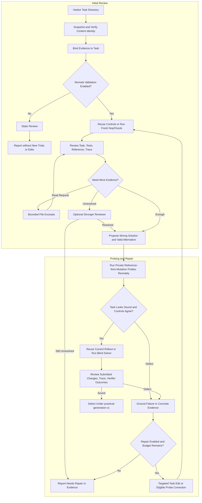

<!-- source: DeepWiki mcp.deepwiki.com · repo huggingface/Repo2RLEnv · page 9.2 Recovery and Publication · fetched 2026-10-26 -->

# Recovery and Publication

<details>
<summary>Relevant source files</summary>

The following files were used as context for generating this wiki page:

- [docs/pipelines/quality_loop.md](docs/pipelines/quality_loop.md)
- [requirements-docs.txt](requirements-docs.txt)
- [src/repo2rlenv/execution/harbor_modal.py](src/repo2rlenv/execution/harbor_modal.py)
- [src/repo2rlenv/execution/harbor_offline.py](src/repo2rlenv/execution/harbor_offline.py)
- [src/repo2rlenv/quality/loop/native_recovery.py](src/repo2rlenv/quality/loop/native_recovery.py)
- [tests/test_daytona_worker_contract.py](tests/test_daytona_worker_contract.py)
- [tests/test_harbor_offline.py](tests/test_harbor_offline.py)
- [tests/test_native_modal_accounting.py](tests/test_native_modal_accounting.py)

</details>


This page details the recovery and publication mechanisms within the `repo2rlenv` codebase, focusing on the `native_recovery.py` module. It covers the resumption of denied verifier allocations, the use of evidence trees and receipts for ensuring data integrity, the `probe_recovery` process, the publication of repaired tasks, and the generation of reports. This system is crucial for the quality loop, allowing for robust review, repair, and re-evaluation of generated tasks.

## Verifier Resumption and Evidence Trees

The `repo2rlenv` quality loop includes a mechanism to resume a private verifier that was previously denied an allocation, without re-running the entire learner process. This is handled by the `native_recovery.py` module [src/repo2rlenv/quality/loop/native_recovery.py:1-6](). This process relies on a "seal" written at collection time, which binds the submission and trace, ensuring that older, unsealed trials require explicit reconciliation. Unknown provider outcomes are never automatically retried [src/repo2rlenv/quality/loop/native_recovery.py:1-6]().

The integrity of the data for resumption is maintained through "evidence trees" and receipts. An evidence tree, generated by the `evidence_tree` function [src/repo2rlenv/quality/loop/native_recovery.py:22-44](), hashes ordinary files and their modes within a given root directory, rejecting symbolic links and incomplete submissions. This function ensures that the recovery evidence is an ordinary directory, contains only regular files, and does not exceed predefined size or file count limits [src/repo2rlenv/quality/loop/native_recovery.py:22-44]().

The `verifier_inputs` function [src/repo2rlenv/quality/loop/native_recovery.py:47-108]() plays a critical role in proving that a trial is a completed native solver followed by a denied allocation for the verifier. It performs several checks:
*   Ensures the task is a single-step Harbor task [src/repo2rlenv/quality/loop/native_recovery.py:53-54]().
*   Validates the trial record, confirming it's a `native-modal` execution, uses the `terminus-2` agent, and that the verifier result is not already present [src/repo2rlenv/quality/loop/native_recovery.py:68-70]().
*   Confirms that the model cost after verifier denial is correctly identified [src/repo2rlenv/quality/loop/native_recovery.py:71-72]().
*   Verifies that all allocation claims are associated with the current budget [src/repo2rlenv/quality/loop/native_recovery.py:73-77]().
*   Checks the integrity and completeness of submission artifacts and the learner's trace [src/repo2rlenv/quality/loop/native_recovery.py:78-100]().

The `seal_verifier_inputs` function [src/repo2rlenv/quality/loop/native_recovery.py:111-116]() persists these verified inputs, preventing modification once sealed.

### Verifier Resumption Data Flow

The following diagram illustrates the data flow for verifier resumption.

```mermaid
graph TD
    A[Harbor Task Directory] --> B{validate_native_task};
    B --> C{Trial Receipt (trial.json)};
    C --> D{Trial Result (result.json)};
    D --> E{Artifacts Directory};
    D --> F{Agent Directory};
    E --> G{evidence_tree(artifacts)};
    F --> H{evidence_tree(agent)};
    C --> I{Allocation Claims (allocations/*.json)};
    I --> J{model_cost_after_verifier_denial};
    J --> K{verifier_inputs};
    G --> K;
    H --> K;
    K --> L{seal_verifier_inputs};
    L --> M[Sealed verifier-inputs.json];
    M --> N{resume_verifier};
    N --> O[New Trial Directory];
    O --> P[Verifier-only Continuation];

    subgraph "Validation and Sealing"
        B
        C
        D
        E
        F
        G
        H
        I
        J
        K
        L
        M
    end

    subgraph "Resumption"
        N
        O
        P
    end

    style B fill:#f9f,stroke:#333,stroke-width:2px
    style C fill:#f9f,stroke:#333,stroke-width:2px
    style D fill:#f9f,stroke:#333,stroke-width:2px
    style E fill:#f9f,stroke:#333,stroke-width:2px
    style F fill:#f9f,stroke:#333,stroke-width:2px
    style G fill:#f9f,stroke:#333,stroke-width:2px
    style H fill:#f9f,stroke:#333,stroke-width:2px
    style I fill:#f9f,stroke:#333,stroke-width:2px
    style J fill:#f9f,stroke:#333,stroke-width:2px
    style K fill:#f9f,stroke:#333,stroke-width:2px
    style L fill:#f9f,stroke:#333,stroke-width:2px
    style M fill:#f9f,stroke:#333,stroke-width:2px
    style N fill:#f9f,stroke:#333,stroke-width:2px
    style O fill:#f9f,stroke:#333,stroke-width:2px
    style P fill:#f9f,stroke:#333,stroke-width:2px
```
**Title**: Verifier Resumption Data Flow
Sources: [src/repo2rlenv/quality/loop/native_recovery.py:22-116]()

### Key Functions and Classes

*   `evidence_tree(root: Path) -> dict`: Hashes files and modes in a directory, ensuring integrity and rejecting invalid entries [src/repo2rlenv/quality/loop/native_recovery.py:22-44]().
*   `verifier_inputs(task: Path, output: Path, budget) -> dict`: Verifies conditions for a verifier continuation, including task type, agent, allocation denial, and artifact integrity [src/repo2rlenv/quality/loop/native_recovery.py:47-108]().
*   `seal_verifier_inputs(task: Path, output: Path, budget)`: Persists the verified verifier inputs to prevent subsequent changes [src/repo2rlenv/quality/loop/native_recovery.py:111-116]().
*   `resume_verifier(task: Path, source: Path, destination: Path, budget, options, execution)`: Executes a single verifier-only continuation, without dispatching an agent or reserving new model tokens [src/repo2rlenv/quality/loop/native_recovery.py:119-250](). It validates the sealed inputs against the current state before proceeding [src/repo2rlenv/quality/loop/native_recovery.py:128-129]().

Sources: [src/repo2rlenv/quality/loop/native_recovery.py:22-250]()

## Probe Recovery and Publication of Repaired Tasks

The `repo2rlenv quality run` command is central to the quality loop, enabling review, optional reuse of rollouts, and remote repair of tasks [docs/pipelines/quality_loop.md:3-5](). This command does not replace the stricter `QualityReport.accepted` contract but provides a mechanism for improving task quality [docs/pipelines/quality_loop.md:8-9](). Each repair produces a separate Harbor directory, preserving original tasks [docs/pipelines/quality_loop.md:5]().

The process involves several stages, as depicted in the `quality_loop.md` flowchart [docs/pipelines/quality_loop.md:13-41]():
1.  **Snapshot and Verify Content Identity**: The Harbor task directory is snapshotted and its content identity verified [docs/pipelines/quality_loop.md:14]().
2.  **Bind Evidence**: Optional baseline, oracle, or solver results are bound to the exact task [docs/pipelines/quality_loop.md:15]().
3.  **Remote Validation**: If enabled, controls are reused or fresh `nop` and `oracle` runs are executed [docs/pipelines/quality_loop.md:18-19](). Otherwise, a static review is performed [docs/pipelines/quality_loop.md:20]().
4.  **Review and Evidence Gathering**: The task, tests, reference, and available trace are reviewed. If more evidence is needed, bounded file excerpts are read [docs/pipelines/quality_loop.md:22-25]().
5.  **Probing**: If the task appears sound, private reference-then-mutation probes are run remotely [docs/pipelines/quality_loop.md:30]().
6.  **Rollout and Review**: If the task is sound and controls agree, the current rollout is reused or a blind solver (e.g., Sonnet/OpenAI) is run [docs/pipelines/quality_loop.md:32-33](). The submitted changes, trace, and verifier outcomes are then reviewed [docs/pipelines/quality_loop.md:34]().
7.  **Repair**: If a defect is found and repair is enabled with budget remaining, a targeted task edit or eligible probe correction is applied, and the process loops back to remote validation [docs/pipelines/quality_loop.md:36-38]().
8.  **Publication**: If the task is sound after review, it is selected under `practical-generation-v1` [docs/pipelines/quality_loop.md:40]().

The `repo2rlenv quality run` command supports various options for controlling this process, including `--run-rollout` for evaluation without editing, `--repair` for enabling repairs, and specifying different models for review, repair, escalation, and solving [docs/pipelines/quality_loop.md:106-110](). The `--resume` flag allows reusing completed, identical model requests and trial evidence, refusing changed inputs or settings [docs/pipelines/quality_loop.md:116-117]().

### Quality Loop Execution Flow


**Title**: Quality Loop Execution and Decisions
Sources: [docs/pipelines/quality_loop.md:13-41]()

### Budgeting and Accounting

The quality loop operates within a budget managed by a `BudgetLedger` [tests/test_native_modal_accounting.py:12](). The `NativeAccounting` class [src/repo2rlenv/execution/harbor_modal.py:33-37]() tracks reservations and environments. The `compute_estimate` function [src/repo2rlenv/execution/harbor_modal.py:45-77]() calculates conservative allocation costs for Modal environments, including build wait times.

The `MeteredModalEnvironment` [src/repo2rlenv/execution/harbor_modal.py:80-118]() ensures that GPU trials adhere to strict offline, single-container contracts and that all allocations are properly accounted for. It records the state of operations and reserves budget before creating a sandbox [src/repo2rlenv/execution/harbor_modal.py:127-154](). If a reservation fails, the state is updated accordingly [src/repo2rlenv/execution/harbor_modal.py:150-153]().

The `test_completed_agent_releases_unused_hold_before_verifier` test [tests/test_native_modal_accounting.py:96-110]() demonstrates how a completed agent releases its budget hold before a verifier, ensuring efficient budget management. Similarly, `test_unfinished_or_unmetered_agent_keeps_its_hold` [tests/test_native_modal_accounting.py:112-129]() confirms that unfinished or unmetered agents retain their budget reservations.

Sources: [src/repo2rlenv/execution/harbor_modal.py:33-77](), [src/repo2rlenv/execution/harbor_modal.py:80-154](), [tests/test_native_modal_accounting.py:12](), [tests/test_native_modal_accounting.py:96-129]()

## Report Generation

After the quality loop completes, reports can be generated. The `repo2rlenv quality show OUTPUT_DIR` command reads the report without making any model or cloud calls [docs/pipelines/quality_loop.md:130](). Both `quality run` and `quality show` commands support a `--json` output format, and ordinary runs display stage progress and criterion scores [docs/pipelines/quality_loop.md:131-132]().

Sources: [docs/pipelines/quality_loop.md:130-132]()

---

