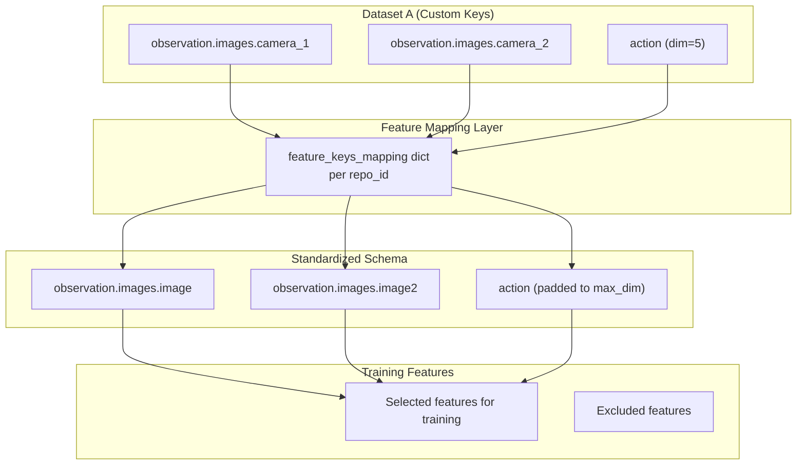
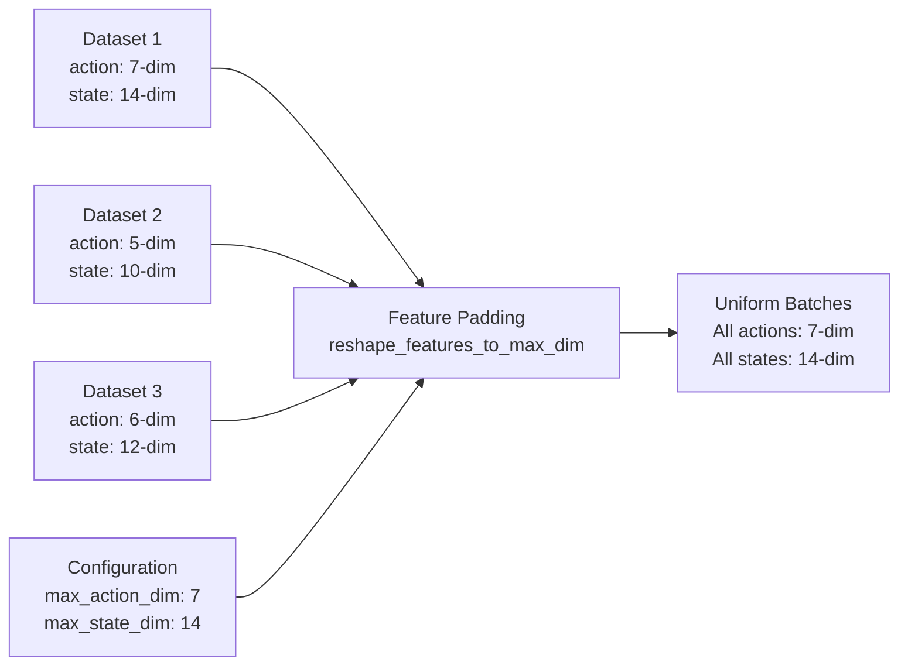
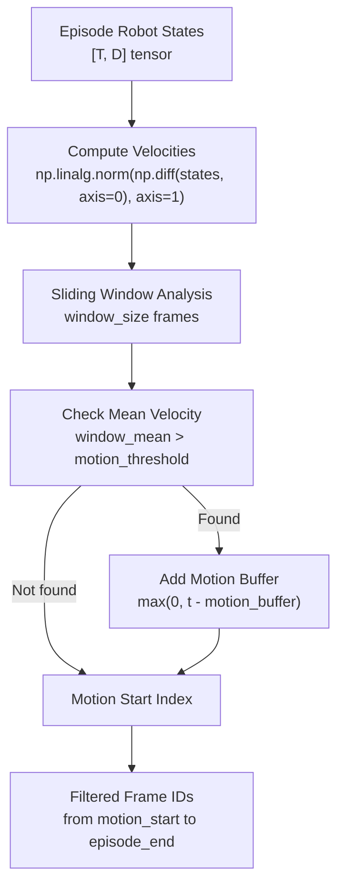
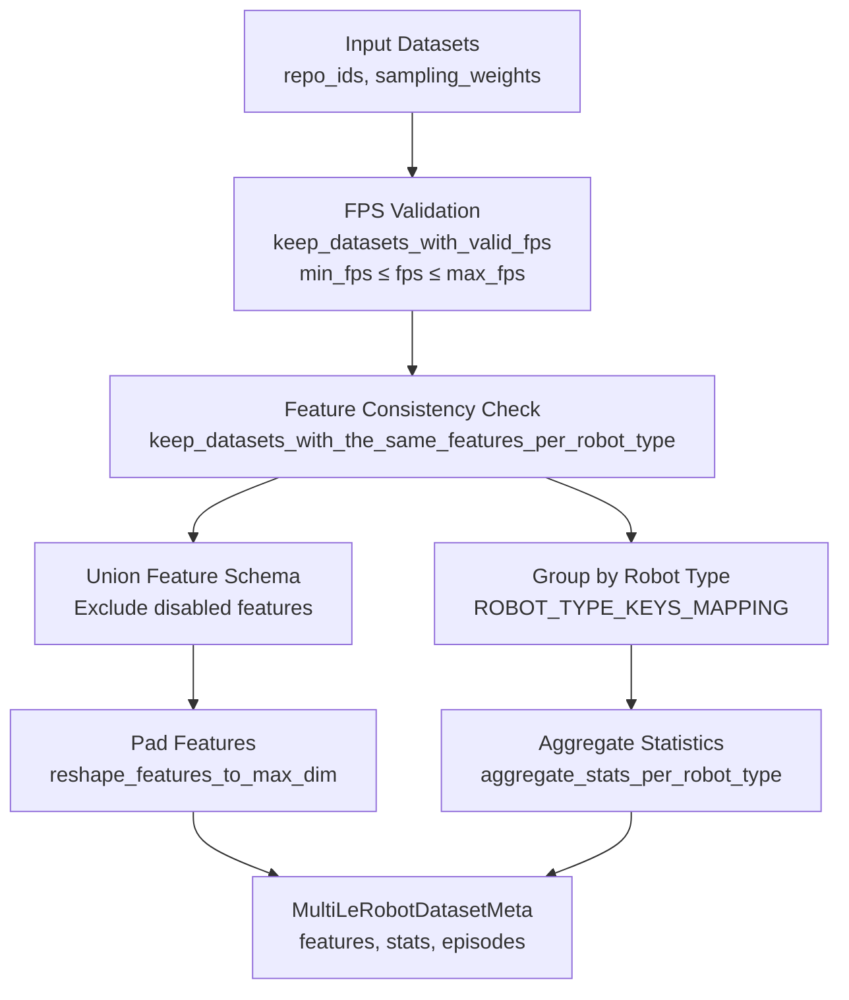
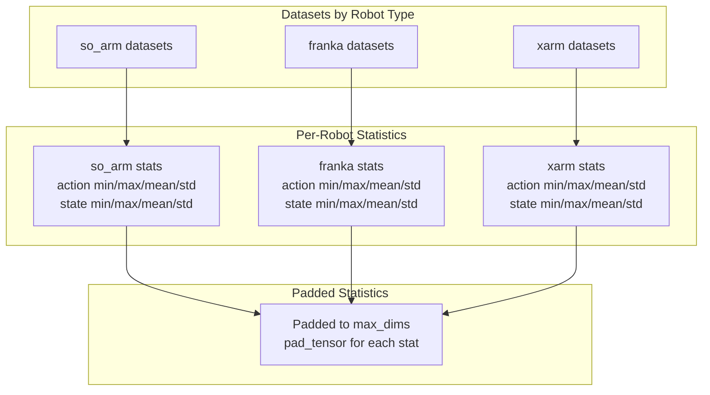
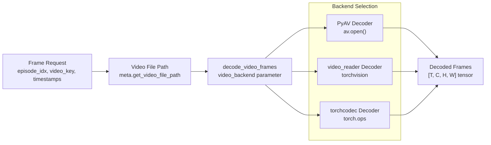
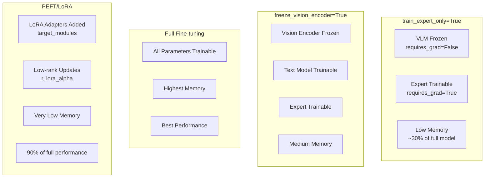
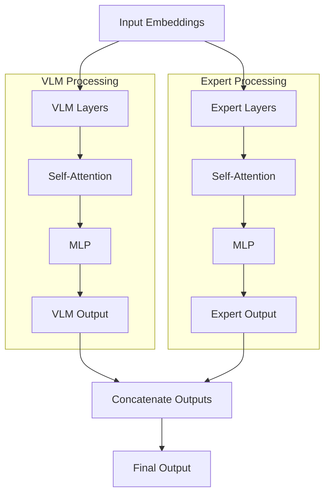
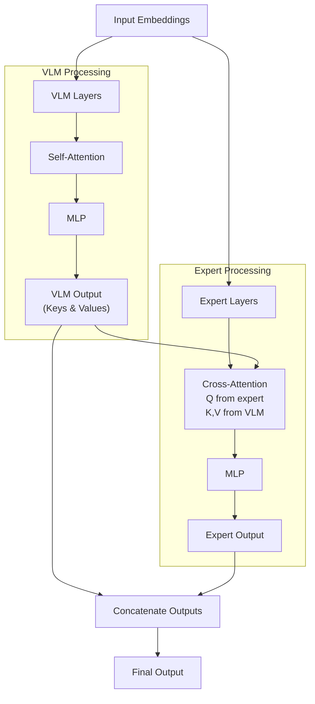
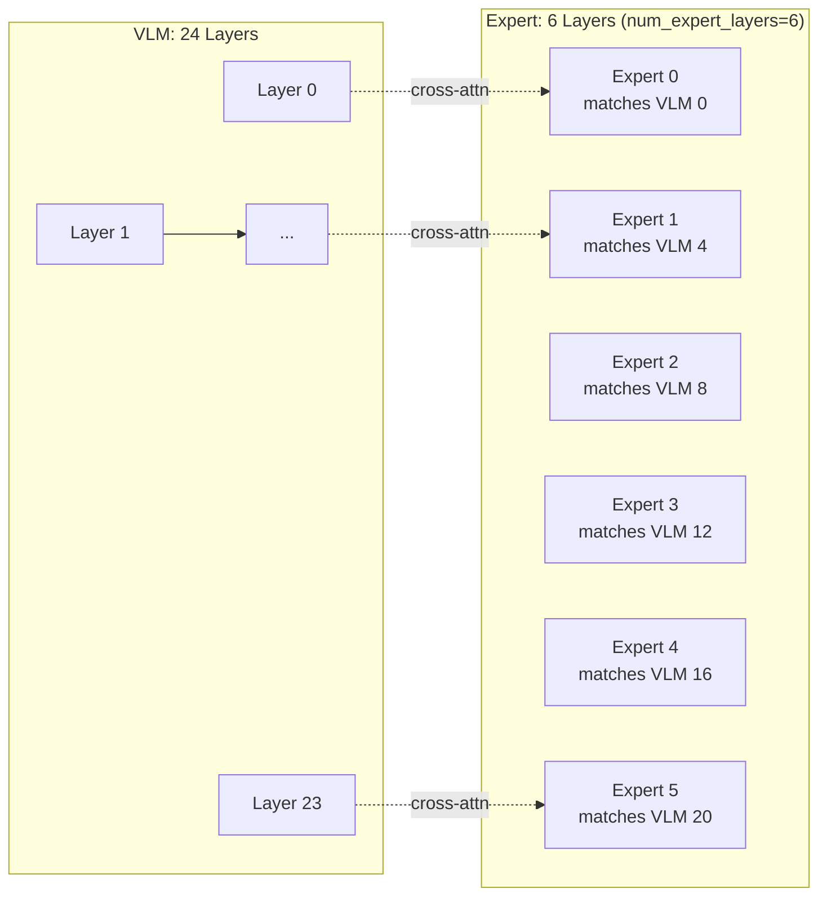

<!-- source: DeepWiki mcp.deepwiki.com · repo huggingface/VLAb · page 10 Advanced Topics · fetched 2026-10-26 -->

# Advanced Topics

<details>
<summary>Relevant source files</summary>

The following files were used as context for generating this wiki page:

- [LICENSE](LICENSE)
- [README.md](README.md)
- [src/lerobot/datasets/lerobot_dataset.py](src/lerobot/datasets/lerobot_dataset.py)
- [src/lerobot/policies/smolvla2/smolvlm_with_expert2.py](src/lerobot/policies/smolvla2/smolvlm_with_expert2.py)

</details>


This page covers advanced usage patterns and implementation details for VLAb that go beyond basic training workflows. These topics are intended for users who need to customize dataset handling, optimize performance, or understand the internal mechanisms of the system.

**Related pages:**
- For temporal querying and history-aware policies, see [Temporal Context with Delta Timestamps](#10.1)
- For recording new datasets, see [Custom Dataset Creation](#10.2)
- For debugging common errors, see [Troubleshooting](#10.3)

---

## Feature Mapping and Heterogeneous Datasets

VLAb supports training on datasets with different feature schemas through a sophisticated feature mapping and padding system. This enables pretraining on diverse robotics datasets that may have different observation spaces, action dimensions, or camera configurations.

### Feature Key Mapping

The `feature_keys_mapping` system allows remapping dataset-specific feature names to standardized keys. This is configured per-dataset and applied during dataset initialization.



**Sources:** [src/lerobot/datasets/lerobot_dataset.py:124-151](), [src/lerobot/datasets/lerobot_dataset.py:543-546]()

### Feature Padding and Alignment

When training on multiple datasets with different feature dimensions, VLAb pads features to a maximum dimension specified in the configuration. This ensures all batches have uniform shapes.

| Feature Type | Configuration Parameter | Padding Strategy |
|-------------|------------------------|------------------|
| Action | `max_action_dim` | Pad to maximum action dimension across datasets |
| State | `max_state_dim` | Pad to maximum state dimension |
| Environment State | `max_state_dim` | Same as state padding |
| Images | `max_image_dim` | Resize or pad to uniform dimensions |
| Number of Images | `max_num_images` | Pad with dummy camera streams |

The padding is applied in [src/lerobot/datasets/lerobot_dataset.py:643-653]() and uses the `reshape_features_to_max_dim` function to transform feature schemas. Statistics are also padded accordingly to ensure proper normalization of padded dimensions.

**Implementation:**



**Sources:** [src/lerobot/datasets/lerobot_dataset.py:643-653](), [src/lerobot/datasets/utils_must.py]()

---

## Motion Detection and Idle Frame Filtering

VLAb provides two mechanisms to filter out idle or stationary frames at the beginning of episodes, which can improve training efficiency by focusing on actionable demonstrations.

### Configuration Options

The frame filtering is controlled by three dataset configuration parameters:

- `discard_first_n_frames` (int): Remove the first N frames from each episode
- `discard_first_idle_frames` (bool): Automatically detect and remove idle frames
- `motion_threshold` (float): Velocity threshold for motion detection (default: 0.05)
- `motion_window_size` (int): Sliding window size for motion detection (default: 10)
- `motion_buffer` (int): Number of frames to include before detected motion (default: 3)

### Motion Detection Algorithm

When `discard_first_idle_frames=True`, the system analyzes robot state velocities to find the start of motion:



The implementation in [src/lerobot/datasets/lerobot_dataset.py:610-623]() computes velocities from consecutive state differences, applies a sliding window to smooth the signal, and identifies when the mean velocity exceeds the threshold. A buffer is added to include context before the motion starts.

**Sources:** [src/lerobot/datasets/lerobot_dataset.py:410-423](), [src/lerobot/datasets/lerobot_dataset.py:610-623](), [src/lerobot/datasets/lerobot_dataset.py:110-116]()

---

## Multi-Dataset Aggregation and Cleaning

The `MultiLeRobotDataset` class handles training on multiple heterogeneous datasets simultaneously, with built-in validation and cleaning mechanisms.

### Dataset Validation Pipeline



The `MultiLeRobotDatasetCleaner` class [src/lerobot/datasets/lerobot_dataset.py:1279-1314]() implements a two-stage filtering process:

1. **FPS Validation**: Removes datasets with invalid frame rates outside the `[min_fps, max_fps]` range
2. **Feature Consistency**: Groups datasets by robot type and ensures all datasets for a given robot type have compatible features

After cleaning, sampling weights are adjusted and cumulative dataset sizes are computed for efficient indexing during training.

**Sources:** [src/lerobot/datasets/lerobot_dataset.py:1279-1314](), [src/lerobot/datasets/lerobot_dataset.py:1216-1277]()

### Robot Type Aggregation

Statistics aggregation respects robot types to enable proper normalization across different robot platforms:



The `aggregate_stats_per_robot_type` function groups datasets by robot type and computes separate statistics for each group. This allows the policy to normalize actions and states appropriately for different robot platforms during training.

**Sources:** [src/lerobot/datasets/lerobot_dataset.py:1260-1271](), [src/lerobot/datasets/utils_must.py:aggregate_stats_per_robot_type]()

---

## Cache Management and Optimization

VLAb relies on HuggingFace's caching mechanisms for datasets and models. Understanding cache behavior is crucial for managing disk space and debugging download issues.

### Cache Structure

The default cache locations are:

| Component | Default Path | Environment Variable |
|-----------|-------------|---------------------|
| Datasets | `~/.cache/huggingface/datasets` | `HF_DATASETS_CACHE` |
| Models | `~/.cache/huggingface/hub` | `HF_HOME` |
| Transformers | `~/.cache/huggingface/transformers` | `TRANSFORMERS_CACHE` |
| LeRobot Datasets | `~/.cache/huggingface/lerobot` | `LEROBOT_HOME` |

### Cache Synchronization

The `force_cache_sync` parameter in `LeRobotDataset` [src/lerobot/datasets/lerobot_dataset.py:126]() controls whether to refresh cached metadata:

```python
meta = LeRobotDatasetMetadata(
    repo_id,
    root,
    force_cache_sync=True  # Forces re-download of metadata
)
```

When `force_cache_sync=True`, the system will re-download metadata files from the hub even if they exist locally, ensuring you have the latest dataset version.

### Manual Cache Cleanup

For corrupted or outdated cache entries, manual cleanup may be required:

```bash
# Remove all cached datasets
rm -rf ~/.cache/huggingface/datasets

# Remove all cached models
rm -rf ~/.cache/huggingface/hub

# Remove all cached transformers
rm -rf ~/.cache/huggingface/transformers
```

In SLURM environments, the cache cleanup can be automated by setting `CLEAN_CACHE=true` in the job script. This is particularly useful when encountering persistent cache corruption issues across cluster nodes.

**Sources:** [README.md:228-245](), [src/lerobot/datasets/lerobot_dataset.py:126](), [src/lerobot/datasets/lerobot_dataset.py:133-143]()

---

## Video Backend Selection and Configuration

VLAb supports multiple video decoding backends, each with different performance characteristics and compatibility requirements.

### Available Backends

| Backend | Description | Requirements | Performance |
|---------|-------------|--------------|-------------|
| `pyav` | FFmpeg-based decoder via PyAV | `av` package | Good compatibility, moderate speed |
| `video_reader` | Torchvision video_reader | Torchvision ≥0.9 | Fast, platform-dependent |
| `torchcodec` | Modern Torch codec (default when available) | Platform-specific | Best performance |

The backend is selected in [src/lerobot/datasets/lerobot_dataset.py:527]():

```python
self.video_backend = video_backend if video_backend else get_safe_default_codec()
```

The `get_safe_default_codec()` function attempts to use `torchcodec` if available, falling back to `pyav` for broader compatibility.

### Video Decoding Flow



Video decoding happens on-demand during `__getitem__` calls [src/lerobot/datasets/lerobot_dataset.py:873-884](), using the configured backend to extract frames at specific timestamps. The decoder ensures frame timestamps match the requested timestamps within the specified `tolerance_s`.

**Sources:** [src/lerobot/datasets/lerobot_dataset.py:527](), [src/lerobot/datasets/lerobot_dataset.py:873-884](), [src/lerobot/datasets/video_utils.py:get_safe_default_codec]()

---

## Training Strategy Optimization

The SmolVLA2 architecture supports multiple training strategies with different compute and memory requirements.

### Training Mode Comparison



The training mode is controlled by configuration parameters and implemented in [src/lerobot/policies/smolvla2/smolvlm_with_expert2.py:202-233]():

- `train_expert_only`: Freezes the entire VLM, trains only the expert model
- `freeze_vision_encoder`: Freezes vision encoder only, trains text model and expert
- `peft_method`: Applies parameter-efficient fine-tuning (LoRA) to specified modules

### PEFT Configuration

When using LoRA, the configuration specifies which modules to adapt:

```python
lora_config = LoraConfig(
    task_type=TaskType.CAUSAL_LM,
    r=peft_config.r,  # Rank of low-rank adaptation
    lora_alpha=peft_config.lora_alpha,  # Scaling factor
    lora_dropout=peft_config.lora_dropout,
    target_modules=["q_proj", "v_proj", "k_proj", "o_proj"],
    exclude_modules=["lm_expert"]  # Expert is always trained fully
)
```

The expert model is always excluded from LoRA adaptation and trained with full-rank updates, regardless of the PEFT configuration.

**Sources:** [src/lerobot/policies/smolvla2/smolvlm_with_expert2.py:151-184](), [src/lerobot/policies/smolvla2/smolvlm_with_expert2.py:202-233]()

---

## Attention Mode Configuration

The SmolVLA2 architecture supports two attention mechanisms that affect how the expert model interacts with the VLM.

### Self-Attention Mode

In self-attention mode (`attention_mode="self_attn"`), the VLM and expert process inputs independently and their outputs are concatenated:



### Cross-Attention Mode

In cross-attention mode (`attention_mode="cross_attn"`), the expert attends to VLM outputs, enabling richer information flow:



The cross-attention implementation [src/lerobot/policies/smolvla2/smolvlm_with_expert2.py:334-443]() reshapes the K and V projections to accept VLM hidden states as input, while Q comes from the expert's own hidden states. This allows the expert to selectively attend to relevant VLM features.

**Sources:** [src/lerobot/policies/smolvla2/smolvlm_with_expert2.py:70](), [src/lerobot/policies/smolvla2/smolvlm_with_expert2.py:124-138](), [src/lerobot/policies/smolvla2/smolvlm_with_expert2.py:334-443](), [src/lerobot/policies/smolvla2/smolvlm_with_expert2.py:479-508]()

---

## Expert Model Architecture Configuration

The expert model's architecture can be customized to balance performance and efficiency.

### Architecture Parameters

| Parameter | Description | Default | Impact |
|-----------|-------------|---------|--------|
| `num_expert_layers` | Number of transformer layers in expert | All VLM layers | Memory usage scales linearly |
| `expert_width_multiplier` | Hidden dimension multiplier | 0.5 | Quadratic memory impact |
| `num_vlm_layers` | Number of VLM layers to use | All layers | Affects KV cache size |
| `self_attn_every_n_layers` | Frequency of self-attention in cross-attn mode | -1 (disabled) | Reduces cross-attn computation |

### Layer Configuration Example



When `num_expert_layers` is less than `num_vlm_layers`, the expert layers are distributed evenly across the VLM depth. The implementation in [src/lerobot/policies/smolvla2/smolvlm_with_expert2.py:445-457]() computes the mapping:

```python
multiple_of = self.num_vlm_layers // self.num_expert_layers
for i in range(self.num_vlm_layers):
    if multiple_of > 0 and i > 0 and i % multiple_of != 0:
        expert_layer = None  # Skip this VLM layer
    else:
        expert_layer_index = i // multiple_of
        expert_layer = models[1].layers[expert_layer_index]
```

**Sources:** [src/lerobot/policies/smolvla2/smolvlm_with_expert2.py:64-75](), [src/lerobot/policies/smolvla2/smolvlm_with_expert2.py:104-122](), [src/lerobot/policies/smolvla2/smolvlm_with_expert2.py:445-457]()

---

