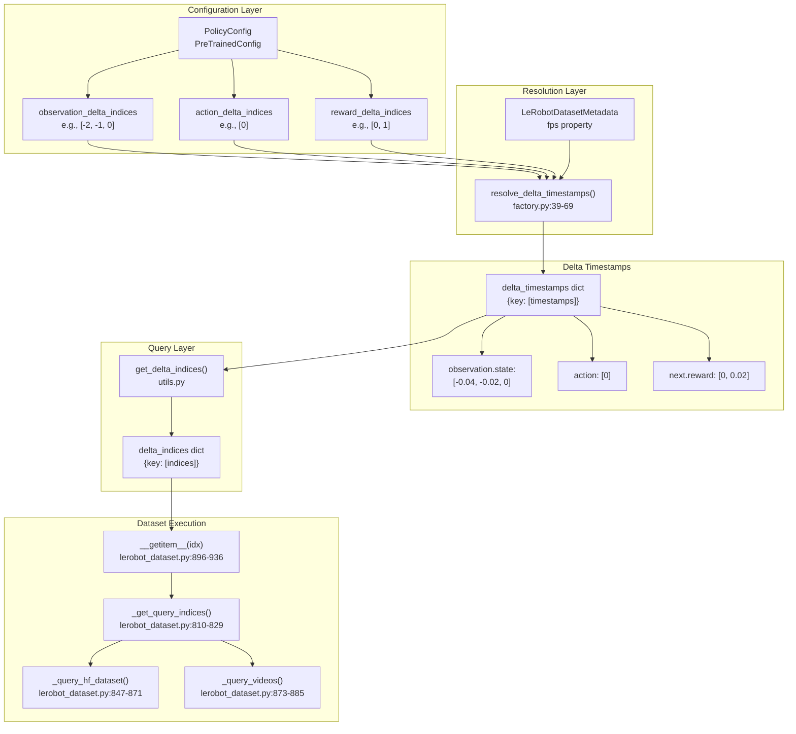
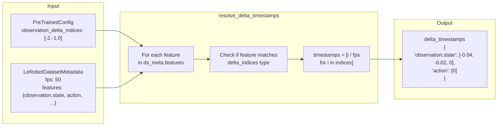
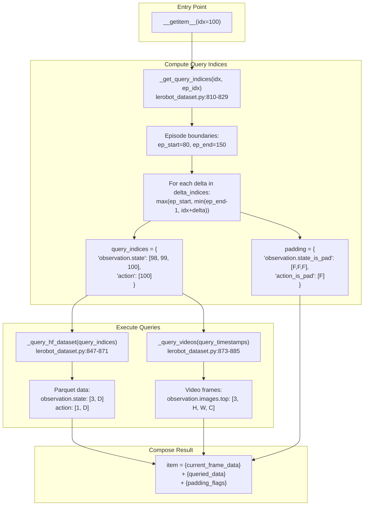
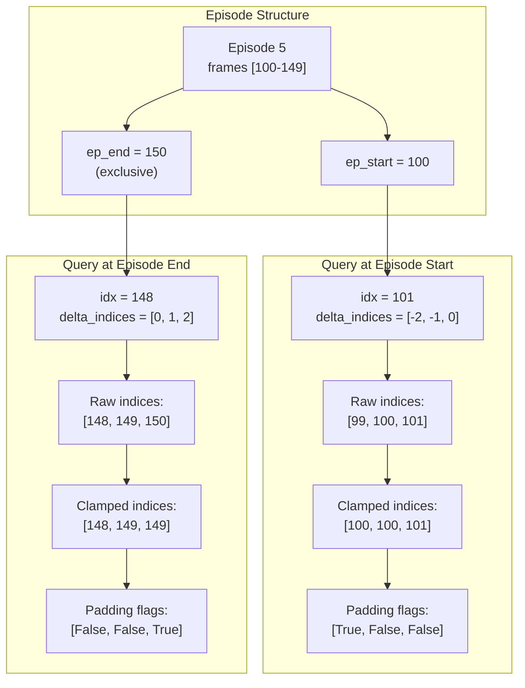
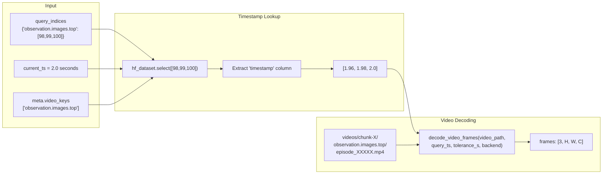
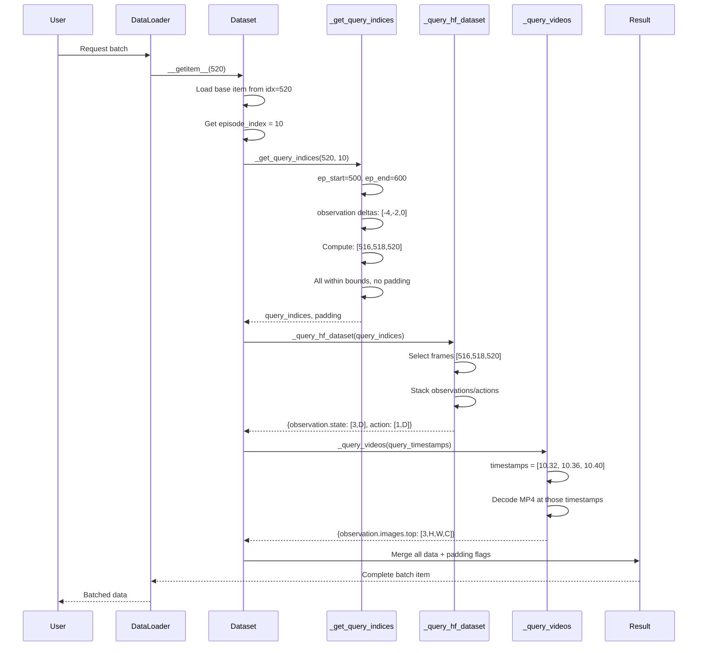
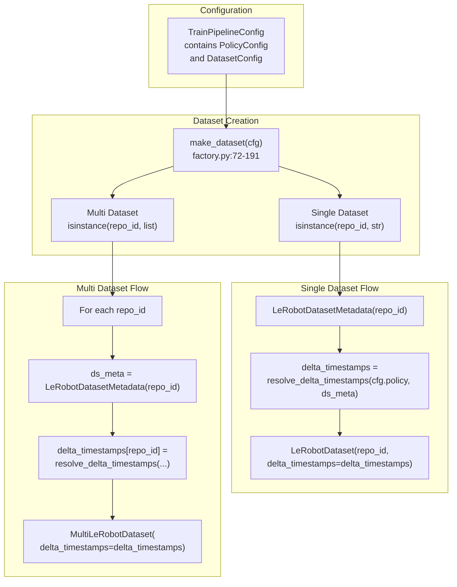

<!-- source: DeepWiki mcp.deepwiki.com · repo huggingface/VLAb · page 10.1 Temporal Context with Delta Timestamps · fetched 2026-10-26 -->

# Temporal Context with Delta Timestamps

<details>
<summary>Relevant source files</summary>

The following files were used as context for generating this wiki page:

- [src/lerobot/datasets/factory.py](src/lerobot/datasets/factory.py)
- [src/lerobot/datasets/lerobot_dataset.py](src/lerobot/datasets/lerobot_dataset.py)

</details>


## Purpose and Scope

This document explains how VLAb implements temporal context for history-aware policies through the **delta timestamps** mechanism. Delta timestamps enable policies to access observations, actions, and rewards from multiple timesteps simultaneously, providing the temporal context necessary for sequential decision-making in robotics tasks.

This mechanism is fundamental to training Vision-Language-Action models that need to understand motion, trajectory, and temporal relationships in robot behavior. For information about the overall dataset system that uses delta timestamps, see [Dataset System](#4). For policy configuration that specifies which temporal offsets to use, see [Policy Configuration](#6.3).

## Overview

Delta timestamps allow a dataset to return data from multiple time offsets relative to the current frame. Instead of returning a single observation at time `t`, the dataset can return observations at times `[t-2, t-1, t]`, providing the policy with temporal context about recent history.

**Key Concepts:**
- **Delta Indices**: Integer frame offsets specified in configuration (e.g., `[-2, -1, 0]`)
- **Delta Timestamps**: Real-time offsets in seconds computed from delta indices (e.g., `[-0.04, -0.02, 0]` at 50 FPS)
- **Temporal Queries**: Mechanism to fetch data at multiple timesteps while respecting episode boundaries

Sources: [src/lerobot/datasets/factory.py:39-69]()

## System Architecture



**Diagram: Delta Timestamps Flow from Configuration to Execution**

Sources: [src/lerobot/datasets/factory.py:39-69](), [src/lerobot/datasets/lerobot_dataset.py:528-635]()

## Configuration: Specifying Delta Indices

Delta indices are specified in the policy configuration using three parameters:

| Parameter | Type | Description | Example |
|-----------|------|-------------|---------|
| `observation_delta_indices` | `list[int]` | Frame offsets for observations | `[-2, -1, 0]` |
| `action_delta_indices` | `list[int]` | Frame offsets for actions | `[0]` |
| `reward_delta_indices` | `list[int]` | Frame offsets for rewards | `[0, 1]` |

These parameters are attributes of the `PreTrainedConfig` class and can be set via command-line arguments or configuration files:

```bash
# Example: Request 3 observation frames and current action
--policy.observation_delta_indices=-2,-1,0 \
--policy.action_delta_indices=0
```

**Interpretation:**
- Negative indices refer to past frames (e.g., `-2` means 2 frames ago)
- Zero refers to the current frame
- Positive indices refer to future frames (e.g., `1` means next frame)

Sources: [src/lerobot/datasets/factory.py:59-64]()

## Resolution: Converting Indices to Timestamps

The `resolve_delta_timestamps` function converts delta indices to delta timestamps by dividing by the dataset's frame rate:



**Diagram: Delta Timestamp Resolution Algorithm**

### Implementation Details

The resolution process in [src/lerobot/datasets/factory.py:39-69]():

1. **Initialize empty dictionary**: `delta_timestamps = {}`

2. **Iterate over dataset features**: For each feature key in `ds_meta.features`

3. **Match to delta type**:
   - If key is `"next.reward"` → use `cfg.reward_delta_indices`
   - If key is `"action"` → use `cfg.action_delta_indices`
   - If key starts with `"observation."` → use `cfg.observation_delta_indices`

4. **Compute timestamps**: `delta_timestamps[key] = [i / ds_meta.fps for i in indices]`

5. **Return result**: Returns `None` if dictionary is empty, otherwise returns the dictionary

**Example:**
- Delta indices: `[-2, -1, 0]`
- FPS: 50 Hz (0.02 seconds per frame)
- Delta timestamps: `[-0.04, -0.02, 0]` seconds

Sources: [src/lerobot/datasets/factory.py:39-69]()

## Query Mechanism: Fetching Multi-Timestep Data

When `delta_timestamps` is provided, the dataset's `__getitem__` method queries data from multiple timesteps instead of a single frame.



**Diagram: Multi-Timestep Query Execution**

Sources: [src/lerobot/datasets/lerobot_dataset.py:896-936](), [src/lerobot/datasets/lerobot_dataset.py:810-829]()

### Query Index Computation

The `_get_query_indices` method computes frame indices for each temporal offset while ensuring they remain within episode boundaries:

```python
# Conceptual implementation (see lerobot_dataset.py:810-829)
def _get_query_indices(self, idx, ep_idx):
    ep_start = self.episode_data_index["from"][ep_idx]
    ep_end = self.episode_data_index["to"][ep_idx]
    
    query_indices = {
        key: [max(ep_start, min(ep_end - 1, idx + delta)) 
              for delta in delta_idx]
        for key, delta_idx in self.delta_indices.items()
    }
    
    padding = {
        f"{key}_is_pad": torch.BoolTensor([
            (idx + delta < ep_start) | (idx + delta >= ep_end)
            for delta in delta_idx
        ])
        for key, delta_idx in self.delta_indices.items()
    }
    
    return query_indices, padding
```

**Key Features:**
- **Clamping**: Indices are clamped to `[ep_start, ep_end-1]` range
- **Padding Flags**: Boolean tensors indicate which queried frames are outside episode bounds
- **Per-Feature Queries**: Different features can have different temporal offsets

Sources: [src/lerobot/datasets/lerobot_dataset.py:810-829]()

## Episode Boundary Handling

A critical aspect of temporal queries is handling episode boundaries correctly. When requesting historical frames at the beginning of an episode, or future frames at the end, the indices must be handled carefully.

### Clamping Strategy



**Diagram: Episode Boundary Clamping Examples**

### Padding Flags

For each feature with temporal context, a corresponding `{feature}_is_pad` boolean tensor is added to the batch:

| Feature Key | Padding Key | Shape | Description |
|-------------|-------------|-------|-------------|
| `observation.state` | `observation.state_is_pad` | `[num_deltas]` | True where frames are outside episode |
| `action` | `action_is_pad` | `[num_deltas]` | True where actions are padded |

The policy can use these flags to:
- Mask attention weights in transformer models
- Skip gradient computation for padded timesteps
- Apply different processing for valid vs. padded data

Sources: [src/lerobot/datasets/lerobot_dataset.py:823-829]()

## Video Frame Queries with Temporal Context

Video frames require special handling because they're stored in MP4 files rather than Parquet tables. The `_query_videos` method decodes frames at specific timestamps.

### Timestamp Computation for Videos

The `_get_query_timestamps` method converts query indices to timestamps for video decoding:



**Diagram: Video Frame Query with Timestamps**

### Implementation Details

The video query process in [src/lerobot/datasets/lerobot_dataset.py:831-885]():

1. **Check if queries exist**: If `query_indices` is not None for a video key, use those indices
2. **Extract timestamps**: Look up actual timestamps from HF dataset at query indices
3. **Decode frames**: Use `decode_video_frames` to extract frames at specified timestamps
4. **Handle tolerance**: Frames within `tolerance_s` of requested time are acceptable
5. **Return stacked frames**: All frames for a video key are returned as a single tensor

**Key Point**: Videos use floating-point timestamps rather than integer indices because:
- Video encoding may not preserve exact frame timing
- Allows sub-frame precision if needed
- Consistent with episode timestamp tracking

Sources: [src/lerobot/datasets/lerobot_dataset.py:831-885]()

## Data Flow: Complete Example

Let's trace a complete example of how temporal context is retrieved:

### Scenario Setup

```
Dataset: aloha_sim_insertion_scripted
FPS: 50 Hz
Episode 10: frames [500-599]
Current index: 520
Policy config: observation_delta_indices = [-4, -2, 0]
                action_delta_indices = [0]
```

### Step-by-Step Execution



**Diagram: Complete Temporal Query Execution Sequence**

### Resulting Batch Structure

The returned dictionary contains:

```python
{
    # Base frame data (always present)
    "index": 520,
    "episode_index": 10,
    "timestamp": 10.40,
    "task_index": 0,
    "task": "Insert the peg",
    
    # Multi-timestep observations (shape: [num_deltas, ...])
    "observation.state": torch.Tensor([3, 14]),        # [516,518,520]
    "observation.images.top": torch.Tensor([3, 480, 640, 3]),
    
    # Single-timestep action
    "action": torch.Tensor([1, 14]),                   # [520]
    
    # Padding indicators
    "observation.state_is_pad": torch.BoolTensor([False, False, False]),
    "action_is_pad": torch.BoolTensor([False]),
}
```

Sources: [src/lerobot/datasets/lerobot_dataset.py:896-936]()

## Integration with Dataset Factory

The `make_dataset` factory function integrates delta timestamp resolution into dataset creation:



**Diagram: Delta Timestamps in Dataset Factory**

### Multi-Dataset Handling

When training on multiple datasets with `MultiLeRobotDataset`, each dataset can have different delta timestamps:

```python
# Conceptual structure (see factory.py:127-173)
delta_timestamps = {}
for i, repo_id in enumerate(repo_ids):
    ds_meta = LeRobotDatasetMetadata(repo_id)
    delta_timestamps[repo_id] = resolve_delta_timestamps(cfg.policy, ds_meta)

dataset = MultiLeRobotDataset(
    repo_ids,
    delta_timestamps=delta_timestamps,  # Per-dataset offsets
    ...
)
```

This allows different datasets with different FPS to use the same delta indices but get appropriately scaled timestamps.

Sources: [src/lerobot/datasets/factory.py:72-191](), [src/lerobot/datasets/lerobot_dataset.py:1323-1437]()

## Performance Considerations

### Efficient Querying

The temporal query mechanism is designed for efficiency:

| Aspect | Implementation | Benefit |
|--------|----------------|---------|
| **Parquet Queries** | `hf_dataset.select(indices)` | Efficient columnar access |
| **Video Decoding** | Single call per video key | Batch decode multiple frames |
| **Index Caching** | Pre-computed episode bounds | No runtime search |
| **Padding Computation** | Vectorized boolean operations | Fast boundary checks |

### Memory Usage

Temporal context increases memory usage proportionally to the number of delta indices:

```
Memory per sample = base_size × (1 + num_observation_deltas + num_action_deltas)
```

For example:
- Base sample: 1 observation + 1 action
- With `observation_delta_indices=[-2,-1,0]`: 3 observations + 1 action
- Memory increase: 3× for observations

### Recommendations

1. **Limit temporal context**: Use only necessary history (e.g., 3-5 frames)
2. **Asymmetric deltas**: Different temporal spans for different modalities
   - Images: `[-2, -1, 0]` (recent history)
   - Actions: `[0]` (current only)
   - State: `[-4, -2, 0]` (wider context)
3. **DataLoader workers**: Use multiple workers to parallelize video decoding
4. **Video backend**: Choose efficient backend (`pyav` or `torchcodec`)

Sources: [src/lerobot/datasets/lerobot_dataset.py:810-885]()

## Common Patterns and Use Cases

### Pattern 1: Action History for Trajectory Modeling

```python
# Policy config for action-conditioned models
observation_delta_indices = [-1, 0]    # Current and previous obs
action_delta_indices = [-1, 0]          # Current and previous action
```

**Use case**: Models that need to understand action effects over time

### Pattern 2: Extended Visual History

```python
# Policy config for motion understanding
observation_delta_indices = [-4, -2, 0]  # 3 frames spanning 80ms at 50Hz
action_delta_indices = [0]               # Current action only
```

**Use case**: Visual policies that track object motion and trajectories

### Pattern 3: Future Prediction

```python
# Policy config for predictive models
observation_delta_indices = [0]
action_delta_indices = [0, 1, 2, 3]      # Current + next 3 actions
```

**Use case**: Training models to predict future action sequences

### Pattern 4: No Temporal Context

```python
# Policy config for reactive policies
observation_delta_indices = None
action_delta_indices = None
```

**Use case**: Simple reactive policies without temporal reasoning

Sources: [src/lerobot/datasets/factory.py:39-69]()

## Troubleshooting

### Issue: Padding at Episode Boundaries

**Symptom**: Many samples have `{feature}_is_pad=True` flags

**Cause**: Temporal offsets extend beyond episode start/end

**Solution**: 
- Reduce magnitude of negative indices (e.g., `[-1,0]` instead of `[-4,-2,0]`)
- Filter episodes with minimum length: `episode_length > abs(min(delta_indices))`
- Handle padding in policy architecture (e.g., attention masking)

### Issue: Video Timestamp Mismatch

**Symptom**: `decode_video_frames` fails or returns incorrect frames

**Cause**: Requested timestamps not in video or exceed tolerance

**Solution**:
- Increase `tolerance_s` parameter (default: 1e-4)
- Check dataset FPS matches actual recording rate
- Verify video encoding settings preserve frame timing

### Issue: Memory Overflow with Large Context

**Symptom**: Out-of-memory errors during training

**Cause**: Too many temporal offsets for batch size

**Solution**:
- Reduce batch size proportionally to context length
- Use fewer delta indices
- Enable gradient checkpointing in policy
- Use mixed precision training

### Issue: Delta Timestamps Not Applied

**Symptom**: Dataset returns single-frame data despite delta_indices config

**Cause**: `resolve_delta_timestamps` returned `None`

**Solution**:
- Verify `delta_indices` are not `None` in policy config
- Check feature keys match dataset features
- Confirm dataset metadata loaded correctly
- Inspect `dataset.delta_timestamps` and `dataset.delta_indices` attributes

Sources: [src/lerobot/datasets/lerobot_dataset.py:39-69](), [src/lerobot/datasets/lerobot_dataset.py:810-936]()

## Summary

The delta timestamps mechanism provides a powerful and flexible way to incorporate temporal context into VLAb's training pipeline:

**Key Capabilities:**
- **Per-modality temporal offsets**: Different features can have different temporal contexts
- **Automatic episode boundary handling**: Safe clamping and padding flags
- **Efficient implementation**: Leverages Parquet columnar storage and batch video decoding
- **FPS-aware**: Automatically converts frame indices to real-time offsets
- **Multi-dataset support**: Each dataset can have different temporal configurations

**Integration Points:**
- Configuration: `PreTrainedConfig.{observation,action,reward}_delta_indices`
- Resolution: `resolve_delta_timestamps(cfg, metadata)` in dataset factory
- Execution: `LeRobotDataset.__getitem__` and query methods
- Usage: Policy architectures that process temporal sequences

This mechanism is essential for training policies that understand dynamics, motion, and temporal causality in robotic manipulation tasks.

Sources: [src/lerobot/datasets/factory.py:39-191](), [src/lerobot/datasets/lerobot_dataset.py:391-936]()

---

