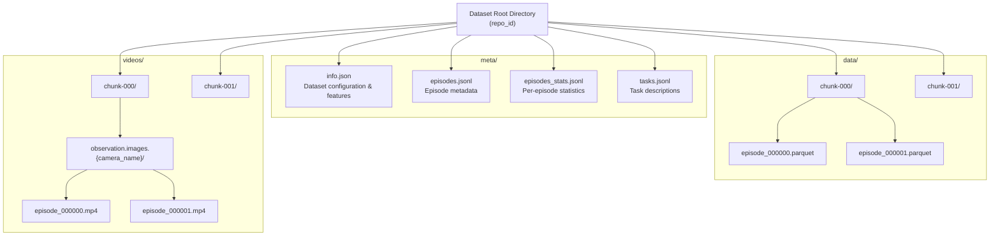
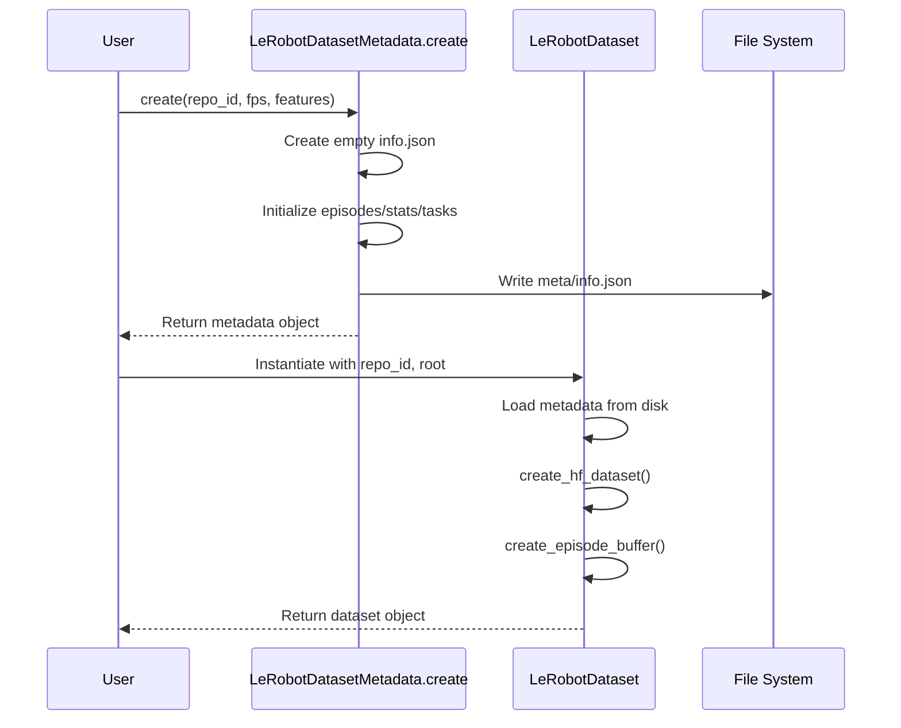
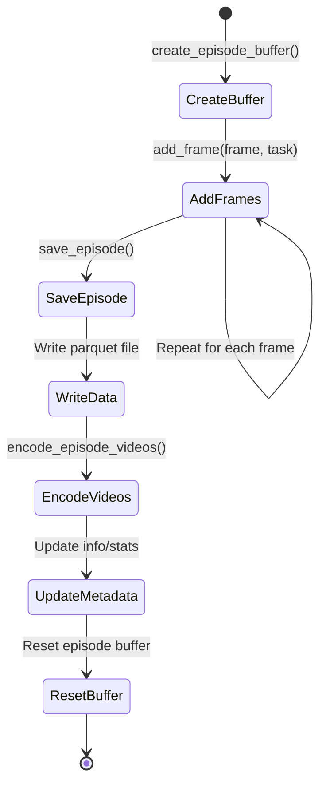
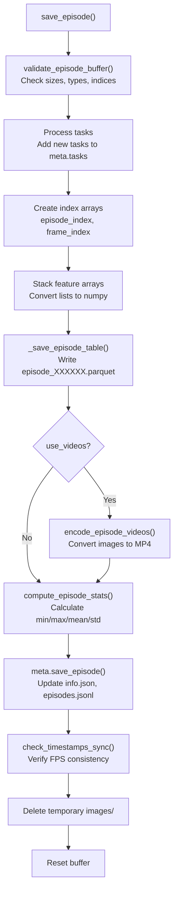

<!-- source: DeepWiki mcp.deepwiki.com · repo huggingface/VLAb · page 10.2 Custom Dataset Creation · fetched 2026-10-26 -->

# Custom Dataset Creation

<details>
<summary>Relevant source files</summary>

The following files were used as context for generating this wiki page:

- [examples/scripts/reproduce_smolvla.slurm](examples/scripts/reproduce_smolvla.slurm)
- [examples/scripts/reproduce_smolvla_resume.slurm](examples/scripts/reproduce_smolvla_resume.slurm)
- [src/lerobot/datasets/lerobot_dataset.py](src/lerobot/datasets/lerobot_dataset.py)
- [src/lerobot/datasets/video_utils.py](src/lerobot/datasets/video_utils.py)

</details>


This page explains how to create and record new robotics datasets in the VLAb format. This includes defining dataset structure, recording episodes frame-by-frame, and saving data to disk in the LeRobotDataset format.

**Scope**: This page covers the programmatic creation of new datasets using VLAb's recording APIs. For information about loading and using existing datasets, see [LeRobotDataset](#4.1). For details on the community dataset collections, see [Community Datasets](#4.5).

---

## Dataset Structure Overview

A LeRobotDataset follows a standardized file structure that separates metadata, data, and videos into distinct directories. This structure enables efficient episode-level access and distributed downloads.

### File Organization



Sources: [src/lerobot/datasets/lerobot_dataset.py:449-488]()

| Directory | Purpose | File Format |
|-----------|---------|-------------|
| `meta/` | Dataset metadata, episode lists, statistics, and tasks | JSON/JSONL |
| `data/` | Observation, action, and state data organized by episode | Parquet |
| `videos/` | Visual observations encoded as MP4 videos | MP4 |

---

## Creating a New Dataset

### Initialization Workflow

The process of creating a new dataset involves two main steps: creating metadata and instantiating the dataset object.



Sources: [src/lerobot/datasets/lerobot_dataset.py:360-388](), [src/lerobot/datasets/lerobot_dataset.py:391-662]()

### Defining Features

Features define the structure of data recorded in each frame. The features dictionary specifies the shape, dtype, and names for each modality.

**Required Feature Types:**

| Feature Type | Description | Example Keys |
|--------------|-------------|--------------|
| Observations | Sensor readings (images, states) | `observation.images.top`, `observation.state` |
| Actions | Robot control commands | `action` |
| States | Ground-truth robot state | `observation.state`, `observation.environment_state` |
| Metadata | Frame/episode information | `episode_index`, `frame_index`, `timestamp` |

**Example Feature Definition:**

```python
features = {
    "observation.images.top": {
        "dtype": "video",  # or "image"
        "shape": (480, 640, 3),
        "names": ["height", "width", "channels"]
    },
    "observation.state": {
        "dtype": "float32",
        "shape": (6,),
        "names": ["x", "y", "z", "roll", "pitch", "yaw"]
    },
    "action": {
        "dtype": "float32",
        "shape": (7,),
        "names": ["joint_1", "joint_2", "joint_3", "joint_4", 
                  "joint_5", "joint_6", "gripper"]
    }
}
```

Sources: [src/lerobot/datasets/lerobot_dataset.py:378-379](), [src/lerobot/datasets/utils.py:46]()

### Creating Dataset Metadata

Use `LeRobotDatasetMetadata.create()` to initialize a new dataset:

```python
from lerobot.datasets.lerobot_dataset import LeRobotDatasetMetadata

meta = LeRobotDatasetMetadata.create(
    repo_id="username/my_robot_dataset",
    fps=30,  # Recording frequency
    features=features,  # Feature definitions from above
    robot_type="ur5",  # Optional: robot identifier
    root="/path/to/datasets",  # Local storage path
    use_videos=True  # True for video, False for images
)
```

This creates the `meta/info.json` file with:
- Codebase version (`v2.1`)
- Feature schemas
- FPS configuration
- Data/video path templates
- Empty episode/stats/tasks lists

Sources: [src/lerobot/datasets/lerobot_dataset.py:360-388]()

---

## Recording Episodes

### Episode Recording Lifecycle



Sources: [src/lerobot/datasets/lerobot_dataset.py:949-1090]()

### Frame-by-Frame Recording

The `add_frame()` method accumulates frames in an episode buffer before writing to disk:

```python
dataset = LeRobotDataset(repo_id="username/my_robot_dataset", root="/path/to/datasets")

# Start new episode
dataset.episode_buffer = dataset.create_episode_buffer()

# Record each frame in a loop
for step in range(num_steps):
    frame = {
        "observation.images.top": camera.read(),  # numpy array (H, W, C)
        "observation.state": robot.get_state(),    # numpy array (D,)
        "action": robot.get_action()               # numpy array (A,)
    }
    
    task_description = "pick and place red block"
    timestamp = step / dataset.fps  # Auto-computed if None
    
    dataset.add_frame(frame, task=task_description, timestamp=timestamp)

# Save complete episode
dataset.save_episode()
```

**Key Points:**

- Frames are validated against the features schema
- Images are temporarily saved to `images/` directory
- The buffer tracks frame count via `episode_buffer["size"]`
- `frame_index` and `timestamp` are auto-generated if not provided

Sources: [src/lerobot/datasets/lerobot_dataset.py:973-1015]()

### Episode Buffer Structure

The episode buffer is a dictionary accumulating data for the current episode:

| Key | Type | Description |
|-----|------|-------------|
| `episode_index` | int | Episode number (assigned at buffer creation) |
| `size` | int | Current frame count |
| `task` | list[str] | Task description for each frame |
| `frame_index` | list[int] | Sequential frame indices |
| `timestamp` | list[float] | Timestamp in seconds |
| Feature keys | list | Accumulated feature values (observations, actions, states) |

For image/video features, the buffer stores temporary file paths rather than pixel data.

Sources: [src/lerobot/datasets/lerobot_dataset.py:949-957]()

---

## Saving and Validation

### Save Episode Workflow



Sources: [src/lerobot/datasets/lerobot_dataset.py:1017-1090]()

### Video Encoding

When `use_videos=True`, images are encoded to MP4 after episode completion:

```python
def encode_episode_videos(self, episode_index: int) -> dict:
    video_paths = {}
    for key in self.meta.video_keys:
        imgs_dir = self.root / "images" / f"episode_{episode_index:06d}" / key
        video_path = self.root / self.meta.get_video_file_path(episode_index, key)
        
        encode_video_frames(
            imgs_dir=imgs_dir,
            video_path=video_path,
            fps=self.fps,
            vcodec="libsvtav1",  # Default codec
            pix_fmt="yuv420p",
            g=2,  # Keyframe interval
            crf=30  # Quality (lower = better, larger file)
        )
        video_paths[key] = str(video_path)
    return video_paths
```

**Encoding Parameters:**

| Parameter | Default | Description |
|-----------|---------|-------------|
| `vcodec` | `libsvtav1` | Video codec (h264, hevc, libsvtav1) |
| `pix_fmt` | `yuv420p` | Pixel format |
| `g` | 2 | Keyframe interval (GOP size) |
| `crf` | 30 | Constant rate factor (quality) |

Sources: [src/lerobot/datasets/lerobot_dataset.py:1102-1144](), [src/lerobot/datasets/video_utils.py:252-338]()

### Statistics Computation

Episode statistics are computed for normalization during training:

```python
from lerobot.datasets.compute_stats import compute_episode_stats

ep_stats = compute_episode_stats(episode_buffer, features)
# Returns:
# {
#     "action": {"max": [...], "min": [...], "mean": [...], "std": [...]},
#     "observation.state": {"max": [...], "min": [...], ...},
#     ...
# }
```

These are saved to `meta/episodes_stats.jsonl` and aggregated into `stats` for the full dataset.

Sources: [src/lerobot/datasets/lerobot_dataset.py:1058](), [src/lerobot/datasets/compute_stats.py]()

---

## Advanced Topics

### Asynchronous Image Writing

For high-FPS recording, use `AsyncImageWriter` to write images in a background thread:

```python
from lerobot.datasets.image_writer import AsyncImageWriter

dataset.image_writer = AsyncImageWriter(num_processes=4)

# In recording loop
dataset.add_frame(frame, task)  # Images written asynchronously

# Before save_episode()
dataset._wait_image_writer()  # Ensure all writes complete
```

Sources: [src/lerobot/datasets/lerobot_dataset.py:1056](), [src/lerobot/datasets/image_writer.py]()

### Task Management

Tasks are natural language descriptions associated with episodes. Multiple tasks can exist within a single episode:

```python
# First occurrence of a task auto-registers it
dataset.add_frame(frame, task="pick red cube")

# Task index is automatically assigned
task_index = dataset.meta.get_task_index("pick red cube")

# Manually add a task without recording
dataset.meta.add_task("new task description")
```

Tasks are stored in `meta/tasks.jsonl` with auto-incremented indices.

Sources: [src/lerobot/datasets/lerobot_dataset.py:281-304](), [src/lerobot/datasets/lerobot_dataset.py:1041-1047]()

### Episode Chunking

Episodes are organized into chunks (groups) to enable efficient loading:

```python
# Configured in info.json
chunks_size = 1000  # Max episodes per chunk

# Episode 0-999 → chunk-000/
# Episode 1000-1999 → chunk-001/
ep_chunk = episode_index // chunks_size
```

This affects file paths:
- `data/chunk-000/episode_000000.parquet`
- `videos/chunk-000/observation.images.top/episode_000000.mp4`

Sources: [src/lerobot/datasets/lerobot_dataset.py:185-196](), [src/lerobot/datasets/lerobot_dataset.py:316-318]()

### Timestamp Synchronization

VLAb validates that timestamps are consistent with the configured FPS:

```python
# Tolerance check
tolerance_s = 1e-4  # seconds

# Validates that frame timestamps are separated by 1/fps ± tolerance_s
check_timestamps_sync(timestamps, episode_indices, ep_data_index, fps, tolerance_s)
```

This ensures proper temporal alignment for history-aware policies using delta timestamps.

Sources: [src/lerobot/datasets/lerobot_dataset.py:1070-1076](), [src/lerobot/datasets/utils.py:check_timestamps_sync]()

---

## Code Reference Summary

| Class/Function | Purpose | Location |
|----------------|---------|----------|
| `LeRobotDatasetMetadata.create()` | Create new dataset metadata | [src/lerobot/datasets/lerobot_dataset.py:360-388]() |
| `LeRobotDataset.create_episode_buffer()` | Initialize episode buffer | [src/lerobot/datasets/lerobot_dataset.py:949-957]() |
| `LeRobotDataset.add_frame()` | Add frame to current episode | [src/lerobot/datasets/lerobot_dataset.py:973-1015]() |
| `LeRobotDataset.save_episode()` | Write episode to disk | [src/lerobot/datasets/lerobot_dataset.py:1017-1090]() |
| `encode_video_frames()` | Encode images to MP4 | [src/lerobot/datasets/video_utils.py:252-338]() |
| `compute_episode_stats()` | Calculate dataset statistics | [src/lerobot/datasets/compute_stats.py]() |
| `AsyncImageWriter` | Background image writing | [src/lerobot/datasets/image_writer.py]() |

---

