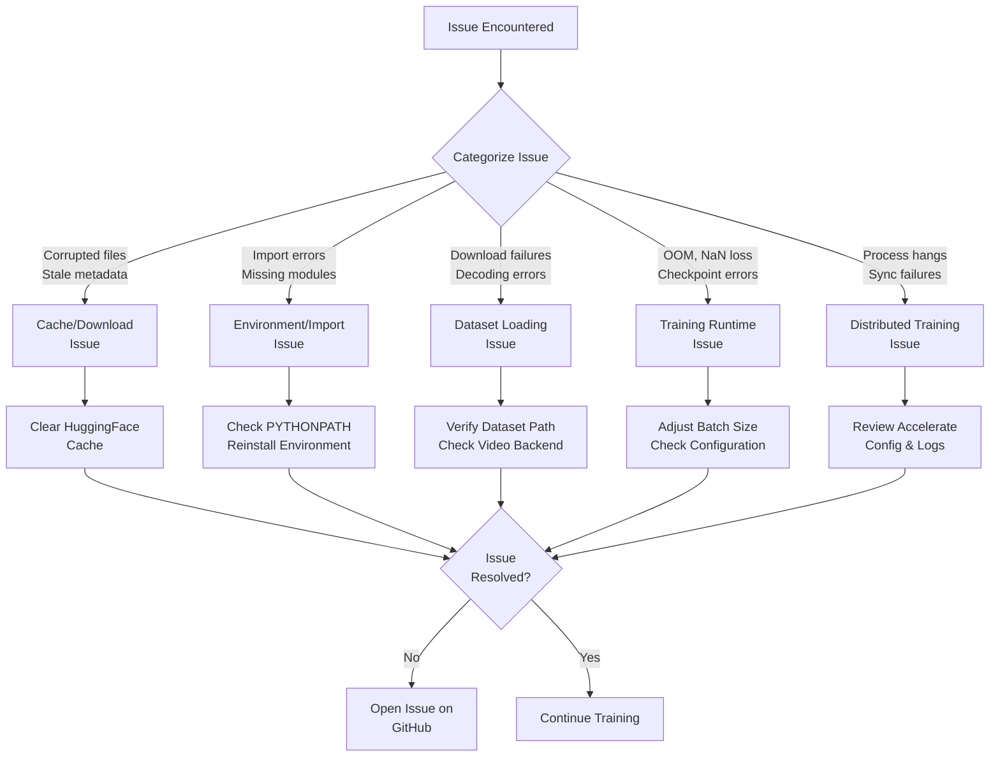
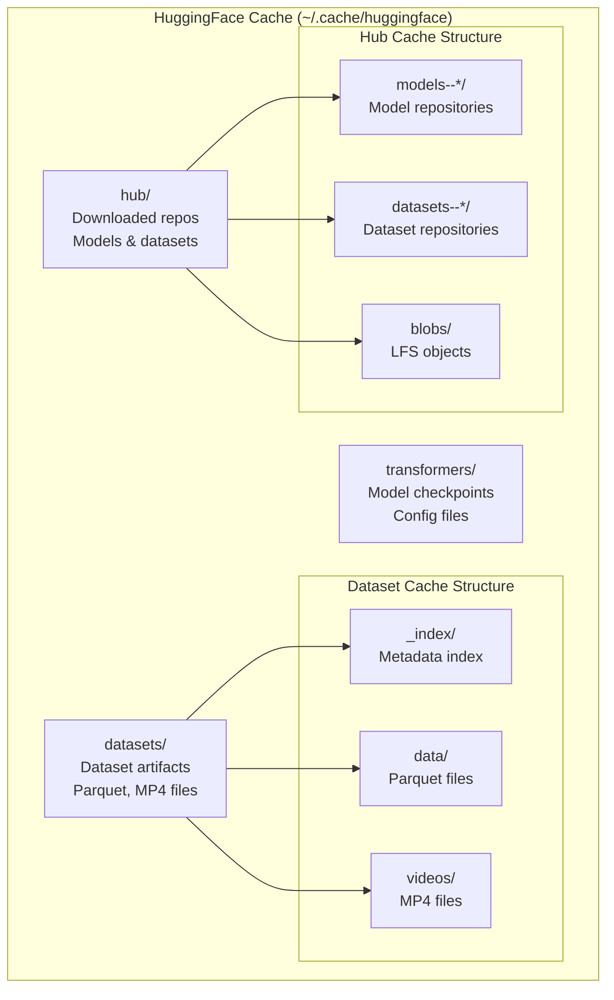
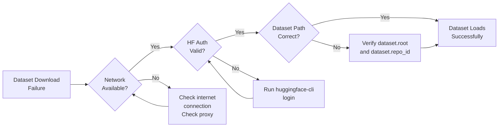
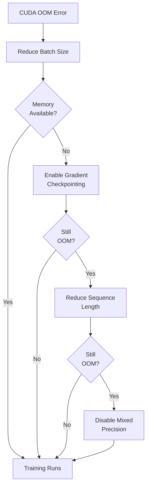
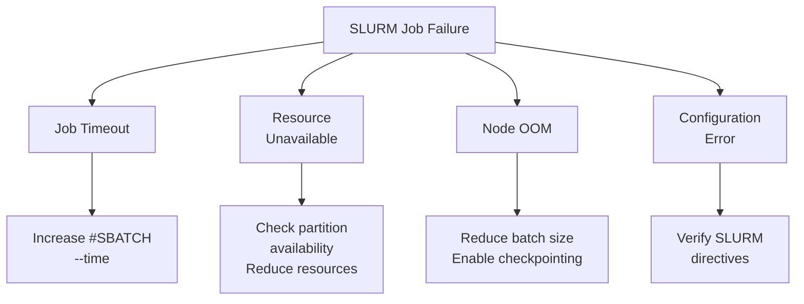

<!-- source: DeepWiki mcp.deepwiki.com · repo huggingface/VLAb · page 10.3 Troubleshooting · fetched 2026-10-26 -->

# Troubleshooting

<details>
<summary>Relevant source files</summary>

The following files were used as context for generating this wiki page:

- [LICENSE](LICENSE)
- [README.md](README.md)
- [environment.yml](environment.yml)

</details>


This page provides solutions for common issues encountered when using VLAb, including cache management, environment setup, dataset loading, training errors, and distributed execution problems. For installation instructions, see [Environment Setup](#2.1). For cluster-specific configuration, see [SLURM Cluster Training](#8.2).

## Overview of Common Issues

VLAb issues typically fall into one of the following categories:

| Category | Common Symptoms | Primary Solutions |
|----------|----------------|-------------------|
| **Cache Corruption** | Persistent download errors, stale metadata, corrupted files | Clear HuggingFace cache directories |
| **Environment Setup** | Import errors, missing modules, CUDA mismatches | Verify `PYTHONPATH`, reinstall environment |
| **Dataset Loading** | Download failures, video decoding errors, missing episodes | Check dataset paths, video backend configuration |
| **Training Failures** | OOM errors, NaN losses, checkpoint errors | Adjust batch size, check configuration, validate checkpoints |
| **Distributed Training** | Process hangs, synchronization failures, SLURM errors | Verify Accelerate config, check SLURM logs |

## Troubleshooting Workflow



**Troubleshooting Workflow**: Follow this decision tree to identify and resolve common VLAb issues systematically.

Sources: [README.md:228-247]()

---

## Cache Issues

HuggingFace caches downloaded models, datasets, and metadata to avoid redundant downloads. Cache corruption is the most common source of persistent errors in VLAb.

### Cache Directory Structure



**HuggingFace Cache Structure**: Understanding cache organization helps diagnose and resolve cache-related issues.

Sources: [README.md:231-239]()

### Common Cache Problems

#### Symptom: Corrupted Dataset Files

**Error Messages:**
```
FileNotFoundError: [Errno 2] No such file or directory: '~/.cache/huggingface/datasets/...'
ParquetInvalidOrCorruptedFileError: Parquet file is corrupted
```

**Solution:**

```bash
# Remove entire datasets cache
rm -rf ~/.cache/huggingface/datasets

# Or remove specific dataset cache
rm -rf ~/.cache/huggingface/datasets/HuggingFaceVLA__community_dataset_v2
```

The dataset will be re-downloaded on next training run.

#### Symptom: Outdated Metadata

**Error Messages:**
```
DatasetGenerationError: An error occurred while generating the dataset
ValueError: Episode indices do not match expected format
```

**Solution:**

Clear both datasets and hub caches to force metadata refresh:

```bash
rm -rf ~/.cache/huggingface/datasets
rm -rf ~/.cache/huggingface/hub
```

#### Symptom: Model Download Failures

**Error Messages:**
```
OSError: Can't load model for 'HuggingFaceTB/SmolVLM2-500M-Video-Instruct'
requests.exceptions.ConnectionError: Failed to download
```

**Solution:**

```bash
# Clear transformers cache
rm -rf ~/.cache/huggingface/transformers

# Clear hub cache for models
rm -rf ~/.cache/huggingface/hub/models--*
```

Then retry training. If issues persist, check HuggingFace Hub authentication:

```bash
huggingface-cli login
```

### SLURM Automatic Cache Cleanup

For SLURM cluster training, the provided scripts support automatic cache cleanup:

```bash
# In SLURM script
export CLEAN_CACHE=true

# Cache will be cleaned before training starts
```

This is useful when:
- Starting fresh training runs
- Switching between dataset versions
- Recovering from persistent cache errors

**Warning:** Automatic cleanup in multi-node jobs may cause race conditions. Use only for single-node jobs or ensure proper synchronization.

Sources: [README.md:228-246](), [examples/scripts/reproduce_smolvla.slurm]() (referenced in README)

---

## Environment Setup Issues

### PYTHONPATH Not Set

#### Symptom

**Error Messages:**
```
ModuleNotFoundError: No module named 'lerobot'
ImportError: cannot import name 'TrainPipelineConfig' from 'lerobot.configs'
```

**Solution:**

VLAb requires the `src` directory in `PYTHONPATH`:

```bash
# Temporary (current session)
export PYTHONPATH="${PWD}/src:${PYTHONPATH}"

# Persistent (add to shell config)
echo 'export PYTHONPATH="${PWD}/src:${PYTHONPATH}"' >> ~/.bashrc
source ~/.bashrc
```

Verify with:

```bash
python -c "import lerobot; print(lerobot.__file__)"
```

Expected output should show path to `src/lerobot/__init__.py`.

Sources: [README.md:56-67]()

### Missing Dependencies

#### Symptom

**Error Messages:**
```
ModuleNotFoundError: No module named 'av'
ImportError: cannot import name 'Accelerator'
ModuleNotFoundError: No module named 'draccus'
```

**Solution:**

Recreate the conda environment:

```bash
# Remove existing environment
conda deactivate
conda env remove -n vlab

# Recreate from environment.yml
conda env create -f environment.yml
conda activate vlab

# Verify installation
python tests/test_installation.py
```

Expected test output:

```
============================================================
VLAb Installation Test
============================================================
✓ TrainPipelineConfig
✓ Policy factory
✓ Dataset factory
============================================================
✅ All tests passed!
```

Sources: [README.md:47-85](), [environment.yml:1-29]()

### CUDA Version Mismatch

#### Symptom

**Error Messages:**
```
RuntimeError: CUDA error: no kernel image is available for execution on the device
AssertionError: Torch not compiled with CUDA enabled
```

**Solution:**

Check CUDA version and update `environment.yml`:

```bash
# Check system CUDA version
nvcc --version

# Check PyTorch CUDA version
python -c "import torch; print(torch.version.cuda)"
```

Edit [environment.yml:10]() to match system CUDA:

```yaml
# For CUDA 11.8
- pytorch-cuda=11.8

# For CUDA 12.1
- pytorch-cuda=12.1
```

Then recreate environment:

```bash
conda env create -f environment.yml --force
```

Sources: [environment.yml:10]()

---

## Dataset Loading Issues

### Dataset Download Failures

#### Symptom

**Error Messages:**
```
ConnectionError: Couldn't reach https://huggingface.co
FileNotFoundError: Dataset not found at /path/to/datasets/...
```

**Diagnosis Flow:**



**Network Issues Solution:**

```bash
# Enable HF transfer acceleration
export HF_HUB_ENABLE_HF_TRANSFER=1

# Set timeout for large downloads
export HF_HUB_DOWNLOAD_TIMEOUT=600

# Retry download
accelerate launch --config_file accelerate_configs/single_gpu.yaml \
    src/lerobot/scripts/train.py \
    --dataset.repo_id="..." \
    --dataset.root="..."
```

**Authentication Solution:**

```bash
# Login to HuggingFace
huggingface-cli login

# Verify token
huggingface-cli whoami
```

**Path Configuration:**

When using `--dataset.root`, paths must be relative to root:

```bash
# Correct: dataset.root + dataset.repo_id
--dataset.root="/data/datasets" \
--dataset.repo_id="community_dataset_v2/user/dataset_name"

# Dataset location: /data/datasets/community_dataset_v2/user/dataset_name
```

Sources: [README.md:147-201]()

### Video Decoding Errors

#### Symptom

**Error Messages:**
```
RuntimeError: Failed to decode video with PyAV
ValueError: Unsupported video backend: ...
av.error.InvalidDataError: Invalid data found when processing input
```

**Solution:**

VLAb uses PyAV for video decoding. Verify backend configuration:

```bash
# Ensure PyAV is installed
pip show av

# If missing, reinstall
pip install av>=14.2.0
```

In training configuration:

```bash
--dataset.video_backend=pyav  # Use PyAV backend
```

For corrupted videos, clear cache and re-download:

```bash
rm -rf ~/.cache/huggingface/datasets/*/videos
```

Sources: [README.md:104](), [environment.yml:16]()

### Episode Index Errors

#### Symptom

**Error Messages:**
```
IndexError: Episode index out of range
KeyError: 'episode_index' not found in dataset
ValueError: Episode data shape mismatch
```

**Solution:**

This typically indicates cache corruption or dataset version mismatch. Clear cache:

```bash
rm -rf ~/.cache/huggingface/datasets
```

Verify dataset features version matches dataset format:

```bash
# For community_dataset_v2
--dataset.features_version=2

# For community_dataset_v1 or older datasets
--dataset.features_version=1
```

Sources: [README.md:189]()

---

## Training Runtime Issues

### CUDA Out of Memory (OOM)

#### Symptom

**Error Messages:**
```
RuntimeError: CUDA out of memory. Tried to allocate X.XX GiB
torch.cuda.OutOfMemoryError: CUDA out of memory
```

**Solution Hierarchy:**



**Primary Solution - Reduce Batch Size:**

```bash
# Reduce from default 8 to 4 or lower
--batch_size=4

# Or use gradient accumulation to maintain effective batch size
--batch_size=2 \
--gradient_accumulation_steps=4  # Effective batch size: 2*4=8
```

**Advanced Solutions:**

```bash
# Enable gradient checkpointing (if supported by policy)
--policy.use_gradient_checkpointing=true

# Reduce sequence length
--dataset.delta_timestamps='[-1, 0]'  # Use fewer history frames

# Disable mixed precision (uses more memory but may help)
--policy.use_amp=false
```

**Clear GPU Cache:**

```python
# In Python debugging session
import torch
torch.cuda.empty_cache()
```

Sources: [src/lerobot/scripts/train.py]() (references batch_size parameter)

### NaN or Inf Loss

#### Symptom

**Error Messages:**
```
RuntimeError: Loss is NaN
ValueError: Loss contains Inf values
Warning: Gradient norm is NaN
```

**Solution:**

Check gradient clipping and learning rate:

```bash
# Reduce learning rate
--optimizer.lr=1e-5  # Instead of default 1e-4

# Ensure gradient clipping is enabled
--clip_grad_max_norm=1.0

# Reduce batch size for more stable gradients
--batch_size=4
```

If using mixed precision, try disabling it:

```bash
--policy.use_amp=false
```

**Debug Steps:**

1. Check data quality:
```bash
# Enable verbose logging
export LEROBOT_DEBUG=1

# Inspect batch statistics
--log_freq=10
```

2. Validate dataset normalization:
```python
# Check for extreme values in dataset
import torch
from lerobot.datasets import make_dataset

dataset = make_dataset(config)
batch = next(iter(dataset))
print(batch['observation.image'].min(), batch['observation.image'].max())
```

Sources: [src/lerobot/scripts/train.py]() (references gradient clipping)

### Checkpoint Loading Failures

#### Symptom

**Error Messages:**
```
FileNotFoundError: Checkpoint not found at ...
RuntimeError: Error loading checkpoint
KeyError: Missing keys in checkpoint: ...
```

**Solution:**

**For Missing Checkpoints:**

```bash
# Check checkpoint directory
ls -la outputs/training/checkpoints/

# Ensure checkpoint exists
--checkpoint_path="outputs/training/checkpoints/last"
```

**For Incompatible Checkpoints:**

```bash
# Clear model cache and re-download
rm -rf ~/.cache/huggingface/hub/models--*

# Or specify exact checkpoint
--policy.pretrained_path="HuggingFaceTB/SmolVLM2-500M-Video-Instruct"
```

**For Resume Failures:**

```bash
# Disable resume and start fresh
--resume=false

# Or specify config from checkpoint
--config_path="outputs/training/checkpoints/last/config.yaml"
```

Sources: [README.md:222-227]() (migration to LeRobot section)

### DataLoader Worker Crashes

#### Symptom

**Error Messages:**
```
RuntimeError: DataLoader worker (pid XXX) exited unexpectedly
BrokenPipeError: [Errno 32] Broken pipe
```

**Solution:**

Reduce number of DataLoader workers:

```bash
# In training configuration
--dataloader.num_workers=2  # Reduce from default 4

# For debugging, use single worker
--dataloader.num_workers=0
```

Check system resources:

```bash
# Check available memory
free -h

# Check open file limits
ulimit -n

# Increase if needed
ulimit -n 4096
```

For shared storage issues (SLURM):

```bash
# Use local storage for caching
export HF_HOME=/tmp/hf_cache
```

Sources: [src/lerobot/datasets/lerobot_dataset.py]() (references DataLoader configuration)

---

## Distributed Training Issues

### Accelerate Configuration Problems

#### Symptom

**Error Messages:**
```
ValueError: Accelerate configuration not found
RuntimeError: Distributed training not properly initialized
```

**Solution:**

Verify Accelerate configuration:

```bash
# Check existing config
accelerate config --config_file accelerate_configs/single_gpu.yaml

# Or generate new config
accelerate config

# Test configuration
accelerate test --config_file accelerate_configs/multi_gpu.yaml
```

For multi-GPU training, ensure `multi_gpu.yaml` specifies correct settings:

```yaml
compute_environment: LOCAL_MACHINE
distributed_type: MULTI_GPU
num_processes: 2  # Match number of GPUs
```

Sources: [README.md:163-174](), [accelerate_configs/multi_gpu.yaml]() (referenced in README)

### Process Synchronization Failures

#### Symptom

**Error Messages:**
```
RuntimeError: ProcessGroup is not initialized
RuntimeError: Timed out waiting for processes
NCCL error: unhandled system error
```

**Solution:**

**Check GPU Availability:**

```bash
# Verify GPUs are visible
nvidia-smi

# Check CUDA is accessible
python -c "import torch; print(torch.cuda.device_count())"
```

**Increase Timeout:**

```bash
# Set environment variables
export NCCL_TIMEOUT=1800
export TORCH_DISTRIBUTED_TIMEOUT=1800
```

**Debug NCCL:**

```bash
# Enable NCCL debug logging
export NCCL_DEBUG=INFO

# Run training and check logs
accelerate launch --config_file accelerate_configs/multi_gpu.yaml ...
```

Sources: [src/lerobot/scripts/train.py]() (references Accelerate initialization)

### SLURM Job Failures

#### Symptom

**Error Messages:**
```
slurmstepd: error: *** JOB XXX ON node CANCELLED AT XXX DUE TO TIME LIMIT ***
sbatch: error: Batch job submission failed: ...
```

**Common Causes and Solutions:**



**Timeout Solution:**

```bash
# In SLURM script
#SBATCH --time=48:00:00  # Increase time limit

# Enable checkpointing for resume
--save_freq=1000
```

**Resource Availability:**

```bash
# Check partition status
sinfo -p hopper-prod

# Check job queue
squeue -u $USER

# Request different resources
#SBATCH --nodes=1
#SBATCH --gpus-per-node=2  # Instead of 8
```

**Debug SLURM Job:**

```bash
# Check job output
tail -f slurm-<job_id>.out

# Check job details
scontrol show job <job_id>

# Check node status
scontrol show node <node_name>
```

Sources: [README.md:202-218](), [examples/scripts/reproduce_smolvla.slurm]() (referenced in README)

---

## Model-Specific Issues

### SmolVLM Loading Errors

#### Symptom

**Error Messages:**
```
OSError: HuggingFaceTB/SmolVLM2-500M-Video-Instruct does not appear to be a valid model identifier
ValueError: Incompatible model architecture
```

**Solution:**

Verify model identifier and cache:

```bash
# Clear transformers cache
rm -rf ~/.cache/huggingface/transformers

# Specify exact model path
--policy.repo_id="HuggingFaceTB/SmolVLM2-500M-Video-Instruct" \
--policy.type="smolvla2"
```

Ensure HuggingFace authentication:

```bash
huggingface-cli login
```

Sources: [README.md:99-113]()

### Expert Model Configuration Errors

#### Symptom

**Error Messages:**
```
ValueError: expert_width_multiplier must be positive
RuntimeError: Expert model layers mismatch
```

**Solution:**

Verify expert model configuration:

```bash
# Use default expert configuration
--policy.expert_width_multiplier=0.5 \
--policy.num_expert_layers=6

# Or disable expert (use base VLM only)
--policy.train_expert_only=false \
--policy.load_vlm_weights=true
```

Sources: [src/lerobot/policies/smolvla2/]() (SmolVLA2 architecture)

---

## Getting Additional Help

If issues persist after following this guide:

1. **Check GitHub Issues**: Search existing issues at https://github.com/huggingface/vlab/issues
2. **Enable Debug Logging**:
   ```bash
   export LEROBOT_DEBUG=1
   export NCCL_DEBUG=INFO
   ```
3. **Collect Diagnostic Information**:
   ```bash
   # System info
   python -c "import torch; print(torch.__version__, torch.cuda.is_available())"
   nvidia-smi
   
   # Environment info
   conda list
   echo $PYTHONPATH
   ```
4. **Open New Issue**: Include error messages, configuration, and diagnostic output

For LeRobot-specific issues (fine-tuning, inference), see [Migration to LeRobot](#9.3) and refer to the LeRobot repository.

Sources: [README.md:247-254]()