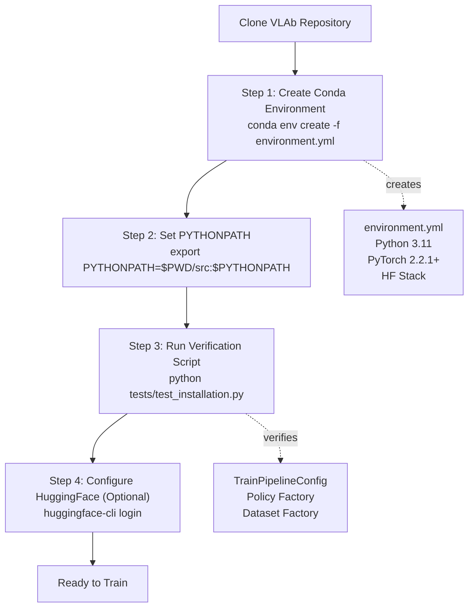
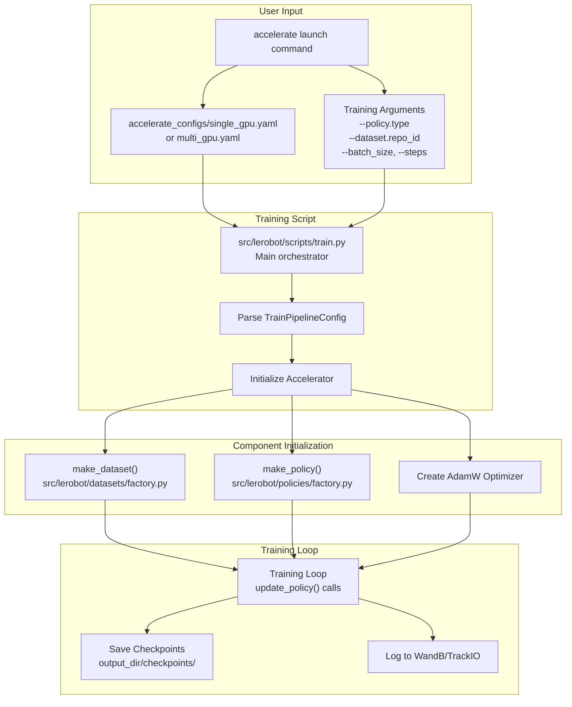
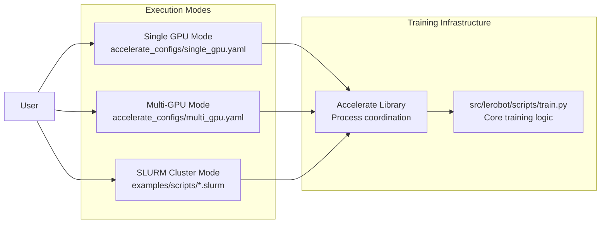
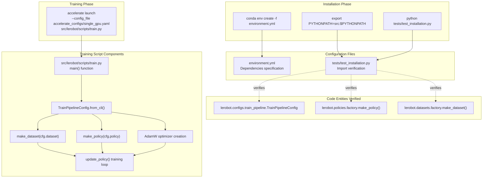

<!-- source: DeepWiki mcp.deepwiki.com · repo huggingface/VLAb · page 2 Getting Started · fetched 2026-10-26 -->

# Getting Started

<details>
<summary>Relevant source files</summary>

The following files were used as context for generating this wiki page:

- [LICENSE](LICENSE)
- [README.md](README.md)
- [environment.yml](environment.yml)

</details>


This page provides a high-level guide to setting up VLAb and running your first training job. VLAb is designed for researchers who want to pretrain Vision-Language-Action (VLA) models on robotics datasets efficiently across multi-GPU setups and SLURM clusters.

**Scope of this page**: This page introduces the installation and quick start workflows. For detailed environment setup instructions, see [Environment Setup](#2.1). For a complete walkthrough of training configurations and options, see [Quick Start Training](#2.2). For advanced distributed training setups, see [Distributed Training with Accelerate](#7.2).

---

## Prerequisites

Before starting, ensure you have:

| Requirement | Purpose | Notes |
|------------|---------|-------|
| **Conda** | Environment management | Required for dependency isolation |
| **CUDA 11.8 or 12.1** | GPU acceleration | Match your system's CUDA version |
| **Python 3.11** | Runtime environment | Installed via conda |
| **Git** | Repository cloning | For downloading VLAb |
| **HuggingFace Account** (optional) | Dataset/model access | Only needed for Hub downloads |

Sources: [README.md:47-93](), [environment.yml:1-29]()

---

## Installation Workflow

The installation process consists of four sequential steps that configure your environment and verify the installation.

**Installation Flow**



**Key Installation Artifacts**

| Component | File/Command | Purpose |
|-----------|--------------|---------|
| Environment Definition | `environment.yml` | Specifies all Python dependencies |
| PYTHONPATH Configuration | `export PYTHONPATH="${PWD}/src:${PYTHONPATH}"` | Enables import of `lerobot` modules |
| Verification Script | `tests/test_installation.py` | Validates core components are importable |
| HuggingFace CLI | `huggingface-cli login` | Authenticates for Hub access |

### Minimal Installation Commands

```bash
# Step 1: Create environment
conda env create -f environment.yml
conda activate vlab

# Step 2: Set Python path
export PYTHONPATH="${PWD}/src:${PYTHONPATH}"

# Step 3: Verify installation
python tests/test_installation.py

# Step 4 (Optional): Configure HuggingFace
huggingface-cli login
```

The verification script validates that the following core components are importable:
- `TrainPipelineConfig` from [src/lerobot/configs/train_pipeline.py]()
- Policy factory function from [src/lerobot/policies/factory.py]()
- Dataset factory function from [src/lerobot/datasets/factory.py]()

For detailed installation instructions including troubleshooting and environment persistence, see [Environment Setup](#2.1).

Sources: [README.md:47-93](), [environment.yml:1-29]()

---

## Quick Start Training Workflow

Once installation is complete, you can launch your first training job. VLAb uses the **Accelerate** library for distributed training orchestration and the `train.py` script as the main entry point.

**Training Execution Flow**



### Minimal Quick Start Command

```bash
accelerate launch --config_file accelerate_configs/single_gpu.yaml \
    src/lerobot/scripts/train.py \
    --policy.type=smolvla2 \
    --policy.repo_id=HuggingFaceTB/SmolVLM2-500M-Video-Instruct \
    --dataset.repo_id="Beegbrain/pick_lemon_and_drop_in_bowl,Chojins/chess_game_000_white_red" \
    --dataset.video_backend=pyav \
    --output_dir="./outputs/training" \
    --batch_size=8 \
    --steps=10000 \
    --wandb.enable=true \
    --wandb.project="smolvla2-quickstart"
```

**Command Structure Breakdown**

| Component | Value | Purpose |
|-----------|-------|---------|
| **Launcher** | `accelerate launch` | Distributed training orchestrator |
| **Accelerate Config** | `--config_file accelerate_configs/single_gpu.yaml` | Defines hardware setup (single GPU) |
| **Training Script** | `src/lerobot/scripts/train.py` | Main training orchestrator |
| **Policy Type** | `--policy.type=smolvla2` | Specifies SmolVLA2 architecture |
| **Base Model** | `--policy.repo_id=HuggingFaceTB/SmolVLM2-500M-Video-Instruct` | Pre-trained VLM to build upon |
| **Datasets** | `--dataset.repo_id="dataset1,dataset2"` | Comma-separated dataset IDs from HF Hub |
| **Video Backend** | `--dataset.video_backend=pyav` | Video decoding library (pyav recommended) |
| **Output Directory** | `--output_dir="./outputs/training"` | Checkpoint save location |
| **Training Duration** | `--batch_size=8 --steps=10000` | Training hyperparameters |
| **Logging** | `--wandb.enable=true --wandb.project="..."` | Weights & Biases integration |

This command will:
1. Download the specified datasets from HuggingFace Hub
2. Load the SmolVLM2-500M-Video-Instruct base model
3. Initialize the SmolVLA2 policy architecture
4. Train for 10,000 steps on a single GPU
5. Save checkpoints to `./outputs/training/checkpoints/`
6. Log metrics to Weights & Biases

For a complete walkthrough with explanations of all configuration options, see [Quick Start Training](#2.2).

Sources: [README.md:95-120](), [src/lerobot/scripts/train.py]()

---

## Training Execution Modes

VLAb supports multiple execution modes depending on your hardware configuration:

**Execution Mode Comparison**

| Mode | Configuration File | Use Case | Hardware |
|------|-------------------|----------|----------|
| **Single GPU** | `accelerate_configs/single_gpu.yaml` | Development, small-scale experiments | 1 GPU |
| **Multi-GPU (Local)** | `accelerate_configs/multi_gpu.yaml` | Medium-scale training | 2+ GPUs on single machine |
| **SLURM Cluster** | `examples/scripts/*.slurm` | Large-scale pretraining | Multi-node cluster |



For local multi-GPU setups, see [Local Multi-GPU Training](#8.1). For SLURM cluster training, see [SLURM Cluster Training](#8.2).

Sources: [README.md:163-218]()

---

## Code Entity Map: Setup to Training

This diagram maps the user-facing commands to the actual code entities they invoke:



Sources: [README.md:47-120](), [tests/test_installation.py](), [src/lerobot/scripts/train.py]()

---

## Next Steps

After completing the quick start, explore these topics:

| Topic | Documentation | Description |
|-------|---------------|-------------|
| **Detailed Configuration** | [Configuration System](#6) | All available configuration parameters |
| **Dataset Options** | [Dataset System](#4) | Working with datasets (local, Hub, multi-dataset) |
| **Model Architecture** | [SmolVLA2 Architecture](#5.1) | Understanding the policy architecture |
| **Training Strategies** | [Training Strategies](#5.2) | Expert-only, freezing, PEFT/LoRA options |
| **Distributed Training** | [Distributed Training with Accelerate](#7.2) | Multi-GPU and multi-node setup |
| **SLURM Clusters** | [SLURM Cluster Training](#8.2) | Running on compute clusters |
| **Experiment Tracking** | [Experiment Tracking](#9.2) | WandB and TrackIO integration |
| **Migration** | [Migration to LeRobot](#9.3) | Using checkpoints for fine-tuning |

### Common Next Actions

```bash
# Train on locally downloaded datasets
accelerate launch --config_file accelerate_configs/multi_gpu.yaml \
    src/lerobot/scripts/train.py \
    --dataset.root="/path/to/datasets" \
    --dataset.repo_id="community_dataset_v2/user/dataset_name" \
    --policy.type=smolvla2

# Resume training from checkpoint
accelerate launch --config_file accelerate_configs/multi_gpu.yaml \
    src/lerobot/scripts/train.py \
    --resume=true \
    --checkpoint_path="./outputs/training/checkpoints/last"

# Train with PEFT/LoRA for efficient fine-tuning
accelerate launch --config_file accelerate_configs/single_gpu.yaml \
    src/lerobot/scripts/train.py \
    --policy.peft_method=lora \
    --policy.peft_config.r=16
```

Sources: [README.md:122-218]()

---

