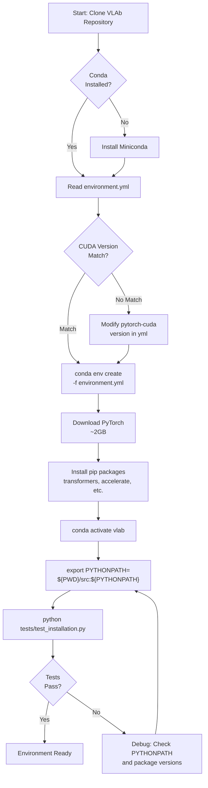
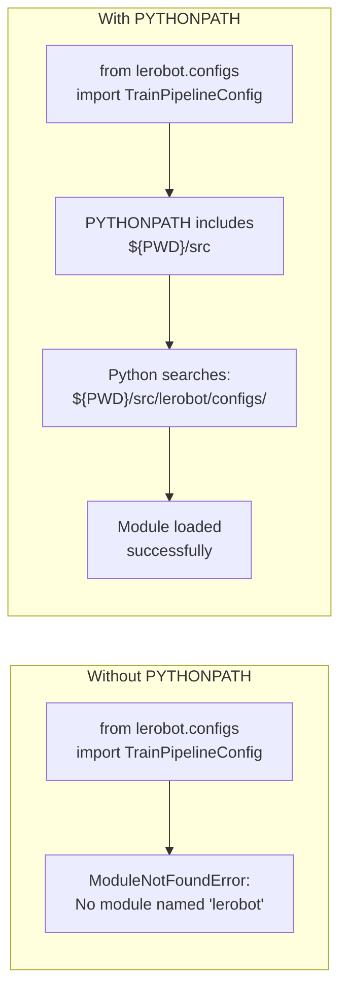
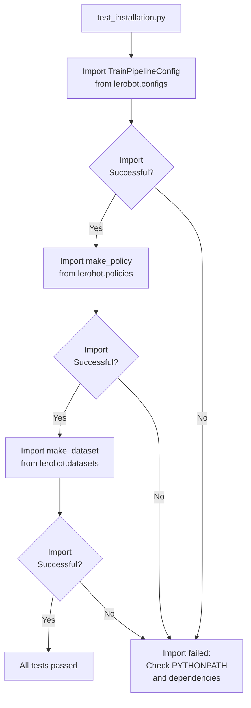
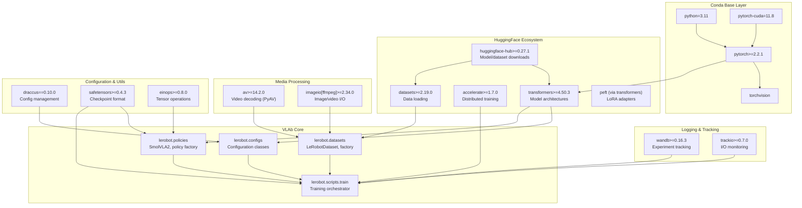

<!-- source: DeepWiki mcp.deepwiki.com · repo huggingface/VLAb · page 2.1 Environment Setup · fetched 2026-10-26 -->

# Environment Setup

<details>
<summary>Relevant source files</summary>

The following files were used as context for generating this wiki page:

- [LICENSE](LICENSE)
- [README.md](README.md)
- [environment.yml](environment.yml)

</details>


This page provides detailed instructions for setting up the VLAb development environment. It covers dependency installation, environment configuration, and verification steps necessary before training VLA models.

For information about running training after setup, see [Quick Start Training](#2.2). For cluster-specific environment configuration, see [SLURM Cluster Training](#8.2).

---

## Overview

VLAb uses a Conda-based environment with Python 3.11, PyTorch 2.2.1+, and the HuggingFace ecosystem. The setup process involves four main steps:

1. Creating the Conda environment from specification
2. Configuring Python module paths
3. Verifying the installation
4. (Optional) Authenticating with HuggingFace Hub

The entire setup process typically takes 5-10 minutes, depending on your internet connection and whether you need to download CUDA dependencies.

**Sources:** [README.md:47-93]()

---

## System Requirements

### Hardware Requirements

| Component | Minimum | Recommended |
|-----------|---------|-------------|
| **RAM** | 16 GB | 32 GB+ |
| **GPU** | NVIDIA GPU with CUDA 11.8 or 12.1 support | NVIDIA A100, H100, or equivalent |
| **Storage** | 50 GB free space | 200+ GB for dataset caching |
| **CPU** | 4 cores | 8+ cores |

### Software Requirements

| Software | Version | Purpose |
|----------|---------|---------|
| **Conda/Miniconda** | Latest | Package and environment management |
| **CUDA** | 11.8 or 12.1 | GPU acceleration |
| **Git** | Any recent version | Repository cloning |
| **HuggingFace CLI** | Included in environment | Dataset/model downloads |

**Note:** The provided `environment.yml` specifies CUDA 11.8 by default. If your system uses CUDA 12.1, modify [environment.yml:10]() before creating the environment.

**Sources:** [environment.yml:1-28](), [README.md:47-93]()

---

## Environment Creation Process



**Sources:** [README.md:47-85](), [environment.yml:1-28]()

---

## Step 1: Create Conda Environment

### Basic Environment Creation

Navigate to the VLAb repository root and create the environment:

```bash
conda env create -f environment.yml
```

This command reads [environment.yml:1-28]() and installs all specified dependencies. The process includes:

1. Creating a new environment named `vlab` with Python 3.11
2. Installing PyTorch, torchvision, and CUDA toolkit from conda channels
3. Installing Python packages via pip (transformers, accelerate, datasets, etc.)

### CUDA Version Compatibility

The default configuration uses CUDA 11.8. If your system has CUDA 12.1:

```bash
# Open environment.yml in an editor
# Change line 10 from:
#   - pytorch-cuda=11.8
# To:
#   - pytorch-cuda=12.1

conda env create -f environment.yml
```

### Verify Environment Creation

```bash
conda activate vlab
python --version  # Should output: Python 3.11.x
```

**Sources:** [README.md:49-54](), [environment.yml:1-28]()

---

## Step 2: Configure PYTHONPATH

### Why PYTHONPATH Configuration is Required

VLAb uses a `src`-layout directory structure where the main package code resides in `src/lerobot/`. Python's import system needs to know where to find these modules. The PYTHONPATH environment variable tells Python to look in the `src/` directory when resolving imports.



### Temporary Configuration (Current Session Only)

```bash
export PYTHONPATH="${PWD}/src:${PYTHONPATH}"
```

This sets PYTHONPATH for the current terminal session. You must run this command in the VLAb repository root directory, as `${PWD}` expands to the current working directory.

### Persistent Configuration (Recommended)

Add the export command to your shell configuration file:

**For Bash:**
```bash
# Add to ~/.bashrc
echo 'export PYTHONPATH="/path/to/VLAb/src:${PYTHONPATH}"' >> ~/.bashrc
source ~/.bashrc
```

**For Zsh:**
```bash
# Add to ~/.zshrc
echo 'export PYTHONPATH="/path/to/VLAb/src:${PYTHONPATH}"' >> ~/.zshrc
source ~/.zshrc
```

Replace `/path/to/VLAb` with the absolute path to your VLAb repository.

### Verification

```bash
python -c "from lerobot.configs import TrainPipelineConfig; print('Import successful')"
```

If this command prints "Import successful", PYTHONPATH is configured correctly.

**Sources:** [README.md:56-67]()

---

## Step 3: Verify Installation

VLAb provides a test script that verifies all critical components are installed and importable.

### Running the Verification Script

```bash
python tests/test_installation.py
```

### Expected Output

```
============================================================
VLAb Installation Test
============================================================
✓ TrainPipelineConfig
✓ Policy factory
✓ Dataset factory
============================================================
✅ All tests passed!
```

### What the Test Verifies



The test script verifies:
1. **Configuration System**: `TrainPipelineConfig` can be imported from `lerobot.configs`
2. **Policy Factory**: `make_policy` function is accessible from `lerobot.policies`
3. **Dataset Factory**: `make_dataset` function is accessible from `lerobot.datasets`

These are the core components required for training VLA models.

**Sources:** [README.md:69-85]()

---

## Step 4: HuggingFace Hub Configuration (Optional)

### When Authentication is Required

HuggingFace Hub authentication is necessary if you plan to:

- Download datasets from HuggingFace Hub (e.g., `community_dataset_v1`, `community_dataset_v2`)
- Download pretrained models (e.g., `SmolVLM2-500M-Video-Instruct`)
- Upload trained checkpoints to the Hub
- Access private repositories

### Authentication Process

```bash
huggingface-cli login
```

This command prompts for a HuggingFace access token. You can create a token at: https://huggingface.co/settings/tokens

### Token Permissions

| Operation | Required Permission |
|-----------|-------------------|
| Download public datasets/models | Read token |
| Download private datasets/models | Read token with repo access |
| Upload checkpoints | Write token |

### Verifying Authentication

```bash
huggingface-cli whoami
```

This displays your authenticated username and token permissions.

### Alternative: Environment Variable

Instead of interactive login, you can set the token as an environment variable:

```bash
export HUGGING_FACE_HUB_TOKEN="hf_xxxxxxxxxxxxx"
```

This is useful for automated scripts and cluster environments. See [SLURM Cluster Training](#8.2) for cluster-specific authentication patterns.

**Sources:** [README.md:87-93]()

---

## Dependency Architecture



### Core Dependencies by Category

| Category | Package | Version | Purpose |
|----------|---------|---------|---------|
| **Deep Learning** | pytorch | ≥2.2.1 | Neural network framework |
| | torchvision | latest | Vision utilities |
| | pytorch-cuda | 11.8 | GPU acceleration |
| **HuggingFace** | transformers | ≥4.50.3 | Model architectures (SmolVLM) |
| | accelerate | ≥1.7.0 | Distributed training |
| | datasets | ≥2.19.0 | Dataset loading (Parquet-backed) |
| | huggingface-hub | ≥0.27.1 | Hub integration with hf-transfer |
| **Video Processing** | av | ≥14.2.0 | Video decoding (PyAV backend) |
| | imageio[ffmpeg] | ≥2.34.0 | Video encoding/frame extraction |
| **Configuration** | draccus | 0.10.0 | Dataclass-based config system |
| | safetensors | ≥0.4.3 | Efficient checkpoint format |
| **Logging** | wandb | ≥0.16.3 | Experiment tracking |
| | trackio | ≥0.7.0 | I/O performance monitoring |
| **Utilities** | einops | ≥0.8.0 | Tensor reshaping operations |
| | termcolor | ≥2.4.0 | Colored terminal output |
| | jsonlines | ≥4.0.0 | JSONL file handling |

**Sources:** [environment.yml:1-28]()

---

## Troubleshooting

### Common Issues and Solutions

#### Issue: ModuleNotFoundError for lerobot

**Symptom:**
```
ModuleNotFoundError: No module named 'lerobot'
```

**Solution:**
1. Verify you're in the VLAb repository root directory
2. Set PYTHONPATH: `export PYTHONPATH="${PWD}/src:${PYTHONPATH}"`
3. Re-run the import or script

#### Issue: CUDA Version Mismatch

**Symptom:**
```
RuntimeError: CUDA error: no kernel image is available for execution on the device
```

**Solution:**
Edit [environment.yml:10]() to match your CUDA version:
```yaml
# For CUDA 12.1
- pytorch-cuda=12.1

# For CUDA 11.8 (default)
- pytorch-cuda=11.8
```

Then recreate the environment:
```bash
conda env remove -n vlab
conda env create -f environment.yml
```

#### Issue: Conda Environment Creation Fails

**Symptom:**
```
CondaError: Unable to create environment
```

**Solutions:**
1. Update conda: `conda update -n base conda`
2. Clear conda cache: `conda clean --all`
3. Try creating with verbose output: `conda env create -f environment.yml -v`

#### Issue: pip Package Installation Fails

**Symptom:**
```
ERROR: Could not build wheels for package-name
```

**Solution:**
1. Activate environment: `conda activate vlab`
2. Manually install problematic package: `pip install package-name --no-cache-dir`
3. Common culprits: `av`, `imageio[ffmpeg]`

For `av` specifically on Linux:
```bash
# Install system dependencies first
sudo apt-get install libavformat-dev libavcodec-dev libavdevice-dev
pip install av
```

#### Issue: HuggingFace Hub Connection Timeout

**Symptom:**
```
requests.exceptions.ConnectionError: HTTPSConnectionPool
```

**Solutions:**
1. Check network connectivity
2. Enable HF transfer acceleration:
   ```bash
   pip install "huggingface-hub[hf-transfer]"
   export HF_HUB_ENABLE_HF_TRANSFER=1
   ```
3. Use a proxy if behind firewall:
   ```bash
   export HTTP_PROXY="http://proxy:port"
   export HTTPS_PROXY="http://proxy:port"
   ```

**Sources:** [README.md:228-246](), [environment.yml:1-28]()

---

## Environment Directory Structure

After successful setup, your environment should have this structure:

```
~/miniconda3/envs/vlab/               # Conda environment root
├── bin/
│   ├── python                        # Python 3.11 interpreter
│   ├── accelerate                    # Accelerate CLI
│   ├── huggingface-cli              # HF Hub CLI
│   └── wandb                         # WandB CLI
├── lib/
│   └── python3.11/
│       └── site-packages/
│           ├── torch/                # PyTorch
│           ├── transformers/         # HuggingFace Transformers
│           ├── accelerate/           # Accelerate
│           ├── datasets/             # HF Datasets
│           ├── av/                   # PyAV
│           └── ...
└── ...
```

Your VLAb repository structure:

```
VLAb/                                 # Repository root
├── src/
│   └── lerobot/                      # Main package (in PYTHONPATH)
│       ├── configs/                  # Configuration classes
│       ├── datasets/                 # Dataset implementations
│       ├── policies/                 # Policy implementations
│       ├── scripts/
│       │   └── train.py             # Training script
│       └── utils/                    # Utilities
├── tests/
│   └── test_installation.py         # Installation verification
├── environment.yml                   # Conda specification
└── accelerate_configs/              # Distributed training configs
```

**Sources:** [README.md:289-309]()

---

## Verification Checklist

Before proceeding to training, ensure all of the following work:

| Check | Command | Expected Result |
|-------|---------|-----------------|
| **Python version** | `python --version` | `Python 3.11.x` |
| **Conda environment** | `conda env list` | `vlab` appears in list |
| **PyTorch installation** | `python -c "import torch; print(torch.__version__)"` | Version ≥2.2.1 |
| **CUDA availability** | `python -c "import torch; print(torch.cuda.is_available())"` | `True` |
| **Transformers** | `python -c "import transformers; print(transformers.__version__)"` | Version ≥4.50.3 |
| **Accelerate** | `python -c "import accelerate; print(accelerate.__version__)"` | Version ≥1.7.0 |
| **PYTHONPATH** | `echo $PYTHONPATH` | Contains `/path/to/VLAb/src` |
| **Config import** | `python -c "from lerobot.configs import TrainPipelineConfig"` | No errors |
| **Policy import** | `python -c "from lerobot.policies import make_policy"` | No errors |
| **Dataset import** | `python -c "from lerobot.datasets import make_dataset"` | No errors |
| **Installation test** | `python tests/test_installation.py` | `All tests passed!` |

If all checks pass, your environment is correctly configured. Proceed to [Quick Start Training](#2.2).

**Sources:** [README.md:69-85]()

---

## Next Steps

After successful environment setup:

1. **Quick Start Training** - Run your first training job with minimal configuration. See [Quick Start Training](#2.2).

2. **Configuration Deep Dive** - Learn about VLAb's configuration system and available parameters. See [Configuration System](#6).

3. **Multi-GPU Setup** - Configure distributed training on local multi-GPU machines. See [Local Multi-GPU Training](#8.1).

4. **Cluster Setup** - Set up training on SLURM clusters. See [SLURM Cluster Training](#8.2).

**Sources:** [README.md:1-309]()

---

