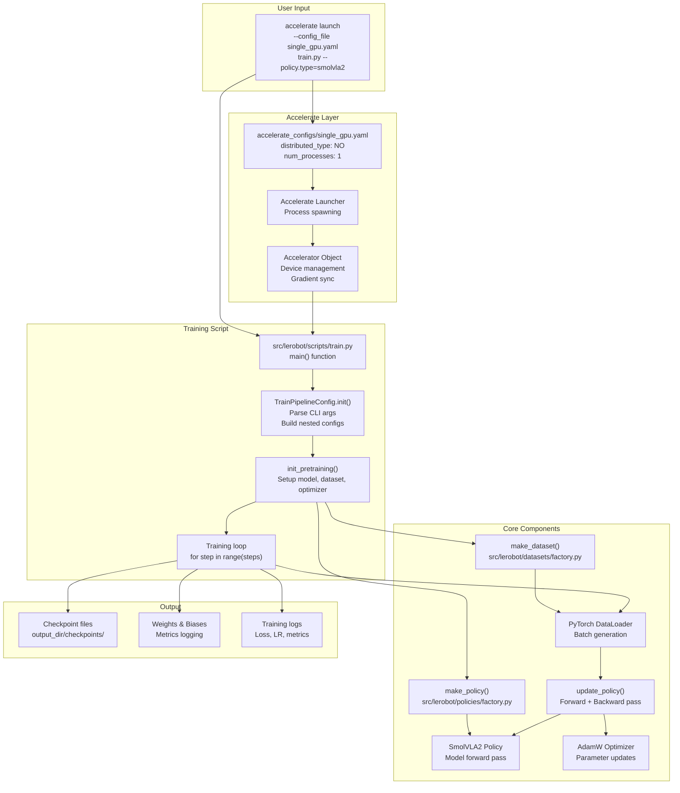
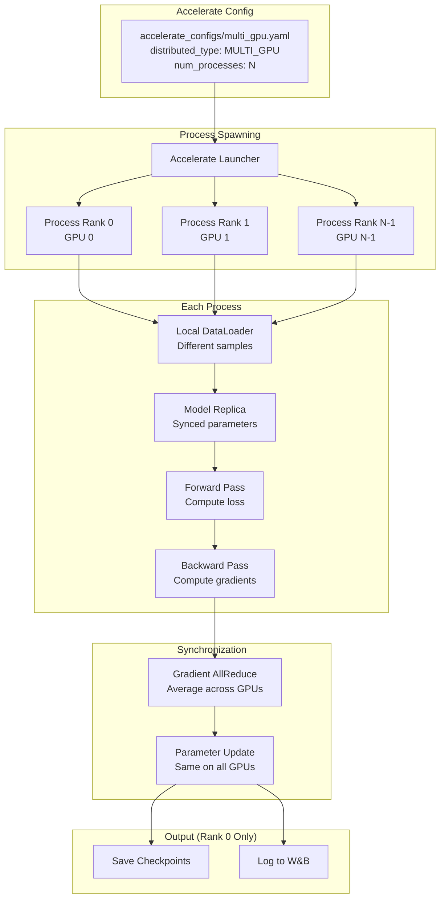
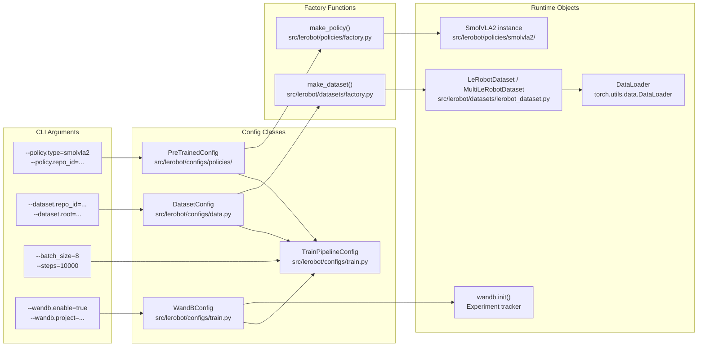
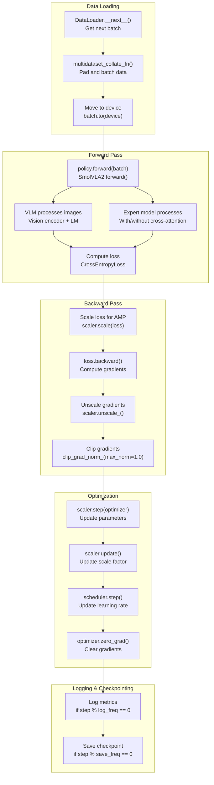

<!-- source: DeepWiki mcp.deepwiki.com · repo huggingface/VLAb · page 2.2 Quick Start Training · fetched 2026-10-26 -->

# Quick Start Training

<details>
<summary>Relevant source files</summary>

The following files were used as context for generating this wiki page:

- [LICENSE](LICENSE)
- [README.md](README.md)
- [examples/README.md](examples/README.md)

</details>


This page guides you through running your first VLAb training examples with minimal configuration. After completing this tutorial, you will understand how to launch training jobs, configure basic parameters, and monitor training progress.

**Prerequisites**: You must have completed the environment setup described in [Environment Setup](#2.1). For detailed configuration options, see [Configuration System](#6). For execution on SLURM clusters, see [SLURM Cluster Training](#8.2).

---

## Overview

VLAb training jobs are launched using the Accelerate library, which handles distributed training across single or multiple GPUs. The basic workflow is:

1. Configure Accelerate for your hardware setup
2. Launch training with `accelerate launch` pointing to the training script
3. Specify model, dataset, and training parameters via command-line arguments
4. Monitor training progress through logs and experiment tracking

---

## Training Command Structure

All VLAb training follows this structure:

```bash
accelerate launch --config_file <accelerate_config> \
    src/lerobot/scripts/train.py \
    --policy.<param>=<value> \
    --dataset.<param>=<value> \
    --<training_param>=<value>
```

**Command Components:**

| Component | Purpose | Example |
|-----------|---------|---------|
| `accelerate launch` | Launches distributed training | Required for all training |
| `--config_file` | Specifies hardware configuration | `accelerate_configs/single_gpu.yaml` |
| `src/lerobot/scripts/train.py` | Main training orchestrator | Fixed path |
| `--policy.*` | Model configuration parameters | `--policy.type=smolvla2` |
| `--dataset.*` | Dataset configuration parameters | `--dataset.repo_id=...` |
| Training parameters | Steps, batch size, output directory | `--batch_size=8 --steps=10000` |

Sources: [README.md:95-111](), [src/lerobot/scripts/train.py]()

---

## Minimal Training Example

### Single GPU Training

This example trains SmolVLA2 on two small datasets from HuggingFace Hub:

```bash
accelerate launch --config_file accelerate_configs/single_gpu.yaml \
    src/lerobot/scripts/train.py \
    --policy.type=smolvla2 \
    --policy.repo_id=HuggingFaceTB/SmolVLM2-500M-Video-Instruct \
    --dataset.repo_id="Beegbrain/pick_lemon_and_drop_in_bowl,Chojins/chess_game_000_white_red" \
    --dataset.video_backend=pyav \
    --output_dir="./outputs/training" \
    --batch_size=8 \
    --steps=10000 \
    --wandb.enable=true \
    --wandb.project="smolvla2-quickstart"
```

**What This Does:**

1. Downloads the SmolVLM2-500M base model from HuggingFace Hub
2. Downloads the two specified datasets (automatically cached)
3. Trains for 10,000 steps with batch size 8
4. Saves checkpoints to `./outputs/training/`
5. Logs metrics to Weights & Biases project "smolvla2-quickstart"

**Expected Output Structure:**

```
./outputs/training/
├── checkpoints/
│   ├── 000500/              # Checkpoint at step 500
│   ├── 001000/              # Checkpoint at step 1000
│   └── last -> 010000/      # Symlink to latest checkpoint
├── config.yaml              # Full training configuration
└── logs/
    └── events.out.tfevents  # TensorBoard logs
```

Sources: [README.md:95-120]()

---

## Training Execution Flow

### Command to Execution Diagram



Sources: [README.md:95-120](), [src/lerobot/scripts/train.py]()

---

## Essential Training Parameters

### Model Parameters

| Parameter | Purpose | Default | Example |
|-----------|---------|---------|---------|
| `--policy.type` | Policy architecture | Required | `smolvla2` |
| `--policy.repo_id` | Base VLM model from Hub | Required | `HuggingFaceTB/SmolVLM2-500M-Video-Instruct` |
| `--policy.pretrained_path` | Local model path (optional) | None | `./models/smolvla2/` |
| `--policy.use_amp` | Enable mixed precision | `true` | `true`, `false` |

### Dataset Parameters

| Parameter | Purpose | Default | Example |
|-----------|---------|---------|---------|
| `--dataset.repo_id` | Comma-separated dataset IDs | Required | `dataset1,dataset2` |
| `--dataset.root` | Local dataset directory | None | `/data/datasets/` |
| `--dataset.video_backend` | Video decoding backend | `pyav` | `pyav`, `opencv` |
| `--dataset.features_version` | Dataset feature version | `2` | `1`, `2` |

### Training Parameters

| Parameter | Purpose | Default | Example |
|-----------|---------|---------|---------|
| `--batch_size` | Batch size per GPU | Required | `8` |
| `--steps` | Total training steps | Required | `100000` |
| `--output_dir` | Checkpoint save location | Required | `./outputs/run1/` |
| `--save_freq` | Checkpoint save frequency | `500` | `1000` |
| `--log_freq` | Logging frequency | `10` | `50` |

### Experiment Tracking Parameters

| Parameter | Purpose | Default | Example |
|-----------|---------|---------|---------|
| `--wandb.enable` | Enable Weights & Biases | `false` | `true` |
| `--wandb.project` | W&B project name | None | `smolvla2-training` |
| `--wandb.entity` | W&B team/user | None | `my-org` |
| `--wandb.run_id` | Resume W&B run | None | `abc123` |

Sources: [README.md:95-120](), [README.md:177-195]()

---

## Multi-GPU Training

### Configuration

For multi-GPU training, use the multi-GPU Accelerate configuration:

```bash
accelerate launch --config_file accelerate_configs/multi_gpu.yaml \
    src/lerobot/scripts/train.py \
    --policy.type=smolvla2 \
    --policy.repo_id=HuggingFaceTB/SmolVLM2-500M-Video-Instruct \
    --dataset.repo_id="dataset1,dataset2,dataset3" \
    --dataset.video_backend=pyav \
    --output_dir="./outputs/multi_gpu_training" \
    --batch_size=8 \
    --steps=200000 \
    --wandb.enable=true \
    --wandb.project="smolvla2-training"
```

**Key Differences:**
- `--config_file accelerate_configs/multi_gpu.yaml` specifies multi-GPU setup
- Batch size is **per GPU** (e.g., batch_size=8 on 4 GPUs = global batch size of 32)
- Gradient synchronization happens automatically via Accelerate
- Only one process saves checkpoints (rank 0)

### Multi-GPU Execution Flow



Sources: [README.md:163-195](), [accelerate_configs/multi_gpu.yaml]()

---

## Training with Local Datasets

If you have pre-downloaded datasets locally, specify the root directory:

```bash
accelerate launch --config_file accelerate_configs/multi_gpu.yaml \
    src/lerobot/scripts/train.py \
    --policy.type=smolvla2 \
    --policy.repo_id=HuggingFaceTB/SmolVLM2-500M-Video-Instruct \
    --dataset.repo_id="community_dataset_v2/airthebear/so100_GL,community_dataset_v2/acrampette/third_arm_01" \
    --dataset.root="/path/to/datasets" \
    --dataset.video_backend=pyav \
    --dataset.features_version=2 \
    --output_dir="./outputs/training" \
    --batch_size=8 \
    --steps=200000 \
    --wandb.enable=true \
    --wandb.project="smolvla2-training"
```

**Dataset Path Resolution:**
- `--dataset.root`: Base directory containing datasets
- `--dataset.repo_id`: Relative path from root
- Example resolution:
  - Root: `/path/to/datasets`
  - Repo ID: `community_dataset_v2/user/dataset_name`
  - Final path: `/path/to/datasets/community_dataset_v2/user/dataset_name`

**Expected Dataset Structure:**
```
/path/to/datasets/
└── community_dataset_v2/
    └── airthebear/
        └── so100_GL/
            ├── data/
            │   └── chunk-000/
            │       └── data.parquet
            ├── videos/
            │   └── chunk-000/
            │       ├── observation.images.top_000000.mp4
            │       └── ...
            └── meta/
                └── info.json
```

Sources: [README.md:177-201]()

---

## Configuration to Code Mapping

This diagram shows how command-line arguments map to configuration classes and code entities:



Sources: [src/lerobot/configs/train.py](), [src/lerobot/scripts/train.py](), [src/lerobot/policies/factory.py](), [src/lerobot/datasets/factory.py]()

---

## Monitoring Training Progress

### Console Output

During training, you will see periodic log messages:

```
step: 100, loss: 2.456, lr: 0.0001, grad_norm: 1.234, time: 0.45s
step: 200, loss: 2.234, lr: 0.0001, grad_norm: 1.156, time: 0.43s
step: 300, loss: 2.087, lr: 0.0001, grad_norm: 0.987, time: 0.44s
```

| Metric | Description |
|--------|-------------|
| `step` | Current training step |
| `loss` | Training loss (should decrease) |
| `lr` | Current learning rate (may vary with scheduler) |
| `grad_norm` | Gradient norm (should be stable, <10) |
| `time` | Time per step in seconds |

### Weights & Biases Dashboard

If `--wandb.enable=true`, metrics are logged to W&B:

1. Navigate to `https://wandb.ai/<entity>/<project>`
2. View real-time plots of loss, learning rate, and gradient norm
3. Compare multiple runs
4. View system metrics (GPU utilization, memory usage)

### Checkpoint Files

Checkpoints are saved at intervals specified by `--save_freq`:

```
outputs/training/checkpoints/
├── 000500/
│   ├── model.safetensors          # Model weights
│   ├── optimizer.bin               # Optimizer state
│   ├── scheduler.bin               # LR scheduler state
│   └── random_states.bin           # RNG states
├── 001000/
└── last -> 010000/                 # Symlink to latest
```

Sources: [src/lerobot/scripts/train.py]()

---

## Single Training Step Flow

This diagram details what happens during a single training step:



Sources: [src/lerobot/scripts/train.py]()

---

## Common Issues

### Out of Memory (OOM)

**Symptoms:** `RuntimeError: CUDA out of memory`

**Solutions:**
- Reduce `--batch_size`
- Enable gradient checkpointing (if supported by policy)
- Use smaller model via `--policy.repo_id`
- Reduce sequence length or image resolution

### Slow Training

**Symptoms:** Steps take >1 second each

**Solutions:**
- Increase `num_workers` in DataLoader (default: 4)
- Use `--dataset.video_backend=pyav` instead of `opencv`
- Ensure datasets are on fast storage (SSD, not network drive)
- Enable mixed precision with `--policy.use_amp=true` (default)

### Dataset Download Failures

**Symptoms:** `Connection error` or `Dataset not found`

**Solutions:**
- Verify HuggingFace Hub login: `huggingface-cli login`
- Check dataset ID spelling in `--dataset.repo_id`
- Clear cache: `rm -rf ~/.cache/huggingface/datasets`
- Use local datasets with `--dataset.root`

### Checkpoint Loading Errors

**Symptoms:** `KeyError` or `Missing keys` when loading checkpoint

**Solutions:**
- Ensure checkpoint is from compatible VLAb version
- Verify model architecture matches (e.g., same `--policy.type`)
- Use fresh output directory for new runs
- For resuming, use exact same configuration

Sources: [README.md:228-246]()

---

## Next Steps

After completing this quick start:

1. **Customize training**: See [Configuration System](#6) for all available parameters
2. **Train on community datasets**: See [Community Datasets](#4.5) for dataset information
3. **Scale to cluster**: See [SLURM Cluster Training](#8.2) for multi-node training
4. **Advanced training strategies**: See [Training Strategies](#5.2) for expert-only, LoRA, etc.
5. **Fine-tuning and inference**: See [Migration to LeRobot](#9.3) for using trained models

Sources: [README.md](), [examples/README.md]()

---

