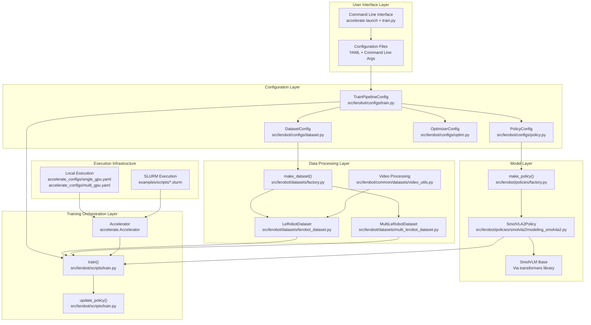
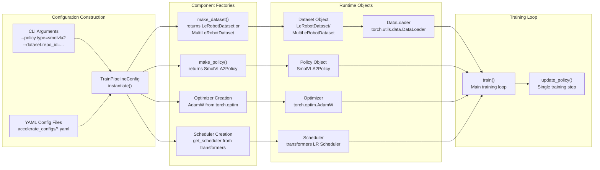
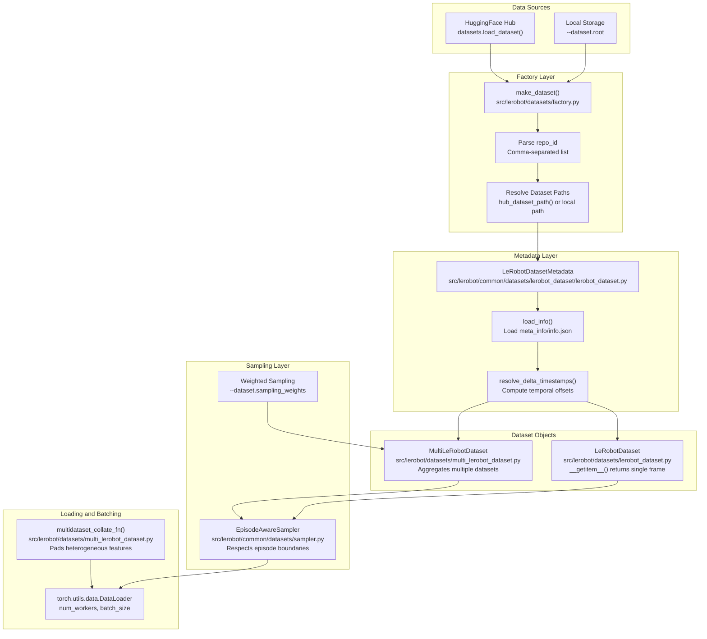
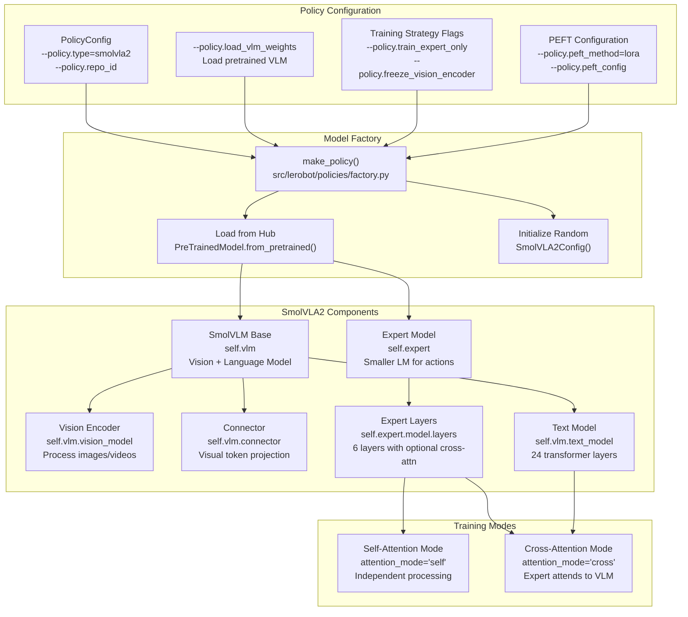
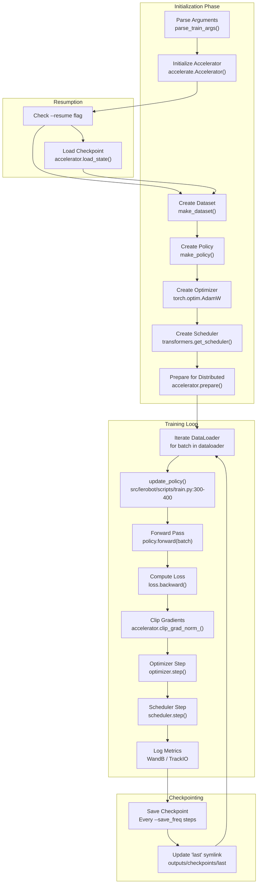
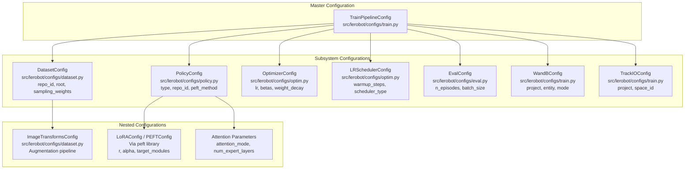
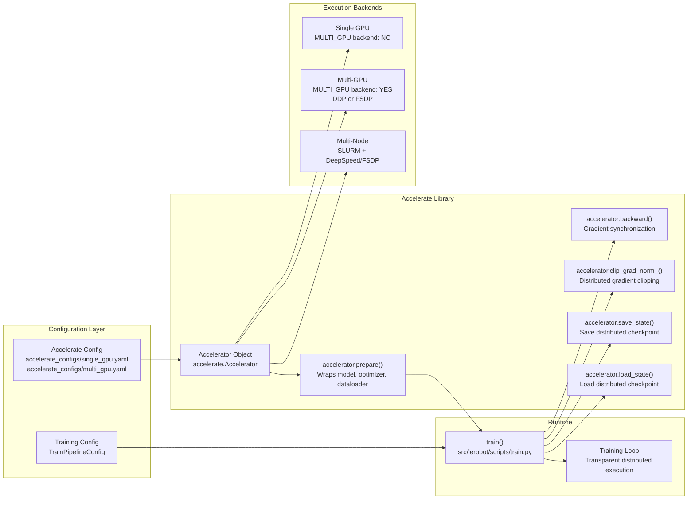

<!-- source: DeepWiki mcp.deepwiki.com · repo huggingface/VLAb · page 3 System Architecture · fetched 2026-10-26 -->

# System Architecture

<details>
<summary>Relevant source files</summary>

The following files were used as context for generating this wiki page:

- [LICENSE](LICENSE)
- [README.md](README.md)
- [VLAb.png](VLAb.png)

</details>


## Purpose and Scope

This document describes the high-level architecture of VLAb, explaining how major components are organized and interact to enable Vision-Language-Action (VLA) model pretraining. The architecture is designed around four core pillars: configuration management, data processing, model training, and distributed execution.

For detailed information about specific subsystems, see:
- Dataset handling and multi-dataset aggregation: [Dataset System](#4)
- Model architecture and training strategies: [Policy and Model System](#5)
- Configuration parameters and options: [Configuration System](#6)
- Training script and execution flow: [Training Execution](#7)
- HuggingFace Hub and experiment tracking: [External Integrations](#9)

---

## Architectural Overview

VLAb follows a layered architecture with clear separation of concerns. The system is built on top of the HuggingFace ecosystem, leveraging `datasets`, `transformers`, `accelerate`, and `peft` libraries for core functionality.

### Core System Layers



**Sources:** [README.md:289-309](), [README.md:1-43]()

---

## Component Relationships

### Configuration to Execution Flow

The system uses a declarative configuration approach where `TrainPipelineConfig` acts as the master orchestrator, aggregating all subsystem configurations.



**Sources:** [README.md:96-120](), [README.md:163-195]()

---

## Data Pipeline Architecture

The data pipeline transforms raw datasets from HuggingFace Hub or local storage into batched tensors ready for model consumption.

### Dataset Factory and Loading Chain



**Sources:** [README.md:147-161](), [README.md:176-195]()

The `make_dataset` factory function determines whether to instantiate a single `LeRobotDataset` or a `MultiLeRobotDataset` based on the number of datasets specified in `--dataset.repo_id`. The `MultiLeRobotDataset` handles feature alignment across heterogeneous datasets through automatic padding.

---

## Model Architecture Components

### Policy Factory and Model Instantiation



**Sources:** [README.md:96-120]()

The `SmolVLA2Policy` class in [src/lerobot/policies/smolvla2/modeling_smolvla2.py]() combines a full SmolVLM model with a smaller expert model. The expert model has reduced hidden dimensions (controlled by `--policy.expert_width_multiplier`) and fewer layers (controlled by `--policy.num_expert_layers`).

---

## Training Execution Flow

### Main Training Loop



**Sources:** [README.md:96-120]()

The `train()` function in [src/lerobot/scripts/train.py]() orchestrates the entire training process. It uses the Accelerate library's `Accelerator` class to handle distributed training transparently across single GPU, multi-GPU, and multi-node configurations.

### Update Policy Function

The `update_policy()` function handles a single training step:

| Step | Function | Description |
|------|----------|-------------|
| 1 | Forward Pass | Execute `policy.forward(batch)` to compute predictions and loss |
| 2 | Backward Pass | Call `loss.backward()` or `accelerator.backward(loss)` for gradient computation |
| 3 | Gradient Clipping | Apply `accelerator.clip_grad_norm_(policy.parameters(), max_norm=1.0)` |
| 4 | Optimizer Step | Execute `optimizer.step()` to update parameters |
| 5 | Zero Gradients | Call `optimizer.zero_grad()` to reset gradients |
| 6 | Scheduler Step | Execute `scheduler.step()` to update learning rate |

**Sources:** [README.md:96-120]()

---

## Configuration System Hierarchy

VLAb uses a hierarchical configuration system with `TrainPipelineConfig` as the root configuration class.



**Sources:** [README.md:96-120](), [README.md:176-195]()

Configuration values can be specified through:
1. Command-line arguments: `--policy.type=smolvla2`
2. Configuration files: YAML files loaded via `--config_path`
3. Default values: Defined in configuration classes

Command-line arguments take precedence over file-based configuration, which takes precedence over defaults.

---

## Distributed Training Infrastructure

### Accelerate Integration



**Sources:** [README.md:163-174](), [README.md:202-218]()

The Accelerate library provides a unified interface for distributed training. The configuration file (e.g., `accelerate_configs/multi_gpu.yaml`) specifies:
- `compute_environment`: LOCAL_MACHINE or CLUSTER
- `mixed_precision`: "no", "fp16", or "bf16"
- `num_processes`: Number of GPUs/processes
- `multi_gpu_backend`: DDP, FSDP, or DeepSpeed

---

## External System Integration

### HuggingFace Ecosystem Integration

```mermaid
graph TB
    subgraph "VLAb Core"
        TrainScript["train.py<br/>Training orchestrator"]
        DatasetFactory["make_dataset()<br/>Dataset factory"]
        PolicyFactory["make_policy()<br/>Policy factory"]
    end
    
    subgraph "HuggingFace Hub"
        HubDatasets["HuggingFace Hub Datasets<br/>datasets.load_dataset()"]
        HubModels["HuggingFace Hub Models<br/>PreTrainedModel.from_pretrained()"]
        PushToHub["Push to Hub<br/>policy.push_to_hub()"]
    end
    
    subgraph "HuggingFace Libraries"
        DatasetsLib["datasets library<br/>Parquet-backed loading"]
        TransformersLib["transformers library<br/>SmolVLM, PreTrainedModel"]
        AccelerateLib["accelerate library<br/>Distributed training"]
        PEFTLib["peft library<br/>LoRA, PrefixTuning"]
    end
    
    subgraph "Experiment Tracking"
        WandB["Weights & Biases<br/>wandb.init(), wandb.log()"]
        TrackIO["TrackIO<br/>trackio.init(), trackio.log()"]
    end
    
    subgraph "Community Datasets"
        CDv1["community_dataset_v1<br/>128 datasets, 119 GB"]
        CDv2["community_dataset_v2<br/>340 datasets, 59 GB"]
    end
    
    DatasetFactory --> DatasetsLib
    DatasetFactory --> HubDatasets
    CDv1 --> HubDatasets
    CDv2 --> HubDatasets
    
    PolicyFactory --> TransformersLib
    PolicyFactory --> HubModels
    PolicyFactory --> PEFTLib
    
    TrainScript --> AccelerateLib
    TrainScript --> WandB
    TrainScript --> TrackIO
    TrainScript --> PushToHub
```



**Sources:** [README.md:1-43](), [README.md:122-145](), [README.md:249-255]()

VLAb is deeply integrated with the HuggingFace ecosystem:

| Integration | Purpose | Key Functions |
|-------------|---------|---------------|
| **datasets** | Load and process robotics datasets | `datasets.load_dataset()`, Parquet backend |
| **transformers** | Load pretrained VLMs, model architectures | `PreTrainedModel.from_pretrained()`, `AutoModel` |
| **accelerate** | Distributed training abstraction | `Accelerator()`, `prepare()`, `backward()` |
| **peft** | Parameter-efficient fine-tuning | `LoraConfig`, `get_peft_model()` |

---

## Checkpoint and State Management

### Checkpoint Structure

Checkpoints are saved to `--output_dir/checkpoints/` with the following structure:

```
outputs/training/checkpoints/
├── 010000/                    # Checkpoint at step 10,000
│   ├── optimizer.bin          # Optimizer state
│   ├── scheduler.bin          # LR scheduler state
│   ├── random_states.pkl      # Random number generator states
│   ├── pytorch_model.bin      # Model weights
│   └── config.json            # Model configuration
├── 020000/                    # Checkpoint at step 20,000
├── last -> 020000             # Symlink to latest checkpoint
└── config.pkl                 # Training configuration
```

**Sources:** [README.md:220-227]()

The `accelerator.save_state()` function in [src/lerobot/scripts/train.py]() handles checkpoint saving, ensuring all distributed state is properly synchronized and saved. The `--resume` flag enables training resumption from the latest checkpoint.

---

## Summary

VLAb's architecture is organized into distinct layers:

1. **Configuration Layer**: Declarative system using `TrainPipelineConfig` and nested configs
2. **Data Processing Layer**: Factory-based dataset instantiation with `make_dataset()` and multi-dataset support
3. **Model Layer**: Factory-based policy instantiation with `make_policy()` and SmolVLA2 architecture
4. **Training Orchestration**: `train()` function and `update_policy()` step function with Accelerate integration
5. **Execution Infrastructure**: Support for local GPU and SLURM cluster execution

The system emphasizes modularity, allowing each component to be independently configured and tested while maintaining clean interfaces between layers. All components integrate with the HuggingFace ecosystem for model/dataset access and experiment tracking.

**Sources:** [README.md:1-309](), [README.md:289-309]()

---

