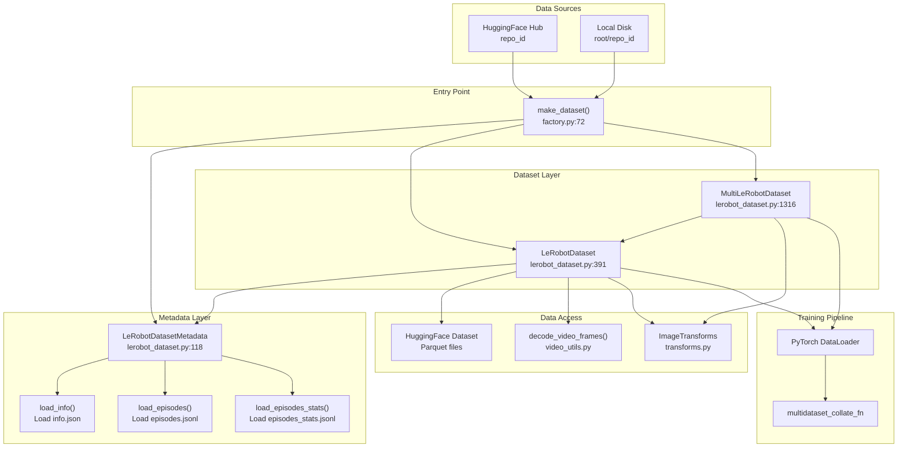
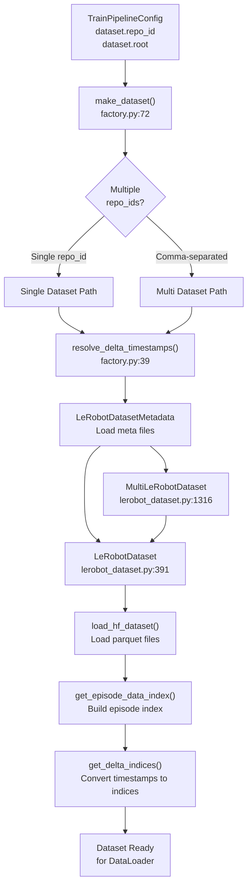
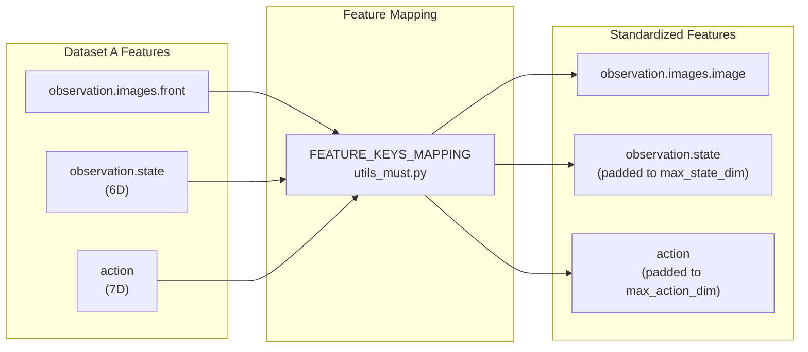
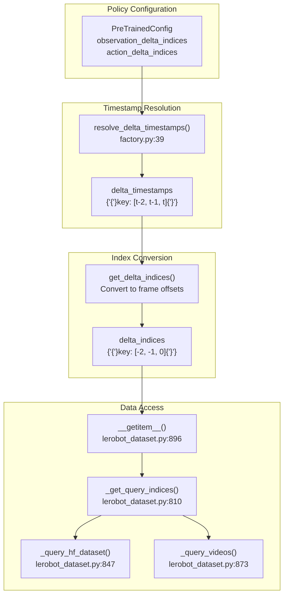
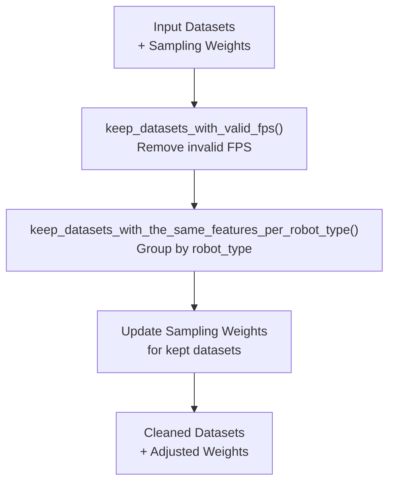

<!-- source: DeepWiki mcp.deepwiki.com · repo huggingface/VLAb · page 4 Dataset System · fetched 2026-10-26 -->

# Dataset System

<details>
<summary>Relevant source files</summary>

The following files were used as context for generating this wiki page:

- [LICENSE](LICENSE)
- [README.md](README.md)
- [src/lerobot/datasets/factory.py](src/lerobot/datasets/factory.py)
- [src/lerobot/datasets/lerobot_dataset.py](src/lerobot/datasets/lerobot_dataset.py)

</details>


## Purpose and Scope

The Dataset System is the core data loading and processing infrastructure in VLAb, responsible for loading robotics datasets, managing multi-modal data (images, videos, states, actions), and preparing batches for training. This system handles datasets stored both on HuggingFace Hub and locally on disk, with support for temporal context queries, multi-dataset aggregation, and heterogeneous feature alignment.

For detailed documentation on specific components:
- Single dataset handling: see [LeRobotDataset](#4.1)
- Multi-dataset aggregation: see [MultiLeRobotDataset](#4.2)
- Dataset instantiation logic: see [Dataset Factory](#4.3)
- Video encoding/decoding: see [Video Processing](#4.4)
- Community dataset collections: see [Community Datasets](#4.5)

## System Architecture

The dataset system is built around three primary abstractions: `LeRobotDatasetMetadata` for metadata management, `LeRobotDataset` for single-dataset access, and `MultiLeRobotDataset` for aggregating multiple datasets with heterogeneous features.



**Sources:** [src/lerobot/datasets/factory.py:1-192](), [src/lerobot/datasets/lerobot_dataset.py:118-389](), [src/lerobot/datasets/lerobot_dataset.py:391-1214](), [src/lerobot/datasets/lerobot_dataset.py:1316-1550]()

## Core Components

### LeRobotDatasetMetadata

The `LeRobotDatasetMetadata` class ([lerobot_dataset.py:118-389]()) manages dataset metadata without loading the actual data. It loads and caches information from the `meta/` directory including:

- `info.json`: Dataset properties (fps, features, shapes, dtypes, robot_type, paths)
- `episodes.jsonl`: Episode-level information (indices, lengths, tasks)
- `episodes_stats.jsonl`: Per-episode statistics for normalization
- `tasks.jsonl`: Task descriptions

Key properties exposed:
- `fps`: Frames per second
- `features`: Dictionary of feature specifications
- `camera_keys`, `video_keys`, `image_keys`: Visual modality accessors
- `shapes`, `names`: Feature dimensionality information
- `episodes_stats`, `stats`: Statistics for normalization

**Sources:** [src/lerobot/datasets/lerobot_dataset.py:118-389]()

### LeRobotDataset

The `LeRobotDataset` class ([lerobot_dataset.py:391-1214]()) provides access to a single robotics dataset, supporting both images and videos, with optional temporal context via `delta_timestamps`. It wraps a HuggingFace `Dataset` object (backed by Parquet files) and handles video decoding on-the-fly.

Key initialization parameters:
- `repo_id`: Dataset identifier (HF Hub or local path)
- `root`: Local directory for dataset storage
- `episodes`: Optional list to load only specific episodes
- `delta_timestamps`: Dict mapping features to temporal offsets
- `video_backend`: Video decoder ("pyav" or "torchcodec")
- `image_transforms`: Preprocessing transforms

**Sources:** [src/lerobot/datasets/lerobot_dataset.py:391-1214]()

### MultiLeRobotDataset

The `MultiLeRobotDataset` class ([lerobot_dataset.py:1316-1550]()) aggregates multiple `LeRobotDataset` instances for joint training. It handles:

- Feature alignment across datasets with different schemas
- Padding features to maximum dimensions
- Per-dataset sampling weights
- Statistics aggregation per robot type
- Dataset filtering by FPS and feature consistency

**Sources:** [src/lerobot/datasets/lerobot_dataset.py:1316-1550]()

### Dataset Factory

The `make_dataset()` function ([factory.py:72-191]()) is the entry point for dataset instantiation. It:

1. Parses comma-separated `repo_id` to determine single vs multi-dataset mode
2. Resolves `delta_timestamps` from policy configuration
3. Handles `root` path construction for local datasets
4. Creates either `LeRobotDataset` or `MultiLeRobotDataset`
5. Optionally applies ImageNet statistics for normalization

**Sources:** [src/lerobot/datasets/factory.py:72-191]()

## Dataset Storage Structure

VLAb datasets follow a standardized directory structure:

```
dataset_root/
├── meta/
│   ├── info.json              # Dataset metadata
│   ├── episodes.jsonl          # Episode index
│   ├── episodes_stats.jsonl    # Per-episode statistics
│   └── tasks.jsonl             # Task descriptions
├── data/
│   ├── chunk-000/
│   │   ├── episode_000000.parquet
│   │   ├── episode_000001.parquet
│   │   └── ...
│   ├── chunk-001/
│   └── ...
└── videos/                     # Optional, if using video storage
    ├── chunk-000/
    │   ├── observation.images.camera1/
    │   │   ├── episode_000000.mp4
    │   │   └── ...
    │   └── observation.images.camera2/
    └── ...
```

**Key points:**
- Episodes are grouped into chunks (default 1000 episodes per chunk)
- Each episode is stored as a separate Parquet file
- Videos are organized by camera key and episode
- Metadata files use JSONL format for incremental updates

**Sources:** [README.md:449-488](), [src/lerobot/datasets/lerobot_dataset.py:449-488]()

## Data Loading Flow



**Sources:** [src/lerobot/datasets/factory.py:39-191](), [src/lerobot/datasets/lerobot_dataset.py:391-636]()

## Feature Alignment and Padding

When training on multiple datasets with heterogeneous features, VLAb performs automatic feature alignment:

### Feature Key Mapping

The system uses `feature_keys_mapping` dictionaries to standardize feature names across datasets. For example, a dataset with `observation.images.side` can be mapped to `observation.images.image2`.



**Sources:** [src/lerobot/datasets/lerobot_dataset.py:94-97](), [src/lerobot/datasets/lerobot_dataset.py:638-653]()

### Dimension Padding

For vector features (states, actions), VLAb pads to maximum dimensions specified in configuration:

| Feature Type | Configuration Parameter | Purpose |
|-------------|------------------------|---------|
| `action` | `max_action_dim` | Pad action vectors to uniform size |
| `observation.state` | `max_state_dim` | Pad state vectors to uniform size |
| `observation.env_state` | `max_state_dim` | Pad environment state vectors |
| `observation.images.*` | `max_image_dim` | Pad image dimensions (width/height) |

The padding occurs in `reshape_features_to_max_dim()` and `create_padded_features()` functions, using zero-padding for vectors and maintaining aspect ratios for images.

**Sources:** [src/lerobot/datasets/lerobot_dataset.py:643-653](), [src/lerobot/datasets/factory.py:121-125]()

## Temporal Context with Delta Timestamps

VLAb supports history-aware policies through `delta_timestamps`, allowing queries for past and future frames:



For example, if `observation_delta_indices = [-2, -1, 0]` and fps=10:
- `delta_timestamps` = {"observation.state": [-0.2, -0.1, 0.0]}
- When accessing frame at t=1.0s, returns observations from t=0.8s, 0.9s, 1.0s

**Sources:** [src/lerobot/datasets/factory.py:39-69](), [src/lerobot/datasets/lerobot_dataset.py:810-829](), [src/lerobot/datasets/lerobot_dataset.py:632-635]()

## Video vs Image Storage

VLAb supports two storage modes for visual data:

### Video Mode (Default)
- Visual observations stored as MP4 files
- Decoded on-the-fly during training using `decode_video_frames()`
- More storage-efficient but requires video decoding overhead
- Configured via `video_backend` ("pyav" or "torchcodec")

### Image Mode
- Visual observations stored as PNG files
- Loaded directly from disk
- Higher storage requirements but no decoding overhead
- Determined by `info["features"][key]["dtype"]` being "image"

The mode is determined during dataset creation and stored in metadata. Both modes support the same API through the dataset `__getitem__` method.

**Sources:** [src/lerobot/datasets/lerobot_dataset.py:873-885](), [src/lerobot/datasets/lerobot_dataset.py:227-239]()

## Episode Management and Sampling

### Episode Data Index

The `get_episode_data_index()` function creates a mapping between episode indices and frame ranges:

```python
episode_data_index = {
    "from": [0, 150, 320, ...],  # Start frame of each episode
    "to": [150, 320, 475, ...]    # End frame of each episode (exclusive)
}
```

This allows efficient episode boundary checking during temporal queries.

**Sources:** [src/lerobot/datasets/lerobot_dataset.py:598]()

### Episode Filtering Options

VLAb provides several mechanisms to filter or subset episodes:

| Parameter | Location | Purpose |
|-----------|----------|---------|
| `episodes` | LeRobotDataset init | Load only specific episode indices |
| `discard_first_n_frames` | LeRobotDataset init | Skip first N seconds of each episode |
| `discard_first_idle_frames` | LeRobotDataset init | Skip static frames at episode start using motion detection |
| `motion_threshold` | LeRobotDataset init | Threshold for motion detection |
| `motion_window_size` | LeRobotDataset init | Window size for motion averaging |
| `motion_buffer` | LeRobotDataset init | Buffer frames before detected motion |

**Sources:** [src/lerobot/datasets/lerobot_dataset.py:601-622]()

### Motion Detection

The `find_start_of_motion()` function ([lerobot_dataset.py:110-116]()) detects when a robot starts moving by:
1. Computing velocity norms from state changes
2. Sliding a window over velocities
3. Finding first window where mean exceeds threshold
4. Including buffer frames before motion start

**Sources:** [src/lerobot/datasets/lerobot_dataset.py:110-116](), [src/lerobot/datasets/lerobot_dataset.py:610-622]()

## Multi-Dataset Sampling

When using `MultiLeRobotDataset`, sampling is controlled by:

### Sampling Weights

Specified via `--dataset.sampling_weights` as comma-separated floats. These weights control the relative sampling probability from each dataset.

**Sources:** [src/lerobot/datasets/factory.py:93](), [src/lerobot/datasets/lerobot_dataset.py:1335-1366]()

### Dataset Filtering

`MultiLeRobotDatasetCleaner` ([lerobot_dataset.py:1279-1314]()) filters datasets by:

1. **FPS Validation**: Removes datasets outside `[min_fps, max_fps]` range
2. **Feature Consistency**: Within each robot type, keeps only datasets with identical feature sets
3. **Weight Adjustment**: Updates sampling weights after filtering



**Sources:** [src/lerobot/datasets/lerobot_dataset.py:1279-1314]()

## Statistics and Normalization

### Statistics Storage

Dataset statistics are stored at two levels:

1. **Per-Episode Statistics** (`episodes_stats.jsonl`): Statistics for each episode
2. **Aggregated Statistics** (`stats` property): Combined statistics across selected episodes

Statistics include `min`, `max`, `mean`, `std` for each feature, used for normalization during training.

**Sources:** [src/lerobot/datasets/lerobot_dataset.py:159-164]()

### Statistics Aggregation

For multi-dataset training, statistics are aggregated per robot type using `aggregate_stats_per_robot_type()`:

- Groups datasets by `robot_type` field
- Computes combined statistics within each group
- Pads statistics to `max_action_dim` and `max_state_dim`
- Enables robot-specific normalization schemes

**Sources:** [src/lerobot/datasets/lerobot_dataset.py:1259-1271]()

### ImageNet Statistics Override

When `--dataset.use_imagenet_stats=true`, the factory applies standard ImageNet normalization to image features:

```python
IMAGENET_STATS = {
    "mean": [0.485, 0.456, 0.406],
    "std": [0.229, 0.224, 0.225]
}
```

**Sources:** [src/lerobot/datasets/factory.py:31-34](), [src/lerobot/datasets/factory.py:178-189]()

## Local vs Remote Dataset Loading

### Remote Loading (HuggingFace Hub)

When `--dataset.root` is not specified:
- Downloads dataset from HuggingFace Hub to `~/.cache/huggingface/lerobot/{repo_id}`
- Uses `snapshot_download()` to fetch files
- Supports incremental downloads (only missing files are fetched)
- Respects `--dataset.revision` for version pinning

### Local Loading

When `--dataset.root=/path/to/datasets` is specified:
- Constructs full path as `root / repo_id`
- Sets `local_files_only=True` to prevent Hub downloads
- Requires complete dataset structure on disk
- Supports relative `repo_id` paths (e.g., `community_dataset_v2/user/dataset`)

**Sources:** [src/lerobot/datasets/factory.py:96-108](), [src/lerobot/datasets/lerobot_dataset.py:131-142](), [README.md:196-201]()

## Integration Points

### DataLoader Integration

Datasets are used with PyTorch `DataLoader`:

```python
from torch.utils.data import DataLoader

dataloader = DataLoader(
    dataset,
    batch_size=cfg.batch_size,
    shuffle=True,
    num_workers=cfg.num_workers,
    collate_fn=multidataset_collate_fn if isinstance(dataset, MultiLeRobotDataset) else None
)
```

The `multidataset_collate_fn` handles padding for batches with mixed datasets.

**Sources:** Based on standard PyTorch DataLoader usage patterns

### Image Transforms

Image transforms are applied in `__getitem__` to all camera keys:

```python
if self.image_transforms is not None:
    for cam in item:
        if cam in self.meta.camera_keys:
            item[cam] = self.image_transforms(item[cam])
```

Transforms are specified via `--dataset.image_transforms.*` configuration parameters.

**Sources:** [src/lerobot/datasets/lerobot_dataset.py:930-933]()

## Key Configuration Parameters

| Parameter | Default | Description |
|-----------|---------|-------------|
| `dataset.repo_id` | Required | Dataset identifier(s), comma-separated for multi-dataset |
| `dataset.root` | None | Local root directory for datasets |
| `dataset.episodes` | None | Specific episodes to load |
| `dataset.video_backend` | "pyav" | Video decoder backend |
| `dataset.features_version` | 2 | Feature schema version |
| `dataset.max_action_dim` | None | Maximum action dimension for padding |
| `dataset.max_state_dim` | None | Maximum state dimension for padding |
| `dataset.max_num_images` | None | Maximum number of camera views |
| `dataset.max_image_dim` | None | Maximum image dimension (width/height) |
| `dataset.sampling_weights` | None | Comma-separated weights for multi-dataset |
| `dataset.use_imagenet_stats` | false | Use ImageNet normalization for images |
| `dataset.discard_first_n_frames` | 0 | Seconds to skip at episode start |
| `dataset.discard_first_idle_frames` | false | Skip static frames at episode start |
| `dataset.min_fps` | 1 | Minimum FPS for dataset inclusion |
| `dataset.max_fps` | 100 | Maximum FPS for dataset inclusion |

**Sources:** [src/lerobot/datasets/factory.py:72-191](), [src/lerobot/datasets/lerobot_dataset.py:392-417]()

---

