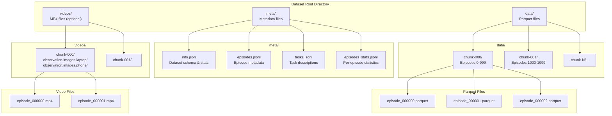
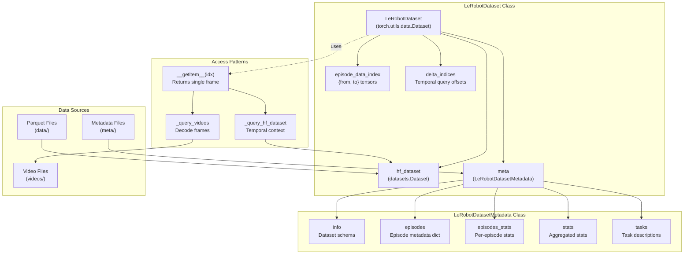
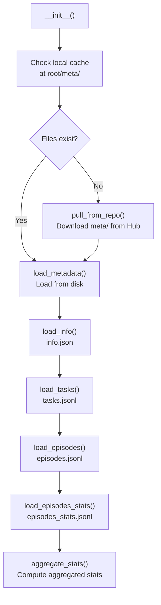
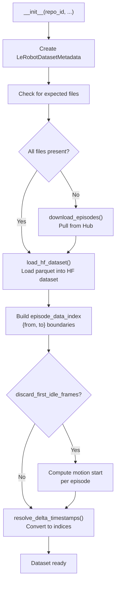
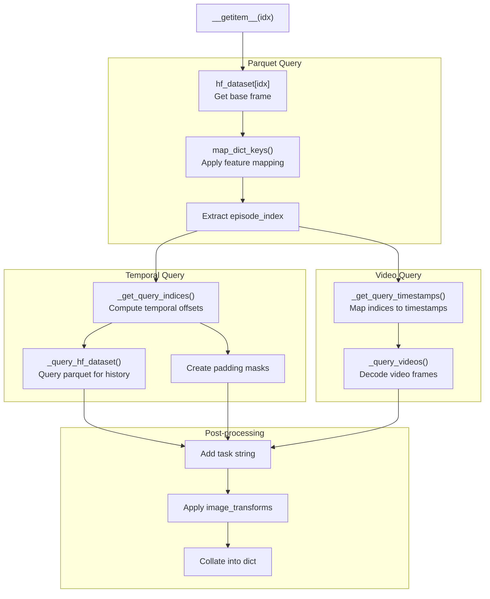
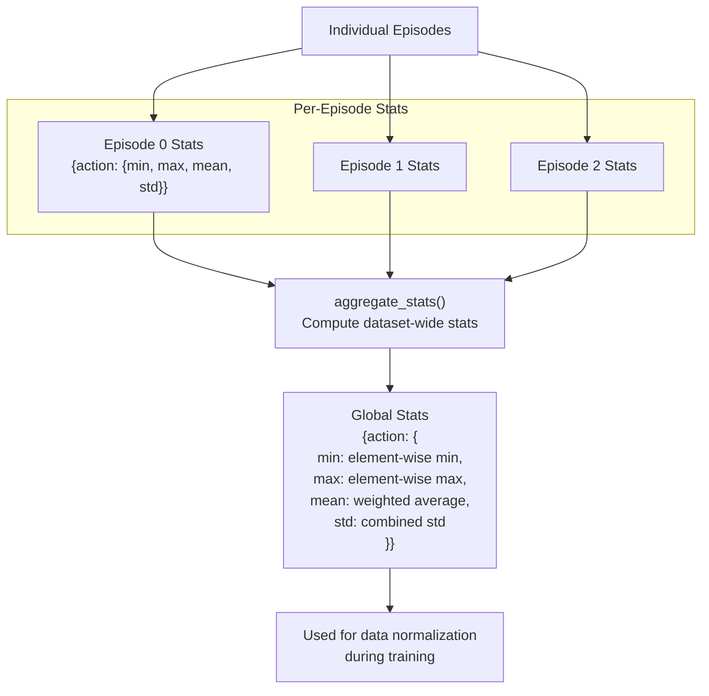
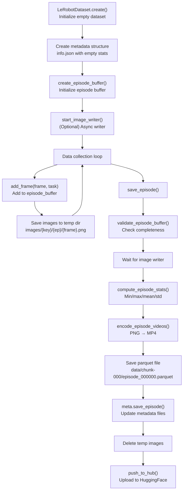
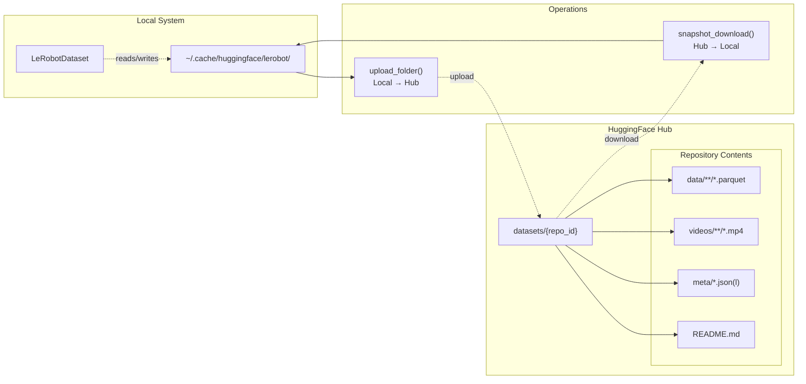

<!-- source: DeepWiki mcp.deepwiki.com · repo huggingface/VLAb · page 4.1 LeRobotDataset · fetched 2026-10-26 -->

# LeRobotDataset

<details>
<summary>Relevant source files</summary>

The following files were used as context for generating this wiki page:

- [LICENSE](LICENSE)
- [README.md](README.md)
- [src/lerobot/datasets/lerobot_dataset.py](src/lerobot/datasets/lerobot_dataset.py)

</details>


## Purpose and Scope

This page documents the `LeRobotDataset` class, which provides the core interface for loading and accessing single robotics datasets in VLAb. The class encapsulates dataset metadata, episode management, and efficient data access patterns for both parquet-based tabular data and video files.

For information about aggregating multiple datasets, see [MultiLeRobotDataset](#4.2). For the factory function that instantiates datasets, see [Dataset Factory](#4.3). For video encoding/decoding utilities, see [Video Processing](#4.4).

## Overview

`LeRobotDataset` wraps a HuggingFace `datasets.Dataset` and extends it with robotics-specific functionality including:
- Episode-based data organization with metadata tracking
- Temporal querying via delta timestamps for history-aware policies
- Efficient video frame decoding synchronized with tabular data
- Support for both local and HuggingFace Hub storage
- Dataset creation and recording workflows

The class is designed to handle datasets that may already exist (locally or on the Hub) or to create new datasets from scratch for data recording.

**Sources:** [src/lerobot/datasets/lerobot_dataset.py:391-1214]()

## File Structure

A `LeRobotDataset` consists of three main components stored on disk:



| Component | Description | Format |
|-----------|-------------|--------|
| **data/** | Tabular data organized by episodes and chunks | Parquet |
| **meta/** | Dataset metadata, episode info, task descriptions | JSON/JSONL |
| **videos/** | Visual observations organized by camera and episode | MP4 |

Episodes are grouped into chunks (default 1000 episodes per chunk) to enable granular downloads and efficient file organization. The `info.json` file contains formattable path strings like `"data/chunk-{episode_chunk:03d}/episode_{episode_index:06d}.parquet"` that determine the exact file locations.

**Sources:** [src/lerobot/datasets/lerobot_dataset.py:449-488](), [README.md:133-145]()

## Architecture Overview

The `LeRobotDataset` system consists of two primary classes that work together:



**Sources:** [src/lerobot/datasets/lerobot_dataset.py:118-389](), [src/lerobot/datasets/lerobot_dataset.py:391-1214]()

## LeRobotDatasetMetadata

The `LeRobotDatasetMetadata` class handles all metadata loading and provides a clean interface to dataset properties.

### Initialization

```python
LeRobotDatasetMetadata(
    repo_id: str,
    root: str | Path | None = None,
    local_files_only: bool = False,
    feature_keys_mapping: dict[str, str] | None = None,
    revision: str | None = None,
    force_cache_sync: bool = False,
)
```

The metadata class automatically downloads metadata files from HuggingFace Hub if not present locally, or loads them from the `meta/` directory if available.

**Sources:** [src/lerobot/datasets/lerobot_dataset.py:118-152]()

### Key Properties

| Property | Type | Description |
|----------|------|-------------|
| `fps` | `int` | Frames per second during data collection |
| `features` | `dict[str, dict]` | Feature schema with dtype, shape, names |
| `shapes` | `dict` | Feature shapes as tuples |
| `image_keys` | `list[str]` | Keys for image modalities |
| `video_keys` | `list[str]` | Keys for video modalities |
| `camera_keys` | `list[str]` | All visual modality keys |
| `total_episodes` | `int` | Total number of episodes |
| `total_frames` | `int` | Total number of frames across all episodes |
| `total_tasks` | `int` | Number of unique tasks |
| `robot_type` | `str` | Robot type identifier |
| `episodes` | `dict` | Episode metadata indexed by episode_index |
| `episodes_stats` | `dict` | Per-episode statistics for normalization |
| `stats` | `dict` | Aggregated statistics across all episodes |

**Sources:** [src/lerobot/datasets/lerobot_dataset.py:180-286]()

### Metadata Loading Flow



**Sources:** [src/lerobot/datasets/lerobot_dataset.py:133-164]()

### Path Resolution

The metadata class provides methods to resolve file paths for episodes:

```python
# Get parquet file path for an episode
data_path = meta.get_data_file_path(ep_index=5)
# Returns: Path("data/chunk-000/episode_000005.parquet")

# Get video file path for an episode and camera
video_path = meta.get_video_file_path(ep_index=5, vid_key="observation.images.laptop")
# Returns: Path("videos/chunk-000/observation.images.laptop/episode_000005.mp4")
```

These methods use formattable path strings from `info.json` and compute the episode chunk index automatically.

**Sources:** [src/lerobot/datasets/lerobot_dataset.py:185-196]()

## LeRobotDataset Initialization

The `LeRobotDataset` class provides flexible initialization for different use cases.

### Constructor Parameters

| Parameter | Type | Default | Description |
|-----------|------|---------|-------------|
| `repo_id` | `str` | Required | Dataset identifier (local path or HF repo) |
| `root` | `str \| Path` | `~/.cache/huggingface/lerobot` | Local storage directory |
| `episodes` | `list[int]` | `None` | Subset of episodes to load (None = all) |
| `image_transforms` | `Callable` | `None` | Torchvision transforms for images |
| `delta_timestamps` | `dict[list[float]]` | `None` | Temporal offsets for history/future |
| `tolerance_s` | `float` | `1e-4` | Timestamp synchronization tolerance |
| `revision` | `str` | `CODEBASE_VERSION` | Git revision for Hub downloads |
| `download_videos` | `bool` | `True` | Whether to download video files |
| `video_backend` | `str` | `None` | Video decoder ("pyav", "torchcodec") |
| `local_files_only` | `bool` | `False` | Disable Hub downloads |
| `force_cache_sync` | `bool` | `False` | Force re-download from Hub |

**Additional parameters for multi-dataset training:**

| Parameter | Type | Default | Description |
|-----------|------|---------|-------------|
| `feature_keys_mapping` | `dict[str, str]` | `None` | Remap feature keys across datasets |
| `max_action_dim` | `int` | `None` | Pad action to this dimension |
| `max_state_dim` | `int` | `None` | Pad state to this dimension |
| `max_image_dim` | `int` | `None` | Pad image features to this dimension |
| `training_features` | `list` | `None` | Subset of features to use |
| `discard_first_n_frames` | `int` | `0` | Skip initial frames per episode |
| `discard_first_idle_frames` | `bool` | `False` | Skip frames before motion detected |
| `motion_threshold` | `float` | `0.05` | Velocity threshold for motion detection |
| `motion_window_size` | `int` | `10` | Window size for motion detection |
| `motion_buffer` | `int` | `3` | Buffer frames before motion start |

**Sources:** [src/lerobot/datasets/lerobot_dataset.py:392-417]()

### Initialization Flow



**Sources:** [src/lerobot/datasets/lerobot_dataset.py:519-636]()

### Episode Data Index

After loading, the dataset builds an `episode_data_index` that maps episode indices to frame ranges:

```python
episode_data_index = {
    "from": torch.tensor([0, 120, 245, ...]),  # Start frame for each episode
    "to": torch.tensor([120, 245, 380, ...]),   # End frame (exclusive) for each episode
}
```

This index is critical for temporal queries to ensure frames don't cross episode boundaries.

**Sources:** [src/lerobot/datasets/lerobot_dataset.py:598](), [src/lerobot/datasets/utils.py:59]()

## Data Access and Querying

### Basic Frame Access

The `__getitem__` method returns a single frame as a dictionary:

```python
frame = dataset[100]
# Returns:
# {
#     "observation.state": torch.Tensor([...]),          # Robot state
#     "observation.images.laptop": torch.Tensor([...]),  # Image from camera
#     "action": torch.Tensor([...]),                      # Action taken
#     "episode_index": torch.Tensor(3),                  # Episode ID
#     "frame_index": torch.Tensor(100),                  # Frame within dataset
#     "timestamp": torch.Tensor(3.33),                   # Time in seconds
#     "task_index": torch.Tensor(0),                     # Task ID
#     "task": "pick up the cube",                        # Task description
# }
```

**Sources:** [src/lerobot/datasets/lerobot_dataset.py:896-936]()

### Temporal Context Queries

When `delta_timestamps` is provided, `__getitem__` returns temporal context:

```python
# Configuration
delta_timestamps = {
    "observation.state": [-0.1, -0.05, 0.0],  # 100ms, 50ms history + current
    "action": [0.0, 0.05, 0.1, 0.15],         # Current + 3 future actions
}

frame = dataset[100]
# Returns:
# {
#     "observation.state": torch.Tensor([3, D]),         # 3 timesteps x D dimensions
#     "observation.state_is_pad": torch.BoolTensor([3]), # Padding flags
#     "action": torch.Tensor([4, D]),                     # 4 timesteps x D dimensions
#     "action_is_pad": torch.BoolTensor([4]),            # Padding flags
#     ...
# }
```

**Query index computation:**

```mermaid
flowchart LR
    CurrentIdx["Current Index<br/>idx=100"]
    DeltaTS["delta_timestamps<br/>{key: [t1, t2, ...]"}
    FPS["Dataset FPS<br/>fps=30"]
    
    ComputeDelta["delta_indices = {<br/>key: [t*fps for t in timestamps]<br/>}"]
    
    EpBounds["Episode Bounds<br/>from=80, to=150"]
    
    QueryIdx["Query Indices<br/>{key: [max(from, min(to-1, idx+delta))<br/>for delta in deltas]}"]
    
    PaddingMask["Padding Mask<br/>{key_is_pad: [<br/>(idx+delta < from) | (idx+delta >= to)<br/>]}"]
    
    CurrentIdx --> ComputeDelta
    DeltaTS --> ComputeDelta
    FPS --> ComputeDelta
    
    ComputeDelta --> QueryIdx
    EpBounds --> QueryIdx
    
    QueryIdx --> PaddingMask
```

The querying system ensures that:
1. Indices never cross episode boundaries
2. Out-of-bounds frames are clamped to episode edges
3. Padding flags indicate which frames are clamped

**Sources:** [src/lerobot/datasets/lerobot_dataset.py:810-829](), [src/lerobot/datasets/utils.py:58]()

### Video Frame Decoding

For video-based datasets, frames are decoded on-the-fly during `__getitem__`:

```python
# Internal flow during __getitem__(idx)
def _query_videos(query_timestamps, ep_idx):
    """Decode video frames at specific timestamps."""
    item = {}
    for vid_key, query_ts in query_timestamps.items():
        # Construct path: videos/chunk-000/observation.images.laptop/episode_000003.mp4
        video_path = root / meta.get_video_file_path(ep_idx, vid_key)
        
        # Decode frames at requested timestamps using pyav or torchcodec
        frames = decode_video_frames(video_path, query_ts, tolerance_s, video_backend)
        item[vid_key] = frames.squeeze(0)
    
    return item
```

The `decode_video_frames` function uses either:
- **pyav**: Default backend, compatible with all platforms
- **torchcodec**: Faster GPU-accelerated decoding (when available)

**Sources:** [src/lerobot/datasets/lerobot_dataset.py:873-885](), [src/lerobot/datasets/video_utils.py:100]()

### Data Query Architecture



**Sources:** [src/lerobot/datasets/lerobot_dataset.py:896-936]()

## Episode Management

### Episode Structure

Each episode in a dataset is defined by:

```python
# From episodes.jsonl
{
    "episode_index": 3,
    "tasks": ["pick up the cube", "place it in the bowl"],
    "length": 180  # Number of frames
}

# From episodes_stats.jsonl (episode_index: stats_dict)
{
    "action": {
        "max": [1.2, 0.8, 1.5, 0.9, 1.1, 0.7],
        "mean": [0.1, 0.05, 0.2, 0.0, 0.15, -0.05],
        "min": [-1.0, -0.7, -1.3, -0.9, -1.0, -0.6],
        "std": [0.4, 0.3, 0.5, 0.3, 0.4, 0.2]
    },
    "observation.state": {...}
}
```

**Sources:** [src/lerobot/datasets/lerobot_dataset.py:327-337](), [src/lerobot/datasets/utils.py:335]()

### Episode Statistics

Statistics are computed per-episode and aggregated for normalization:



**Sources:** [src/lerobot/datasets/compute_stats.py:41](), [src/lerobot/datasets/lerobot_dataset.py:336]()

### Episode Filtering

The dataset can load a subset of episodes:

```python
# Load only specific episodes
dataset = LeRobotDataset(
    repo_id="user/dataset",
    episodes=[0, 1, 5, 10]  # Only these episodes
)

# Access pattern is transparent
frame = dataset[0]  # Still uses zero-based indexing
```

When episodes are filtered:
1. Only the specified parquet and video files are downloaded
2. `episode_data_index` is rebuilt for the subset
3. Statistics are recomputed from the subset if using v2.1+ format

**Sources:** [src/lerobot/datasets/lerobot_dataset.py:524](), [src/lerobot/datasets/lerobot_dataset.py:559-561]()

### Motion Detection and Frame Filtering

For datasets with idle periods at the start of episodes, VLAb can automatically detect and skip frames before motion:

```python
dataset = LeRobotDataset(
    repo_id="user/dataset",
    discard_first_idle_frames=True,
    motion_threshold=0.05,       # Velocity threshold (L2 norm)
    motion_window_size=10,       # Frames to average over
    motion_buffer=3              # Include N frames before motion
)
```

The motion detection algorithm:
1. Computes frame-to-frame velocities from `observation.state`
2. Finds the first window where average velocity exceeds threshold
3. Includes a buffer of frames before motion starts
4. Builds a filtered frame index `subset_frame_ids`

**Sources:** [src/lerobot/datasets/lerobot_dataset.py:610-622](), [src/lerobot/datasets/lerobot_dataset.py:110-115]()

## Dataset Creation and Recording

`LeRobotDataset` can be created from scratch for recording new data.

### Creation Workflow

```python
from lerobot.datasets import LeRobotDataset

# Define features
features = {
    "observation.state": {"dtype": "float32", "shape": (6,), "names": ["x", "y", "z", "rx", "ry", "rz"]},
    "observation.images.laptop": {"dtype": "video", "shape": (480, 640, 3)},
    "action": {"dtype": "float32", "shape": (6,), "names": ["dx", "dy", "dz", "drx", "dry", "drz"]},
}

# Create empty dataset
dataset = LeRobotDataset.create(
    repo_id="username/my_dataset",
    fps=30,
    features=features,
    robot_type="so100",
    root="./data",
    use_videos=True
)

# Record frames
for frame in data_collection_loop():
    dataset.add_frame(
        frame={
            "observation.state": state_vector,
            "observation.images.laptop": image_array,
            "action": action_vector
        },
        task="pick up the cube"
    )

# Save episode
dataset.save_episode()
```

**Sources:** [src/lerobot/datasets/lerobot_dataset.py:1169-1213](), [src/lerobot/datasets/lerobot_dataset.py:973-1016]()

### Recording Pipeline



**Sources:** [src/lerobot/datasets/lerobot_dataset.py:1017-1091]()

### Async Image Writing

For high-throughput recording, use asynchronous image writing:

```python
# Start async writer with multiple processes/threads
dataset.start_image_writer(
    num_processes=4,  # Parallel processes for writing
    num_threads=4     # Threads per process
)

# Recording loop writes images asynchronously
for frame in data_collection():
    dataset.add_frame(frame, task)

# Writer is automatically waited on during save_episode()
dataset.save_episode()
```

The `AsyncImageWriter` uses a queue-based system with multiple worker processes to write images in parallel without blocking the data collection loop.

**Sources:** [src/lerobot/datasets/lerobot_dataset.py:1115-1138](), [src/lerobot/datasets/image_writer.py:44]()

## HuggingFace Hub Integration

### Downloading from Hub

```python
# Automatic download if not cached
dataset = LeRobotDataset(
    repo_id="lerobot/pusht",  # HuggingFace repo
    download_videos=True       # Include videos
)

# Explicit download of specific episodes
dataset = LeRobotDataset(
    repo_id="lerobot/pusht",
    episodes=[0, 1, 2]  # Only download these
)
```

The download process:
1. Checks local cache at `~/.cache/huggingface/lerobot/lerobot/pusht`
2. Downloads missing files using `huggingface_hub.snapshot_download`
3. Constructs file patterns from metadata to download only needed files

**Sources:** [src/lerobot/datasets/lerobot_dataset.py:733-746]()

### Uploading to Hub

```python
# Upload dataset to HuggingFace Hub
dataset.push_to_hub(
    branch="main",
    tags=["robotics", "manipulation"],
    license="apache-2.0",
    push_videos=True,  # Include video files
    private=False
)
```

The upload process:
1. Creates repository on Hub if it doesn't exist
2. Uploads all files except `images/` directory (temporary)
3. Generates README card with dataset information
4. Creates git tag for version tracking

**Sources:** [src/lerobot/datasets/lerobot_dataset.py:663-717]()

### Hub Integration Architecture



**Sources:** [src/lerobot/datasets/lerobot_dataset.py:166-178](), [src/lerobot/datasets/lerobot_dataset.py:719-731]()

## Feature Mapping and Padding

For multi-dataset training, VLAb supports feature key remapping and dimension padding.

### Feature Key Mapping

Datasets may use different naming conventions for the same features:

```python
feature_keys_mapping = {
    "community_dataset_v2/user/dataset_a": {
        "observation.images.side": "observation.images.image2",  # Rename camera
        "observation.joint_positions": None,  # Exclude feature
    }
}

dataset = LeRobotDataset(
    repo_id="community_dataset_v2/user/dataset_a",
    feature_keys_mapping=feature_keys_mapping
)
```

This remapping ensures consistent feature names across datasets when training on multiple sources.

**Sources:** [src/lerobot/datasets/lerobot_dataset.py:543-546](), [src/lerobot/datasets/utils_must.py:88]()

### Dimension Padding

Actions and states can be padded to a common dimension:

```python
dataset = LeRobotDataset(
    repo_id="user/dataset",
    max_action_dim=10,   # Pad actions to 10D
    max_state_dim=15,    # Pad states to 15D
    max_image_dim=3      # Pad to 3 cameras
)

# If dataset has 6D actions, they become 10D with padding:
# [a1, a2, a3, a4, a5, a6, 0, 0, 0, 0]
```

Padding enables batching across datasets with different action/state spaces.

**Sources:** [src/lerobot/datasets/lerobot_dataset.py:644-653](), [src/lerobot/datasets/utils_must.py:96]()

## Summary

The `LeRobotDataset` class provides:

| Capability | Key Classes/Methods | Purpose |
|------------|---------------------|---------|
| **Metadata Management** | `LeRobotDatasetMetadata` | Load/manage dataset schema and statistics |
| **Data Loading** | `load_hf_dataset()`, `__getitem__()` | Efficient parquet and video access |
| **Temporal Queries** | `delta_timestamps`, `_get_query_indices()` | History-aware policy support |
| **Episode Management** | `episode_data_index`, `episodes` | Organize data by episodes |
| **Recording** | `create()`, `add_frame()`, `save_episode()` | Create new datasets |
| **Hub Integration** | `download_episodes()`, `push_to_hub()` | Sync with HuggingFace Hub |
| **Multi-Dataset** | `feature_keys_mapping`, padding parameters | Cross-dataset compatibility |

For aggregating multiple `LeRobotDataset` instances, see [MultiLeRobotDataset](#4.2).

**Sources:** [src/lerobot/datasets/lerobot_dataset.py:1-1550]()

---

