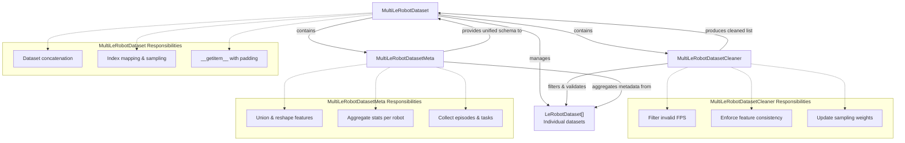
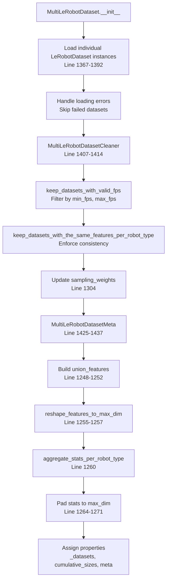
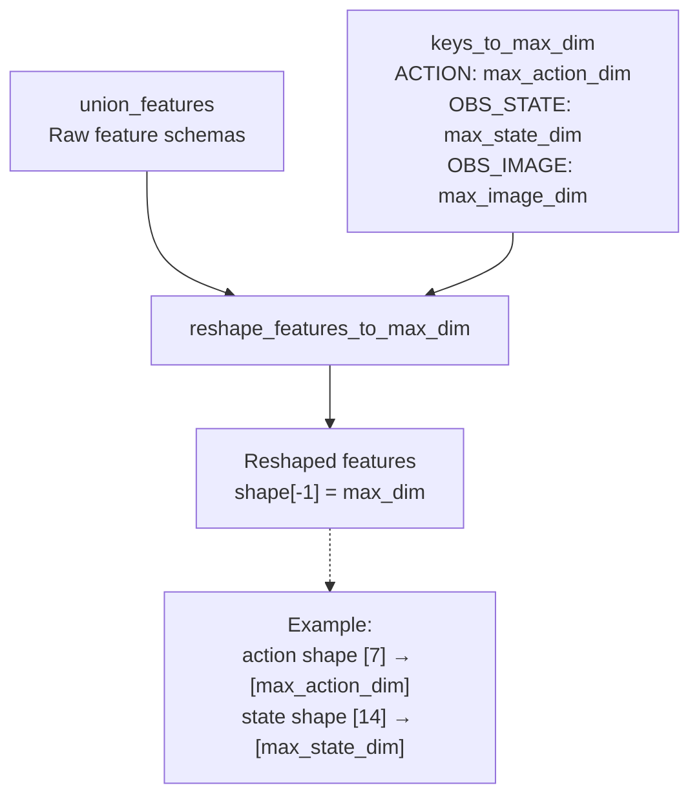
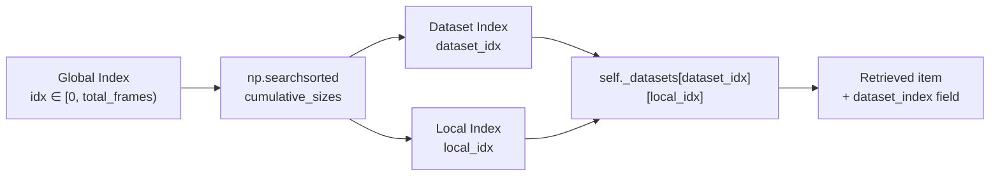
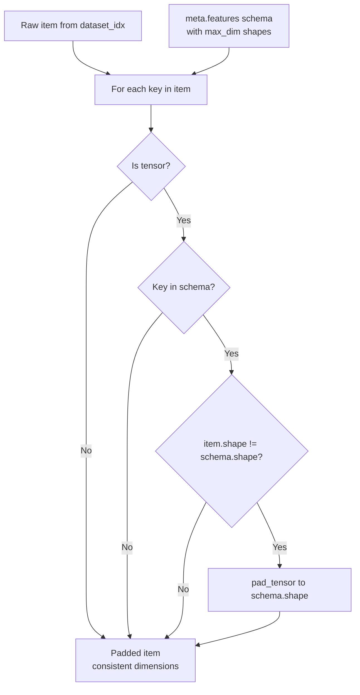
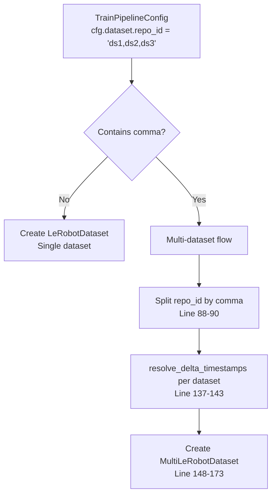

<!-- source: DeepWiki mcp.deepwiki.com · repo huggingface/VLAb · page 4.2 MultiLeRobotDataset · fetched 2026-10-26 -->

# MultiLeRobotDataset

<details>
<summary>Relevant source files</summary>

The following files were used as context for generating this wiki page:

- [src/lerobot/datasets/factory.py](src/lerobot/datasets/factory.py)
- [src/lerobot/datasets/lerobot_dataset.py](src/lerobot/datasets/lerobot_dataset.py)

</details>


This page documents the `MultiLeRobotDataset` class, which aggregates multiple heterogeneous robotics datasets into a single unified dataset for multi-dataset training. For information about individual dataset handling, see [LeRobotDataset](#4.1). For information about how datasets are instantiated, see [Dataset Factory](#4.3).

## Purpose and Scope

`MultiLeRobotDataset` enables training on multiple robotics datasets simultaneously by:
- Concatenating multiple `LeRobotDataset` instances into a single dataset interface
- Aligning heterogeneous features across datasets through padding and standardization
- Cleaning datasets to ensure compatibility (valid FPS, consistent features per robot type)
- Supporting weighted sampling across datasets
- Aggregating statistics per robot type for proper normalization

This class is essential for pretraining Vision-Language-Action models on diverse robotics data where different datasets may have different action dimensions, state dimensions, camera configurations, and robot types.

## Class Architecture

The `MultiLeRobotDataset` system consists of three interconnected classes that work together to aggregate and manage multiple datasets.



**Sources:** [src/lerobot/datasets/lerobot_dataset.py:1216-1277](), [src/lerobot/datasets/lerobot_dataset.py:1279-1314](), [src/lerobot/datasets/lerobot_dataset.py:1316-1549]()

## Initialization Flow

The initialization process for `MultiLeRobotDataset` involves loading individual datasets, cleaning them, and building unified metadata.



**Sources:** [src/lerobot/datasets/lerobot_dataset.py:1323-1439](), [src/lerobot/datasets/lerobot_dataset.py:1279-1314](), [src/lerobot/datasets/lerobot_dataset.py:1216-1277]()

## Constructor Parameters

The `MultiLeRobotDataset` constructor accepts an extensive set of parameters to control dataset aggregation and processing:

| Parameter | Type | Description |
|-----------|------|-------------|
| `repo_ids` | `list[str]` | List of HuggingFace dataset repository IDs to aggregate |
| `root` | `str \| Path \| None` | Local directory for datasets (defaults to `HF_LEROBOT_HOME`) |
| `episodes` | `dict \| None` | Per-dataset episode selection `{repo_id: [episode_indices]}` |
| `image_transforms` | `Callable \| None` | Torchvision transforms applied to visual modalities |
| `delta_timestamps` | `dict[list[float]] \| None` | Per-dataset temporal offsets for history-aware policies |
| `sampling_weights` | `list[float] \| None` | Relative sampling probability for each dataset |
| `feature_keys_mapping` | `dict[str, dict[str, str]] \| None` | Per-dataset feature key remapping |
| `max_action_dim` | `int` | Maximum action dimension for padding |
| `max_state_dim` | `int` | Maximum state dimension for padding |
| `max_num_images` | `int` | Maximum number of camera images |
| `max_image_dim` | `int` | Maximum image feature dimension |
| `train_on_all_features` | `bool` | If False, only train on common features across datasets |
| `training_features` | `list \| None` | Explicit list of features to use for training |
| `discard_first_n_frames` | `int` | Number of initial frames to skip per episode |
| `discard_first_idle_frames` | `bool` | Skip idle frames before motion starts |
| `min_fps` | `int` | Minimum FPS threshold for dataset inclusion (default: 1) |
| `max_fps` | `int` | Maximum FPS threshold for dataset inclusion (default: 100) |
| `motion_threshold` | `float` | Velocity threshold for motion detection (default: 0.05) |
| `motion_window_size` | `int` | Window size for motion detection (default: 10) |
| `motion_buffer` | `int` | Buffer frames before detected motion (default: 3) |

**Sources:** [src/lerobot/datasets/lerobot_dataset.py:1323-1350]()

## Dataset Cleaning Process

The `MultiLeRobotDatasetCleaner` ensures compatibility across datasets by applying a two-stage filtering process:

```mermaid
flowchart LR
    Input["Input datasets<br/>Original list"]
    
    Stage1["Stage 1: FPS Filtering<br/>keep_datasets_with_valid_fps"]
    ValidFPS["Datasets with<br/>min_fps ≤ fps ≤ max_fps"]
    
    Stage2["Stage 2: Feature Consistency<br/>keep_datasets_with_the_same_features_per_robot_type"]
    ConsistentDS["Datasets with matching<br/>features per robot_type"]
    
    UpdateMask["Update keep_mask<br/>cleaned_weights<br/>cleaned_repo_ids"]
    
    Output["Cleaned datasets<br/>ready for aggregation"]
    
    Input --> Stage1
    Stage1 --> ValidFPS
    ValidFPS --> Stage2
    Stage2 --> ConsistentDS
    ConsistentDS --> UpdateMask
    UpdateMask --> Output
```



### FPS Filtering

The cleaner removes datasets with FPS values outside the valid range using `keep_datasets_with_valid_fps` from [src/lerobot/datasets/utils_must.py](). This prevents mixing datasets with drastically different temporal resolutions.

### Feature Consistency by Robot Type

The function `keep_datasets_with_the_same_features_per_robot_type` groups datasets by `robot_type` and ensures all datasets within each robot type group have identical feature sets. Datasets with mismatched features are removed from the group.

**Sources:** [src/lerobot/datasets/lerobot_dataset.py:1279-1314](), [src/lerobot/datasets/utils_must.py]()

## Feature Alignment and Padding

Multi-dataset training requires aligning heterogeneous features. The `MultiLeRobotDatasetMeta` class handles this through a multi-stage process:

### Stage 1: Disabled Features

When `train_on_all_features=False`, the system computes the intersection of features across all datasets and disables any features not in this intersection:

```python
# From MultiLeRobotDatasetMeta.__init__
intersection = set(datasets[0].features)
for ds in datasets:
    intersection.intersection_update(ds.features)
    
for repo_id, ds in zip(repo_ids, datasets):
    extra = set(ds.features) - intersection
    disabled_features.update(extra)
```

**Sources:** [src/lerobot/datasets/lerobot_dataset.py:1234-1245]()

### Stage 2: Union Features

The system builds `union_features` by collecting all non-disabled features from all datasets:

```python
union_features = {}
for ds in datasets:
    for k, v in ds.features.items():
        if k not in disabled_features:
            union_features[k] = v
```

**Sources:** [src/lerobot/datasets/lerobot_dataset.py:1248-1252]()

### Stage 3: Feature Reshaping

The `reshape_features_to_max_dim` function from [src/lerobot/datasets/utils_must.py]() reshapes feature schemas to accommodate maximum dimensions:



**Sources:** [src/lerobot/datasets/lerobot_dataset.py:1255-1257](), [src/lerobot/datasets/utils_must.py]()

### Stage 4: Statistics Aggregation and Padding

Statistics are aggregated per robot type using `aggregate_stats_per_robot_type`, then padded to match maximum dimensions:

```python
# Aggregate stats by robot type
stats = aggregate_stats_per_robot_type(datasets)

# Pad stats tensors
for robot_type_, stats_ in stats.items():
    for feat_key, feat_stats in stats_.items():
        if feat_key in [ACTION, OBS_ENV_STATE, OBS_STATE]:
            for k, v in feat_stats.items():
                pad_value = 0 if k in ["min", "mean"] else 1
                stats[robot_type_][feat_key][k] = pad_tensor(
                    v, 
                    max_size=keys_to_max_dim.get(feat_key, -1),
                    pad_dim=-1,
                    pad_value=pad_value
                )
```

This ensures normalization statistics match the padded feature dimensions.

**Sources:** [src/lerobot/datasets/lerobot_dataset.py:1260-1271](), [src/lerobot/datasets/utils_must.py]()

## Indexing and Sampling

The `MultiLeRobotDataset` implements a concatenated indexing scheme with cumulative offsets:



### Cumulative Sizes

The `cumulative_sizes` array stores the cumulative frame counts:

```python
cumulative_sizes = [0] + list(torch.cumsum(torch.tensor([len(d) for d in datasets]), dim=0))
# Example: [0, 1000, 2500, 5000] for datasets with 1000, 1500, 2500 frames
```

### Index Mapping Algorithm

```python
def __getitem__(self, idx: int) -> dict[str, torch.Tensor]:
    # Find which dataset this index belongs to
    dataset_idx = np.searchsorted(self.cumulative_sizes, idx, side="right").item() - 1
    
    # Compute local index within that dataset
    local_idx = (idx - self.cumulative_sizes[dataset_idx]).item()
    
    # Retrieve item from appropriate dataset
    item = self._datasets[dataset_idx][local_idx]
    
    # Add dataset identifier
    item["dataset_index"] = torch.tensor(dataset_idx)
    
    # Pad features to maximum dimensions
    item = create_padded_features(item, self.meta.features)
    
    # Remove disabled features
    for data_key in self.disabled_features:
        if data_key in item:
            del item[data_key]
    
    return item
```

**Sources:** [src/lerobot/datasets/lerobot_dataset.py:1524-1535](), [src/lerobot/datasets/lerobot_dataset.py:1310-1312]()

## Runtime Feature Padding

The `create_padded_features` function from [src/lerobot/datasets/utils_must.py]() pads features at retrieval time to ensure consistent tensor shapes across datasets:



Example padding for actions:

| Dataset | Original Shape | Padded Shape (max_action_dim=10) | Padding |
|---------|---------------|----------------------------------|---------|
| Dataset A | `[7]` | `[10]` | `[0, 0, 0]` appended |
| Dataset B | `[10]` | `[10]` | No padding |
| Dataset C | `[5]` | `[10]` | `[0, 0, 0, 0, 0]` appended |

**Sources:** [src/lerobot/datasets/lerobot_dataset.py:1531](), [src/lerobot/datasets/utils_must.py]()

## Metadata Access

The `MultiLeRobotDatasetMeta` class provides unified access to metadata across all datasets:

| Property | Type | Description |
|----------|------|-------------|
| `features` | `dict` | Unified feature schema with max dimensions |
| `stats` | `dict[str, dict]` | Per-robot-type statistics (keyed by robot_type) |
| `episodes` | `dict[str, dict]` | Per-dataset episode metadata (keyed by repo_id) |
| `tasks` | `dict[str, dict]` | Per-dataset task definitions (keyed by repo_id) |
| `info` | `dict[str, dict]` | Per-dataset info metadata (keyed by repo_id) |
| `disabled_features` | `set[str]` | Features excluded from training |
| `union_features` | `dict` | All non-disabled features before reshaping |

**Sources:** [src/lerobot/datasets/lerobot_dataset.py:1216-1277]()

## Properties and Methods

### Dataset Properties

```python
@property
def repo_id_to_index(self) -> dict[str, int]:
    """Mapping from repo_id to numeric dataset index."""
    return {repo_id: i for i, repo_id in enumerate(self.repo_ids)}

@property
def repo_index_to_id(self) -> dict[int, str]:
    """Inverse mapping from dataset index to repo_id."""
    return {v: k for k, v in self.repo_id_to_index}

@property
def fps(self) -> int:
    """Frames per second (assumes all datasets have same FPS)."""
    return self._datasets[0].meta.info["fps"]

@property
def num_frames(self) -> int:
    """Total number of frames across all datasets."""
    return sum(d.num_frames for d in self._datasets)

@property
def num_episodes(self) -> int:
    """Total number of episodes across all datasets."""
    return sum(d.num_episodes for d in self._datasets)
```

**Sources:** [src/lerobot/datasets/lerobot_dataset.py:1441-1520]()

### Special Methods

```python
def __len__(self) -> int:
    """Returns total number of frames."""
    return self.num_frames

def __getitem__(self, idx: int) -> dict[str, torch.Tensor]:
    """Retrieves item with index mapping and feature padding."""
    # Implementation shown in Indexing section above

def __repr__(self) -> str:
    """String representation showing dataset configuration."""
    return (
        f"{self.__class__.__name__}(\n"
        f"  Repository IDs: '{self.repo_ids}',\n"
        f"  Number of Samples: {self.num_frames},\n"
        f"  Number of Episodes: {self.num_episodes},\n"
        ...
    )
```

**Sources:** [src/lerobot/datasets/lerobot_dataset.py:1521-1549]()

## Usage in Training Pipeline

The `make_dataset` factory function in [src/lerobot/datasets/factory.py]() creates a `MultiLeRobotDataset` when multiple repo_ids are provided:



### Example Configuration

```python
# In TrainPipelineConfig
dataset.repo_id = "aloha/sim_transfer,bridge/v2,rt_1/pusht"
dataset.sampling_weights = "1.0,2.0,1.5"
dataset.max_action_dim = 14
dataset.max_state_dim = 30
```

This creates a `MultiLeRobotDataset` with three datasets, where Bridge v2 is sampled twice as often as ALOHA, and RT-1 PushT is sampled 1.5x as often.

**Sources:** [src/lerobot/datasets/factory.py:72-191]()

## Sampling Weights

Sampling weights control the relative probability of sampling from each dataset. They are specified as a comma-separated string and converted to a numpy array:

```python
sampling_weights = cfg.dataset.sampling_weights.split(",")  # ["1.0", "2.0", "1.5"]
sampling_weights = [float(w) for w in sampling_weights]     # [1.0, 2.0, 1.5]
```

The cleaner updates these weights after removing invalid datasets:

```python
cleaned_weights = [sampling_weights[i] for i in range(len(datasets)) if keep_mask[i]]
```

**Note:** As of the current implementation, sampling weights are stored but not actively used in the `__getitem__` method. They are prepared for integration with weighted samplers like `EpisodeAwareSampler`.

**Sources:** [src/lerobot/datasets/factory.py:93](), [src/lerobot/datasets/lerobot_dataset.py:1304](), [src/lerobot/datasets/lerobot_dataset.py:1362-1366]()

## Error Handling

The initialization process includes robust error handling for dataset loading failures:

```python
for i, repo_id in enumerate(repo_ids):
    try:
        _datasets.append(LeRobotDataset(...))
        datasets_repo_ids.append(repo_id)
        sampling_weights.append(float(sampling_weights[i]))
    except Exception as e:
        print(f"Failed to load dataset: {repo_id} due to Exception: {e}")
```

Failed datasets are skipped rather than causing the entire initialization to fail. This is useful when working with large collections of community datasets where some may be temporarily unavailable.

**Sources:** [src/lerobot/datasets/lerobot_dataset.py:1368-1392]()

## Integration with DataLoader

The `MultiLeRobotDataset` is compatible with PyTorch's `DataLoader` and can be used with custom collate functions:

```python
from lerobot.datasets.collate import multidataset_collate_fn

dataloader = torch.utils.data.DataLoader(
    multi_dataset,
    batch_size=32,
    collate_fn=multidataset_collate_fn,
    num_workers=4,
)
```

The `multidataset_collate_fn` handles batching of padded features and ensures proper alignment of tensors with different dimensions across datasets.

**Sources:** [src/lerobot/datasets/lerobot_dataset.py:1316-1549]()

## Key Design Decisions

### Why Feature Padding?

Different robotics platforms have different dimensionalities:
- **Action space:** UR5 has 6 DoF, Aloha has 14 DoF (bimanual)
- **State space:** Varies based on proprioceptive sensors
- **Visual observations:** Different camera configurations

Padding to maximum dimensions allows these heterogeneous datasets to be batched together during training while maintaining semantic correctness.

### Why Clean by Robot Type?

Datasets from the same robot type should have consistent feature sets because the physical hardware determines what observations and actions are available. Mixing incompatible feature sets within a robot type would produce invalid training data.

### Why Cumulative Indexing?

The cumulative indexing scheme provides O(log n) lookup time (via binary search) while maintaining the abstraction of a single concatenated dataset. This is more efficient than iterating through datasets and more intuitive than maintaining separate samplers per dataset.

**Sources:** [src/lerobot/datasets/lerobot_dataset.py:1216-1549](), [src/lerobot/datasets/utils_must.py]()

---

