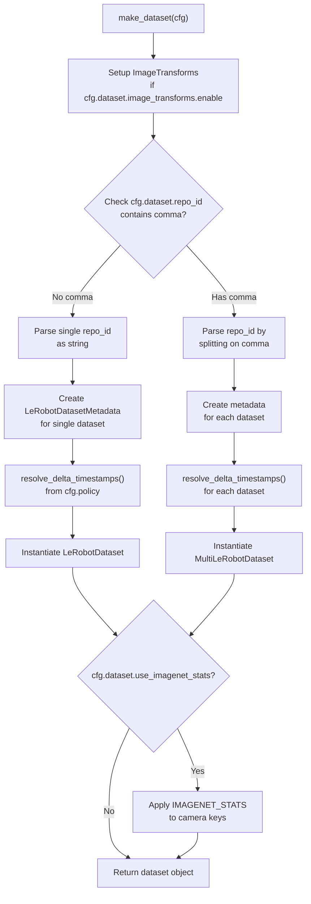
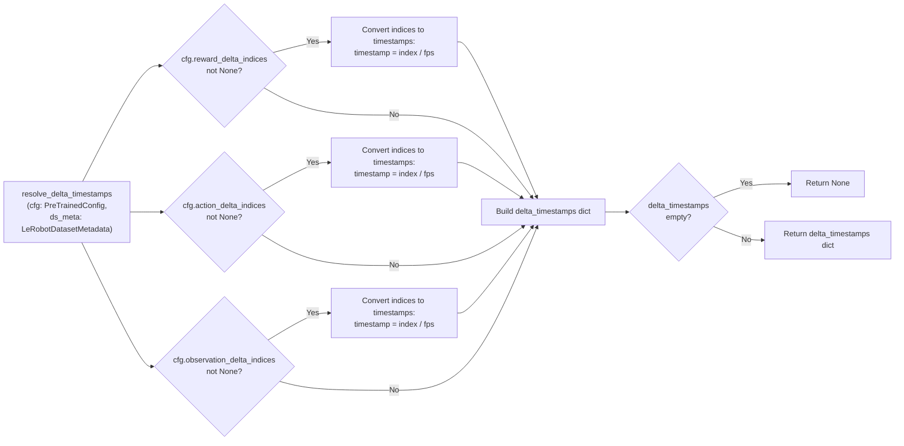
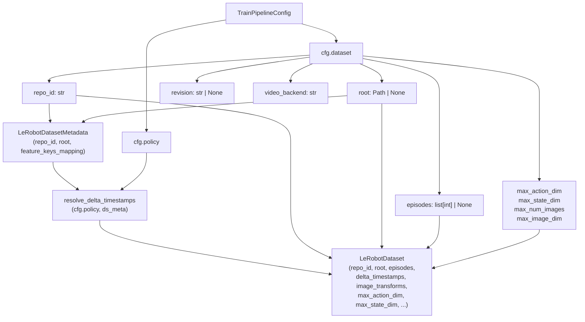
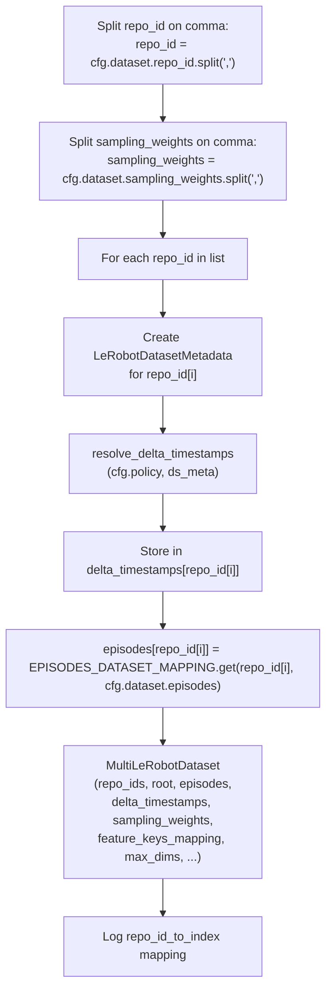
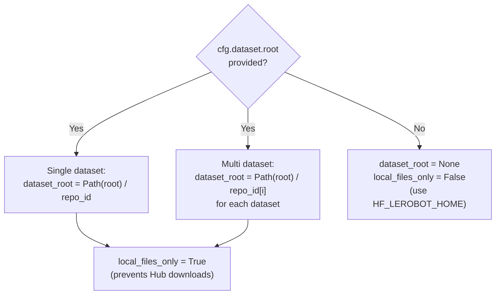
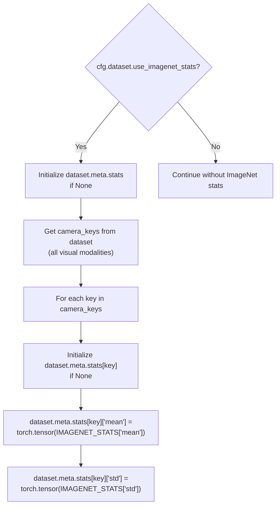
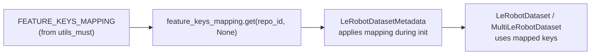
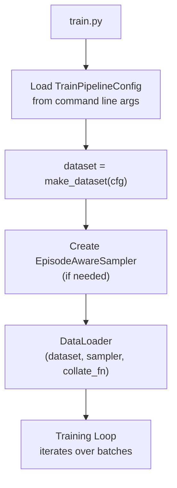

<!-- source: DeepWiki mcp.deepwiki.com · repo huggingface/VLAb · page 4.3 Dataset Factory · fetched 2026-10-26 -->

# Dataset Factory

<details>
<summary>Relevant source files</summary>

The following files were used as context for generating this wiki page:

- [src/lerobot/datasets/factory.py](src/lerobot/datasets/factory.py)
- [src/lerobot/datasets/lerobot_dataset.py](src/lerobot/datasets/lerobot_dataset.py)

</details>


## Purpose and Scope

The Dataset Factory is responsible for instantiating dataset objects (`LeRobotDataset` or `MultiLeRobotDataset`) from configuration parameters. It serves as the entry point for dataset creation during training, handling the complex logic of determining which dataset type to create, resolving temporal context parameters (delta timestamps), and configuring preprocessing options.

For details on the dataset classes themselves, see [LeRobotDataset](#4.1) and [MultiLeRobotDataset](#4.2). For information on the configuration parameters that drive the factory, see [DatasetConfig](#6.2).

**Sources:** [src/lerobot/datasets/factory.py:1-192]()

---

## Factory Function Overview

The Dataset Factory is implemented primarily through the `make_dataset` function in [src/lerobot/datasets/factory.py:72-191](). This function accepts a `TrainPipelineConfig` object and returns either a `LeRobotDataset` (for single datasets) or a `MultiLeRobotDataset` (for multi-dataset training).

### Decision Flow



**Sources:** [src/lerobot/datasets/factory.py:72-191]()

---

## Delta Timestamps Resolution

Delta timestamps enable history-aware policies by specifying temporal offsets for observations and actions. The `resolve_delta_timestamps` function converts frame-based indices from the policy configuration into time-based offsets.

### Function Signature and Logic



### Delta Indices to Timestamps Conversion

The conversion formula is straightforward:
```
delta_timestamp = delta_index / fps
```

For example, if `fps=10` and `observation_delta_indices=[-2, -1, 0]`:
- Index -2 → Timestamp -0.2s (200ms in the past)
- Index -1 → Timestamp -0.1s (100ms in the past)  
- Index 0 → Timestamp 0.0s (current frame)

**Sources:** [src/lerobot/datasets/factory.py:39-69]()

---

## Single Dataset Instantiation

When `cfg.dataset.repo_id` does not contain a comma, a single `LeRobotDataset` is created.

### Configuration to Dataset Mapping



### Key Parameters

| Parameter | Source | Purpose |
|-----------|--------|---------|
| `repo_id` | `cfg.dataset.repo_id` | HuggingFace Hub dataset identifier |
| `root` | `cfg.dataset.root` | Local directory path (if provided, prevents Hub downloads) |
| `episodes` | `cfg.dataset.episodes` | Subset of episodes to load |
| `delta_timestamps` | Resolved from `cfg.policy.*_delta_indices` | Temporal context offsets |
| `image_transforms` | `cfg.dataset.image_transforms` | Image preprocessing pipeline |
| `video_backend` | `cfg.dataset.video_backend` | Video decoding backend ('pyav' or 'torchcodec') |
| `max_action_dim` | `cfg.dataset.max_action_dim` | Maximum action dimension for padding |
| `max_state_dim` | `cfg.dataset.max_state_dim` | Maximum state dimension for padding |
| `local_files_only` | Derived from `root is not None` | Skip HuggingFace Hub downloads |

**Sources:** [src/lerobot/datasets/factory.py:95-125]()

---

## Multi-Dataset Instantiation

When `cfg.dataset.repo_id` contains a comma-separated list of dataset IDs, a `MultiLeRobotDataset` is created to aggregate multiple datasets.

### Multi-Dataset Configuration Flow



### Multi-Dataset Specific Parameters

| Parameter | Source | Purpose |
|-----------|--------|---------|
| `sampling_weights` | `cfg.dataset.sampling_weights` | Relative sampling frequency per dataset |
| `train_on_all_features` | `cfg.dataset.train_on_all_features` | Whether to use union vs intersection of features |
| `discard_first_n_frames` | `cfg.dataset.discard_first_n_frames` | Skip initial frames per episode |
| `min_fps` / `max_fps` | `cfg.dataset.min_fps` / `cfg.dataset.max_fps` | Filter datasets by FPS range |
| `discard_first_idle_frames` | `cfg.dataset.discard_first_idle_frames` | Skip frames before motion starts |
| `motion_threshold` | `cfg.dataset.motion_threshold` | Velocity threshold for motion detection |

The `EPISODES_DATASET_MAPPING` constant provides per-dataset episode overrides, allowing fine-grained control over which episodes are used from each source.

**Sources:** [src/lerobot/datasets/factory.py:126-177]()

---

## Root Path Handling

The factory supports both local datasets and HuggingFace Hub datasets. When `root` is provided, it affects path construction and download behavior:



This design enables:
- **Local training**: Point to a local directory containing datasets
- **Hub-based training**: Automatically download from HuggingFace Hub
- **Offline training**: Use pre-downloaded datasets without network access

**Sources:** [src/lerobot/datasets/factory.py:97-101](), [src/lerobot/datasets/factory.py:129-135]()

---

## ImageNet Statistics Normalization

The factory can optionally apply ImageNet normalization statistics to camera inputs. This is useful when leveraging pretrained vision encoders that expect ImageNet-normalized images.

### ImageNet Statistics Structure

```python
IMAGENET_STATS = {
    "mean": [[[0.485]], [[0.456]], [[0.406]]],  # (c,1,1)
    "std": [[[0.229]], [[0.224]], [[0.225]]],   # (c,1,1)
}
```

### Application Logic



**Important Notes:**
- ImageNet statistics are applied **after** dataset creation
- They override any existing statistics in `dataset.meta.stats`
- The statistics are stored as PyTorch tensors with shape `(3, 1, 1)` for broadcasting
- This only affects normalization during data loading, not the underlying dataset files

**Sources:** [src/lerobot/datasets/factory.py:31-34](), [src/lerobot/datasets/factory.py:178-189]()

---

## Feature Keys Mapping

The factory uses `FEATURE_KEYS_MAPPING` to standardize feature names across datasets. This allows datasets with different naming conventions to be aggregated in multi-dataset training.

### Mapping Flow



### Example Mapping

A dataset might use custom camera names like `"observation.images.wrist_camera"` which gets mapped to the standardized `"observation.images.image"` key for uniform processing.

**Sources:** [src/lerobot/datasets/factory.py:36](), [src/lerobot/datasets/factory.py:94]()

---

## Integration with Training Pipeline

The factory is called early in the training pipeline to create the dataset that will be wrapped in a PyTorch DataLoader.

### Training Script Integration



The factory abstracts all dataset complexity, providing a clean interface where the training script only needs to:
1. Load configuration
2. Call `make_dataset(cfg)`
3. Wrap the result in a DataLoader

**Sources:** [src/lerobot/datasets/factory.py:72-191]()

---

## Summary Table: Factory Responsibilities

| Responsibility | Implementation | Location |
|---------------|----------------|----------|
| Parse repo_id configuration | String splitting on comma | [factory.py:88-92]() |
| Setup image transforms | ImageTransforms instantiation | [factory.py:84-86]() |
| Resolve temporal context | `resolve_delta_timestamps()` | [factory.py:39-69]() |
| Create metadata objects | `LeRobotDatasetMetadata()` | [factory.py:102-108](), [137-142]() |
| Instantiate single dataset | `LeRobotDataset()` | [factory.py:110-125]() |
| Instantiate multi-dataset | `MultiLeRobotDataset()` | [factory.py:148-173]() |
| Apply ImageNet normalization | Override `dataset.meta.stats` | [factory.py:178-189]() |
| Handle local vs Hub paths | Path construction and `local_files_only` flag | [factory.py:97-101](), [129-135]() |
| Feature key mapping | Pass `feature_keys_mapping` to datasets | [factory.py:94](), [105](), [120]() |

---

## Error Handling and Edge Cases

The factory includes several important checks and fallbacks:

1. **Empty repo_id filtering**: When splitting comma-separated IDs, empty strings are filtered out [factory.py:89-91]()
2. **Sampling weights validation**: Defaults to equal weights if not provided [factory.py:93]()
3. **Root path handling**: Constructs proper paths for both single and multi-dataset cases
4. **Local-only mode**: Automatically enabled when `root` is provided to prevent unwanted downloads

The factory delegates most error handling to the underlying dataset classes (`LeRobotDataset` and `MultiLeRobotDataset`), which perform validation during initialization.

**Sources:** [src/lerobot/datasets/factory.py:72-191]()

---

