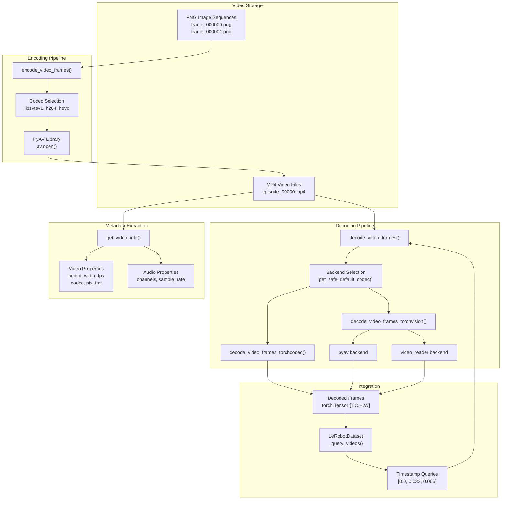
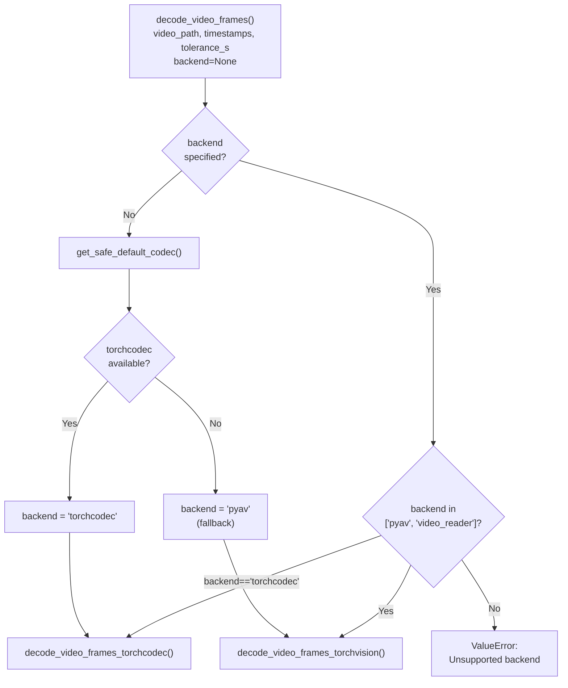
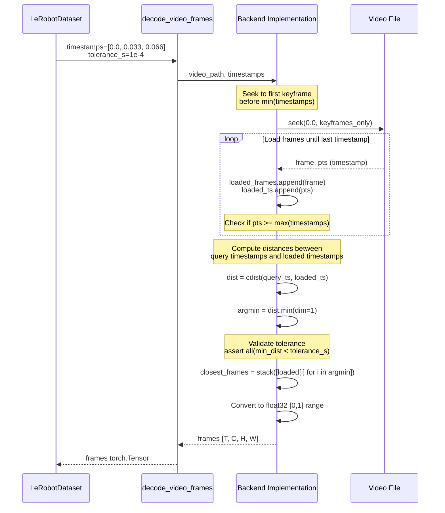
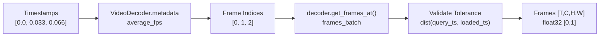
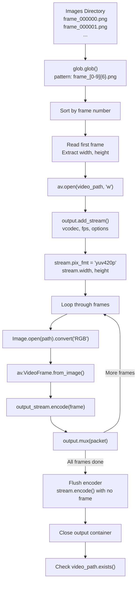
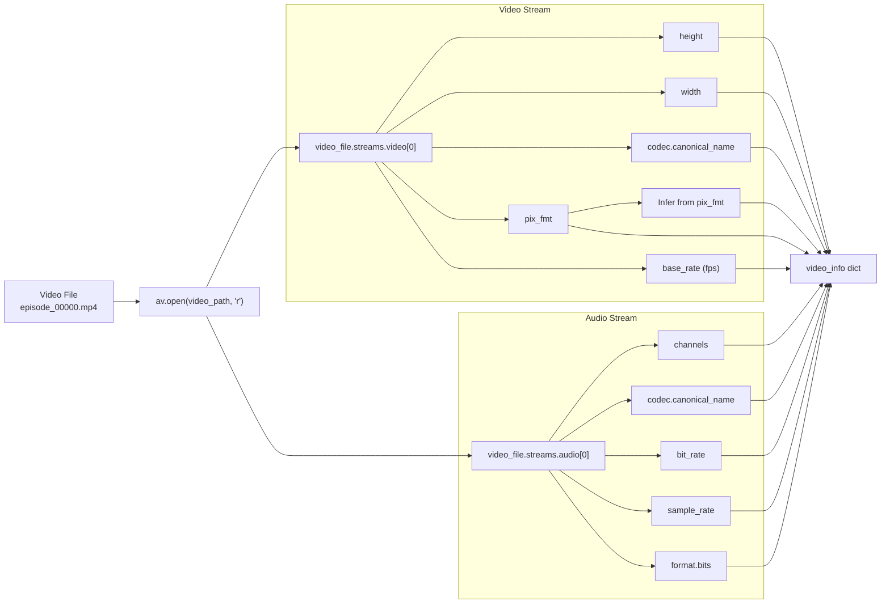
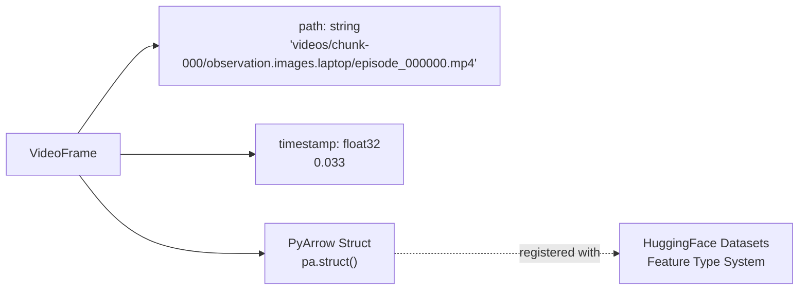
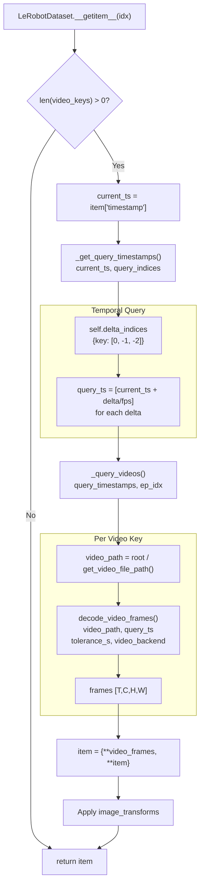

<!-- source: DeepWiki mcp.deepwiki.com · repo huggingface/VLAb · page 4.4 Video Processing · fetched 2026-10-26 -->

# Video Processing

<details>
<summary>Relevant source files</summary>

The following files were used as context for generating this wiki page:

- [examples/scripts/reproduce_smolvla.slurm](examples/scripts/reproduce_smolvla.slurm)
- [examples/scripts/reproduce_smolvla_resume.slurm](examples/scripts/reproduce_smolvla_resume.slurm)
- [src/lerobot/datasets/lerobot_dataset.py](src/lerobot/datasets/lerobot_dataset.py)
- [src/lerobot/datasets/video_utils.py](src/lerobot/datasets/video_utils.py)

</details>


This page documents VLAb's video processing capabilities, including video decoding, encoding, and frame extraction utilities used throughout the dataset system. Video processing enables efficient storage and retrieval of visual observations from robotics datasets by storing image sequences as compressed video files rather than individual frames.

For information about the broader dataset system that uses these video utilities, see [Dataset System](#4). For details on the LeRobotDataset class that consumes video frames, see [LeRobotDataset](#4.1).

## Overview

VLAb's video processing system provides three main capabilities:

1. **Video Decoding**: Extracting frames from MP4 video files at specific timestamps using multiple backend options
2. **Video Encoding**: Converting sequences of PNG images into compressed MP4 video files
3. **Metadata Extraction**: Reading video properties such as resolution, FPS, codec, and pixel format

The system is designed around timestamp-based frame extraction, allowing precise temporal querying of video data to support history-aware policies that need to access multiple frames at specific time intervals.

**Video Processing Architecture**



Sources: [src/lerobot/datasets/video_utils.py:1-461](), [src/lerobot/datasets/lerobot_dataset.py:98-104](), [src/lerobot/datasets/lerobot_dataset.py:873-885]()

## Video Decoding

Video decoding extracts frames from compressed MP4 files at specified timestamps. VLAb supports multiple decoding backends to optimize performance across different hardware configurations.

### Decoding Backend Selection

The system automatically selects the best available backend or allows manual specification via configuration.

**Backend Selection Flow**



Sources: [src/lerobot/datasets/video_utils.py:36-73]()

### Supported Backends

| Backend | Library | Default Device | Key Features | Performance Notes |
|---------|---------|----------------|--------------|-------------------|
| `torchcodec` | torchcodec | CPU (GPU capable) | Fast seeking, accurate timestamps | Preferred when available |
| `pyav` | torchvision + PyAV | CPU | Keyframe-only seeking | Reliable fallback |
| `video_reader` | torchvision | CPU | Faster than pyav | Requires special compilation |

Sources: [src/lerobot/datasets/video_utils.py:76-174](), [src/lerobot/datasets/video_utils.py:177-249]()

### Timestamp-Based Frame Extraction

Frame extraction uses timestamps rather than frame indices to support variable FPS datasets and temporal queries.

**Frame Extraction Process**



Sources: [src/lerobot/datasets/video_utils.py:76-174]()

### TorchCodec Backend

The `torchcodec` backend provides fast, accurate frame extraction with approximate seeking.



Key implementation details:
- Converts timestamps to frame indices using `round(ts * average_fps)`
- Uses `seek_mode="approximate"` for efficient random access
- Batch retrieves all requested frames in single call
- Operates on CPU by default (GPU support available but not recommended in data workers)

Sources: [src/lerobot/datasets/video_utils.py:177-249]()

### PyAV Backend (Torchvision)

The `pyav` backend uses torchvision's video reader with PyAV under the hood.

Key characteristics:
- **Keyframe-only seeking**: Must load all frames from preceding keyframe to target frame
- **Sequential loading**: Iterates through frames after seeking to first keyframe
- **Tolerance validation**: Ensures extracted frames are within `tolerance_s` of requested timestamps
- **Container management**: Explicitly closes PyAV container after reading

The keyframe limitation means decoding time scales with distance between keyframes in the video. This can be controlled during encoding via the `g` (GOP size) parameter.

Sources: [src/lerobot/datasets/video_utils.py:76-174]()

### Configuration in Dataset

The video backend is configured when instantiating a `LeRobotDataset`:

```python
# From lerobot_dataset.py __init__
self.video_backend = video_backend if video_backend else get_safe_default_codec()
```

The backend is then used in frame queries:

```python
# From LeRobotDataset._query_videos()
frames = decode_video_frames(video_path, query_ts, self.tolerance_s, self.video_backend)
```

Configuration via command line:
```bash
--dataset.video_backend=pyav
```

Sources: [src/lerobot/datasets/lerobot_dataset.py:527](), [src/lerobot/datasets/lerobot_dataset.py:873-885](), [examples/scripts/reproduce_smolvla.slurm:196]()

## Video Encoding

Video encoding converts sequences of PNG images into compressed MP4 files for efficient storage and access.

### Encoding Pipeline

**Encoding Process Flow**



Sources: [src/lerobot/datasets/video_utils.py:252-338]()

### Codec Support and Options

VLAb supports three video codecs with different trade-offs:

| Codec | Identifier | Pixel Format Support | Compression | Speed | Use Case |
|-------|-----------|---------------------|-------------|-------|----------|
| H.264 | `h264` | yuv420p, yuv444p | Good | Fast | Broad compatibility |
| HEVC (H.265) | `hevc` | yuv420p | Better | Moderate | Higher compression |
| AV1 | `libsvtav1` | yuv420p | Best | Slower | Storage efficiency |

**Encoding Parameters**

```python
def encode_video_frames(
    imgs_dir: Path,
    video_path: Path,
    fps: int,
    vcodec: str = "libsvtav1",      # Default codec
    pix_fmt: str = "yuv420p",       # Pixel format
    g: int | None = 2,              # GOP size (keyframe interval)
    crf: int | None = 30,           # Constant Rate Factor (quality)
    fast_decode: int = 0,           # Fast decode optimization
    log_level: int | None = av.logging.ERROR,
    overwrite: bool = False,
)
```

Key parameters:
- **`g` (GOP size)**: Controls keyframe interval. Smaller values = more keyframes = faster seeking but larger files
- **`crf` (Constant Rate Factor)**: Quality setting. Lower = better quality but larger files (18-28 typical range)
- **`fast_decode`**: Enables decoder optimization (AV1-specific)
- **`pix_fmt`**: Pixel format. `yuv420p` is most compatible; `yuv444p` offers better quality but limited codec support

Codec-pixel format compatibility:
- `libsvtav1` and `hevc` do not support `yuv444p`, automatically fallback to `yuv420p`
- `h264` supports both `yuv420p` and `yuv444p`

Sources: [src/lerobot/datasets/video_utils.py:252-338]()

### Integration with Dataset Recording

During episode recording, images are temporarily saved as PNGs, then encoded to video after the episode completes:

```python
# From LeRobotDataset.save_episode()
if len(self.meta.video_keys) > 0:
    video_paths = self.encode_episode_videos(episode_index)
    for key in self.meta.video_keys:
        episode_buffer[key] = video_paths[key]
```

After encoding, the temporary PNG directory is deleted:

```python
# Delete images
img_dir = self.root / "images"
if img_dir.is_dir():
    shutil.rmtree(self.root / "images")
```

Sources: [src/lerobot/datasets/lerobot_dataset.py:1060-1087]()

## Video Metadata Extraction

VLAb provides utilities to extract comprehensive metadata from video files without fully decoding them.

### Video Information Structure

**Metadata Extraction Flow**



Sources: [src/lerobot/datasets/video_utils.py:404-461]()

### Extracted Properties

**Video Properties**

| Property | Key | Type | Source |
|----------|-----|------|--------|
| Height | `video.height` | int | `video_stream.height` |
| Width | `video.width` | int | `video_stream.width` |
| Codec | `video.codec` | str | `video_stream.codec.canonical_name` |
| Pixel Format | `video.pix_fmt` | str | `video_stream.pix_fmt` |
| FPS | `video.fps` | int | `video_stream.base_rate` |
| Channels | `video.channels` | int | Inferred from `pix_fmt` |
| Is Depth Map | `video.is_depth_map` | bool | Always False (placeholder) |

**Audio Properties**

| Property | Key | Type | Source |
|----------|-----|------|--------|
| Has Audio | `has_audio` | bool | Audio stream exists |
| Channels | `audio.channels` | int | `audio_stream.channels` |
| Codec | `audio.codec` | str | `audio_stream.codec.canonical_name` |
| Bit Rate | `audio.bit_rate` | int | `audio_stream.bit_rate` |
| Sample Rate | `audio.sample_rate` | int | `audio_stream.sample_rate` |
| Bit Depth | `audio.bit_depth` | int | `audio_stream.format.bits` |
| Channel Layout | `audio.channel_layout` | str | `audio_stream.layout.name` |

Sources: [src/lerobot/datasets/video_utils.py:404-461]()

### Pixel Format Channel Inference

The `get_video_pixel_channels()` function infers the number of color channels from the pixel format string:

```python
def get_video_pixel_channels(pix_fmt: str) -> int:
    if "gray" in pix_fmt or "depth" in pix_fmt or "monochrome" in pix_fmt:
        return 1  # Grayscale
    elif "rgba" in pix_fmt or "yuva" in pix_fmt:
        return 4  # RGBA with alpha
    elif "rgb" in pix_fmt or "yuv" in pix_fmt:
        return 3  # RGB or YUV
    else:
        raise ValueError("Unknown format")
```

Similar logic exists for PIL images via `get_image_pixel_channels()`.

Sources: [src/lerobot/datasets/video_utils.py:439-461]()

### Usage in Dataset Metadata

Video information is stored in dataset metadata and updated after encoding the first episode:

```python
# From LeRobotDatasetMetadata.update_video_info()
for key in self.video_keys:
    if not self.features[key].get("info", None):
        video_path = self.root / self.get_video_file_path(ep_index=0, vid_key=key)
        self.info["features"][key]["info"] = get_video_info(video_path)
```

This metadata is crucial for validating video compatibility and understanding dataset structure without loading video data.

Sources: [src/lerobot/datasets/lerobot_dataset.py:339-348]()

## VideoFrame Feature Type

VLAb defines a custom HuggingFace Datasets feature type for representing video frames with timestamp metadata.

### VideoFrame DataClass

```python
@dataclass
class VideoFrame:
    """
    Provides a type for a dataset containing video frames.
    
    Example:
    data_dict = [{"image": {"path": "videos/episode_0.mp4", "timestamp": 0.3}}]
    features = {"image": VideoFrame()}
    Dataset.from_dict(data_dict, features=Features(features))
    """
    pa_type: ClassVar[Any] = pa.struct({"path": pa.string(), "timestamp": pa.float32()})
    _type: str = field(default="VideoFrame", init=False, repr=False)
    
    def __call__(self):
        return self.pa_type
```

The `VideoFrame` type is registered with HuggingFace Datasets to enable seamless integration:

```python
register_feature(VideoFrame, "VideoFrame")
```

**VideoFrame Structure**



This feature type allows video references to be stored in Parquet files alongside other data, with actual video decoding deferred until access time.

Sources: [src/lerobot/datasets/video_utils.py:340-369]()

## Integration with Dataset System

Video processing is tightly integrated with the LeRobotDataset class for efficient data loading during training.

### Video Querying in LeRobotDataset

**Dataset-to-Video Integration**



Sources: [src/lerobot/datasets/lerobot_dataset.py:873-936]()

### Temporal Context Retrieval

The video system supports retrieving multiple frames at different temporal offsets to provide history for policies:

```python
# Example: delta_timestamps for action-chunking with observation history
delta_timestamps = {
    "observation.images.top": [-0.1, 0.0],      # Current and 100ms ago
    "observation.state": [0.0],                  # Current only
    "action": [0.0, 0.02, 0.04, 0.06],          # Current + 3 future steps
}
```

The system converts these time deltas to frame indices and retrieves the closest available frames from video:

```python
# From LeRobotDataset._get_query_indices()
query_indices = {
    key: [max(ep_start, min(ep_end - 1, idx + delta)) for delta in delta_idx]
    for key, delta_idx in self.delta_indices.items()
}
```

This enables efficient temporal sampling without loading entire episodes into memory.

Sources: [src/lerobot/datasets/lerobot_dataset.py:810-829]()

### Video Path Resolution

Video files are organized by episode chunks and camera keys:

```
videos/
├── chunk-000/
│   ├── observation.images.top/
│   │   ├── episode_000000.mp4
│   │   ├── episode_000001.mp4
│   └── observation.images.wrist/
│       ├── episode_000000.mp4
│       ├── episode_000001.mp4
├── chunk-001/
└── ...
```

Path resolution:
```python
# From LeRobotDatasetMetadata.get_video_file_path()
def get_video_file_path(self, ep_index: int, vid_key: str) -> Path:
    ep_chunk = self.get_episode_chunk(ep_index)
    fpath = self.video_path.format(
        episode_chunk=ep_chunk,
        video_key=vid_key,
        episode_index=ep_index
    )
    return Path(fpath)
```

The `video_path` template is stored in dataset metadata:
```
"video_path": "videos/chunk-{episode_chunk:03d}/{video_key}/episode_{episode_index:06d}.mp4"
```

Sources: [src/lerobot/datasets/lerobot_dataset.py:190-193](), [src/lerobot/datasets/lerobot_dataset.py:873-885]()

### Performance Considerations

**Video Loading in DataLoader Workers**

Important: Video decoders should not be initialized in the main process when using multi-worker data loading:

```python
# From video_utils.py docstring
"""Note: When using data workers (e.g. DataLoader with num_workers>0), do not call this function
in the main process (e.g. by using a second Dataloader with num_workers=0). It will result in a
Segmentation Fault. This probably happens because a memory reference to the video loader is created in
the main process and a subprocess fails to access it."""
```

This constraint affects how video decoding is used in training pipelines with parallel data loading.

**Video Compression vs. Decoding Trade-off**

Videos benefit from inter-frame compression, but this creates a decoding dependency:
- Decoders must load the preceding keyframe and all intermediate frames to access a target frame
- Keyframe interval (GOP size `g`) controls this trade-off:
  - Smaller `g` = more keyframes = faster random access but larger files
  - Larger `g` = fewer keyframes = smaller files but slower random access
- Typical setting: `g=2` provides good balance for robotics datasets with frequent temporal sampling

Sources: [src/lerobot/datasets/video_utils.py:873-877](), [src/lerobot/datasets/video_utils.py:96-100]()

## Configuration Options

Video processing behavior is controlled through dataset configuration parameters.

### Key Configuration Parameters

| Parameter | Type | Default | Description |
|-----------|------|---------|-------------|
| `video_backend` | str | `"torchcodec"` or `"pyav"` | Video decoding backend |
| `tolerance_s` | float | `1e-4` | Maximum timestamp deviation (seconds) |
| `download_videos` | bool | `True` | Whether to download video files |
| `vcodec` | str | `"libsvtav1"` | Video encoding codec |
| `g` | int | `2` | GOP size (keyframe interval) |
| `crf` | int | `30` | Constant Rate Factor (quality) |

### Example Configuration

**Command-line configuration:**
```bash
python train.py \
    --dataset.video_backend=pyav \
    --dataset.root=/path/to/data \
    --dataset.repo_id=example/dataset
```

**Python configuration:**
```python
dataset = LeRobotDataset(
    repo_id="example/dataset",
    video_backend="pyav",
    tolerance_s=1e-4,
    download_videos=True,
)
```

Sources: [src/lerobot/datasets/lerobot_dataset.py:392-418](), [examples/scripts/reproduce_smolvla.slurm:190]()

---

