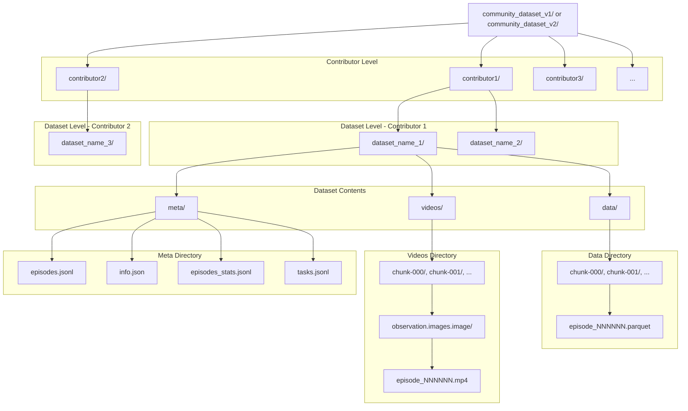
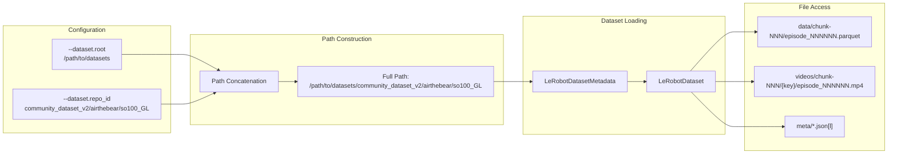
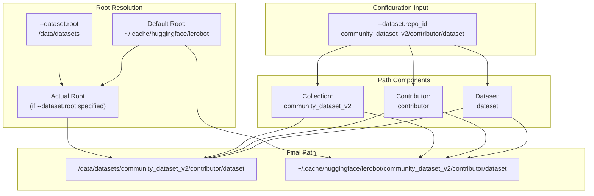
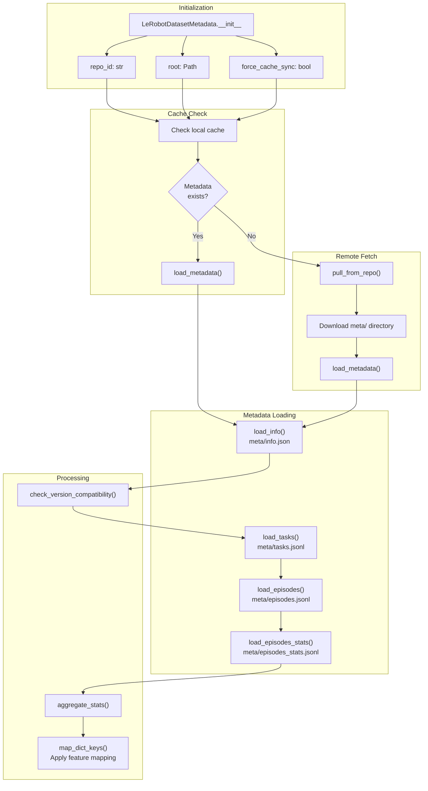
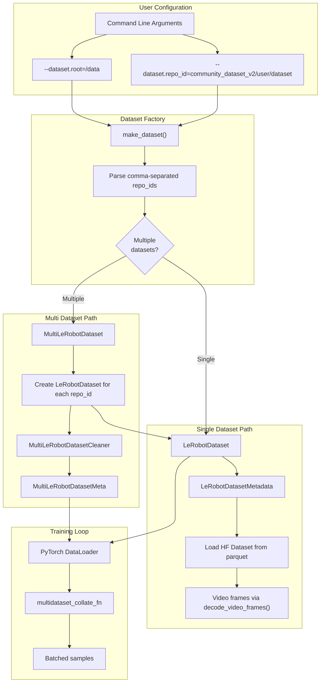

<!-- source: DeepWiki mcp.deepwiki.com · repo huggingface/VLAb · page 4.5 Community Datasets · fetched 2026-10-26 -->

# Community Datasets

<details>
<summary>Relevant source files</summary>

The following files were used as context for generating this wiki page:

- [LICENSE](LICENSE)
- [README.md](README.md)
- [src/lerobot/datasets/lerobot_dataset.py](src/lerobot/datasets/lerobot_dataset.py)

</details>


This page documents the pre-curated community dataset collections (v1 and v2) provided by HuggingFace for VLA pretraining. These datasets are publicly available on the HuggingFace Hub and contain robotics demonstrations collected by community contributors.

For information about loading and processing individual datasets, see [LeRobotDataset](#4.1). For multi-dataset training aggregation, see [MultiLeRobotDataset](#4.2).

---

## Purpose and Scope

The community datasets are curated collections of robotics demonstrations designed specifically for VLA pretraining. VLAb provides two versions of these collections, which differ in size, curation level, and format support. This page covers:

- The differences between Community Dataset v1 and v2
- The hierarchical directory structure
- Download procedures via HuggingFace Hub
- Path resolution and dataset referencing in training configurations
- Dataset metadata and format specifications

---

## Overview

Community datasets are hosted on HuggingFace Hub as hierarchical collections of individual robotics datasets. Each dataset within the collection follows the LeRobot dataset format with parquet files for data and MP4 files for videos.

### Key Characteristics

Both community dataset versions share these properties:

- **Robot Platform**: SO-100 robotic arm demonstrations
- **Task Domain**: Tabletop manipulation, pick-and-place operations, object interactions
- **Format**: LeRobot v2.0+ format with parquet data files and MP4 video files
- **Organization**: Hierarchical structure with contributor subdirectories

**Sources**: [README.md:126-145]()

---

## Dataset Versions

### Community Dataset v1

| Property | Value |
|----------|-------|
| Hub Repository | `HuggingFaceVLA/community_dataset_v1` |
| Total Datasets | 128 |
| Contributors | 55 |
| Episodes | 11,100 |
| Frames | 5.1M |
| Duration | 46.9 hours |
| Size | 119.3 GB |
| Format Version | LeRobot v2.0/v2.1 |

Community Dataset v1 represents a **curated, high-quality subset** with manual quality filtering and task description verification. This version was used to pretrain the original SmolVLA model.

### Community Dataset v2

| Property | Value |
|----------|-------|
| Hub Repository | `HuggingFaceVLA/community_dataset_v2` |
| Total Datasets | 340 |
| Contributors | 117 |
| Episodes | 6,300 |
| Frames | 5M |
| Duration | 46.6 hours |
| Size | 59 GB |
| Format Version | LeRobot v2.0/v2.1 |

Community Dataset v2 expands the collection with more contributors and datasets while maintaining LeRobot v2.0/v2.1 format compatibility. This version has broader coverage but less stringent quality filtering compared to v1.

**Sources**: [README.md:126-131]()

---

## Directory Structure

Both community dataset versions use an identical hierarchical structure:

```
Directory Structure of Community Datasets
```



**Sources**: [README.md:134-145]()

### Directory Components

Each individual dataset within the community collection contains:

- **`data/`**: Parquet files organized by episode chunks
  - `chunk-NNN/episode_NNNNNN.parquet`: Episode data with observations, actions, states
- **`videos/`**: MP4 video files organized by episode chunks and camera keys
  - `chunk-NNN/{camera_key}/episode_NNNNNN.mp4`: Encoded video frames
- **`meta/`**: Metadata files describing the dataset
  - `info.json`: Dataset configuration (fps, features, shapes, robot_type)
  - `episodes.jsonl`: Episode metadata (length, task indices)
  - `episodes_stats.jsonl`: Per-episode statistics for normalization
  - `tasks.jsonl`: Task descriptions in natural language

**Sources**: [src/lerobot/datasets/lerobot_dataset.py:449-481]()

---

## Downloading Datasets

### Using HuggingFace CLI

The recommended method for downloading community datasets is using the `huggingface-cli` tool:

```bash
# Download Community Dataset v1 (119.3 GB)
hf download HuggingFaceVLA/community_dataset_v1 \
    --repo-type=dataset \
    --local-dir /path/to/datasets/community_dataset_v1

# Download Community Dataset v2 (59 GB)
hf download HuggingFaceVLA/community_dataset_v2 \
    --repo-type=dataset \
    --local-dir /path/to/datasets/community_dataset_v2
```

### Download Considerations

- **Time**: Initial download may take 3-4 hours depending on network speed
- **Authentication**: Login via `huggingface-cli login` if required
- **Incremental**: Already-downloaded files are skipped automatically
- **Selective**: Download specific datasets by adjusting `allow_patterns`

```bash
# Download only specific contributor's datasets
hf download HuggingFaceVLA/community_dataset_v2 \
    --repo-type=dataset \
    --local-dir /path/to/datasets/community_dataset_v2 \
    --include="airthebear/*"
```

**Sources**: [README.md:147-161]()

---

## Using Community Datasets in Training

### Path Resolution Mechanism

When using community datasets with VLAb, the path resolution follows this pattern:

```
Path Resolution for Community Datasets
```



**Sources**: [README.md:196-201](), [src/lerobot/datasets/lerobot_dataset.py:130-132]()

### Training Configuration Examples

#### Single Dataset from Community Collection

```bash
accelerate launch --config_file accelerate_configs/single_gpu.yaml \
    src/lerobot/scripts/train.py \
    --policy.type=smolvla2 \
    --policy.repo_id=HuggingFaceTB/SmolVLM2-500M-Video-Instruct \
    --dataset.repo_id="community_dataset_v2/airthebear/so100_GL" \
    --dataset.root="/path/to/datasets" \
    --dataset.video_backend=pyav \
    --dataset.features_version=2 \
    --output_dir="./outputs/training" \
    --batch_size=8 \
    --steps=10000
```

#### Multiple Datasets from Community Collection

```bash
accelerate launch --config_file accelerate_configs/multi_gpu.yaml \
    src/lerobot/scripts/train.py \
    --policy.type=smolvla2 \
    --policy.repo_id=HuggingFaceTB/SmolVLM2-500M-Video-Instruct \
    --dataset.repo_id="community_dataset_v2/airthebear/so100_GL,community_dataset_v2/acrampette/third_arm_01" \
    --dataset.root="/path/to/datasets" \
    --dataset.video_backend=pyav \
    --dataset.features_version=2 \
    --output_dir="./outputs/training" \
    --batch_size=8 \
    --steps=200000
```

#### Mixed Community and Hub Datasets

Community datasets can be mixed with direct Hub downloads:

```bash
accelerate launch --config_file accelerate_configs/multi_gpu.yaml \
    src/lerobot/scripts/train.py \
    --policy.type=smolvla2 \
    --policy.repo_id=HuggingFaceTB/SmolVLM2-500M-Video-Instruct \
    --dataset.repo_id="community_dataset_v2/airthebear/so100_GL,Beegbrain/pick_lemon_and_drop_in_bowl" \
    --dataset.root="/path/to/datasets" \
    --dataset.video_backend=pyav \
    --output_dir="./outputs/training" \
    --batch_size=8
```

When `--dataset.root` is specified:
- Datasets matching the root path structure are loaded locally
- Datasets not found locally are downloaded from HuggingFace Hub

**Sources**: [README.md:176-201]()

---

## Dataset Naming Conventions

### Repo ID Format

Community datasets use a three-level naming hierarchy:

```
{collection_name}/{contributor_name}/{dataset_name}
```

Examples:
- `community_dataset_v1/airthebear/so100_GL`
- `community_dataset_v2/acrampette/third_arm_01`
- `community_dataset_v1/Beegbrain/pick_lemon_and_drop_in_bowl`

### Path Mapping

```
Dataset Name to File Path Mapping
```



**Sources**: [src/lerobot/datasets/lerobot_dataset.py:131-132](), [README.md:196-201]()

---

## Dataset Metadata and Format

### Features Version

Community datasets use `features_version=2`, which corresponds to LeRobot v2.0/v2.1 format. This must be specified in the dataset configuration:

```bash
--dataset.features_version=2
```

The features version determines:
- Expected metadata file format (`episodes_stats.jsonl` vs legacy `stats.json`)
- Feature schema structure
- Video encoding parameters

**Sources**: [src/lerobot/datasets/lerobot_dataset.py:158-164]()

### Metadata Files

Each dataset in the community collection contains standardized metadata:

| File | Format | Purpose |
|------|--------|---------|
| `meta/info.json` | JSON | Dataset configuration: fps, features, shapes, codebase version |
| `meta/episodes.jsonl` | JSON Lines | Per-episode metadata: index, length, task indices |
| `meta/episodes_stats.jsonl` | JSON Lines | Per-episode statistics for normalization (min, max, mean, std) |
| `meta/tasks.jsonl` | JSON Lines | Task descriptions indexed by task_index |

### Loading Metadata

The `LeRobotDatasetMetadata` class handles metadata loading:

```
Metadata Loading Flow
```



**Sources**: [src/lerobot/datasets/lerobot_dataset.py:118-164]()

### Feature Keys Mapping

Community datasets may have non-standard feature key names. VLAb handles this via `feature_keys_mapping`:

```python
# Example mapping applied internally
feature_keys_mapping = {
    "community_dataset_v2/contributor/dataset": {
        "observation.images.side": "observation.images.image2",
        "observation.images.wrist": "observation.images.image3"
    }
}
```

This mapping is applied during dataset loading to standardize feature keys across different datasets.

**Sources**: [src/lerobot/datasets/lerobot_dataset.py:144-151](), [src/lerobot/datasets/lerobot_dataset.py:543-546]()

---

## Integration with Dataset System

### From Community Datasets to Training

```
End-to-End Dataset Loading
```



**Sources**: [src/lerobot/datasets/lerobot_dataset.py:391-597](), [src/lerobot/datasets/lerobot_dataset.py:1316-1438]()

### Dataset Cleaning and Validation

When loading multiple community datasets, `MultiLeRobotDatasetCleaner` performs validation:

1. **FPS Filtering**: Remove datasets with fps outside valid range [1, 100]
2. **Feature Consistency**: Keep datasets with same features per robot_type
3. **Weight Adjustment**: Adjust sampling weights for remaining datasets

```python
# Cleaning steps applied in MultiLeRobotDatasetCleaner
# 1. keep_datasets_with_valid_fps()
# 2. keep_datasets_with_the_same_features_per_robot_type()
# 3. Adjust sampling_weights and repo_ids lists
```

**Sources**: [src/lerobot/datasets/lerobot_dataset.py:1279-1314]()

---

## Best Practices

### Storage Management

- **Separate Root Directory**: Use a dedicated directory for community datasets to avoid mixing with other data
- **Disk Space**: Ensure sufficient space (120 GB for v1, 60 GB for v2)
- **Cache Location**: Set `LEROBOT_HOME` environment variable to control cache location

### Training Configuration

- **Explicit Root**: Always specify `--dataset.root` for local datasets to avoid redundant Hub downloads
- **Features Version**: Always set `--dataset.features_version=2` for community datasets
- **Video Backend**: Use `--dataset.video_backend=pyav` for reliable video decoding
- **Sampling Weights**: Adjust `--dataset.sampling_weights` to balance dataset contributions

### Troubleshooting

Common issues with community datasets:

| Issue | Solution |
|-------|----------|
| Missing metadata files | Run with `--force_cache_sync` to re-download metadata |
| Corrupted downloads | Clear cache: `rm -rf ~/.cache/huggingface/datasets` |
| Video key mismatches | Check `feature_keys_mapping` for camera key standardization |
| Path not found | Verify `--dataset.root` matches actual download location |

**Sources**: [README.md:228-246]()

---

## Summary

Community datasets provide curated collections of robotics demonstrations optimized for VLA pretraining:

- **Two versions**: v1 (curated, 128 datasets) and v2 (expanded, 340 datasets)
- **Hierarchical structure**: `{collection}/{contributor}/{dataset}` with standardized LeRobot format
- **Hub integration**: Downloadable via `huggingface-cli` and loadable via `LeRobotDataset`
- **Path resolution**: Flexible local/remote loading via `--dataset.root` and `--dataset.repo_id`
- **Multi-dataset support**: Seamless aggregation via `MultiLeRobotDataset` with validation and cleaning

These datasets enable efficient pretraining workflows by providing pre-organized, quality-controlled robotics data at scale.

**Sources**: [README.md:124-201](), [src/lerobot/datasets/lerobot_dataset.py:118-164](), [src/lerobot/datasets/lerobot_dataset.py:1279-1438]()

---

