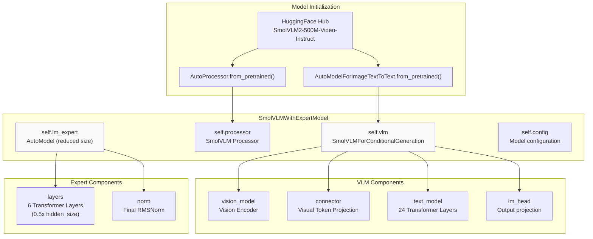
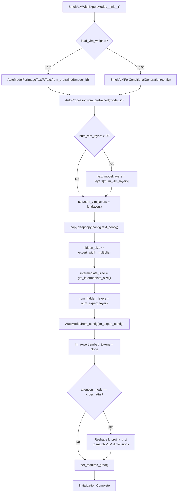
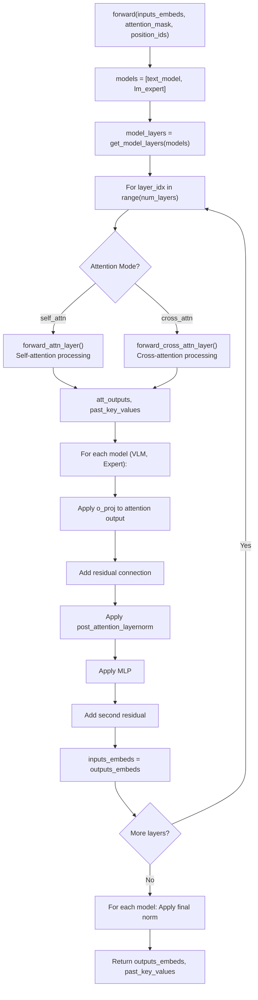
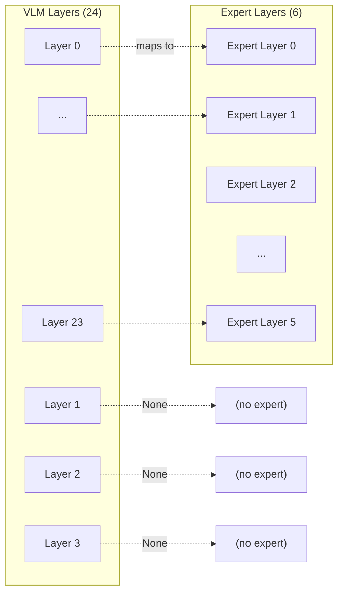
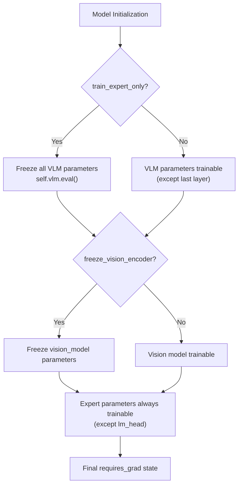
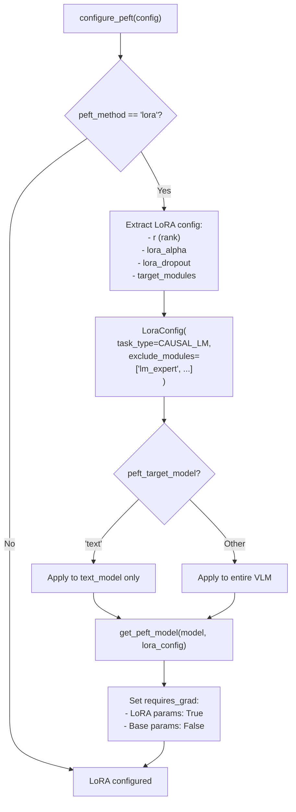

<!-- source: DeepWiki mcp.deepwiki.com · repo huggingface/VLAb · page 5 Policy and Model System · fetched 2026-10-26 -->

# Policy and Model System

<details>
<summary>Relevant source files</summary>

The following files were used as context for generating this wiki page:

- [LICENSE](LICENSE)
- [README.md](README.md)
- [src/lerobot/policies/smolvla2/smolvlm_with_expert2.py](src/lerobot/policies/smolvla2/smolvlm_with_expert2.py)

</details>


This document describes VLAb's policy and model architecture, focusing on the `SmolVLA2` implementation. It covers the hybrid VLM+Expert architecture, attention mechanisms, model initialization, forward pass logic, and integration with training strategies.

For information about training strategies and optimization approaches, see [Training Strategies](#5.2). For details about configuring the policy, see [Policy Configuration](#6.3). For the complete training loop that uses these models, see [Training Execution](#7).

## Overview

The VLAb policy system is built around the `SmolVLMWithExpertModel` class, which combines a pretrained Vision-Language Model (SmolVLM) with a smaller "expert" language model. This hybrid architecture enables efficient pretraining for vision-language-action tasks by processing visual and textual inputs through a full-capacity VLM while using a smaller expert model for action-specific reasoning.

The system supports multiple attention modes (self-attention and cross-attention) and flexible training strategies (expert-only training, vision encoder freezing, full fine-tuning, and PEFT/LoRA adaptation).

Sources: [src/lerobot/policies/smolvla2/smolvlm_with_expert2.py:1-603](), [README.md:1-309]()

## Architecture Overview

The following diagram illustrates the high-level architecture and how the major components interact:



**Architecture Components:**

| Component | Class/Type | Purpose |
|-----------|------------|---------|
| `SmolVLMWithExpertModel` | `nn.Module` | Main wrapper orchestrating VLM and Expert |
| `self.vlm` | `SmolVLMForConditionalGeneration` | Pretrained vision-language model |
| `self.lm_expert` | `AutoModel` | Smaller expert model for action reasoning |
| `self.processor` | `AutoProcessor` | Tokenizer and image processor |
| `vision_model` | Vision encoder | Encodes images to patch embeddings |
| `connector` | Resampler/projection | Projects visual tokens for text model |
| `text_model` | Transformer layers | Processes combined visual+text tokens |

Sources: [src/lerobot/policies/smolvla2/smolvlm_with_expert2.py:63-150]()

## SmolVLMWithExpertModel Class

The `SmolVLMWithExpertModel` class is defined in [src/lerobot/policies/smolvla2/smolvlm_with_expert2.py:63-603]() and serves as the main policy implementation.

### Constructor Parameters

```python
def __init__(
    self,
    model_id: str = "HuggingFaceTB/SmolVLM2-500M-Video-Instruct",
    load_vlm_weights: bool = True,
    train_expert_only: bool = True,
    freeze_vision_encoder: bool = False,
    attention_mode: str = "self_attn",
    num_expert_layers: int = -1,
    num_vlm_layers: int = -1,
    self_attn_every_n_layers: int = -1,
    expert_width_multiplier: float = 0.5,
)
```

| Parameter | Type | Default | Description |
|-----------|------|---------|-------------|
| `model_id` | `str` | `"HuggingFaceTB/SmolVLM2-500M-Video-Instruct"` | HuggingFace model ID for base VLM |
| `load_vlm_weights` | `bool` | `True` | Whether to load pretrained VLM weights |
| `train_expert_only` | `bool` | `True` | Freeze VLM and train only expert model |
| `freeze_vision_encoder` | `bool` | `False` | Freeze vision encoder during training |
| `attention_mode` | `str` | `"self_attn"` | Attention mechanism: `"self_attn"` or `"cross_attn"` |
| `num_expert_layers` | `int` | `-1` | Number of expert layers (-1 = match VLM) |
| `num_vlm_layers` | `int` | `-1` | Number of VLM layers to use (-1 = all) |
| `self_attn_every_n_layers` | `int` | `-1` | Frequency of self-attention in cross-attention mode |
| `expert_width_multiplier` | `float` | `0.5` | Hidden size multiplier for expert (0.5 = half size) |

Sources: [src/lerobot/policies/smolvla2/smolvlm_with_expert2.py:64-75]()

## Model Initialization Flow

The following diagram shows how the model components are initialized:



### Key Initialization Steps

1. **VLM Loading** [src/lerobot/policies/smolvla2/smolvlm_with_expert2.py:77-102](): Loads SmolVLM from HuggingFace Hub with bfloat16 precision. Uses `device_map=None` when Accelerate is detected to avoid tensor parallelism conflicts.

2. **Layer Reduction** [src/lerobot/policies/smolvla2/smolvlm_with_expert2.py:104-107](): Optionally reduces VLM layers for faster training.

3. **Expert Configuration** [src/lerobot/policies/smolvla2/smolvlm_with_expert2.py:109-119](): Creates expert config with reduced `hidden_size` (multiplied by `expert_width_multiplier`) and recalculated `intermediate_size` via `get_intermediate_size()` [src/lerobot/policies/smolvla2/smolvlm_with_expert2.py:56-60]().

4. **Cross-Attention Setup** [src/lerobot/policies/smolvla2/smolvlm_with_expert2.py:124-138](): When using cross-attention, reshapes expert's `k_proj` and `v_proj` to accept VLM-sized inputs.

5. **Gradient Configuration** [src/lerobot/policies/smolvla2/smolvlm_with_expert2.py:202-232](): Sets `requires_grad` based on training strategy.

Sources: [src/lerobot/policies/smolvla2/smolvlm_with_expert2.py:63-150]()

## Expert Model Sizing

The expert model is created with reduced capacity to enable efficient training:

```python
# From smolvlm_with_expert2.py:110-119
lm_expert_config = copy.deepcopy(config.text_config)
hidden_size = lm_expert_config.hidden_size
lm_expert_config.hidden_size = int(hidden_size * expert_width_multiplier)  # e.g., 0.5x
lm_expert_config.intermediate_size = get_intermediate_size(
    int(hidden_size * expert_width_multiplier)
)
```

**Sizing Function** [src/lerobot/policies/smolvla2/smolvlm_with_expert2.py:56-60]():

```python
def get_intermediate_size(hidden_dim, ffn_dim_multiplier=4, multiple_of=256):
    hidden_dim = int(2 * hidden_dim / 3)
    hidden_dim = int(ffn_dim_multiplier * hidden_dim)
    hidden_dim = multiple_of * ((hidden_dim + multiple_of - 1) // multiple_of)
    return hidden_dim
```

This ensures the intermediate size follows standard transformer scaling patterns.

Sources: [src/lerobot/policies/smolvla2/smolvlm_with_expert2.py:56-60](), [src/lerobot/policies/smolvla2/smolvlm_with_expert2.py:109-120]()

## Attention Mechanisms

VLAb supports two attention modes that determine how the VLM and expert interact:

```mermaid
graph TB
    subgraph "Self-Attention Mode"
        SA_Input["Input Embeddings<br/>[VLM_embeds, Expert_embeds]"]
        SA_Concat["Concatenate on sequence dimension"]
        SA_QKV["Compute Q, K, V<br/>for concatenated sequence"]
        SA_Attn["Standard Self-Attention<br/>All tokens attend to all tokens"]
        SA_Split["Split outputs back<br/>to VLM and Expert"]
        SA_Output["Output Embeddings<br/>[VLM_out, Expert_out]"]
        
        SA_Input --> SA_Concat
        SA_Concat --> SA_QKV
        SA_QKV --> SA_Attn
        SA_Attn --> SA_Split
        SA_Split --> SA_Output
    end
    
    subgraph "Cross-Attention Mode"
        CA_Input["Input Embeddings<br/>[VLM_embeds, Expert_embeds]"]
        CA_VLM["VLM Self-Attention<br/>Process VLM tokens"]
        CA_KV["Extract K, V from VLM output"]
        CA_Expert["Expert Cross-Attention<br/>Q from Expert, K/V from VLM"]
        CA_Output["Output Embeddings<br/>[VLM_out, Expert_out]"]
        
        CA_Input --> CA_VLM
        CA_VLM --> CA_KV
        CA_Input --> CA_Expert
        CA_KV --> CA_Expert
        CA_VLM --> CA_Output
        CA_Expert --> CA_Output
    end
```



### Self-Attention Mode

In self-attention mode [src/lerobot/policies/smolvla2/smolvlm_with_expert2.py:273-332](), both VLM and expert embeddings are concatenated and processed together through standard self-attention:

**Process:**
1. Concatenate VLM and expert embeddings on sequence dimension
2. Compute Q, K, V for entire concatenated sequence
3. Apply RoPE positional encoding [src/lerobot/policies/smolvla2/smolvlm_with_expert2.py:30-53]()
4. Perform attention computation
5. Split output back to VLM and expert components

**Implementation:** `forward_attn_layer()` [src/lerobot/policies/smolvla2/smolvlm_with_expert2.py:261-332]()

Sources: [src/lerobot/policies/smolvla2/smolvlm_with_expert2.py:261-332]()

### Cross-Attention Mode

In cross-attention mode [src/lerobot/policies/smolvla2/smolvlm_with_expert2.py:334-443](), the expert attends to VLM outputs:

**Process:**
1. VLM processes its embeddings through self-attention
2. Extract K, V from VLM outputs
3. Expert computes Q from its embeddings
4. Expert's K, V projections reshape VLM's K, V to expert dimensions
5. Expert attends to VLM representations

**Key Projection Reshaping** [src/lerobot/policies/smolvla2/smolvlm_with_expert2.py:407-419]():
```python
expert_key_states = expert_layer.self_attn.k_proj(_key_states).view(
    *_key_states.shape[:-1], -1, expert_layer.self_attn.head_dim
)
expert_value_states = expert_layer.self_attn.v_proj(_value_states).view(
    *_value_states.shape[:-1], -1, expert_layer.self_attn.head_dim
)
```

**Implementation:** `forward_cross_attn_layer()` [src/lerobot/policies/smolvla2/smolvlm_with_expert2.py:334-443]()

Sources: [src/lerobot/policies/smolvla2/smolvlm_with_expert2.py:334-443]()

## Forward Pass

The forward pass coordinates processing through both VLM and expert models:



### Forward Method Signature

[src/lerobot/policies/smolvla2/smolvlm_with_expert2.py:459-467]()
```python
def forward(
    self,
    attention_mask: Optional[torch.Tensor] = None,
    position_ids: Optional[torch.LongTensor] = None,
    past_key_values: Optional[List[torch.FloatTensor]] = None,
    inputs_embeds: List[torch.FloatTensor] = None,
    use_cache: Optional[bool] = None,
    fill_kv_cache: Optional[bool] = None,
)
```

### Layer Processing Logic

The main forward loop [src/lerobot/policies/smolvla2/smolvlm_with_expert2.py:476-541]():

1. **Attention Layer** [src/lerobot/policies/smolvla2/smolvlm_with_expert2.py:478-508](): Routes to `forward_attn_layer()` or `forward_cross_attn_layer()` based on `attention_mode`

2. **Output Projection** [src/lerobot/policies/smolvla2/smolvlm_with_expert2.py:522-525](): Applies `o_proj` to attention output and adds first residual

3. **MLP Block** [src/lerobot/policies/smolvla2/smolvlm_with_expert2.py:530-533](): Applies post-attention normalization, MLP, and second residual

4. **Final Normalization** [src/lerobot/policies/smolvla2/smolvlm_with_expert2.py:543-550](): Applies final RMSNorm to both models' outputs

Sources: [src/lerobot/policies/smolvla2/smolvlm_with_expert2.py:459-551]()

## Layer Alignment

When the number of VLM layers differs from expert layers, the system aligns them intelligently:



**Implementation** [src/lerobot/policies/smolvla2/smolvlm_with_expert2.py:445-457]():

```python
def get_model_layers(self, models: list) -> list:
    vlm_layers = []
    expert_layers = []
    multiple_of = self.num_vlm_layers // self.num_expert_layers
    for i in range(self.num_vlm_layers):
        if multiple_of > 0 and i > 0 and i % multiple_of != 0:
            expert_layer = None  # Skip expert for intermediate layers
        else:
            expert_layer_index = i // multiple_of if multiple_of > 0 else i
            expert_layer = models[1].layers[expert_layer_index]
        vlm_layers.append(models[0].layers[i])
        expert_layers.append(expert_layer)
    return [vlm_layers, expert_layers]
```

This allows the expert to process at a coarser granularity while the VLM maintains full layer depth.

Sources: [src/lerobot/policies/smolvla2/smolvlm_with_expert2.py:445-457]()

## Embedding Methods

The model provides utility methods for embedding different input modalities:

### Image Embedding

[src/lerobot/policies/smolvla2/smolvlm_with_expert2.py:243-256]()

```python
def embed_image(self, image: torch.Tensor):
    # Vision encoder processes raw pixels
    image_hidden_states = (
        self.get_vlm_model()
        .vision_model(
            pixel_values=image.to(dtype=self.get_vlm_model().vision_model.dtype),
            patch_attention_mask=patch_attention_mask,
        )
        .last_hidden_state
    )
    # Connector projects to text model dimension
    image_hidden_states = self.get_vlm_model().connector(image_hidden_states)
    return image_hidden_states
```

**Process:**
1. Vision encoder converts pixels to patch embeddings
2. Connector/resampler projects visual tokens to text model dimension
3. Returns embeddings ready for concatenation with text tokens

### Language Token Embedding

[src/lerobot/policies/smolvla2/smolvlm_with_expert2.py:258-259]()

```python
def embed_language_tokens(self, tokens: torch.Tensor):
    return self.get_vlm_model().text_model.get_input_embeddings()(tokens)
```

Sources: [src/lerobot/policies/smolvla2/smolvlm_with_expert2.py:243-259]()

## Attention Implementation

The attention computation uses eager (non-flash) attention with manual softmax:

[src/lerobot/policies/smolvla2/smolvlm_with_expert2.py:557-602]()

```python
def eager_attention_forward(
    self, attention_mask, batch_size, head_dim, query_states, key_states, value_states
):
    # Expand key/value for grouped-query attention
    key_states = key_states[:, :, :, None, :].expand(...)
    value_states = value_states[:, :, :, None, :].expand(...)
    
    # Transpose for attention computation
    query_states = query_states.transpose(1, 2)
    key_states = key_states.transpose(1, 2)
    
    # Compute attention scores
    att_weights = torch.matmul(query_states, key_states.transpose(2, 3))
    att_weights *= head_dim**-0.5
    
    # Apply causal mask
    big_neg = torch.finfo(att_weights.dtype).min
    masked_att_weights = torch.where(attention_mask[:, None, :, :], att_weights, big_neg)
    
    # Softmax and weighted sum
    probs = nn.functional.softmax(masked_att_weights, dim=-1)
    att_output = torch.matmul(probs, value_states.permute(0, 2, 1, 3))
    
    return att_output.reshape(batch_size, -1, ...)
```

**Key Features:**
- Grouped-query attention support (key/value head expansion)
- Causal masking via attention mask
- Upcasting to float32 for numerical stability
- Manual softmax computation

Sources: [src/lerobot/policies/smolvla2/smolvlm_with_expert2.py:553-602]()

## RoPE Positional Encoding

Rotary Position Embedding (RoPE) is applied to queries and keys:

[src/lerobot/policies/smolvla2/smolvlm_with_expert2.py:30-53]()

```python
def apply_rope(x, positions, max_wavelength=10_000):
    """
    Applies RoPE positions [B, L] to x [B, L, H, D].
    """
    d_half = x.shape[-1] // 2
    
    # Compute frequency scaling
    freq_exponents = (2.0 / x.shape[-1]) * torch.arange(d_half, ...)
    timescale = max_wavelength**freq_exponents
    radians = positions[..., None].to(torch.float32) / timescale[...]
    
    # Compute sin/cos
    sin = torch.sin(radians)
    cos = torch.cos(radians)
    
    # Apply rotation
    x1, x2 = x.split(d_half, dim=-1)
    res[..., :d_half] = x1 * cos - x2 * sin
    res[..., d_half:] = x2 * cos + x1 * sin
    
    return res
```

RoPE provides relative positional information without adding learned parameters.

Sources: [src/lerobot/policies/smolvla2/smolvlm_with_expert2.py:30-53]()

## Training Strategy Configuration

The model's training behavior is controlled by several flags set during initialization:



### Gradient Configuration

The `set_requires_grad()` method [src/lerobot/policies/smolvla2/smolvlm_with_expert2.py:202-232]() configures which parameters receive gradients:

**Vision Encoder** [src/lerobot/policies/smolvla2/smolvlm_with_expert2.py:203-206]():
```python
if self.freeze_vision_encoder:
    self.get_vlm_model().vision_model.eval()
    for params in self.get_vlm_model().vision_model.parameters():
        params.requires_grad = False
```

**VLM Training** [src/lerobot/policies/smolvla2/smolvlm_with_expert2.py:207-228]():
```python
if self.train_expert_only:
    self.vlm.eval()
    for params in self.vlm.parameters():
        params.requires_grad = False
else:
    # Freeze last layer and lm_head to avoid unused param issues
    frozen_layers = ["lm_head", "text_model.model.norm.weight"]
    for layer in last_layers:
        frozen_layers.append(f"text_model.model.layers.{layer}.")
```

**Expert Training** [src/lerobot/policies/smolvla2/smolvlm_with_expert2.py:229-232]():
```python
for name, params in self.lm_expert.named_parameters():
    if "lm_head" in name:
        params.requires_grad = False
```

The `train()` method [src/lerobot/policies/smolvla2/smolvlm_with_expert2.py:234-242]() ensures frozen components stay in eval mode even when `model.train()` is called.

Sources: [src/lerobot/policies/smolvla2/smolvlm_with_expert2.py:202-242]()

## PEFT/LoRA Integration

VLAb supports Parameter-Efficient Fine-Tuning (PEFT) via LoRA adaptation:



### LoRA Configuration

[src/lerobot/policies/smolvla2/smolvlm_with_expert2.py:151-183]()

```python
def configure_peft(self, config):
    if "lora" in self.peft_method:
        lora_config = LoraConfig(
            task_type=TaskType.CAUSAL_LM,
            r=peft_config.r,  # LoRA rank
            lora_alpha=peft_config.lora_alpha,  # Scaling factor
            lora_dropout=peft_config.lora_dropout,
            target_modules=target_modules,  # Which layers to adapt
            exclude_modules=["lm_expert", "model.lm_expert.model.layers"],
        )
        
        # Apply LoRA
        if "text" in self.peft_target_model:
            self.get_vlm_model().text_model = get_peft_model(
                self.get_vlm_model().text_model, lora_config
            )
        else:
            self.vlm = get_peft_model(self.vlm, lora_config)
        
        # Set trainable parameters
        for name, param in self.vlm.named_parameters():
            if "lora" in name:
                param.requires_grad = True
            else:
                param.requires_grad = False
```

**LoRA Parameters:**

| Parameter | Description |
|-----------|-------------|
| `r` | LoRA rank (low-rank decomposition dimension) |
| `lora_alpha` | Scaling factor for LoRA updates |
| `lora_dropout` | Dropout probability for LoRA layers |
| `target_modules` | Which linear layers to adapt (e.g., `["q_proj", "v_proj"]`) |

### Merging LoRA Weights

After training, LoRA weights can be merged back into the base model:

[src/lerobot/policies/smolvla2/smolvlm_with_expert2.py:185-192]()

```python
def merge_lora_weights(self):
    if "text" in self.peft_target_model:
        self.get_vlm_model().text_model = self.get_vlm_model().text_model.merge_and_unload()
    else:
        self.vlm = self.vlm.merge_and_unload()
```

This creates a single model without the separate LoRA adapters, useful for deployment.

Sources: [src/lerobot/policies/smolvla2/smolvlm_with_expert2.py:151-192]()

## Device Mapping and Distributed Training

The model initialization handles distributed training environments:

[src/lerobot/policies/smolvla2/smolvlm_with_expert2.py:77-98]()

```python
# Disable device_map when using Accelerate for multi-GPU training
import os
is_accelerate = "ACCELERATE_MIXED_PRECISION" in os.environ

try:
    import torch.distributed as dist
    is_distributed = dist.is_initialized()
except:
    is_distributed = False

# Use device_map=None when using accelerate or distributed training
use_device_map = not (is_accelerate or is_distributed)
device_map = None if not use_device_map else "auto"

self.vlm = AutoModelForImageTextToText.from_pretrained(
    model_id,
    device_map=device_map,
    torch_dtype="bfloat16",
    low_cpu_mem_usage=True,
)
```

**Rationale:**
- When using Accelerate or distributed training, `device_map` must be `None` to let Accelerate handle device placement
- `device_map="auto"` enables automatic tensor parallelism only for single-device inference
- This prevents conflicts with PyTorch's distributed training mechanisms

Sources: [src/lerobot/policies/smolvla2/smolvlm_with_expert2.py:77-98]()

## Helper Methods

### VLM Model Access

[src/lerobot/policies/smolvla2/smolvlm_with_expert2.py:194-200]()

```python
def get_vlm_model(self):
    if hasattr(self.vlm.model, "model"):  # When using PEFT
        return self.vlm.model.model
    else:
        return self.vlm.model
```

This method abstracts accessing the underlying model, handling both PEFT-wrapped and unwrapped cases.

### Attention Interface

[src/lerobot/policies/smolvla2/smolvlm_with_expert2.py:553-555]()

```python
def get_attention_interface(self):
    attention_interface = self.eager_attention_forward
    return attention_interface
```

This provides a hook for potentially swapping attention implementations (e.g., to FlashAttention in the future).

Sources: [src/lerobot/policies/smolvla2/smolvlm_with_expert2.py:194-200](), [src/lerobot/policies/smolvla2/smolvlm_with_expert2.py:553-555]()

## Summary

The VLAb policy system provides a flexible, efficient architecture for pretraining vision-language-action models:

| Feature | Implementation | Benefit |
|---------|----------------|---------|
| **Hybrid Architecture** | VLM + Expert model | Balance capacity and efficiency |
| **Flexible Attention** | Self-attention or cross-attention | Control information flow |
| **Layer Alignment** | Automatic VLM-expert mapping | Support different layer counts |
| **Training Strategies** | Expert-only, vision freezing, full, PEFT | Adapt to compute budgets |
| **PEFT Support** | LoRA integration | Parameter-efficient adaptation |
| **Distributed Training** | Accelerate-compatible | Scale to multi-GPU/multi-node |

The implementation in `SmolVLMWithExpertModel` provides the foundation for efficient VLA pretraining while maintaining compatibility with the HuggingFace ecosystem.

Sources: [src/lerobot/policies/smolvla2/smolvlm_with_expert2.py:1-603]()

---

