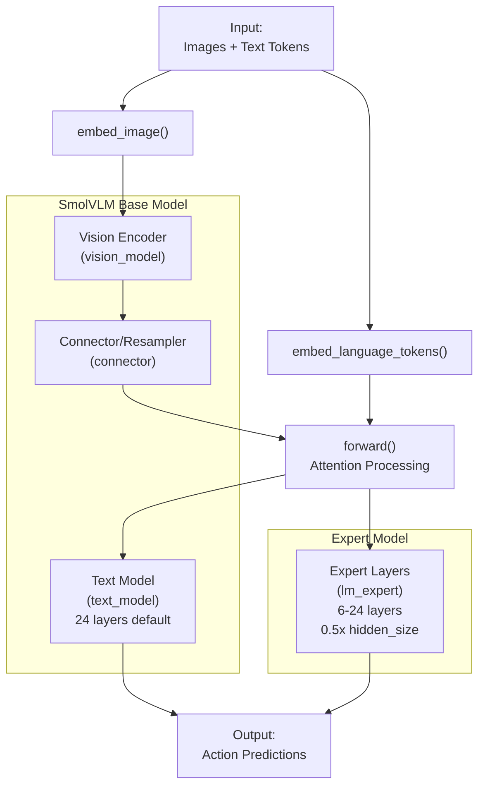
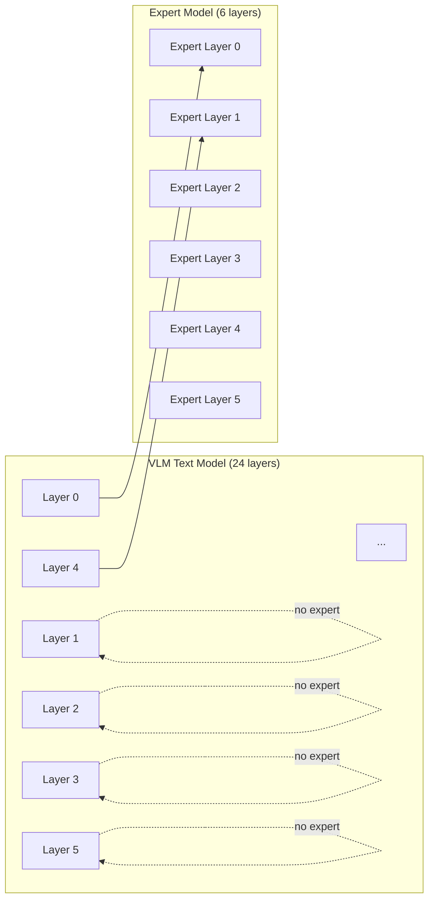
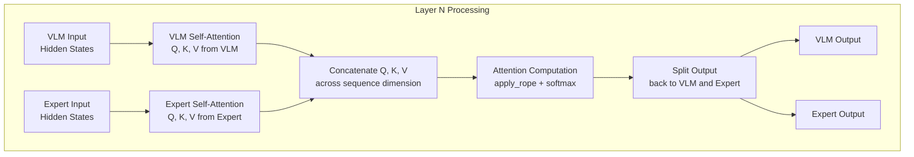
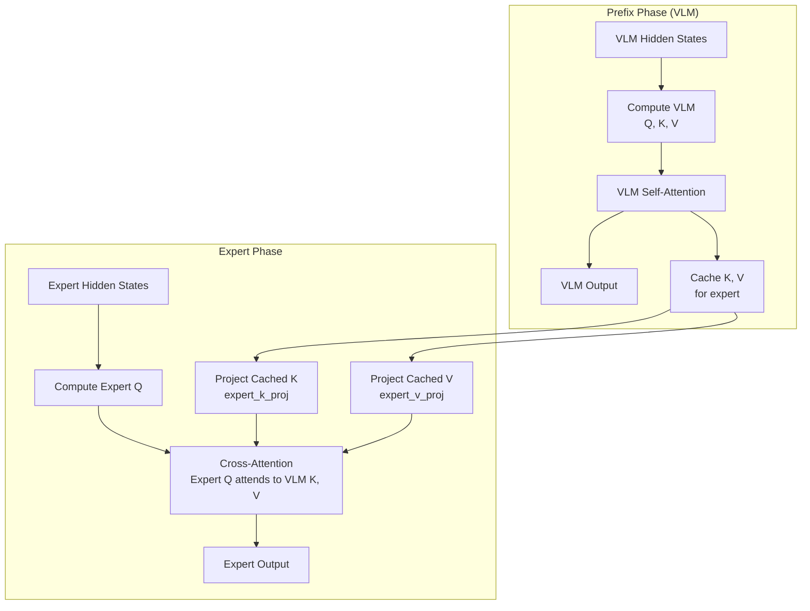
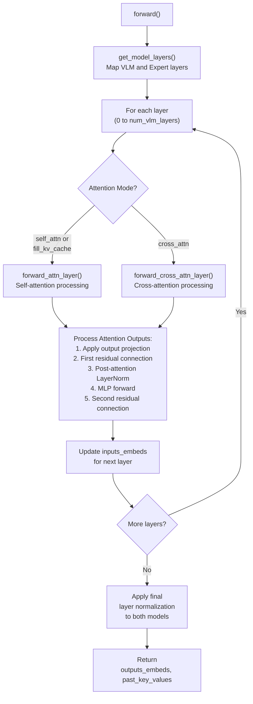
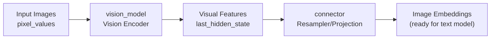
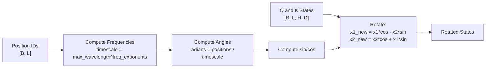
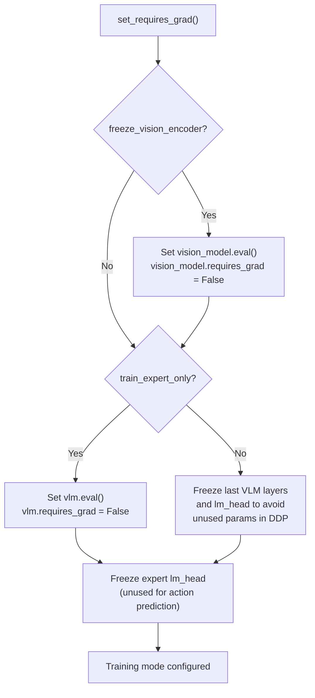

<!-- source: DeepWiki mcp.deepwiki.com · repo huggingface/VLAb · page 5.1 SmolVLA2 Architecture · fetched 2026-10-26 -->

# SmolVLA2 Architecture

<details>
<summary>Relevant source files</summary>

The following files were used as context for generating this wiki page:

- [LICENSE](LICENSE)
- [README.md](README.md)
- [src/lerobot/policies/smolvla2/smolvlm_with_expert2.py](src/lerobot/policies/smolvla2/smolvlm_with_expert2.py)

</details>


This document provides a detailed technical explanation of the SmolVLA2 architecture, which combines a full Vision-Language Model (VLM) with a smaller expert language model for efficient Vision-Language-Action (VLA) pretraining. For information about training strategies and PEFT methods, see [Training Strategies](#5.2). For configuration options, see [Policy Configuration](#6.3).

---

## Overview

SmolVLA2 is a hybrid architecture that leverages a pretrained SmolVLM base model alongside a smaller "expert" language model. The architecture supports two attention modes: **self-attention** (where VLM and expert process independently) and **cross-attention** (where the expert attends to VLM outputs). This design enables efficient pretraining by allowing different training strategies, from freezing the entire VLM to full fine-tuning with PEFT methods.

The primary implementation is in the `SmolVLMWithExpertModel` class, which orchestrates the interaction between the VLM and expert components.

**Sources:** [src/lerobot/policies/smolvla2/smolvlm_with_expert2.py:63-151](), [README.md:1-25]()

---

## High-Level Architecture



**Sources:** [src/lerobot/policies/smolvla2/smolvlm_with_expert2.py:63-150]()

---

## Architecture Components

### Base VLM Model

The SmolVLA2 architecture uses `SmolVLMForConditionalGeneration` as its base VLM, which is loaded from HuggingFace Hub. The VLM consists of three main components:

| Component | Description | Code Reference |
|-----------|-------------|----------------|
| Vision Encoder | Processes image/video inputs into visual features | `self.get_vlm_model().vision_model` |
| Connector | Projects and resamples visual features into language model space | `self.get_vlm_model().connector` |
| Text Model | Language model with 24 layers (default) for text processing | `self.get_vlm_model().text_model` |

The VLM is loaded with the following configuration:

```python
self.vlm = AutoModelForImageTextToText.from_pretrained(
    model_id,
    device_map=device_map,
    torch_dtype="bfloat16",
    low_cpu_mem_usage=True,
)
```

**Sources:** [src/lerobot/policies/smolvla2/smolvlm_with_expert2.py:77-108](), [src/lerobot/policies/smolvla2/smolvlm_with_expert2.py:194-200]()

### Expert Model

The expert model is a scaled-down version of the VLM's text model, designed for efficient action prediction:

**Expert Model Configuration:**

| Parameter | Value | Description |
|-----------|-------|-------------|
| `hidden_size` | `vlm_hidden_size * expert_width_multiplier` | Typically 0.5x VLM hidden size |
| `intermediate_size` | Computed via `get_intermediate_size()` | FFN dimension |
| `num_hidden_layers` | 6-24 (configurable) | Number of transformer layers |
| `embed_tokens` | `None` (removed) | Uses VLM embeddings instead |

The expert is instantiated from the VLM's text config:

```python
lm_expert_config = copy.deepcopy(config.text_config)
lm_expert_config.hidden_size = int(hidden_size * expert_width_multiplier)
lm_expert_config.intermediate_size = get_intermediate_size(
    int(hidden_size * expert_width_multiplier)
)
self.lm_expert = AutoModel.from_config(lm_expert_config)
```

**Sources:** [src/lerobot/policies/smolvla2/smolvlm_with_expert2.py:110-141](), [src/lerobot/policies/smolvla2/smolvlm_with_expert2.py:56-60]()

### Layer Mapping Strategy

When the expert has fewer layers than the VLM, layers are mapped according to a multiple strategy:



The mapping logic computes `multiple_of = num_vlm_layers // num_expert_layers` and only attaches expert layers at multiples of this value.

**Sources:** [src/lerobot/policies/smolvla2/smolvlm_with_expert2.py:445-457]()

---

## Attention Mechanisms

SmolVLA2 supports two attention modes controlled by the `attention_mode` parameter:

### Self-Attention Mode

In self-attention mode (`attention_mode="self_attn"`), the VLM and expert process their inputs independently:



**Key Implementation Details:**
- Query, key, and value states are computed independently for VLM and expert
- States are concatenated along the sequence dimension
- Single attention operation is performed on concatenated states
- Output is split back to respective models

**Sources:** [src/lerobot/policies/smolvla2/smolvlm_with_expert2.py:261-332]()

### Cross-Attention Mode

In cross-attention mode (`attention_mode="cross_attn"`), the expert attends to VLM outputs:



**Key Implementation Details:**
- VLM processes first, computing its own Q, K, V
- K and V are cached for the expert
- Expert computes only its own Q
- Expert's K and V projections take VLM's K, V as input (different dimensions)
- Expert queries attend to projected VLM keys and values

The cross-attention projections are reshaped during initialization:

```python
self.lm_expert.layers[layer_idx].self_attn.k_proj = nn.Linear(
    config.text_config.num_key_value_heads * config.text_config.head_dim,
    lm_expert_config.num_key_value_heads * lm_expert_config.head_dim,
    bias=lm_expert_config.attention_bias,
)
```

**Sources:** [src/lerobot/policies/smolvla2/smolvlm_with_expert2.py:334-443](), [src/lerobot/policies/smolvla2/smolvlm_with_expert2.py:124-138]()

### Mixed Attention Mode

A hybrid mode supports periodic self-attention layers within cross-attention mode via `self_attn_every_n_layers`:

```python
if (self.self_attn_every_n_layers > 0 and 
    layer_idx % self.self_attn_every_n_layers == 0):
    # Use self-attention for this layer
    att_outputs = self.forward_attn_layer(...)
else:
    # Use cross-attention for this layer
    att_outputs = self.forward_cross_attn_layer(...)
```

This allows some layers to process independently while others use cross-attention.

**Sources:** [src/lerobot/policies/smolvla2/smolvlm_with_expert2.py:479-508](), [src/lerobot/policies/smolvla2/smolvlm_with_expert2.py:123]()

---

## Forward Pass Flow

The forward pass orchestrates the interaction between VLM and expert models:



**Key Parameters:**

| Parameter | Type | Description |
|-----------|------|-------------|
| `inputs_embeds` | `List[torch.FloatTensor]` | List of embeddings for VLM and expert |
| `attention_mask` | `torch.Tensor` | Causal attention mask |
| `position_ids` | `torch.LongTensor` | Position indices for RoPE |
| `past_key_values` | `Optional[dict]` | Cached K, V for generation |
| `use_cache` | `bool` | Whether to cache K, V states |
| `fill_kv_cache` | `bool` | Whether to fill cache (vs. use cached values) |

**Sources:** [src/lerobot/policies/smolvla2/smolvlm_with_expert2.py:459-551]()

---

## Embedding Processing

### Image Embedding Pipeline

Images are processed through a multi-stage pipeline:



**Implementation:**

The `embed_image()` method processes images:

```python
def embed_image(self, image: torch.Tensor):
    patch_attention_mask = None
    # Get sequence from the vision encoder
    image_hidden_states = (
        self.get_vlm_model()
        .vision_model(
            pixel_values=image.to(dtype=self.get_vlm_model().vision_model.dtype),
            patch_attention_mask=patch_attention_mask,
        )
        .last_hidden_state
    )
    # Modality projection & resampling
    image_hidden_states = self.get_vlm_model().connector(image_hidden_states)
    return image_hidden_states
```

**Sources:** [src/lerobot/policies/smolvla2/smolvlm_with_expert2.py:243-256]()

### Text Embedding

Text tokens are embedded through the text model's embedding layer:

```python
def embed_language_tokens(self, tokens: torch.Tensor):
    return self.get_vlm_model().text_model.get_input_embeddings()(tokens)
```

These embeddings are concatenated with image embeddings before being fed to the attention layers.

**Sources:** [src/lerobot/policies/smolvla2/smolvlm_with_expert2.py:258-259]()

### RoPE Position Encoding

Rotary Position Embeddings (RoPE) are applied to query and key states:



**Sources:** [src/lerobot/policies/smolvla2/smolvlm_with_expert2.py:30-53]()

---

## Configuration Options

### Architectural Parameters

The architecture supports extensive configuration through initialization parameters:

```python
def __init__(
    self,
    model_id: str = "HuggingFaceTB/SmolVLM2-500M-Video-Instruct",
    load_vlm_weights: bool = True,
    train_expert_only: bool = True,
    freeze_vision_encoder: bool = False,
    attention_mode: str = "self_attn",
    num_expert_layers: int = -1,
    num_vlm_layers: int = -1,
    self_attn_every_n_layers: int = -1,
    expert_width_multiplier: float = 0.5,
):
```

**Parameter Details:**

| Parameter | Default | Description |
|-----------|---------|-------------|
| `model_id` | `"HuggingFaceTB/SmolVLM2-500M-Video-Instruct"` | HuggingFace model ID for base VLM |
| `load_vlm_weights` | `True` | Load pretrained VLM weights vs. random initialization |
| `train_expert_only` | `True` | Freeze VLM and train only expert model |
| `freeze_vision_encoder` | `False` | Freeze vision encoder (keep text model trainable) |
| `attention_mode` | `"self_attn"` | `"self_attn"` or `"cross_attn"` |
| `num_expert_layers` | `-1` | Number of expert layers (default: match VLM) |
| `num_vlm_layers` | `-1` | Number of VLM layers (default: use all 24) |
| `self_attn_every_n_layers` | `-1` | Periodic self-attention in cross-attention mode |
| `expert_width_multiplier` | `0.5` | Expert hidden size relative to VLM |

**Sources:** [src/lerobot/policies/smolvla2/smolvlm_with_expert2.py:64-75]()

### PEFT/LoRA Configuration

SmolVLA2 supports Parameter-Efficient Fine-Tuning (PEFT) via LoRA:

```python
def configure_peft(self, config):
    self.peft_method = config.peft_method
    self.peft_target_model = config.peft_target_model
    if "lora" in self.peft_method:
        peft_config = config.peft_config
        target_modules = peft_config.target_modules
        lora_config = LoraConfig(
            task_type=TaskType.CAUSAL_LM,
            r=peft_config.r,
            lora_alpha=peft_config.lora_alpha,
            lora_dropout=peft_config.lora_dropout,
            target_modules=target_modules,
            exclude_modules=["lm_expert", "model.lm_expert.model.layers"],
        )
```

**LoRA Parameters:**

| Parameter | Description |
|-----------|-------------|
| `r` | Rank of low-rank adaptation matrices |
| `lora_alpha` | Scaling factor for LoRA updates |
| `lora_dropout` | Dropout probability for LoRA layers |
| `target_modules` | List of modules to apply LoRA (e.g., `["q_proj", "v_proj"]`) |
| `peft_target_model` | Whether to apply LoRA to full model or just `text_model` |

LoRA adapters are applied to the VLM while excluding the expert model, which is trained normally.

**Sources:** [src/lerobot/policies/smolvla2/smolvlm_with_expert2.py:151-183]()

---

## Training Mode Management

### Gradient Control

The `set_requires_grad()` method controls which parameters are trainable:



**Special Handling for Distributed Training:**

To avoid unused parameter errors in distributed training, the last VLM layer and `lm_head` are always frozen:

```python
frozen_layers = [
    "lm_head",
    "text_model.model.norm.weight",
]
for layer in last_layers:
    frozen_layers.append(f"text_model.model.layers.{layer}.")

for name, params in self.vlm.named_parameters():
    if any(k in name for k in frozen_layers):
        params.requires_grad = False
```

**Sources:** [src/lerobot/policies/smolvla2/smolvlm_with_expert2.py:202-232]()

### Training Mode Override

The `train()` method ensures frozen components remain in eval mode:

```python
def train(self, mode: bool = True):
    super().train(mode)
    
    if self.freeze_vision_encoder:
        self.get_vlm_model().vision_model.eval()
    
    if self.train_expert_only:
        self.vlm.eval()
```

This prevents batch normalization and dropout from being activated in frozen modules during training.

**Sources:** [src/lerobot/policies/smolvla2/smolvlm_with_expert2.py:234-241]()

---

## Device and Memory Management

### Multi-GPU Compatibility

The model initialization detects whether Accelerate or distributed training is active:

```python
import os
is_accelerate = "ACCELERATE_MIXED_PRECISION" in os.environ

try:
    import torch.distributed as dist
    is_distributed = dist.is_initialized()
except:
    is_distributed = False

# Use device_map=None when using accelerate or distributed training
use_device_map = not (is_accelerate or is_distributed)
device_map = None if not use_device_map else "auto"
```

When using Accelerate or distributed training, `device_map` is set to `None` to prevent tensor parallel which requires PyTorch >=2.5.

**Sources:** [src/lerobot/policies/smolvla2/smolvlm_with_expert2.py:81-92]()

### Memory-Efficient Loading

Models are loaded with memory optimization flags:

```python
self.vlm = AutoModelForImageTextToText.from_pretrained(
    model_id,
    device_map=device_map,
    torch_dtype="bfloat16",  # Mixed precision
    low_cpu_mem_usage=True,   # Efficient loading
)
```

**Sources:** [src/lerobot/policies/smolvla2/smolvlm_with_expert2.py:93-98]()

---

## Code Entity Reference

This table maps high-level concepts to specific code entities:

| Concept | Class/Function | File | Lines |
|---------|---------------|------|-------|
| Main Architecture | `SmolVLMWithExpertModel` | `src/lerobot/policies/smolvla2/smolvlm_with_expert2.py` | 63-603 |
| VLM Access | `get_vlm_model()` | `src/lerobot/policies/smolvla2/smolvlm_with_expert2.py` | 194-200 |
| Image Processing | `embed_image()` | `src/lerobot/policies/smolvla2/smolvlm_with_expert2.py` | 243-256 |
| Text Embedding | `embed_language_tokens()` | `src/lerobot/policies/smolvla2/smolvlm_with_expert2.py` | 258-259 |
| Forward Pass | `forward()` | `src/lerobot/policies/smolvla2/smolvlm_with_expert2.py` | 459-551 |
| Self-Attention | `forward_attn_layer()` | `src/lerobot/policies/smolvla2/smolvlm_with_expert2.py` | 261-332 |
| Cross-Attention | `forward_cross_attn_layer()` | `src/lerobot/policies/smolvla2/smolvlm_with_expert2.py` | 334-443 |
| RoPE Encoding | `apply_rope()` | `src/lerobot/policies/smolvla2/smolvlm_with_expert2.py` | 30-53 |
| Layer Mapping | `get_model_layers()` | `src/lerobot/policies/smolvla2/smolvlm_with_expert2.py` | 445-457 |
| PEFT Configuration | `configure_peft()` | `src/lerobot/policies/smolvla2/smolvlm_with_expert2.py` | 151-183 |
| Gradient Control | `set_requires_grad()` | `src/lerobot/policies/smolvla2/smolvlm_with_expert2.py` | 202-232 |
| FFN Size Calculation | `get_intermediate_size()` | `src/lerobot/policies/smolvla2/smolvlm_with_expert2.py` | 56-60 |
| Attention Interface | `eager_attention_forward()` | `src/lerobot/policies/smolvla2/smolvlm_with_expert2.py` | 557-602 |

**Sources:** [src/lerobot/policies/smolvla2/smolvlm_with_expert2.py:1-603]()

---

