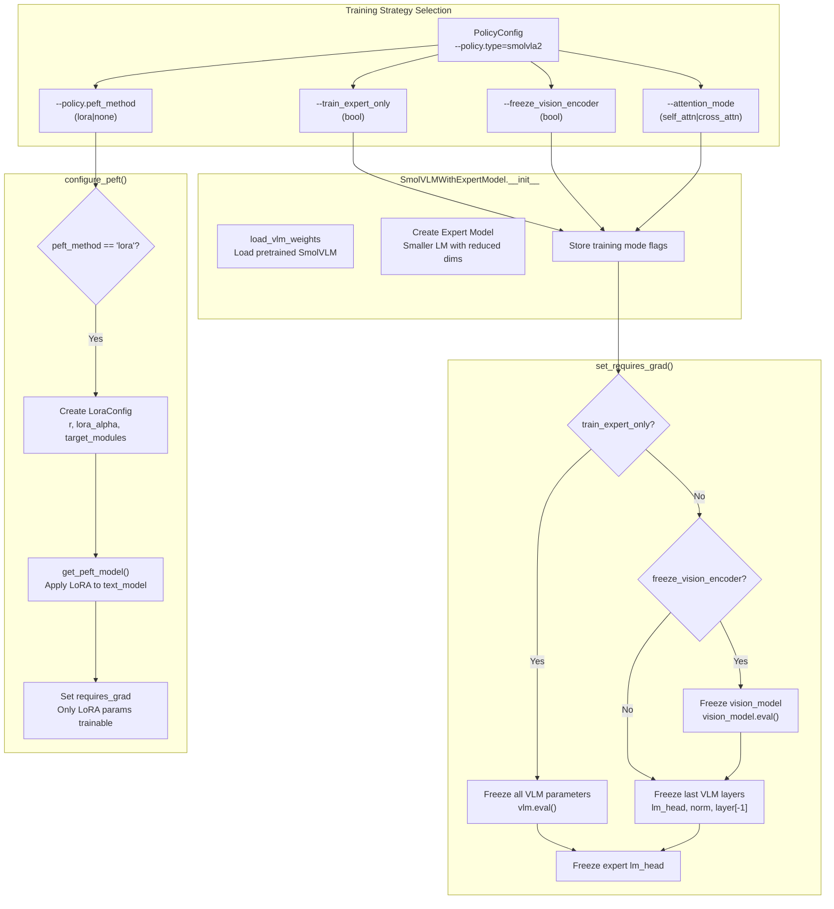
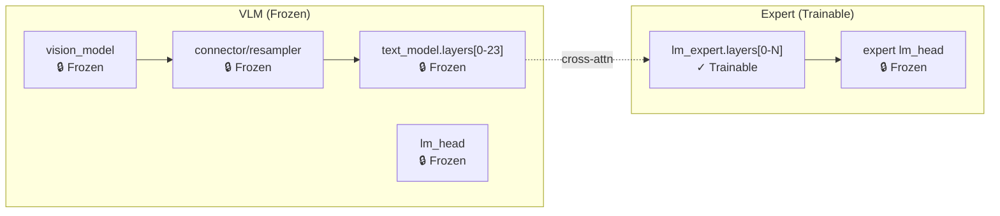
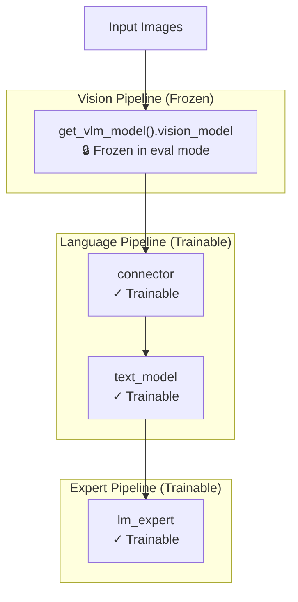
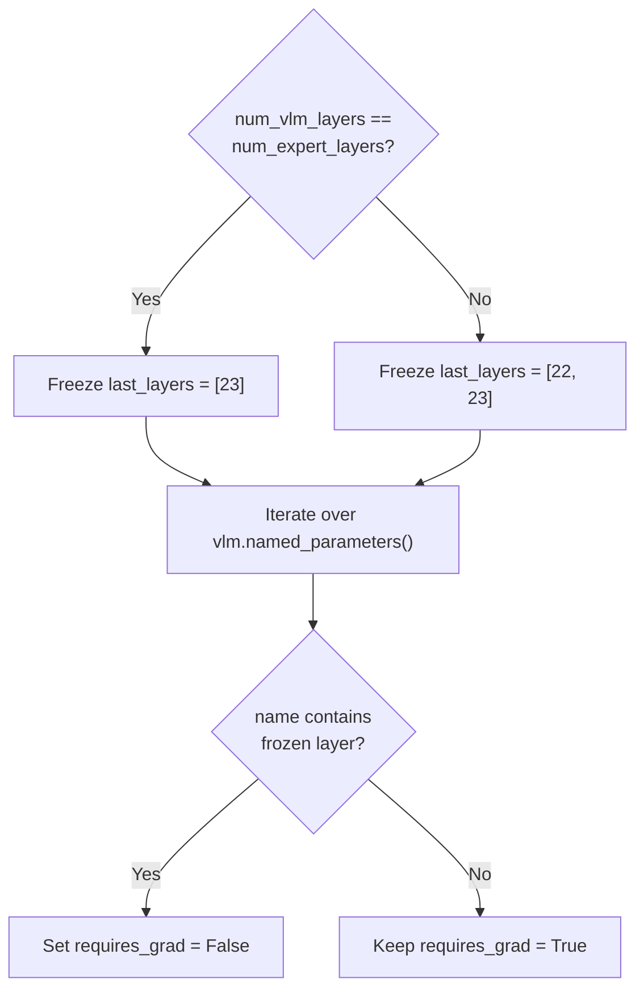
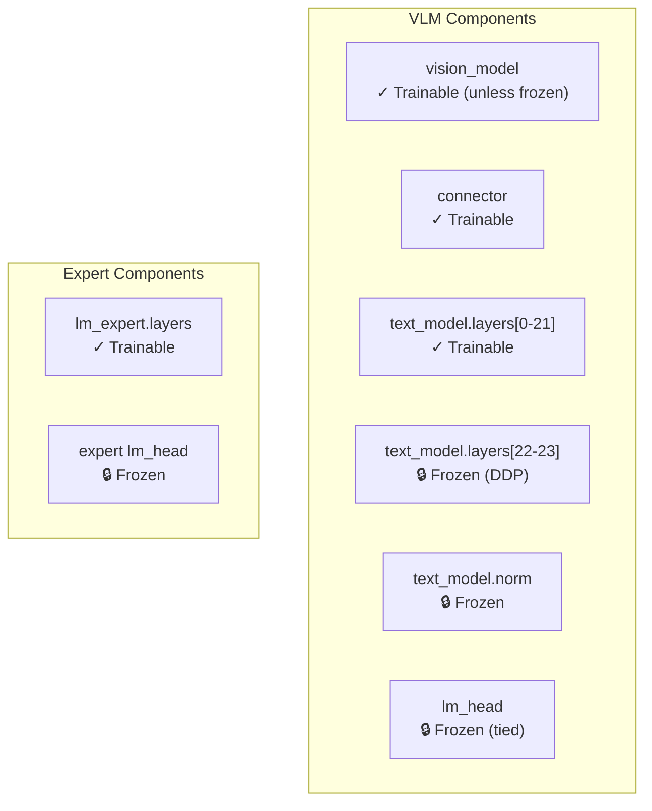
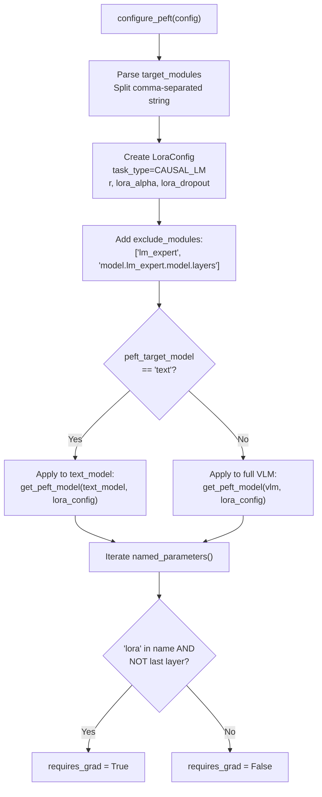
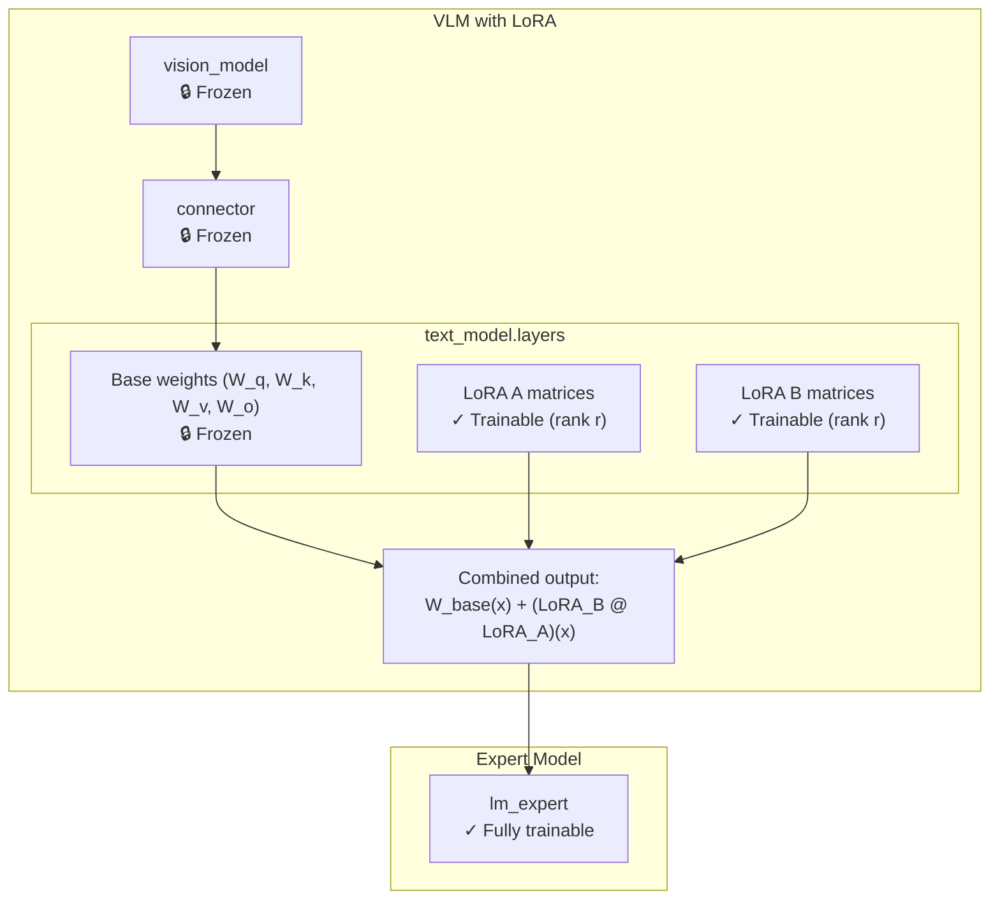
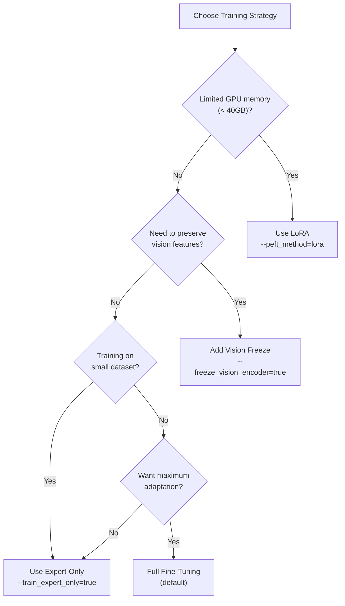

<!-- source: DeepWiki mcp.deepwiki.com · repo huggingface/VLAb · page 5.2 Training Strategies · fetched 2026-10-26 -->

# Training Strategies

<details>
<summary>Relevant source files</summary>

The following files were used as context for generating this wiki page:

- [LICENSE](LICENSE)
- [README.md](README.md)
- [src/lerobot/policies/smolvla2/smolvlm_with_expert2.py](src/lerobot/policies/smolvla2/smolvlm_with_expert2.py)

</details>


## Purpose and Scope

This page documents the different training strategies available in VLAb for pretraining Vision-Language-Action models. Training strategies determine which model components are updated during training and how parameter updates are applied, enabling efficient pretraining with controlled compute budgets and memory footprint.

For architectural details of the SmolVLA2 model, see [SmolVLA2 Architecture](#5.1). For optimizer and learning rate configuration, see [Optimization Configuration](#6.4).

---

## Overview of Training Strategies

VLAb supports four primary training strategies that can be combined to create flexible training configurations:

| Strategy | Parameters Updated | Memory Footprint | Compute Cost | Primary Use Case |
|----------|-------------------|------------------|--------------|------------------|
| **Expert-Only** | Expert model only | Low (~50% of full) | Low | Efficient pretraining with frozen VLM |
| **Vision Freezing** | Text model + Expert | Medium | Medium | Preserve visual representations |
| **Full Fine-Tuning** | All parameters | High | High | Maximum adaptation capability |
| **PEFT/LoRA** | Low-rank adapters | Very Low (~1-5% extra) | Low | Parameter-efficient adaptation |

These strategies are controlled through configuration parameters in the `SmolVLMWithExpertModel` class and can be combined (e.g., expert-only + vision freezing).

Sources: [src/lerobot/policies/smolvla2/smolvlm_with_expert2.py:63-149](), [README.md:17-24]()

---

## Training Strategy Architecture



Sources: [src/lerobot/policies/smolvla2/smolvlm_with_expert2.py:63-149](), [src/lerobot/policies/smolvla2/smolvlm_with_expert2.py:202-232](), [src/lerobot/policies/smolvla2/smolvlm_with_expert2.py:151-183]()

---

## Expert-Only Training

### Description

Expert-only training freezes the entire VLM (Vision-Language Model) and trains only the expert model. This is the most compute-efficient strategy, as the VLM forward pass is computed but gradients are not propagated through it.

### Configuration

Enable expert-only training with:
```bash
--train_expert_only=true
```

### Implementation Details

When `train_expert_only=True`, the `set_requires_grad()` method at [src/lerobot/policies/smolvla2/smolvlm_with_expert2.py:207-210]() performs the following:

1. Sets `vlm.eval()` to put the VLM in evaluation mode
2. Sets `requires_grad=False` for all VLM parameters
3. Expert model remains trainable by default

The `train()` method override at [src/lerobot/policies/smolvla2/smolvlm_with_expert2.py:234-242]() ensures that `vlm.eval()` is maintained even when the overall model is set to training mode.

### Frozen Components



### Use Cases

- **Initial pretraining**: Start with expert-only to quickly adapt the expert to robotics tasks
- **Limited compute**: Reduce memory and compute requirements by ~50%
- **Preserve VLM knowledge**: When the base VLM already has strong visual and language understanding

### Memory and Compute Impact

With expert-only training:
- **Memory**: ~50% reduction (no gradients stored for VLM)
- **Backward pass**: Only expert layers compute gradients
- **Forward pass**: Full VLM forward pass still computed (needed for cross-attention)

Sources: [src/lerobot/policies/smolvla2/smolvlm_with_expert2.py:68](), [src/lerobot/policies/smolvla2/smolvlm_with_expert2.py:207-210](), [src/lerobot/policies/smolvla2/smolvlm_with_expert2.py:234-242]()

---

## Vision Encoder Freezing

### Description

Vision encoder freezing keeps the vision model's weights fixed while allowing the text model and expert to be trained. This preserves the pre-trained visual representations while adapting the language and action components.

### Configuration

Enable vision encoder freezing with:
```bash
--freeze_vision_encoder=true
```

This can be combined with other strategies:
```bash
# Vision freezing + expert-only
--freeze_vision_encoder=true --train_expert_only=true

# Vision freezing + full fine-tuning
--freeze_vision_encoder=true
```

### Implementation Details

The vision encoder freezing is implemented at [src/lerobot/policies/smolvla2/smolvlm_with_expert2.py:203-206]():

1. Sets `vision_model.eval()` to evaluation mode
2. Sets `requires_grad=False` for all vision model parameters
3. Maintained in training mode override at [src/lerobot/policies/smolvla2/smolvlm_with_expert2.py:237-238]()

### Component Status with Vision Freezing



### Use Cases

- **Domain-specific vision**: When the vision encoder is already well-trained on relevant visual data
- **Stability**: Prevent catastrophic forgetting of visual features during robotics pretraining
- **Compute reduction**: Save memory and compute on vision encoder gradients

Sources: [src/lerobot/policies/smolvla2/smolvlm_with_expert2.py:69](), [src/lerobot/policies/smolvla2/smolvlm_with_expert2.py:203-206](), [src/lerobot/policies/smolvla2/smolvlm_with_expert2.py:237-238]()

---

## Full Fine-Tuning

### Description

Full fine-tuning trains all model parameters except certain architecture-specific frozen components (last layers, lm_head). This provides maximum adaptation capability but requires the most memory and compute.

### Configuration

Full fine-tuning is the default when neither expert-only nor PEFT is enabled:
```bash
# Full fine-tuning (default)
accelerate launch ... --train_expert_only=false --policy.peft_method=none

# With vision freezing (common combination)
accelerate launch ... --train_expert_only=false --freeze_vision_encoder=true
```

### Architecture-Specific Freezing

Even in full fine-tuning mode, certain components are frozen to prevent unused parameters in distributed training. The logic at [src/lerobot/policies/smolvla2/smolvlm_with_expert2.py:212-228]() freezes:

| Component | Reason for Freezing |
|-----------|-------------------|
| `lm_head` | Tied to embeddings, not separately trainable |
| `text_model.model.norm.weight` | Final layer norm |
| Last 1-2 text model layers | Prevents unused parameter issues in DDP |
| Expert `lm_head` | Not used for action prediction |

### Layer Freezing Logic



### Trainable Parameters in Full Fine-Tuning



### Use Cases

- **Maximum adaptation**: When the model needs to learn significantly different visual or language patterns
- **Smaller datasets**: When pretraining on a focused, high-quality dataset
- **Fine-grained control**: When you need all components to adapt to the robotics domain

### Memory and Compute Requirements

Full fine-tuning requires:
- **Memory**: Highest memory usage (gradients for all trainable parameters)
- **GPU requirements**: Typically needs 40GB+ VRAM for SmolVLM-500M with reasonable batch sizes
- **Training speed**: Slowest due to backward pass through all layers

Sources: [src/lerobot/policies/smolvla2/smolvlm_with_expert2.py:212-228](), [src/lerobot/policies/smolvla2/smolvlm_with_expert2.py:230-232]()

---

## PEFT with LoRA

### Description

Parameter-Efficient Fine-Tuning (PEFT) using LoRA (Low-Rank Adaptation) adds trainable low-rank matrices to existing layers, enabling efficient adaptation with minimal additional parameters. In VLAb, LoRA is applied to the VLM's text model while keeping the expert model fully trainable.

### Configuration

Enable LoRA with:
```bash
--policy.peft_method=lora \
--policy.peft_config.r=8 \
--policy.peft_config.lora_alpha=16 \
--policy.peft_config.lora_dropout=0.05 \
--policy.peft_config.target_modules="q_proj,v_proj,k_proj,o_proj"
```

### LoRA Parameters

| Parameter | Default | Description |
|-----------|---------|-------------|
| `r` | 8 | Rank of low-rank matrices (higher = more capacity) |
| `lora_alpha` | 16 | Scaling factor for LoRA updates |
| `lora_dropout` | 0.05 | Dropout applied to LoRA layers |
| `target_modules` | `"q_proj,v_proj,k_proj,o_proj"` | Which attention projections to adapt |

### Implementation Details

LoRA configuration is handled by the `configure_peft()` method at [src/lerobot/policies/smolvla2/smolvlm_with_expert2.py:151-183]():



### LoRA Application Scope

The `peft_target_model` parameter controls where LoRA is applied:

- **`"text"`**: Apply LoRA only to `text_model` (default for SmolVLA2)
- **Other**: Apply LoRA to the entire `vlm` model

The expert model is always excluded from LoRA via the `exclude_modules` list at [src/lerobot/policies/smolvla2/smolvlm_with_expert2.py:166-169]().

### Parameter Status with LoRA



### Memory and Efficiency

LoRA provides significant efficiency gains:

| Metric | Full Fine-Tuning | LoRA (r=8) |
|--------|------------------|------------|
| Trainable parameters | ~500M (100%) | ~5-25M (1-5%) |
| Memory overhead | High | Very low |
| Training speed | Baseline | Faster (fewer gradients) |
| Checkpoint size | Full model (~1-2GB) | LoRA weights only (~10-50MB) |

### Use Cases

- **Memory-constrained training**: Train on GPUs with limited VRAM
- **Quick iteration**: Faster training and smaller checkpoints for experimentation
- **Task-specific adaptation**: Keep base model frozen, add task-specific LoRA adapters
- **Multi-task learning**: Train separate LoRA adapters for different robotics tasks

### Merging LoRA Weights

After training, LoRA weights can be merged back into the base model using the `merge_lora_weights()` method at [src/lerobot/policies/smolvla2/smolvlm_with_expert2.py:185-192]():

```python
# Merge LoRA weights into base model
model.merge_lora_weights()
```

This creates a standard model without LoRA adapters, useful for deployment.

Sources: [src/lerobot/policies/smolvla2/smolvlm_with_expert2.py:151-183](), [src/lerobot/policies/smolvla2/smolvlm_with_expert2.py:185-192]()

---

## Combining Training Strategies

### Compatible Combinations

Training strategies can be combined to create custom training configurations:

| Combination | Expert-Only | Vision Freeze | LoRA | Use Case |
|-------------|-------------|---------------|------|----------|
| **Minimal Compute** | ✓ | ✓ | - | Fastest training, frozen VLM |
| **Vision Preservation** | - | ✓ | ✓ | Keep vision fixed, efficient text adaptation |
| **Expert Focus** | ✓ | - | - | Train expert only, VLM with vision trainable |
| **Balanced** | - | ✓ | - | Full text training, frozen vision |
| **Maximum Efficiency** | ✓ | ✓ | ✓ | Expert + LoRA on VLM (rare) |

### Configuration Examples

**1. Minimal Compute (Expert-Only + Vision Freeze):**
```bash
accelerate launch ... \
  --train_expert_only=true \
  --freeze_vision_encoder=true
```

**2. Vision Preservation with LoRA:**
```bash
accelerate launch ... \
  --freeze_vision_encoder=true \
  --policy.peft_method=lora \
  --policy.peft_config.r=8
```

**3. Expert-Only (Default for SmolVLA Reproduction):**
```bash
accelerate launch ... \
  --train_expert_only=true
```

### Strategy Selection Decision Tree



Sources: [src/lerobot/policies/smolvla2/smolvlm_with_expert2.py:64-75](), [README.md:96-120]()

---

## Attention Mode Impact on Training

### Attention Modes

The `attention_mode` parameter affects how the VLM and expert interact, which impacts training strategy effectiveness:

| Mode | Description | Best Strategy |
|------|-------------|---------------|
| `self_attn` | VLM and expert process independently | Expert-only works well |
| `cross_attn` | Expert attends to VLM outputs | Requires VLM forward pass |

### Cross-Attention Dependencies

When using `attention_mode="cross_attn"`, the expert model requires VLM outputs for its key/value projections at [src/lerobot/policies/smolvla2/smolvlm_with_expert2.py:406-419](). This means:

1. **Expert-only training**: VLM forward pass is still computed (no memory savings on activations)
2. **Memory savings**: Only from not storing VLM gradients
3. **Cross-attention layers**: Modified k_proj and v_proj to project VLM outputs at [src/lerobot/policies/smolvla2/smolvlm_with_expert2.py:129-138]()

### Self-Attention Configuration

With `self_attn_every_n_layers > 0`, certain layers use self-attention instead of cross-attention:

```python
# Example: Self-attention every 2 layers in a 6-layer expert
--num_expert_layers=6 --self_attn_every_n_layers=2
# Layers 0, 2, 4 use self-attention
# Layers 1, 3, 5 use cross-attention (if attention_mode="cross_attn")
```

This is checked at [src/lerobot/policies/smolvla2/smolvlm_with_expert2.py:127-128]() during initialization and [src/lerobot/policies/smolvla2/smolvlm_with_expert2.py:482]() during forward pass.

Sources: [src/lerobot/policies/smolvla2/smolvlm_with_expert2.py:70](), [src/lerobot/policies/smolvla2/smolvlm_with_expert2.py:73](), [src/lerobot/policies/smolvla2/smolvlm_with_expert2.py:127-138](), [src/lerobot/policies/smolvla2/smolvlm_with_expert2.py:406-419]()

---

## Training Mode Override

### Maintaining Frozen State

The `train()` method at [src/lerobot/policies/smolvla2/smolvlm_with_expert2.py:234-242]() overrides PyTorch's default to maintain frozen states:

```python
def train(self, mode: bool = True):
    super().train(mode)
    
    if self.freeze_vision_encoder:
        self.get_vlm_model().vision_model.eval()
    
    if self.train_expert_only:
        self.vlm.eval()
```

This ensures that even when the model is set to training mode (e.g., by the training loop), frozen components remain in evaluation mode with dropout/batch normalization disabled.

### Impact on Training

| Component State | train() Called | Frozen Component Behavior |
|----------------|----------------|---------------------------|
| `model.train()` | Yes | Frozen components stay in `eval()` |
| `model.eval()` | No | All components in `eval()` |
| Frozen dropout | - | Always disabled |
| Frozen batch norm | - | Always uses running stats |

This is critical for:
1. **Reproducibility**: Frozen components behave identically in train/eval
2. **Correctness**: No stochastic behavior (dropout) in frozen layers
3. **Stability**: Batch norm uses pre-computed statistics

Sources: [src/lerobot/policies/smolvla2/smolvlm_with_expert2.py:234-242]()

---

## Best Practices and Recommendations

### For SmolVLA Reproduction

The official SmolVLA reproduction uses expert-only training:
```bash
--train_expert_only=true
```

This matches the original SmolVLA pretraining strategy and provides a good balance of efficiency and performance.

### For Different Scenarios

**Limited GPU Memory (< 24GB):**
```bash
--policy.peft_method=lora \
--policy.peft_config.r=8 \
--freeze_vision_encoder=true \
--batch_size=4  # Smaller batch size
```

**Maximum Performance (40GB+ GPU):**
```bash
--train_expert_only=false \
--freeze_vision_encoder=false \
--batch_size=16
```

**Quick Experimentation:**
```bash
--train_expert_only=true \
--freeze_vision_encoder=true \
--steps=1000  # Short training run
```

### Gradient Clipping and Mixed Precision

Training strategies interact with optimization settings:

- **Gradient clipping**: Applied regardless of strategy (default `max_norm=1.0`)
- **Mixed precision (`use_amp`)**: Compatible with all strategies, saves additional memory
- **Gradient accumulation**: Useful with small batch sizes in memory-constrained settings

For optimization details, see [Optimization Configuration](#6.4).

### Monitoring Training

Different strategies may show different training dynamics:

| Strategy | Expected Loss Pattern | Key Metrics |
|----------|----------------------|-------------|
| Expert-only | Faster initial drop | Expert gradient norms |
| Full fine-tuning | Slower, steady | All layer gradients |
| LoRA | Similar to full, faster | LoRA parameter norms |
| Vision frozen | Stable vision features | Text loss dominates |

Sources: [README.md:122-195](), [README.md:96-120]()

---

## Summary

VLAb provides flexible training strategies to balance compute efficiency, memory usage, and model adaptation capability:

1. **Expert-Only**: Train only the expert model (default for SmolVLA reproduction)
2. **Vision Freezing**: Keep vision encoder fixed while training language/action components
3. **Full Fine-Tuning**: Update all parameters (except specific frozen layers)
4. **PEFT/LoRA**: Parameter-efficient adaptation with low-rank matrices

These strategies can be combined through configuration parameters in `SmolVLMWithExpertModel`, with automatic handling of frozen states, gradient computation, and distributed training compatibility.

For implementation details of the SmolVLA2 architecture that these strategies operate on, see [SmolVLA2 Architecture](#5.1).

Sources: [src/lerobot/policies/smolvla2/smolvlm_with_expert2.py:63-232]()

---

