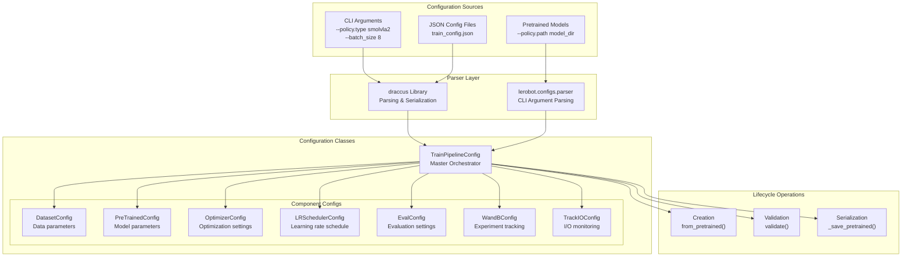
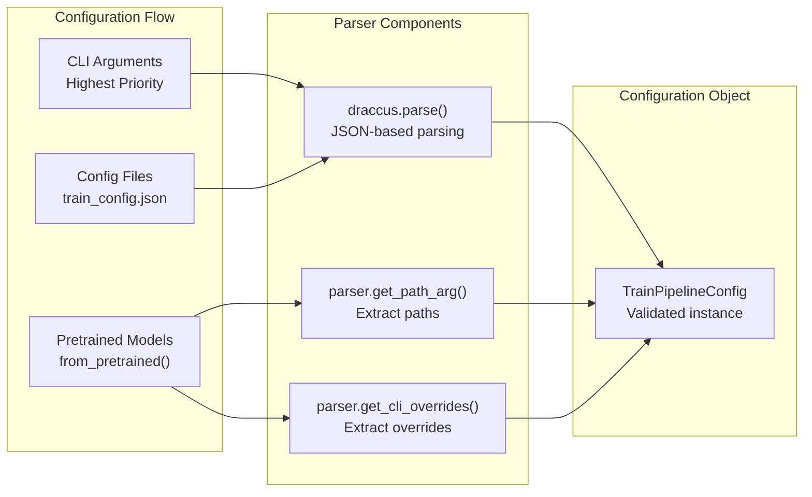
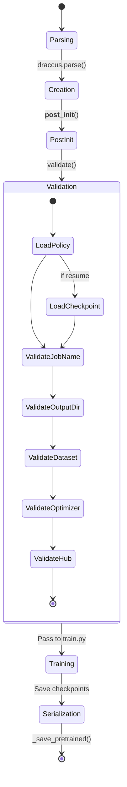
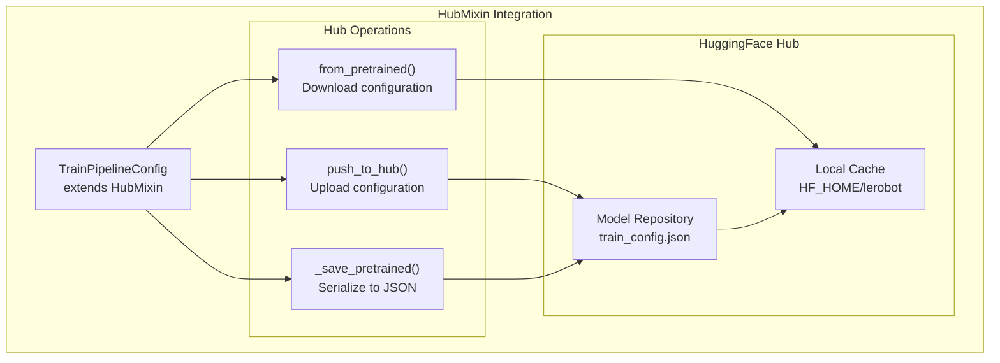

<!-- source: DeepWiki mcp.deepwiki.com · repo huggingface/VLAb · page 6 Configuration System · fetched 2026-10-26 -->

# Configuration System

<details>
<summary>Relevant source files</summary>

The following files were used as context for generating this wiki page:

- [src/lerobot/configs/__pycache__/default.cpython-311.pyc](src/lerobot/configs/__pycache__/default.cpython-311.pyc)
- [src/lerobot/configs/__pycache__/train.cpython-311.pyc](src/lerobot/configs/__pycache__/train.cpython-311.pyc)
- [src/lerobot/configs/default.py](src/lerobot/configs/default.py)
- [src/lerobot/configs/train.py](src/lerobot/configs/train.py)
- [src/lerobot/constants.py](src/lerobot/constants.py)

</details>


## Purpose and Scope

The Configuration System provides a declarative, type-safe mechanism for specifying all parameters required to train VLA models. It uses a hierarchical dataclass structure that aggregates dataset, policy, optimization, evaluation, and logging configurations into a unified `TrainPipelineConfig`. This system enables configuration through multiple sources (CLI arguments, JSON files, pretrained models) and ensures validation before training begins.

For details on specific configuration classes, see:
- [TrainPipelineConfig](#6.1) - Master training configuration orchestrator
- [DatasetConfig](#6.2) - Dataset parameters and multi-dataset support
- [Policy Configuration](#6.3) - Model architecture and training strategy parameters
- [Optimization Configuration](#6.4) - Optimizer and learning rate scheduler settings

## System Architecture

The configuration system is built on three core principles:
1. **Hierarchical Composition**: Nested dataclasses organize related parameters
2. **Type Safety**: Python type hints enable validation and IDE support
3. **Multiple Sources**: Configuration can come from CLI, files, or pretrained models



**Sources**: [src/lerobot/configs/train.py:1-215](), [src/lerobot/configs/default.py:1-98]()

## Configuration Class Hierarchy

The configuration system organizes parameters into specialized dataclasses, each responsible for a specific subsystem:

| Configuration Class | Purpose | Key Parameters | File Location |
|---------------------|---------|----------------|---------------|
| `TrainPipelineConfig` | Master configuration orchestrator | `batch_size`, `steps`, `output_dir`, `resume` | [train.py:38-215]() |
| `DatasetConfig` | Dataset loading and preprocessing | `repo_id`, `root`, `episodes`, `image_transforms` | [default.py:27-55]() |
| `PreTrainedConfig` | Policy architecture and parameters | `type`, `pretrained_path`, `push_to_hub` | Referenced from policies |
| `OptimizerConfig` | Optimizer settings | `lr`, `betas`, `weight_decay` | Referenced from optim |
| `LRSchedulerConfig` | Learning rate scheduling | `warmup_steps`, `num_training_steps` | Referenced from optim |
| `EvalConfig` | Evaluation parameters | `n_episodes`, `batch_size`, `use_async_envs` | [default.py:81-97]() |
| `WandBConfig` | Weights & Biases logging | `enable`, `project`, `entity`, `run_id` | [default.py:58-66]() |
| `TrackIOConfig` | TrackIO I/O monitoring | `enable`, `project`, `space_id` | [default.py:70-77]() |

**Sources**: [src/lerobot/configs/train.py:38-69](), [src/lerobot/configs/default.py:26-97]()

## Configuration Sources and Parsing

VLAb supports three primary sources for configuration parameters, each with specific use cases:



### CLI Arguments

Command-line arguments provide the highest priority configuration source. The system uses `draccus` for parsing, which supports nested dataclass fields:

```bash
accelerate launch train.py \
  --dataset.repo_id "lerobot/aloha_sim_insertion_human_image" \
  --policy.type smolvla2 \
  --batch_size 16 \
  --steps 100000
```

The `draccus` library automatically maps dot-notation CLI arguments to nested dataclass fields, performing type checking and conversion.

### Config Files

JSON configuration files enable reproducibility and version control. The system saves configurations to `train_config.json` in the output directory:

```python
# Saving configuration
def _save_pretrained(self, save_directory: Path) -> None:
    with open(save_directory / TRAIN_CONFIG_NAME, "w") as f, draccus.config_type("json"):
        draccus.dump(self, f, indent=4)
```

### Pretrained Models

When resuming or loading from pretrained models, configurations are loaded from the model directory. This ensures consistency when continuing training:

```python
# Loading from pretrained
config = TrainPipelineConfig.from_pretrained(
    pretrained_name_or_path="path/to/checkpoint",
    cli_args=sys.argv[1:]  # CLI overrides still apply
)
```

**Sources**: [src/lerobot/configs/train.py:73-95](), [src/lerobot/configs/train.py:162-209]()

## Configuration Lifecycle

The configuration system follows a well-defined lifecycle from creation to validation to serialization:



### Creation Phase

Configuration objects are created through one of three mechanisms:

1. **Direct instantiation** with default values:
```python
config = TrainPipelineConfig(
    dataset=DatasetConfig(repo_id="lerobot/dataset"),
    policy=PreTrainedConfig(type="smolvla2")
)
```

2. **CLI parsing** with `draccus`:
```python
config = draccus.parse(TrainPipelineConfig)
```

3. **Loading from pretrained** models or checkpoints:
```python
config = TrainPipelineConfig.from_pretrained("path/to/checkpoint")
```

**Sources**: [src/lerobot/configs/train.py:166-209]()

### Post-Initialization

The `__post_init__` method performs basic initialization immediately after object creation:

```python
def __post_init__(self):
    self.checkpoint_path = None
```

This initializes state that depends on the configuration but doesn't require validation logic.

**Sources**: [src/lerobot/configs/train.py:70-71]()

### Validation Phase

The `validate()` method performs comprehensive checks and transformations before training begins. This phase handles:

#### 1. Policy Loading
```python
policy_path = parser.get_path_arg("policy")
if policy_path:
    cli_overrides = parser.get_cli_overrides("policy")
    self.policy = PreTrainedConfig.from_pretrained(policy_path, cli_overrides=cli_overrides)
    self.policy.pretrained_path = policy_path
```

Loads policy configuration from a pretrained model path if provided via CLI.

#### 2. Resume Logic
```python
elif self.resume:
    config_path = parser.parse_arg("config_path")
    if not config_path:
        raise ValueError(
            f"A config_path is expected when resuming a run. Please specify path to {TRAIN_CONFIG_NAME}"
        )
    policy_path = Path(config_path).parent
    self.checkpoint_path = policy_path.parent
```

When resuming, validates that a config path exists and sets up checkpoint paths.

#### 3. Job Name Generation
```python
if not self.job_name:
    if self.env is None:
        self.job_name = f"{self.policy.type}"
    else:
        self.job_name = f"{self.env.type}_{self.policy.type}"
```

Automatically generates descriptive job names if not provided.

#### 4. Output Directory Management
```python
if not self.output_dir:
    now = dt.datetime.now()
    train_dir = f"{now:%Y-%m-%d}/{now:%H-%M-%S}_{self.job_name}"
    self.output_dir = Path("outputs/train") / train_dir
elif not self.resume and isinstance(self.output_dir, Path) and self.output_dir.is_dir():
    # Handle existing directory - prompt or auto-timestamp
```

Creates timestamped output directories and handles existing directory conflicts based on whether the session is interactive or non-interactive (e.g., SLURM).

#### 5. Dataset Validation
```python
if isinstance(self.dataset.repo_id, list):
    raise NotImplementedError("LeRobotMultiDataset is not currently implemented.")
```

Validates dataset configuration parameters.

#### 6. Optimizer/Scheduler Setup
```python
if not self.use_policy_training_preset and (self.optimizer is None or self.scheduler is None):
    raise ValueError("Optimizer and Scheduler must be set when the policy presets are not used.")
elif self.use_policy_training_preset and not self.resume:
    self.optimizer = self.policy.get_optimizer_preset()
    self.scheduler = self.policy.get_scheduler_preset()
```

Either validates that optimizer/scheduler are provided or loads them from policy presets.

#### 7. Hub Integration
```python
if self.policy.push_to_hub and not self.policy.repo_id:
    raise ValueError(
        "'policy.repo_id' argument missing. Please specify it to push the model to the hub."
    )
```

Ensures Hub parameters are properly configured if model pushing is enabled.

**Sources**: [src/lerobot/configs/train.py:73-152]()

### Serialization Phase

After validation, configurations are serialized to JSON format using `draccus`:

```python
def _save_pretrained(self, save_directory: Path) -> None:
    with open(save_directory / TRAIN_CONFIG_NAME, "w") as f, draccus.config_type("json"):
        draccus.dump(self, f, indent=4)
```

The serialized configuration is saved as `train_config.json` in the output directory, enabling exact reproduction of training runs.

**Sources**: [src/lerobot/configs/train.py:162-164]()

## Integration with HubMixin

`TrainPipelineConfig` inherits from `HubMixin`, providing seamless integration with HuggingFace Hub:



The `from_pretrained()` method handles multiple scenarios:

1. **Local directory**: Loads `train_config.json` from the specified path
2. **Local file**: Loads the config file directly
3. **Hub repository**: Downloads config from HuggingFace Hub using `hf_hub_download()`

```python
@classmethod
def from_pretrained(
    cls: Type["TrainPipelineConfig"],
    pretrained_name_or_path: str | Path,
    *,
    force_download: bool = False,
    resume_download: bool = None,
    proxies: dict | None = None,
    token: str | bool | None = None,
    cache_dir: str | Path | None = None,
    local_files_only: bool = False,
    revision: str | None = None,
    **kwargs,
) -> "TrainPipelineConfig":
```

This enables seamless loading of configurations from both local paths and remote repositories.

**Sources**: [src/lerobot/configs/train.py:32-33](), [src/lerobot/configs/train.py:166-209]()

## Configuration Constants

The configuration system defines several constants used throughout the codebase:

| Constant | Value | Purpose | Location |
|----------|-------|---------|----------|
| `TRAIN_CONFIG_NAME` | `"train_config.json"` | Filename for saved configurations | [train.py:34]() |
| `HF_LEROBOT_HOME` | `Path(HF_HOME) / "lerobot"` | Cache directory for datasets and models | [constants.py:54]() |
| `CHECKPOINTS_DIR` | `"checkpoints"` | Directory for model checkpoints | [constants.py:36]() |
| `LAST_CHECKPOINT_LINK` | `"last"` | Symlink to most recent checkpoint | [constants.py:37]() |

**Sources**: [src/lerobot/configs/train.py:34](), [src/lerobot/constants.py:36-54]()

## Type Safety and Validation

The configuration system leverages Python's type hints for compile-time and runtime validation:

```python
@dataclass
class DatasetConfig:
    repo_id: str  # Required field
    root: str | None = None  # Optional field with default
    episodes: list[int] | None = None  # Typed collection
    image_transforms: ImageTransformsConfig = field(default_factory=ImageTransformsConfig)  # Nested config
    features_version: int = 0  # Integer with default
    motion_threshold: float = 5e-2  # Float with default
```

Key type safety features:

1. **Required vs Optional**: Fields without defaults are required at creation
2. **Union Types**: `str | None` enables optional parameters
3. **Collection Types**: `list[int]` specifies element types
4. **Nested Dataclasses**: Enables hierarchical composition
5. **Default Factories**: `field(default_factory=...)` for mutable defaults

The `draccus` library uses these type hints to:
- Parse CLI arguments with correct types
- Validate configuration values
- Generate documentation
- Provide IDE autocompletion

**Sources**: [src/lerobot/configs/default.py:26-55]()

## Configuration Best Practices

Based on the codebase design, follow these practices when working with configurations:

### 1. Use Policy Presets
Enable `use_policy_training_preset=True` to load optimizer and scheduler configurations from the policy:

```python
# Policy presets are enabled by default
config = TrainPipelineConfig(
    policy=PreTrainedConfig(type="smolvla2"),
    use_policy_training_preset=True
)
```

### 2. Specify Output Directories
Always specify output directories to avoid conflicts:

```bash
--output_dir outputs/train/my_experiment
```

### 3. Enable Resumption Properly
When resuming, provide the config path:

```bash
--resume --config_path outputs/train/previous_run/train_config.json
```

### 4. Use Revision for Reproducibility
Specify dataset and model revisions for exact reproducibility:

```bash
--dataset.revision main --policy.revision v1.0
```

### 5. Validate Before Long Runs
Configuration validation catches errors early. Review validation output before submitting long training jobs.

**Sources**: [src/lerobot/configs/train.py:73-152]()

---

