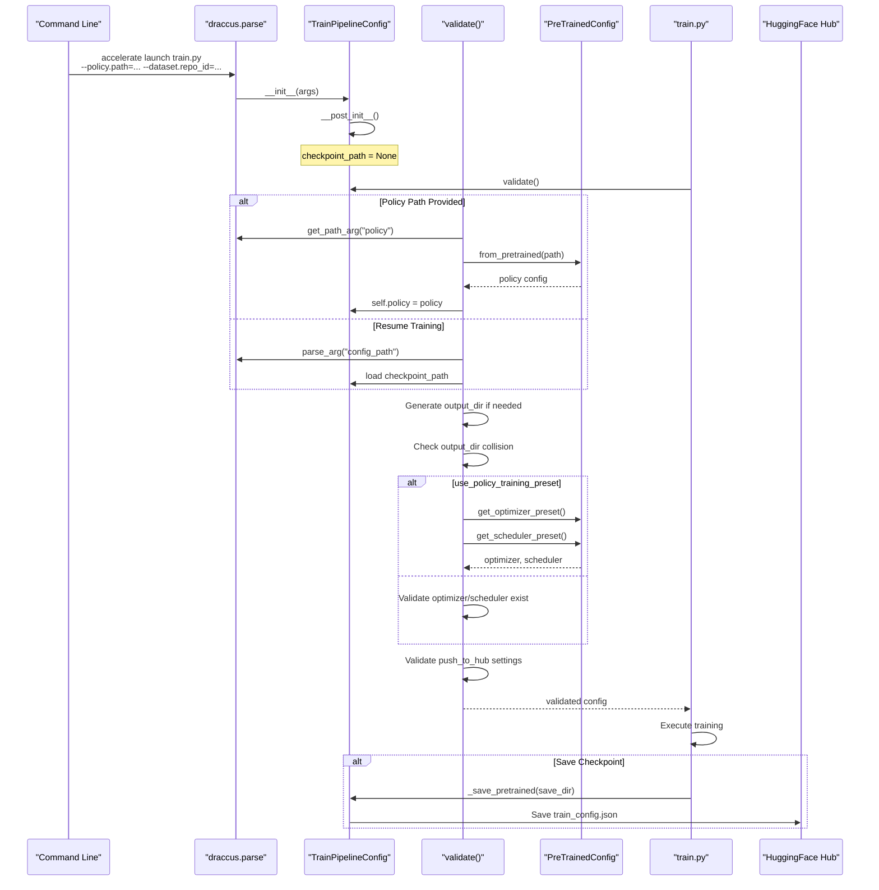
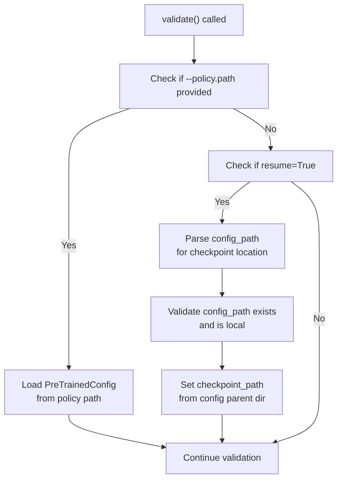
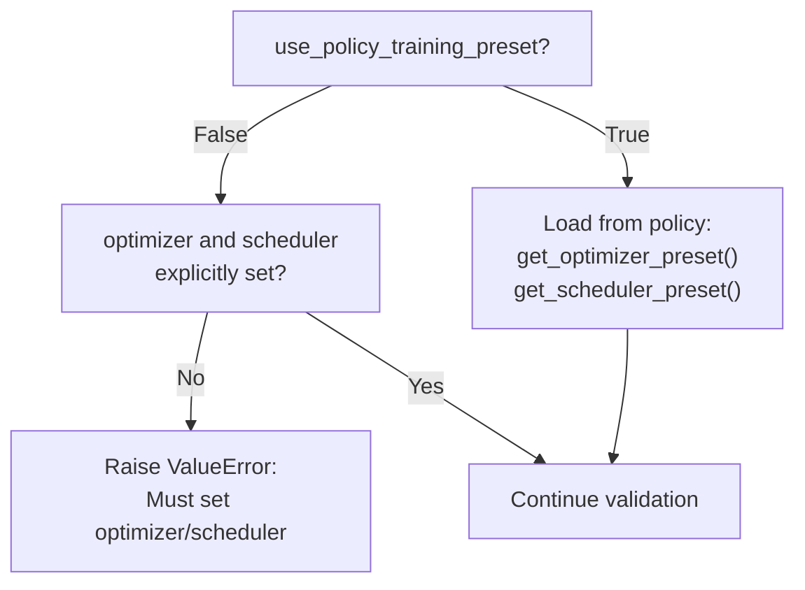
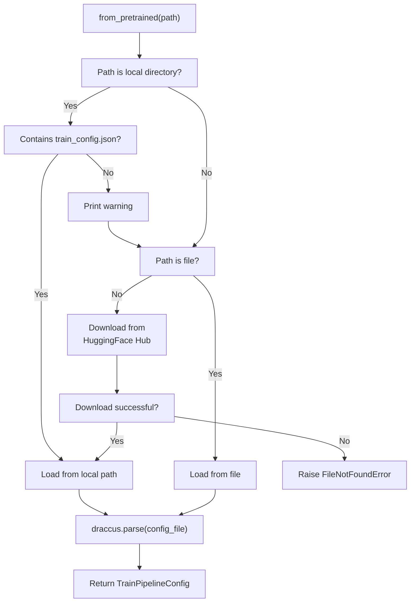
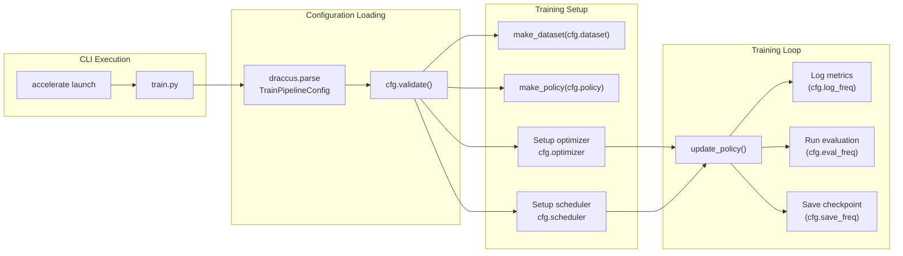

<!-- source: DeepWiki mcp.deepwiki.com · repo huggingface/VLAb · page 6.1 TrainPipelineConfig · fetched 2026-10-26 -->

# TrainPipelineConfig

<details>
<summary>Relevant source files</summary>

The following files were used as context for generating this wiki page:

- [src/lerobot/configs/__pycache__/default.cpython-311.pyc](src/lerobot/configs/__pycache__/default.cpython-311.pyc)
- [src/lerobot/configs/__pycache__/train.cpython-311.pyc](src/lerobot/configs/__pycache__/train.cpython-311.pyc)
- [src/lerobot/configs/train.py](src/lerobot/configs/train.py)
- [src/lerobot/constants.py](src/lerobot/constants.py)

</details>


## Purpose

`TrainPipelineConfig` is the master configuration class that orchestrates all training parameters in VLAb. It serves as the single source of truth for a training run, aggregating specialized configuration objects for datasets, policies, optimization, evaluation, and logging. This page documents the structure, lifecycle, and usage patterns of `TrainPipelineConfig`.

For specific configuration subsystems, see:
- Dataset parameters: [DatasetConfig](#6.2)
- Policy parameters: [Policy Configuration](#6.3)
- Optimization parameters: [Optimization Configuration](#6.4)

**Sources:** [src/lerobot/configs/train.py:38-215]()

## Class Overview

`TrainPipelineConfig` is defined as a Python dataclass that extends `HubMixin` from the lerobot utilities, enabling integration with HuggingFace Hub. The class uses the `draccus` library for configuration parsing, serialization, and command-line argument handling.

### Core Structure

```mermaid
graph TB
    TrainPipelineConfig["TrainPipelineConfig<br/>(HubMixin)"]
    
    subgraph "Configuration Objects"
        DatasetConfig["DatasetConfig<br/>data loading parameters"]
        PreTrainedConfig["PreTrainedConfig<br/>policy/model parameters"]
        OptimizerConfig["OptimizerConfig<br/>optimizer settings"]
        LRSchedulerConfig["LRSchedulerConfig<br/>LR schedule"]
        EvalConfig["EvalConfig<br/>evaluation settings"]
        WandBConfig["WandBConfig<br/>Weights & Biases"]
        TrackIOConfig["TrackIOConfig<br/>TrackIO logging"]
    end
    
    subgraph "Training Parameters"
        Steps["steps: int<br/>total training iterations"]
        BatchSize["batch_size: int<br/>samples per batch"]
        Seed["seed: int<br/>random seed"]
        NumWorkers["num_workers: int<br/>dataloader workers"]
    end
    
    subgraph "Checkpoint Parameters"
        OutputDir["output_dir: Path<br/>save location"]
        Resume["resume: bool<br/>continue from checkpoint"]
        SaveFreq["save_freq: int<br/>checkpoint interval"]
        CheckpointPath["checkpoint_path: Path<br/>resume location"]
    end
    
    subgraph "Logging Parameters"
        LogFreq["log_freq: int<br/>logging interval"]
        EvalFreq["eval_freq: int<br/>eval interval"]
        JobName["job_name: str<br/>run identifier"]
    end
    
    TrainPipelineConfig --> DatasetConfig
    TrainPipelineConfig --> PreTrainedConfig
    TrainPipelineConfig --> OptimizerConfig
    TrainPipelineConfig --> LRSchedulerConfig
    TrainPipelineConfig --> EvalConfig
    TrainPipelineConfig --> WandBConfig
    TrainPipelineConfig --> TrackIOConfig
    
    TrainPipelineConfig --> Steps
    TrainPipelineConfig --> BatchSize
    TrainPipelineConfig --> Seed
    TrainPipelineConfig --> NumWorkers
    
    TrainPipelineConfig --> OutputDir
    TrainPipelineConfig --> Resume
    TrainPipelineConfig --> SaveFreq
    TrainPipelineConfig --> CheckpointPath
    
    TrainPipelineConfig --> LogFreq
    TrainPipelineConfig --> EvalFreq
    TrainPipelineConfig --> JobName
```



**Sources:** [src/lerobot/configs/train.py:38-69]()

## Configuration Fields

### Core Training Parameters

| Field | Type | Default | Description |
|-------|------|---------|-------------|
| `steps` | `int` | `100_000` | Total number of training iterations |
| `batch_size` | `int` | `8` | Number of samples per training batch |
| `seed` | `int \| None` | `1000` | Random seed for reproducibility |
| `num_workers` | `int` | `4` | Number of dataloader worker processes |

**Sources:** [src/lerobot/configs/train.py:54-57]()

### Output and Checkpointing

| Field | Type | Default | Description |
|-------|------|---------|-------------|
| `output_dir` | `Path \| None` | `None` | Directory for saving outputs and checkpoints |
| `job_name` | `str \| None` | `None` | Human-readable identifier for the training run |
| `resume` | `bool` | `False` | Whether to resume from a previous checkpoint |
| `save_checkpoint` | `bool` | `True` | Whether to save checkpoints during training |
| `save_freq` | `int` | `20_000` | Checkpoint saving interval (in steps) |

The `output_dir` is auto-generated if not specified, using the format `outputs/train/{YYYY-MM-DD}/{HH-MM-SS}_{job_name}`. The system includes collision detection and user prompting to prevent accidental overwrites.

**Sources:** [src/lerobot/configs/train.py:44-63]()

### Logging and Evaluation

| Field | Type | Default | Description |
|-------|------|---------|-------------|
| `log_freq` | `int` | `200` | Logging interval (in steps) |
| `eval_freq` | `int` | `20_000` | Evaluation interval (in steps) |
| `eval` | `EvalConfig` | `EvalConfig()` | Evaluation-specific configuration |
| `wandb` | `WandBConfig` | `WandBConfig()` | Weights & Biases configuration |
| `trackio` | `TrackIOConfig` | `TrackIOConfig()` | TrackIO configuration |

**Sources:** [src/lerobot/configs/train.py:58-68]()

### Optimization Configuration

| Field | Type | Default | Description |
|-------|------|---------|-------------|
| `use_policy_training_preset` | `bool` | `True` | Use policy's default optimizer/scheduler |
| `optimizer` | `OptimizerConfig \| None` | `None` | Custom optimizer configuration |
| `scheduler` | `LRSchedulerConfig \| None` | `None` | Custom LR scheduler configuration |

When `use_policy_training_preset=True`, the optimizer and scheduler are automatically loaded from the policy's preset methods. Otherwise, they must be explicitly specified.

**Sources:** [src/lerobot/configs/train.py:63-65]()

## Configuration Lifecycle

### Diagram: Configuration Lifecycle



**Sources:** [src/lerobot/configs/train.py:70-153]()

### Initialization and Post-Processing

The configuration object is initialized through standard dataclass mechanisms. The `__post_init__` method sets the initial checkpoint path to `None`:

```python
def __post_init__(self):
    self.checkpoint_path = None
```

**Sources:** [src/lerobot/configs/train.py:70-71]()

### Validation Logic

The `validate()` method is called after initialization to perform several critical checks and transformations:

#### 1. Policy Configuration Loading



**Sources:** [src/lerobot/configs/train.py:74-95]()

#### 2. Job Name Generation

If `job_name` is not provided, it's automatically generated:
- Without env: `{policy.type}`
- With env: `{env.type}_{policy.type}`

Note: VLAb pretraining doesn't use environments, so the first pattern applies.

**Sources:** [src/lerobot/configs/train.py:97-101]()

#### 3. Output Directory Collision Handling

The validation logic includes sophisticated handling for output directory collisions:

| Scenario | Interactive Mode | Non-Interactive Mode |
|----------|-----------------|---------------------|
| `output_dir` not set | Generate: `outputs/train/{date}/{time}_{job_name}` | Same |
| `output_dir` exists, not resuming | Prompt user (y/n) | Auto-append timestamp |
| User confirms overwrite | Use existing directory | N/A |
| User declines overwrite | Append timestamp | Append timestamp |

The timestamp format is `YYYYMMDD_HHMMSS`.

**Sources:** [src/lerobot/configs/train.py:103-138]()

#### 4. Dataset Validation

The method validates that multi-dataset configurations are not used (currently unsupported):

```python
if isinstance(self.dataset.repo_id, list):
    raise NotImplementedError("LeRobotMultiDataset is not currently implemented.")
```

**Sources:** [src/lerobot/configs/train.py:140-141]()

#### 5. Optimizer and Scheduler Validation



**Sources:** [src/lerobot/configs/train.py:143-147]()

#### 6. Hub Validation

Validates that if `policy.push_to_hub=True`, then `policy.repo_id` must be set:

**Sources:** [src/lerobot/configs/train.py:149-152]()

## Serialization and Persistence

### Configuration File Format

`TrainPipelineConfig` is serialized to JSON format using the draccus library. The configuration is saved as `train_config.json` in the checkpoint directory.

**Constant Definition:**
```python
TRAIN_CONFIG_NAME = "train_config.json"
```

**Sources:** [src/lerobot/configs/train.py:34](), [src/lerobot/constants.py:1-59]()

### Saving Configuration

The `_save_pretrained` method writes the configuration to disk:

```python
def _save_pretrained(self, save_directory: Path) -> None:
    with open(save_directory / TRAIN_CONFIG_NAME, "w") as f, draccus.config_type("json"):
        draccus.dump(self, f, indent=4)
```

This method:
1. Opens the target file in write mode
2. Sets draccus context to JSON serialization
3. Dumps the entire configuration with 4-space indentation

**Sources:** [src/lerobot/configs/train.py:162-164]()

### Loading Configuration

The `from_pretrained` classmethod supports loading from multiple sources:



#### Method Signature

```python
@classmethod
def from_pretrained(
    cls: Type["TrainPipelineConfig"],
    pretrained_name_or_path: str | Path,
    *,
    force_download: bool = False,
    resume_download: bool = None,
    proxies: dict | None = None,
    token: str | bool | None = None,
    cache_dir: str | Path | None = None,
    local_files_only: bool = False,
    revision: str | None = None,
    **kwargs,
) -> "TrainPipelineConfig":
```

#### Loading Process

1. **Local Directory**: Check if path contains `train_config.json`
2. **Local File**: Directly load if path points to a file
3. **HuggingFace Hub**: Download using `hf_hub_download` with provided parameters
4. **Parsing**: Use `draccus.parse` with optional CLI argument overrides

**Sources:** [src/lerobot/configs/train.py:166-209]()

## Integration with Command-Line Interface

### Path Field Resolution

The `__get_path_fields__` classmethod enables special handling for nested configuration objects that can be loaded from paths:

```python
@classmethod
def __get_path_fields__(cls) -> list[str]:
    """This enables the parser to load config from the policy using `--policy.path=local/dir`"""
    return ["policy"]
```

This allows commands like:
```bash
python train.py --policy.path=outputs/train/2024-01-15/model --dataset.repo_id=...
```

The parser automatically loads the `PreTrainedConfig` from the specified path before creating `TrainPipelineConfig`.

**Sources:** [src/lerobot/configs/train.py:154-157]()

### Dictionary Serialization

The `to_dict` method converts the configuration to a dictionary for programmatic access:

```python
def to_dict(self) -> dict:
    return draccus.encode(self)
```

**Sources:** [src/lerobot/configs/train.py:159-160]()

## Integration with Training System

### Connection to train.py



The training script accesses configuration parameters throughout execution:
- **Data loading**: `cfg.dataset`, `cfg.batch_size`, `cfg.num_workers`
- **Model setup**: `cfg.policy`
- **Optimization**: `cfg.optimizer`, `cfg.scheduler`, `cfg.steps`
- **Checkpointing**: `cfg.output_dir`, `cfg.save_freq`, `cfg.resume`
- **Logging**: `cfg.log_freq`, `cfg.wandb`, `cfg.trackio`
- **Evaluation**: `cfg.eval_freq`, `cfg.eval`

**Sources:** [src/lerobot/configs/train.py:1-215]()

## Special Configuration: TrainRLServerPipelineConfig

A specialized variant exists for reinforcement learning scenarios where no offline dataset is needed:

```python
@dataclass(kw_only=True)
class TrainRLServerPipelineConfig(TrainPipelineConfig):
    dataset: DatasetConfig | None = None  # NOTE: In RL, we don't need an offline dataset
```

This subclass makes the `dataset` field optional, allowing training configurations that operate purely on online RL data.

**Sources:** [src/lerobot/configs/train.py:212-214]()

## Configuration Field Reference Table

### Complete Field Summary

| Category | Field | Type | Default | Required | Notes |
|----------|-------|------|---------|----------|-------|
| **Data** | `dataset` | `DatasetConfig` | - | Yes | See [DatasetConfig](#6.2) |
| **Model** | `env` | `None` | `None` | No | Removed for SmolVLA2 pretraining |
| **Model** | `policy` | `PreTrainedConfig \| None` | `None` | Yes | See [Policy Configuration](#6.3) |
| **Output** | `output_dir` | `Path \| None` | Auto-generated | No | Auto-collision handling |
| **Output** | `job_name` | `str \| None` | Auto-generated | No | Used in output path |
| **Checkpoint** | `resume` | `bool` | `False` | No | Resume from checkpoint |
| **Training** | `seed` | `int \| None` | `1000` | No | Random seed |
| **Training** | `num_workers` | `int` | `4` | No | Dataloader workers |
| **Training** | `batch_size` | `int` | `8` | No | Batch size |
| **Training** | `steps` | `int` | `100_000` | No | Total training steps |
| **Evaluation** | `eval_freq` | `int` | `20_000` | No | Evaluation interval |
| **Logging** | `log_freq` | `int` | `200` | No | Logging interval |
| **Checkpoint** | `save_checkpoint` | `bool` | `True` | No | Enable checkpointing |
| **Checkpoint** | `save_freq` | `int` | `20_000` | No | Checkpoint interval |
| **Optimization** | `use_policy_training_preset` | `bool` | `True` | No | Use policy defaults |
| **Optimization** | `optimizer` | `OptimizerConfig \| None` | `None` | Conditional | Required if preset=False |
| **Optimization** | `scheduler` | `LRSchedulerConfig \| None` | `None` | Conditional | Required if preset=False |
| **Evaluation** | `eval` | `EvalConfig` | `EvalConfig()` | No | Evaluation settings |
| **Logging** | `wandb` | `WandBConfig` | `WandBConfig()` | No | W&B settings |
| **Logging** | `trackio` | `TrackIOConfig` | `TrackIOConfig()` | No | TrackIO settings |

**Sources:** [src/lerobot/configs/train.py:38-69](), [src/lerobot/configs/default.py:1-115]()

---

