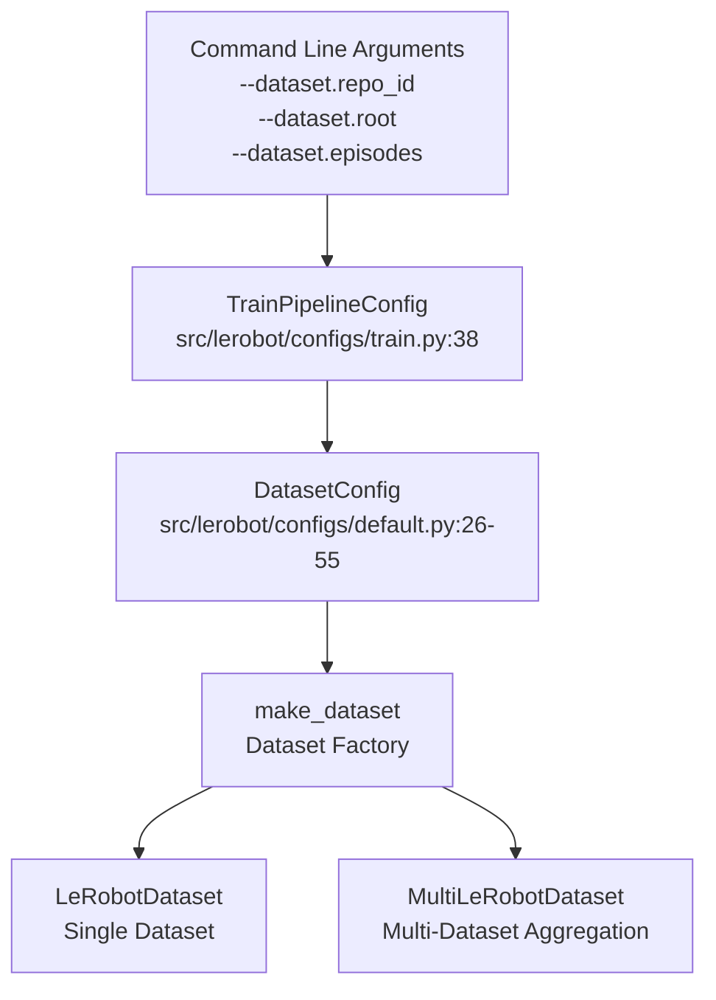
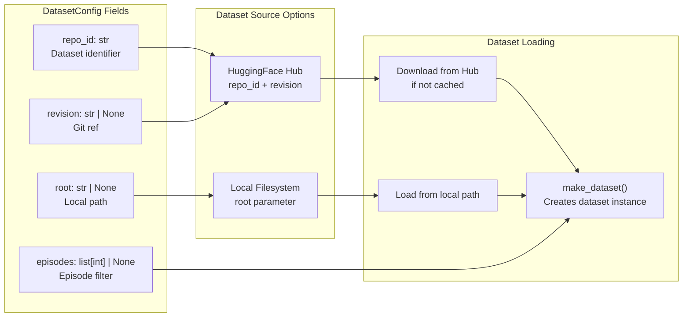
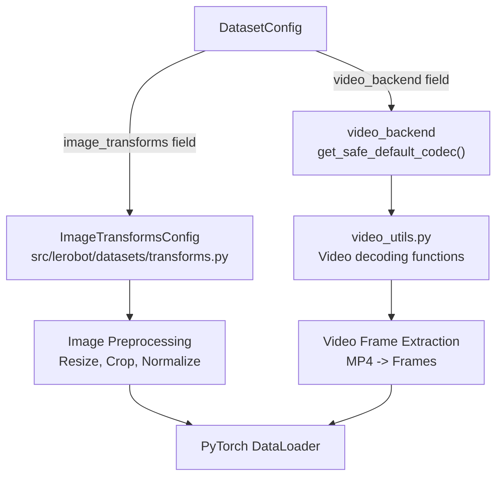
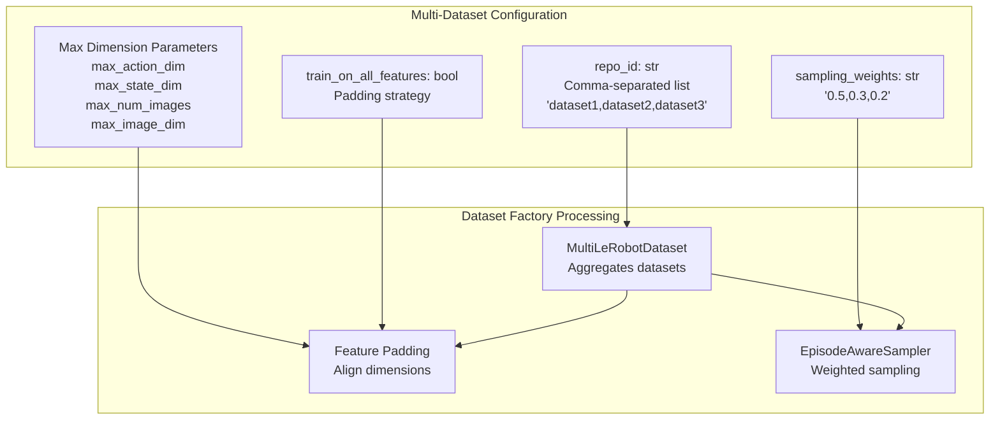
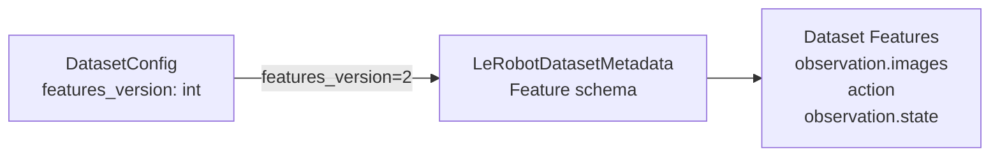
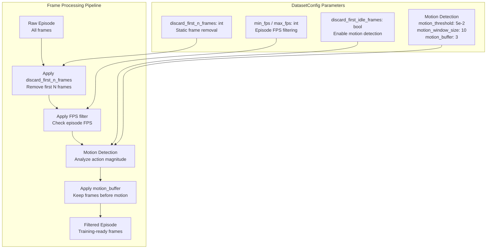
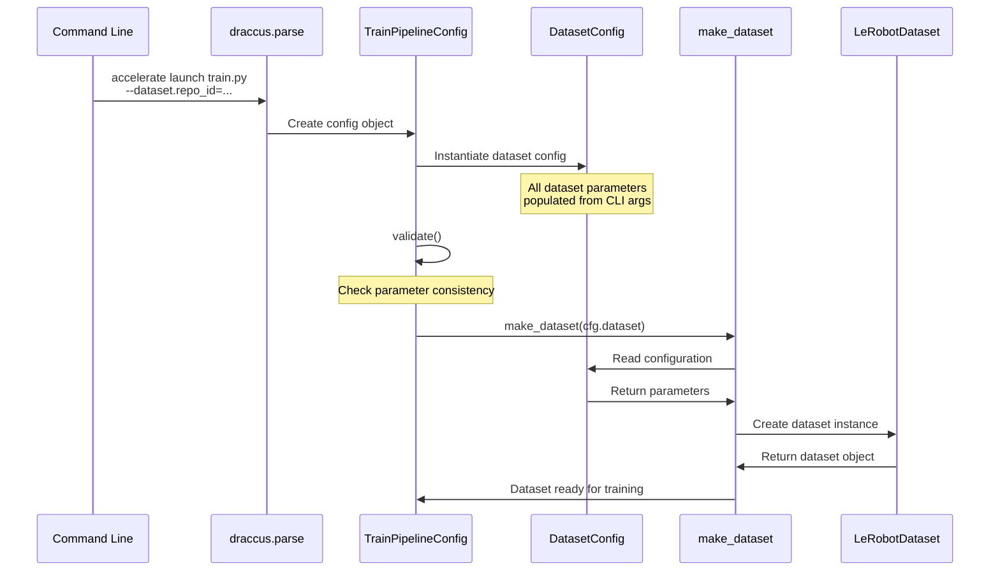
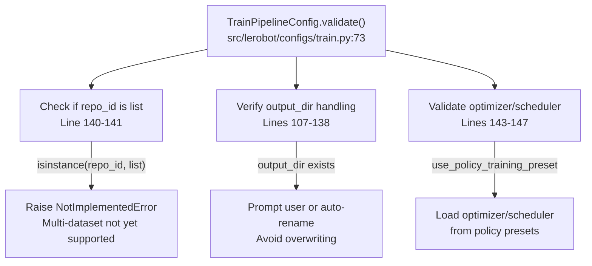

<!-- source: DeepWiki mcp.deepwiki.com · repo huggingface/VLAb · page 6.2 DatasetConfig · fetched 2026-10-26 -->

# DatasetConfig

<details>
<summary>Relevant source files</summary>

The following files were used as context for generating this wiki page:

- [src/lerobot/configs/default.py](src/lerobot/configs/default.py)
- [src/lerobot/configs/train.py](src/lerobot/configs/train.py)
- [src/lerobot/constants.py](src/lerobot/constants.py)

</details>


## Purpose and Scope

`DatasetConfig` is the configuration class that controls all dataset-related parameters for VLAb training. It defines dataset sources, data loading behavior, multi-dataset aggregation settings, image/video processing options, and motion detection filters. This configuration is used by the Dataset Factory (see [Dataset Factory](#4.3)) to instantiate `LeRobotDataset` (see [LeRobotDataset](#4.1)) or `MultiLeRobotDataset` (see [MultiLeRobotDataset](#4.2)) objects.

For information about the master training configuration that includes `DatasetConfig`, see [TrainPipelineConfig](#6.1). For policy-specific configuration, see [Policy Configuration](#6.3).

**Sources:** [src/lerobot/configs/default.py:26-55]()

---

## Configuration Class Structure

`DatasetConfig` is defined as a Python dataclass in [src/lerobot/configs/default.py:26-55](). It is instantiated as part of `TrainPipelineConfig` and passed to the dataset factory during training initialization.



**Sources:** [src/lerobot/configs/train.py:39](), [src/lerobot/configs/default.py:26-55]()

---

## Dataset Source Configuration

### Core Source Parameters

| Parameter | Type | Default | Description |
|-----------|------|---------|-------------|
| `repo_id` | `str` | Required | HuggingFace Hub repository ID for the dataset (e.g., `"lerobot/aloha_sim_insertion_human"`) or comma-separated list for multi-dataset training |
| `root` | `str \| None` | `None` | Local directory path where dataset will be stored or loaded from. If `None`, uses HuggingFace cache |
| `episodes` | `list[int] \| None` | `None` | Specific episode indices to load. If `None`, loads all available episodes |
| `revision` | `str \| None` | `None` | Git revision (branch, tag, or commit) to load from HuggingFace Hub |



**Example Usage:**
```bash
# Load from HuggingFace Hub
python train.py --dataset.repo_id=lerobot/aloha_sim_insertion_human

# Load from local directory
python train.py --dataset.root=/path/to/local/dataset

# Load specific episodes
python train.py --dataset.episodes=[0,1,2,5,10]

# Load specific revision
python train.py --dataset.repo_id=lerobot/my_dataset --dataset.revision=v1.0
```

**Sources:** [src/lerobot/configs/default.py:32-37]()

---

## Image and Video Configuration

### Image Transformation Configuration

The `image_transforms` field is an `ImageTransformsConfig` object that controls image preprocessing. It is separate from `DatasetConfig` but integrated through composition.

| Parameter | Type | Default | Description |
|-----------|------|---------|-------------|
| `image_transforms` | `ImageTransformsConfig` | `ImageTransformsConfig()` | Configuration for image preprocessing pipeline (see [ImageTransforms](#4.1)) |
| `use_imagenet_stats` | `bool` | `True` | Whether to normalize images using ImageNet statistics (mean and std) |

### Video Backend Configuration

| Parameter | Type | Default | Description |
|-----------|------|---------|-------------|
| `video_backend` | `str` | `get_safe_default_codec()` | Video decoding backend to use. Default is `"pyav"`. Options include `"pyav"`, `"opencv"`, etc. |



**Sources:** [src/lerobot/configs/default.py:36-39](), [src/lerobot/datasets/video_utils.py:23]()

---

## Multi-Dataset Support

When training on multiple datasets simultaneously, `DatasetConfig` provides parameters to handle heterogeneous datasets with different feature dimensions and sampling strategies.

### Multi-Dataset Parameters

| Parameter | Type | Default | Description |
|-----------|------|---------|-------------|
| `sampling_weights` | `str \| None` | `None` | Comma-separated list of sampling weights for multi-dataset training. Must match number of datasets in `repo_id`. Example: `"0.5,0.3,0.2"` |
| `max_action_dim` | `int \| None` | `None` | Maximum action dimensionality across all datasets. Smaller datasets are padded. |
| `max_state_dim` | `int \| None` | `None` | Maximum state dimensionality across all datasets. Smaller datasets are padded. |
| `max_num_images` | `int \| None` | `None` | Maximum number of image observations across all datasets. |
| `max_image_dim` | `int \| None` | `None` | Maximum spatial dimension for images (assumes square images). |
| `train_on_all_features` | `bool` | `True` | If `False`, only train on features common across all datasets. If `True`, pad missing features. |



**Example Usage:**
```bash
# Train on multiple datasets with equal sampling
python train.py --dataset.repo_id="dataset1,dataset2,dataset3"

# Train with weighted sampling
python train.py \
  --dataset.repo_id="dataset1,dataset2" \
  --dataset.sampling_weights="0.7,0.3"

# Specify maximum dimensions for padding
python train.py \
  --dataset.repo_id="dataset1,dataset2" \
  --dataset.max_action_dim=14 \
  --dataset.max_state_dim=30
```

**Note:** As of the current implementation, [src/lerobot/configs/train.py:140-141]() indicates that multi-dataset support via list `repo_id` raises `NotImplementedError`, suggesting this feature is planned but not yet fully implemented in the training pipeline.

**Sources:** [src/lerobot/configs/default.py:40-46](), [src/lerobot/configs/train.py:140-141]()

---

## Feature Configuration

### Feature Versioning

| Parameter | Type | Default | Description |
|-----------|------|---------|-------------|
| `features_version` | `int` | `0` | Dataset features schema version. Version 2 is recommended for new datasets. Controls metadata interpretation and feature naming conventions. |

The `features_version` parameter determines how dataset metadata is interpreted and which feature naming conventions are used. This is important for compatibility with different dataset formats and versions.



**Sources:** [src/lerobot/configs/default.py:47]()

---

## Frame Filtering and Motion Detection

VLAb provides sophisticated frame filtering capabilities to remove redundant or idle frames from training data, improving data efficiency.

### Frame Filtering Parameters

| Parameter | Type | Default | Description |
|-----------|------|---------|-------------|
| `discard_first_n_frames` | `int` | `0` | Number of frames to discard from the start of each episode |
| `min_fps` | `int` | `1` | Minimum frames per second threshold for filtering episodes |
| `max_fps` | `int` | `100` | Maximum frames per second threshold for filtering episodes |
| `discard_first_idle_frames` | `bool` | `False` | Whether to automatically detect and discard idle frames at episode start based on motion detection |

### Motion Detection Parameters

When `discard_first_idle_frames=True`, these parameters control how motion is detected:

| Parameter | Type | Default | Description |
|-----------|------|---------|-------------|
| `motion_threshold` | `float` | `5e-2` (0.05) | Minimum action magnitude to be considered "motion". Actions below this threshold are considered idle |
| `motion_window_size` | `int` | `10` | Number of consecutive frames to analyze for motion detection |
| `motion_buffer` | `int` | `3` | Number of frames before detected motion to retain (safety buffer) |



### Motion Detection Algorithm

The motion detection process works as follows:

1. **Action Analysis:** For each frame, compute the L2 norm of the action vector
2. **Threshold Check:** Compare action magnitude against `motion_threshold`
3. **Window Evaluation:** Look at `motion_window_size` consecutive frames
4. **Motion Point Detection:** Find the first frame where significant motion begins
5. **Buffer Application:** Keep `motion_buffer` frames before the detected motion point

**Example:** If `motion_threshold=0.05`, `motion_window_size=10`, and `motion_buffer=3`:
- The algorithm scans the first frames of each episode
- When it finds 10 consecutive frames where action magnitude > 0.05
- It marks the motion start point
- It discards all frames except the 3 frames before motion started

**Example Usage:**
```bash
# Discard first 10 frames from each episode
python train.py --dataset.discard_first_n_frames=10

# Filter episodes by FPS
python train.py --dataset.min_fps=15 --dataset.max_fps=30

# Enable automatic idle frame removal with custom thresholds
python train.py \
  --dataset.discard_first_idle_frames=True \
  --dataset.motion_threshold=0.1 \
  --dataset.motion_window_size=5 \
  --dataset.motion_buffer=2
```

**Sources:** [src/lerobot/configs/default.py:48-54]()

---

## Integration with Training Pipeline

`DatasetConfig` is instantiated as part of `TrainPipelineConfig` and used during the training initialization phase.



**Sources:** [src/lerobot/configs/train.py:38-39]()

---

## Configuration Validation

`DatasetConfig` itself does not implement validation logic (it's a plain dataclass). Validation occurs in `TrainPipelineConfig.validate()`:



**Key Validation Points:**

1. **Multi-Dataset Check (Line 140-141):** Currently raises `NotImplementedError` if `repo_id` is a list
2. **Output Directory Handling (Lines 107-138):** Prevents accidental overwriting of existing training runs
3. **Optimizer/Scheduler Configuration (Lines 143-147):** Ensures optimizer and scheduler are properly configured

**Sources:** [src/lerobot/configs/train.py:73-148]()

---

## Complete Parameter Reference Table

| Parameter | Type | Default | Category | Description |
|-----------|------|---------|----------|-------------|
| `repo_id` | `str` | Required | Source | Dataset repository ID or comma-separated list |
| `root` | `str \| None` | `None` | Source | Local directory path for dataset storage |
| `episodes` | `list[int] \| None` | `None` | Source | Specific episode indices to load |
| `revision` | `str \| None` | `None` | Source | Git revision for HuggingFace Hub |
| `image_transforms` | `ImageTransformsConfig` | `ImageTransformsConfig()` | Processing | Image preprocessing configuration |
| `use_imagenet_stats` | `bool` | `True` | Processing | Use ImageNet normalization statistics |
| `video_backend` | `str` | `"pyav"` | Processing | Video decoding backend |
| `sampling_weights` | `str \| None` | `None` | Multi-Dataset | Dataset sampling weight distribution |
| `max_action_dim` | `int \| None` | `None` | Multi-Dataset | Maximum action dimension for padding |
| `max_state_dim` | `int \| None` | `None` | Multi-Dataset | Maximum state dimension for padding |
| `max_num_images` | `int \| None` | `None` | Multi-Dataset | Maximum number of image observations |
| `max_image_dim` | `int \| None` | `None` | Multi-Dataset | Maximum image spatial dimension |
| `train_on_all_features` | `bool` | `True` | Multi-Dataset | Whether to pad or filter features |
| `features_version` | `int` | `0` | Features | Dataset feature schema version |
| `discard_first_n_frames` | `int` | `0` | Filtering | Number of initial frames to discard |
| `min_fps` | `int` | `1` | Filtering | Minimum FPS threshold |
| `max_fps` | `int` | `100` | Filtering | Maximum FPS threshold |
| `discard_first_idle_frames` | `bool` | `False` | Filtering | Enable automatic idle frame removal |
| `motion_threshold` | `float` | `5e-2` | Motion Detection | Action magnitude threshold for motion |
| `motion_window_size` | `int` | `10` | Motion Detection | Frames to analyze for motion |
| `motion_buffer` | `int` | `3` | Motion Detection | Frames to keep before motion start |

**Sources:** [src/lerobot/configs/default.py:26-55]()

---

## Usage Examples

### Basic Single Dataset Training

```bash
# Simple training with HuggingFace Hub dataset
python train.py \
  --dataset.repo_id=lerobot/aloha_sim_insertion_human \
  --policy.type=smolvla2
```

### Local Dataset with Custom Parameters

```bash
# Train from local dataset with specific episodes
python train.py \
  --dataset.root=/data/robotics/my_dataset \
  --dataset.episodes=[0,1,2,5,10,15] \
  --dataset.features_version=2
```

### Motion Detection and Frame Filtering

```bash
# Remove idle frames and limit FPS range
python train.py \
  --dataset.repo_id=lerobot/pusht \
  --dataset.discard_first_idle_frames=True \
  --dataset.motion_threshold=0.08 \
  --dataset.motion_window_size=15 \
  --dataset.min_fps=10 \
  --dataset.max_fps=30
```

### Multi-Dataset Training Configuration

```bash
# Multi-dataset training with weighted sampling (when implemented)
python train.py \
  --dataset.repo_id="dataset1,dataset2,dataset3" \
  --dataset.sampling_weights="0.5,0.3,0.2" \
  --dataset.max_action_dim=14 \
  --dataset.max_state_dim=30 \
  --dataset.train_on_all_features=True
```

**Sources:** [src/lerobot/configs/default.py:26-55](), [src/lerobot/configs/train.py:38-39]()

---

