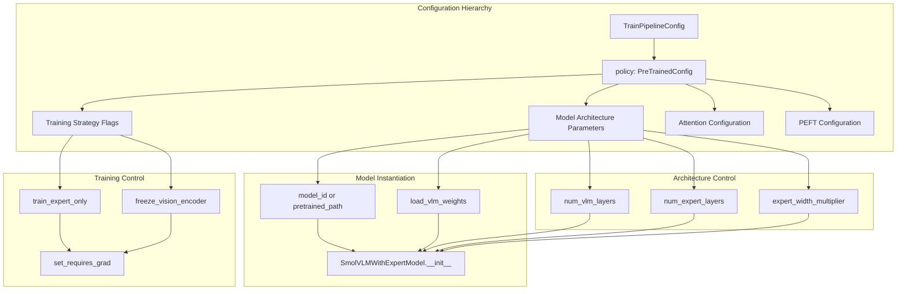
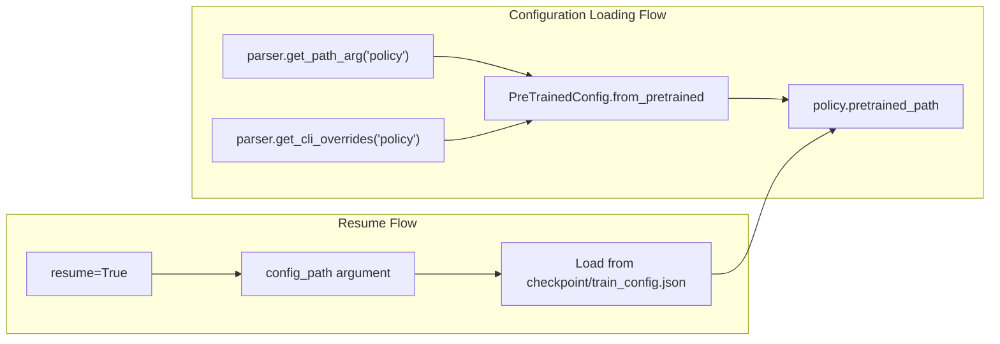
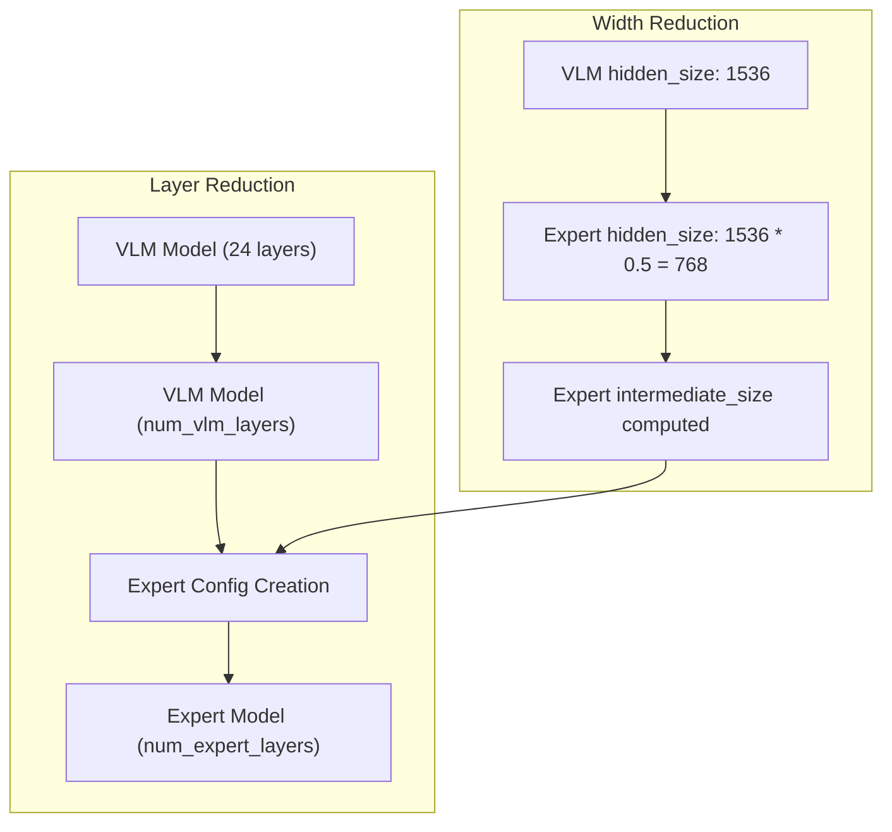
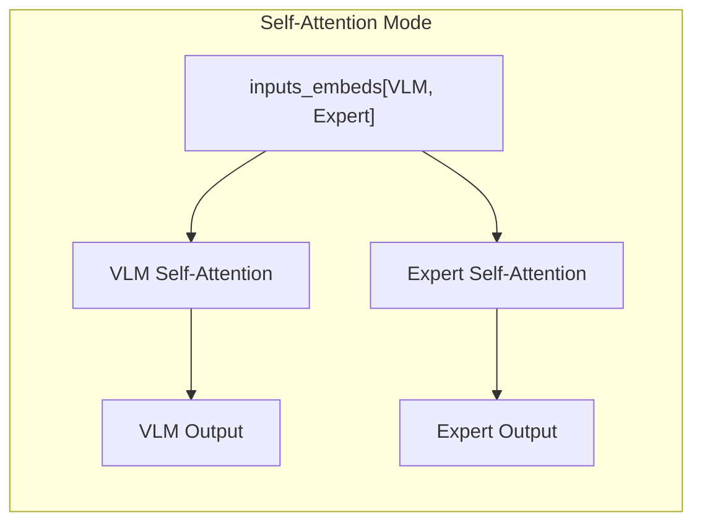
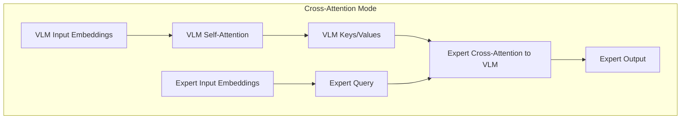
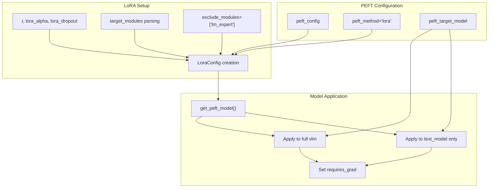
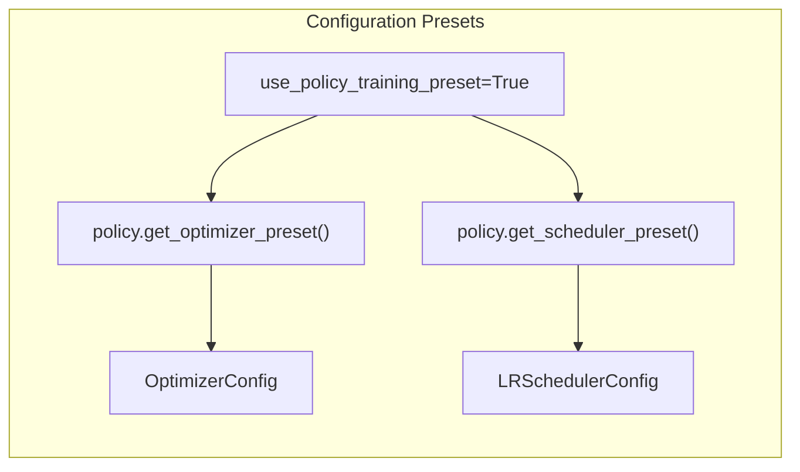
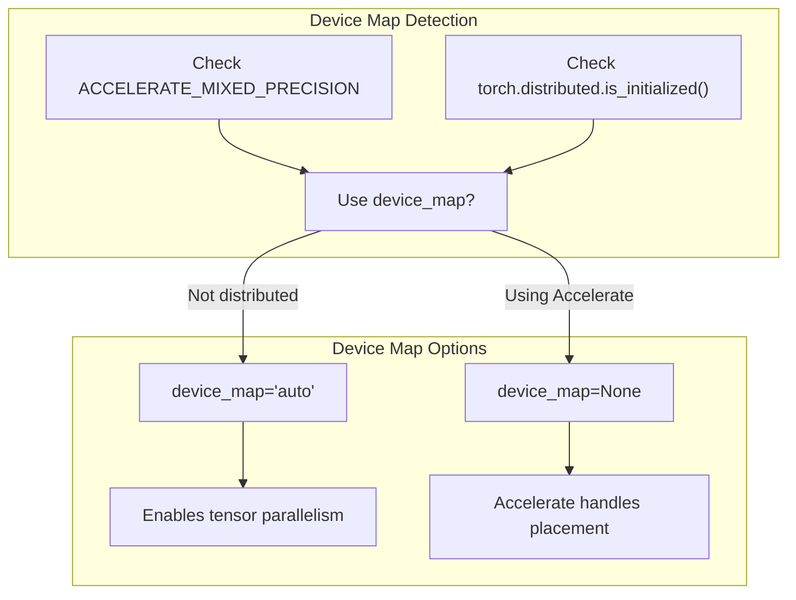

<!-- source: DeepWiki mcp.deepwiki.com · repo huggingface/VLAb · page 6.3 Policy Configuration · fetched 2026-10-26 -->

# Policy Configuration

<details>
<summary>Relevant source files</summary>

The following files were used as context for generating this wiki page:

- [src/lerobot/configs/train.py](src/lerobot/configs/train.py)
- [src/lerobot/constants.py](src/lerobot/constants.py)
- [src/lerobot/policies/smolvla2/smolvlm_with_expert2.py](src/lerobot/policies/smolvla2/smolvlm_with_expert2.py)

</details>


## Purpose and Scope

This page documents the policy configuration system in VLAb, which controls the SmolVLA2 model architecture, training strategies, and Parameter-Efficient Fine-Tuning (PEFT) settings. Policy configuration is a component of the master `TrainPipelineConfig` (see [TrainPipelineConfig](#6.1)) and determines how the VLM+Expert model is instantiated and trained.

For information about the underlying SmolVLA2 model architecture, see [SmolVLA2 Architecture](#5.1). For training strategy details including expert-only training and vision freezing, see [Training Strategies](#5.2).

**Sources:** [src/lerobot/configs/train.py:38-68]()

## Policy Configuration Overview

The policy configuration in VLAb is managed through the `PreTrainedConfig` class, which is embedded within `TrainPipelineConfig`. The configuration system supports:

1. **Model instantiation** from HuggingFace Hub or local paths
2. **Architecture parameters** controlling VLM and expert model sizes
3. **Training strategy flags** for selective parameter training
4. **Attention mode selection** between self-attention and cross-attention
5. **PEFT/LoRA settings** for efficient fine-tuning



**Sources:** [src/lerobot/configs/train.py:38-41](), [src/lerobot/policies/smolvla2/smolvlm_with_expert2.py:63-149]()

## PreTrainedConfig Integration

The `policy` field in `TrainPipelineConfig` is of type `PreTrainedConfig`, which can be instantiated in several ways:

| Loading Method | CLI Syntax | Description |
|----------------|------------|-------------|
| From Hub | `--policy.path=HuggingFaceTB/SmolVLM2` | Loads configuration from HuggingFace Hub repository |
| From Local Path | `--policy.path=/path/to/checkpoint` | Loads configuration from local checkpoint directory |
| With Overrides | `--policy.path=... --policy.train_expert_only=true` | Loads from path with CLI parameter overrides |
| From Scratch | Specify all parameters directly | Creates new configuration without pretrained weights |

The configuration validation and loading process is handled by `TrainPipelineConfig.validate()`:



**Sources:** [src/lerobot/configs/train.py:73-96]()

## Model Architecture Parameters

The policy configuration controls the SmolVLA2 model architecture through several key parameters:

### Model Loading Parameters

| Parameter | Type | Default | Description |
|-----------|------|---------|-------------|
| `model_id` | `str` | `"HuggingFaceTB/SmolVLM2-500M-Video-Instruct"` | HuggingFace Hub model ID or local path |
| `load_vlm_weights` | `bool` | `True` | Whether to load pretrained VLM weights |

The `load_vlm_weights` parameter determines whether to initialize the VLM with pretrained weights or from scratch:

- **`True`**: Uses `AutoModelForImageTextToText.from_pretrained()` to load full pretrained model
- **`False`**: Creates model from config only using `SmolVLMForConditionalGeneration(config=config)`

**Sources:** [src/lerobot/policies/smolvla2/smolvlm_with_expert2.py:66-102]()

### Layer Configuration

| Parameter | Type | Default | Description |
|-----------|------|---------|-------------|
| `num_vlm_layers` | `int` | `-1` | Number of VLM text model layers (default: use all) |
| `num_expert_layers` | `int` | `-1` | Number of expert model layers (default: match VLM) |
| `expert_width_multiplier` | `float` | `0.5` | Expert hidden size multiplier relative to VLM |

The layer configuration enables creating smaller expert models:



The expert model's hidden size is computed as:
- `expert_hidden_size = int(vlm_hidden_size * expert_width_multiplier)`
- `expert_intermediate_size = get_intermediate_size(expert_hidden_size)`

**Sources:** [src/lerobot/policies/smolvla2/smolvlm_with_expert2.py:104-122](), [src/lerobot/policies/smolvla2/smolvlm_with_expert2.py:56-60]()

## Attention Mode Configuration

The attention mode determines how the VLM and expert models interact:

| Parameter | Type | Default | Options | Description |
|-----------|------|---------|---------|-------------|
| `attention_mode` | `str` | `"self_attn"` | `"self_attn"`, `"cross_attn"` | Attention mechanism between VLM and expert |
| `self_attn_every_n_layers` | `int` | `-1` | Any positive int or `-1` | Frequency of self-attention in cross-attention mode |

### Self-Attention Mode

In self-attention mode, VLM and expert process their inputs independently:



### Cross-Attention Mode

In cross-attention mode, the expert attends to VLM outputs:



When using cross-attention, the expert's `k_proj` and `v_proj` layers are reshaped to accept VLM hidden states:

**Sources:** [src/lerobot/policies/smolvla2/smolvlm_with_expert2.py:70](), [src/lerobot/policies/smolvla2/smolvlm_with_expert2.py:124-138](), [src/lerobot/policies/smolvla2/smolvlm_with_expert2.py:334-443]()

## Training Strategy Parameters

Training strategy flags control which model components are trainable:

| Parameter | Type | Default | Description |
|-----------|------|---------|-------------|
| `train_expert_only` | `bool` | `True` | Freeze all VLM parameters, train only expert |
| `freeze_vision_encoder` | `bool` | `False` | Freeze vision encoder within VLM |

### Parameter Freezing Logic

The `set_requires_grad()` method implements the parameter freezing:

```mermaid
graph TB
    subgraph "Freeze Vision Encoder"
        FreezeVision["freeze_vision_encoder=True"]
        VisionEval["vision_model.eval()"]
        VisionParams["vision_model.parameters().requires_grad=False"]
    end
    
    subgraph "Train Expert Only"
        TrainExpert["train_expert_only=True"]
        VLMEval["vlm.eval()"]
        VLMParams["vlm.parameters().requires_grad=False"]
        ExpertTrain["expert parameters trainable"]
    end
    
    subgraph "Full Fine-Tuning"
        TrainBoth["train_expert_only=False"]
        FreezeLastLayers["Freeze last VLM layers"]
        FreezeHead["Freeze lm_head"]
        TrainVLM["Train most VLM layers"]
    end
    
    FreezeVision --> VisionEval
    FreezeVision --> VisionParams
    
    TrainExpert --> VLMEval
    TrainExpert --> VLMParams
    VLMParams --> ExpertTrain
    
    TrainBoth --> FreezeLastLayers
    TrainBoth --> FreezeHead
    FreezeLastLayers --> TrainVLM
```



Key implementation details:
- When `train_expert_only=True`, the entire VLM is set to `.eval()` and all parameters have `requires_grad=False`
- When `freeze_vision_encoder=True`, only the vision encoder is frozen
- When training the full model, the last VLM layer and `lm_head` are frozen to avoid unused parameters in distributed training
- Expert's `lm_head` is always frozen

**Sources:** [src/lerobot/policies/smolvla2/smolvlm_with_expert2.py:68-69](), [src/lerobot/policies/smolvla2/smolvlm_with_expert2.py:202-233](), [src/lerobot/policies/smolvla2/smolvlm_with_expert2.py:234-242]()

## PEFT/LoRA Configuration

VLAb supports Parameter-Efficient Fine-Tuning through the PEFT library, particularly LoRA:

### PEFT Configuration Structure

The `configure_peft()` method accepts a configuration object with the following structure:

| Field | Type | Description |
|-------|------|-------------|
| `peft_method` | `str` | Method name (e.g., `"lora"`) |
| `peft_target_model` | `str` | Which model to apply PEFT to (`"text"` or full model) |
| `peft_config` | `object` | PEFT-specific configuration |

### LoRA Configuration Parameters

When `peft_method="lora"`, the `peft_config` object should contain:

| Parameter | Type | Description |
|-----------|------|-------------|
| `r` | `int` | Rank of the low-rank adaptation matrices |
| `lora_alpha` | `float` | Scaling factor for LoRA weights |
| `lora_dropout` | `float` | Dropout probability for LoRA layers |
| `target_modules` | `str` or `list[str]` | Module names or patterns to apply LoRA to |

### PEFT Application Flow



Key implementation details:
- `target_modules` can be a comma-separated string or list
- The expert model (`lm_expert`) is always excluded from LoRA
- Only parameters containing `"lora"` in their name are set to `requires_grad=True`
- Layer 17 of the text model is excluded from LoRA updates
- LoRA weights can be merged back into the base model using `merge_lora_weights()`

**Sources:** [src/lerobot/policies/smolvla2/smolvlm_with_expert2.py:151-192]()

## Configuration Examples

### Example 1: Expert-Only Training

Train only the expert model while freezing the pretrained VLM:

```bash
--policy.path=HuggingFaceTB/SmolVLM2-500M-Video-Instruct \
--policy.load_vlm_weights=true \
--policy.train_expert_only=true \
--policy.freeze_vision_encoder=false
```

This configuration:
- Loads full pretrained VLM weights
- Freezes all VLM parameters
- Trains only expert parameters
- Vision encoder is frozen as part of VLM

### Example 2: LoRA Fine-Tuning

Apply LoRA to the text model while training the expert:

```bash
--policy.path=HuggingFaceTB/SmolVLM2-500M-Video-Instruct \
--policy.load_vlm_weights=true \
--policy.train_expert_only=false \
--policy.peft_method=lora \
--policy.peft_target_model=text \
--policy.peft_config.r=8 \
--policy.peft_config.lora_alpha=16 \
--policy.peft_config.lora_dropout=0.1 \
--policy.peft_config.target_modules="q_proj,v_proj"
```

### Example 3: Reduced Model Size

Create a smaller expert model with fewer layers:

```bash
--policy.path=HuggingFaceTB/SmolVLM2-500M-Video-Instruct \
--policy.num_vlm_layers=12 \
--policy.num_expert_layers=6 \
--policy.expert_width_multiplier=0.5 \
--policy.train_expert_only=true
```

This configuration:
- Reduces VLM from 24 to 12 layers
- Creates expert with 6 layers
- Expert hidden size is 50% of VLM hidden size

### Example 4: Cross-Attention Mode

Enable cross-attention between VLM and expert:

```bash
--policy.path=HuggingFaceTB/SmolVLM2-500M-Video-Instruct \
--policy.attention_mode=cross_attn \
--policy.num_expert_layers=6 \
--policy.self_attn_every_n_layers=-1
```

**Sources:** [src/lerobot/policies/smolvla2/smolvlm_with_expert2.py:64-75]()

## Policy Configuration Presets

The `PreTrainedConfig` class provides preset methods for optimizer and scheduler configuration:



When `use_policy_training_preset=True`, the training pipeline automatically retrieves optimizer and scheduler configurations from the policy, ensuring consistency with recommended training settings.

**Sources:** [src/lerobot/configs/train.py:143-147]()

## Model Device Mapping

The policy configuration handles device placement automatically based on the execution environment:



The device mapping logic ensures compatibility with:
- Single GPU training (uses `device_map="auto"`)
- Multi-GPU with Accelerate (uses `device_map=None`)
- Distributed training (uses `device_map=None`)

Setting `device_map=None` when using Accelerate prevents tensor parallelism which requires PyTorch 2.5+, ensuring compatibility with PyTorch 2.4.

**Sources:** [src/lerobot/policies/smolvla2/smolvlm_with_expert2.py:77-98]()

---

