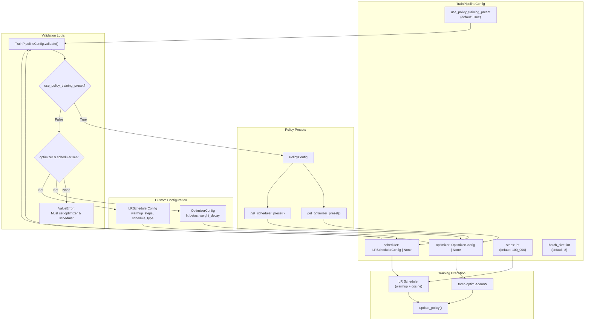
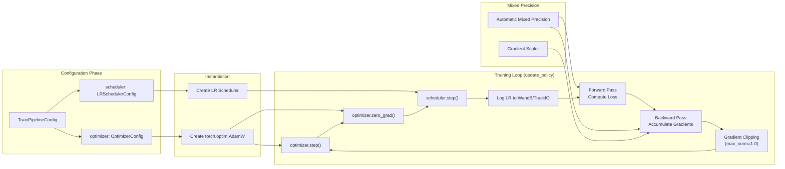
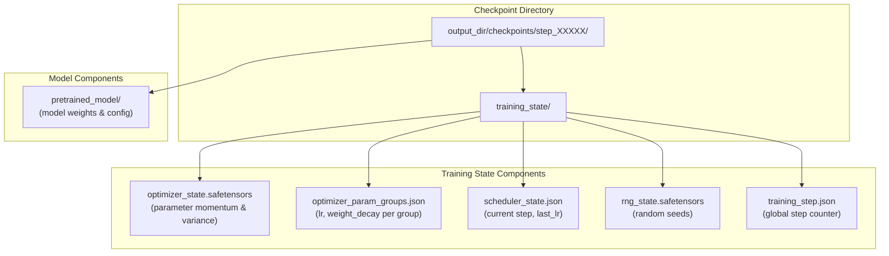
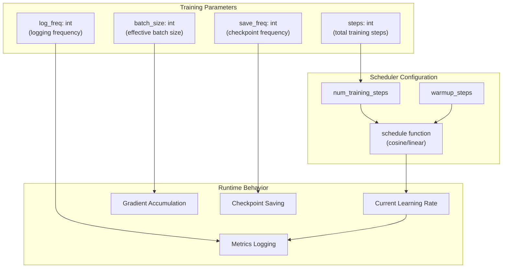

<!-- source: DeepWiki mcp.deepwiki.com · repo huggingface/VLAb · page 6.4 Optimization Configuration · fetched 2026-10-26 -->

# Optimization Configuration

<details>
<summary>Relevant source files</summary>

The following files were used as context for generating this wiki page:

- [src/lerobot/configs/default.py](src/lerobot/configs/default.py)
- [src/lerobot/configs/train.py](src/lerobot/configs/train.py)
- [src/lerobot/constants.py](src/lerobot/constants.py)

</details>


This page documents the optimization configuration system in VLAb, including optimizer and learning rate scheduler setup. For the master training configuration, see [TrainPipelineConfig](#6.1). For policy-specific parameters, see [Policy Configuration](#6.3).

## Overview

VLAb provides two mechanisms for configuring optimization:

1. **Policy Training Presets** (default): Automatically uses optimizer and scheduler configurations recommended by the policy
2. **Custom Configuration**: Explicitly specify optimizer and scheduler parameters via command-line arguments

The optimization configuration system integrates with the distributed training infrastructure and checkpoint management to enable resumable training with full optimizer state preservation.

## Configuration Architecture



Sources: [src/lerobot/configs/train.py:38-148]()

## Policy Training Presets

The default configuration mode leverages policy-specific optimization presets. When `use_policy_training_preset=True` (the default), VLAb automatically retrieves optimizer and scheduler configurations from the policy class.

### Preset Activation Logic

[src/lerobot/configs/train.py:143-147]() implements the preset activation logic:

```python
if not self.use_policy_training_preset and (self.optimizer is None or self.scheduler is None):
    raise ValueError("Optimizer and Scheduler must be set when the policy presets are not used.")
elif self.use_policy_training_preset and not self.resume:
    self.optimizer = self.policy.get_optimizer_preset()
    self.scheduler = self.policy.get_scheduler_preset()
```

Key behaviors:
- **Non-resuming training**: Calls `get_optimizer_preset()` and `get_scheduler_preset()` on the policy
- **Resuming training**: Skips preset loading; configurations are restored from checkpoint
- **Validation**: Ensures optimizer and scheduler are set when presets are disabled

### Usage Example

```bash
# Use policy presets (default)
python -m lerobot.scripts.train \
    --policy.type smolvla2 \
    --policy.pretrained_path HuggingFaceTB/SmolVLM2-500M-Video-Instruct \
    --batch_size 8 \
    --steps 100000
```

Sources: [src/lerobot/configs/train.py:143-147]()

## Custom Optimization Configuration

For advanced use cases, you can disable policy presets and specify custom optimizer and scheduler parameters.

### OptimizerConfig

The `OptimizerConfig` class defines parameters for the optimizer, typically AdamW. Based on the training architecture diagrams, standard parameters include:

| Parameter | Type | Description |
|-----------|------|-------------|
| `lr` | float | Learning rate (e.g., 1e-4, 5e-5) |
| `betas` | tuple[float, float] | Adam beta parameters (β₁, β₂) for momentum and variance |
| `weight_decay` | float | L2 regularization coefficient |
| `eps` | float | Numerical stability epsilon |

### LRSchedulerConfig

The `LRSchedulerConfig` class defines learning rate scheduling, typically implementing warmup followed by cosine decay:

| Parameter | Type | Description |
|-----------|------|-------------|
| `warmup_steps` | int | Number of steps for linear warmup phase |
| `schedule_type` | str | Scheduler type (e.g., "cosine", "linear") |
| `num_training_steps` | int | Total training steps (derived from `steps` config) |
| `min_lr` | float | Minimum learning rate after decay |

### Custom Configuration Example

```bash
# Disable presets and use custom configuration
python -m lerobot.scripts.train \
    --policy.type smolvla2 \
    --use_policy_training_preset false \
    --optimizer.lr 1e-4 \
    --optimizer.betas 0.9 0.999 \
    --optimizer.weight_decay 0.01 \
    --scheduler.warmup_steps 1000 \
    --scheduler.schedule_type cosine \
    --batch_size 8 \
    --steps 100000
```

Sources: [src/lerobot/configs/train.py:64-65](), [src/lerobot/configs/train.py:143-144]()

## Training Loop Integration



The optimization configuration flows into the training loop as follows:

1. **Instantiation**: `OptimizerConfig` and `LRSchedulerConfig` are used to create PyTorch optimizer and scheduler objects
2. **Forward Pass**: Model computes predictions and loss
3. **Backward Pass**: Gradients are computed (with AMP if enabled)
4. **Gradient Clipping**: Gradients are clipped to max norm 1.0 for stability
5. **Optimizer Step**: Parameters are updated using AdamW
6. **Zero Gradients**: Gradient buffers are cleared
7. **Scheduler Step**: Learning rate is updated according to schedule
8. **Logging**: Current learning rate is logged to WandB/TrackIO

Sources: [src/lerobot/configs/train.py:64-65]()

## Checkpoint Management

Optimizer and scheduler states are preserved during checkpointing to enable seamless training resumption.

### Checkpoint Structure



Checkpoint files related to optimization:

| File | Purpose | Format |
|------|---------|--------|
| `optimizer_state.safetensors` | Optimizer state (momentum, variance, step counts) | SafeTensors |
| `optimizer_param_groups.json` | Parameter group configurations (learning rates, weight decay) | JSON |
| `scheduler_state.json` | Scheduler state (current step, learning rates) | JSON |
| `training_step.json` | Global training step counter | JSON |

Sources: [src/lerobot/constants.py:36-44]()

### Resumption Behavior

When resuming training with `--resume true`:

1. **Configuration Loading**: Entire `TrainPipelineConfig` (including optimizer/scheduler configs) is loaded from `train_config.json` [src/lerobot/configs/train.py:81-95]()
2. **State Restoration**: Optimizer and scheduler states are restored from checkpoint directory
3. **Preset Bypassing**: `use_policy_training_preset` logic is skipped to preserve original configuration [src/lerobot/configs/train.py:145]()
4. **Step Continuation**: Training continues from the saved global step

Example resumption command:

```bash
python -m lerobot.scripts.train \
    --resume true \
    --config_path outputs/train/2024-01-15/12-00-00_smolvla2/checkpoints/last/train_config.json
```

Sources: [src/lerobot/configs/train.py:81-95](), [src/lerobot/constants.py:36-44]()

## Training Parameter Interactions

Several training parameters in `TrainPipelineConfig` directly affect optimization behavior:



### Parameter Relationships

| Config Parameter | Effect on Optimization |
|-----------------|----------------------|
| `steps` | Defines total training duration; used to calculate scheduler `num_training_steps` |
| `batch_size` | Determines effective learning rate; larger batches may require higher learning rates |
| `log_freq` | Controls how often learning rate is logged to WandB/TrackIO |
| `save_freq` | Determines checkpoint frequency, preserving optimizer/scheduler states |

Sources: [src/lerobot/configs/train.py:56-62]()

## Gradient Clipping

VLAb applies gradient clipping with a maximum norm of 1.0 to prevent gradient explosion and stabilize training. This is hardcoded in the training loop implementation and occurs after the backward pass but before the optimizer step.

Gradient clipping flow:
1. Backward pass computes gradients
2. Gradients are clipped: `torch.nn.utils.clip_grad_norm_(parameters, max_norm=1.0)`
3. Optimizer step updates parameters with clipped gradients

This configuration cannot be modified without changing the training script source code.

Sources: High-level system diagrams (Diagram 4: Model Architecture and Training Strategy)

## Mixed Precision Training

VLAb supports Automatic Mixed Precision (AMP) training, which affects optimization by:

1. **Forward/Backward Passes**: Computed in FP16 for memory efficiency
2. **Gradient Scaling**: Applied to prevent gradient underflow in FP16
3. **Optimizer Step**: Performed in FP32 for numerical stability
4. **Master Weights**: Maintained in FP32 within optimizer state

Mixed precision is controlled by the `--policy.use_amp` flag and integrates with the optimizer through gradient scaling. The optimizer state size increases when using AMP due to maintaining FP32 master weights.

Sources: High-level system diagrams (Diagram 4: Model Architecture and Training Strategy)

## Configuration Validation

The `TrainPipelineConfig.validate()` method enforces optimization configuration constraints:

```python
# From src/lerobot/configs/train.py:143-147
if not self.use_policy_training_preset and (self.optimizer is None or self.scheduler is None):
    raise ValueError("Optimizer and Scheduler must be set when the policy presets are not used.")
elif self.use_policy_training_preset and not self.resume:
    self.optimizer = self.policy.get_optimizer_preset()
    self.scheduler = self.policy.get_scheduler_preset()
```

Validation ensures:
- **Mutual exclusivity**: Either use presets OR provide custom configs, not neither
- **Completeness**: Both optimizer and scheduler must be specified together when using custom configs
- **Resume handling**: Configuration validation is skipped when resuming from checkpoint

Sources: [src/lerobot/configs/train.py:143-147]()

---

