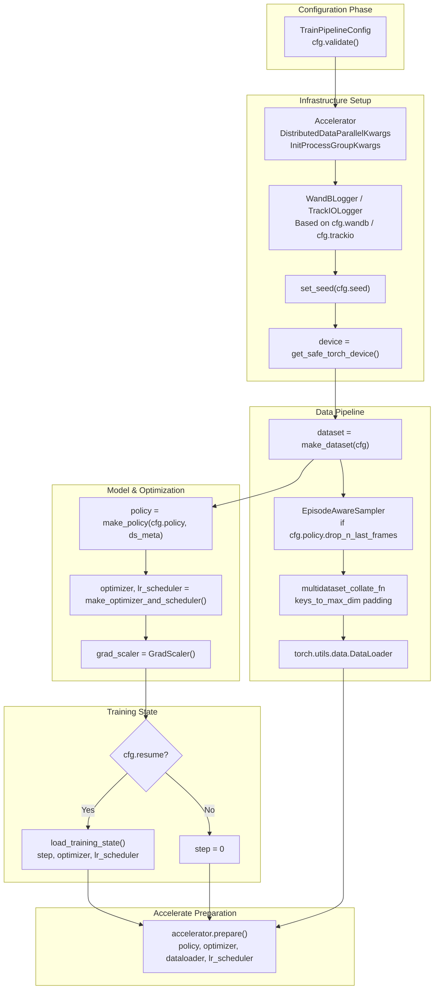
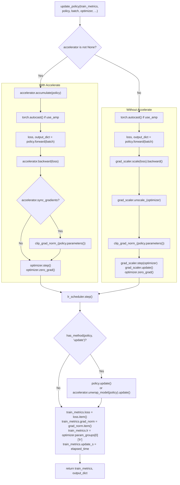
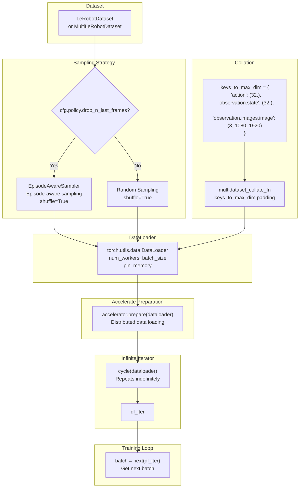

<!-- source: DeepWiki mcp.deepwiki.com · repo huggingface/VLAb · page 7 Training Execution · fetched 2026-10-26 -->

# Training Execution

<details>
<summary>Relevant source files</summary>

The following files were used as context for generating this wiki page:

- [LICENSE](LICENSE)
- [README.md](README.md)
- [src/lerobot/scripts/train.py](src/lerobot/scripts/train.py)

</details>


This page documents the training orchestration system in VLAb, including the main training script, the core training loop, and the execution flow from initialization to completion. This covers how the various components (datasets, policies, optimizers) are coordinated during the pretraining process.

For detailed information on specific aspects of training execution:
- Training script structure and initialization: see [Training Script Overview](#7.1)
- Distributed training with Accelerate: see [Distributed Training with Accelerate](#7.2)
- Checkpoint management: see [Checkpointing and Resumption](#7.3)

For related configuration options, see [Configuration System](#6). For model architecture details, see [Policy and Model System](#5). For dataset loading, see [Dataset System](#4).

---

## Training Orchestration Overview

VLAb's training execution is orchestrated by the `train.py` script, which serves as the central coordinator for all training activities. The script initializes all necessary components, manages the training loop, handles distributed training via Accelerate, and coordinates logging and checkpointing.

### Execution Entry Point

Training is launched using the Accelerate library command-line interface:

```bash
accelerate launch --config_file accelerate_configs/single_gpu.yaml \
    src/lerobot/scripts/train.py \
    --policy.type=smolvla2 \
    --dataset.repo_id="dataset1,dataset2" \
    --batch_size=8 \
    --steps=200000
```

The entry point is the `train()` function in [src/lerobot/scripts/train.py:129-377](), which is wrapped with the configuration parser decorator.

**Sources:** [src/lerobot/scripts/train.py:1-62](), [README.md:95-120]()

---

## Training Execution Flow

The following diagram illustrates the complete training execution flow from script launch to completion:

### Diagram: End-to-End Training Execution Flow

```mermaid
flowchart TD
    CLI["accelerate launch + train.py"]
    ParseConfig["@parser.wrap()<br/>Parse TrainPipelineConfig"]
    InitAccel["Initialize Accelerator<br/>is_launched_with_accelerate()"]
    InitLogging["Initialize Logging<br/>WandBLogger / TrackIOLogger"]
    
    SetSeed["set_seed(cfg.seed)"]
    CheckDevice["get_safe_torch_device()"]
    
    MakeDataset["make_dataset(cfg)<br/>Create LeRobotDataset"]
    MakePolicy["make_policy(cfg.policy, ds_meta)<br/>Load SmolVLA2"]
    MakeOptim["make_optimizer_and_scheduler()<br/>AdamW + LR Scheduler"]
    GradScaler["GradScaler(enabled=use_amp)"]
    
    Resume{"cfg.resume?"}
    LoadState["load_training_state()<br/>Load optimizer, scheduler, step"]
    
    CreateDataLoader["torch.utils.data.DataLoader<br/>with multidataset_collate_fn"]
    PrepareAccel["accelerator.prepare()<br/>policy, optimizer, dataloader, scheduler"]
    CycleIter["cycle(dataloader)<br/>Infinite iterator"]
    
    TrainLoop["Training Loop<br/>for _ in range(step, cfg.steps)"]
    NextBatch["batch = next(dl_iter)"]
    MoveDevice["Move batch to device"]
    UpdatePolicy["update_policy()<br/>Forward + Backward + Optimizer step"]
    
    LogCheck{"step % log_freq == 0?"}
    LogMetrics["Log to WandB/TrackIO<br/>loss, grad_norm, lr"]
    
    SaveCheck{"step % save_freq == 0?"}
    SaveCheckpoint["save_checkpoint()<br/>update_last_checkpoint()"]
    
    EndCheck{"step == cfg.steps?"}
    
    PushHub{"cfg.policy.push_to_hub?"}
    PushModel["policy.push_model_to_hub()"]
    
    End["End of Training"]
    
    CLI --> ParseConfig
    ParseConfig --> InitAccel
    InitAccel --> InitLogging
    InitLogging --> SetSeed
    SetSeed --> CheckDevice
    CheckDevice --> MakeDataset
    MakeDataset --> MakePolicy
    MakePolicy --> MakeOptim
    MakeOptim --> GradScaler
    GradScaler --> Resume
    
    Resume -->|Yes| LoadState
    Resume -->|No| CreateDataLoader
    LoadState --> CreateDataLoader
    
    CreateDataLoader --> PrepareAccel
    PrepareAccel --> CycleIter
    CycleIter --> TrainLoop
    
    TrainLoop --> NextBatch
    NextBatch --> MoveDevice
    MoveDevice --> UpdatePolicy
    UpdatePolicy --> LogCheck
    
    LogCheck -->|Yes| LogMetrics
    LogCheck -->|No| SaveCheck
    LogMetrics --> SaveCheck
    
    SaveCheck -->|Yes| SaveCheckpoint
    SaveCheck -->|No| EndCheck
    SaveCheckpoint --> EndCheck
    
    EndCheck -->|No| NextBatch
    EndCheck -->|Yes| PushHub
    
    PushHub -->|Yes| PushModel
    PushHub -->|No| End
    PushModel --> End
```



**Sources:** [src/lerobot/scripts/train.py:129-377]()

---

## Component Initialization

The training script initializes components in a specific sequence to ensure proper dependency resolution:

### Diagram: Component Initialization Sequence



**Sources:** [src/lerobot/scripts/train.py:129-252]()

---

## Training Loop Structure

The main training loop executes a fixed number of steps, performing data loading, model updates, logging, and checkpointing:

### Training Loop Code Structure

The training loop is implemented in [src/lerobot/scripts/train.py:269-325]():

```python
for _ in range(step, cfg.steps):
    # 1. Data loading
    start_time = time.perf_counter()
    batch = next(dl_iter)
    train_tracker.dataloading_s = time.perf_counter() - start_time
    
    # 2. Move batch to device
    for key in batch:
        if isinstance(batch[key], torch.Tensor):
            batch[key] = batch[key].to(device, non_blocking=True)
    
    # 3. Policy update
    train_tracker, output_dict = update_policy(
        train_tracker, policy, batch, optimizer,
        cfg.optimizer.grad_clip_norm, grad_scaler,
        lr_scheduler, cfg.policy.use_amp, accelerator
    )
    
    # 4. Step increment and checks
    step += 1
    train_tracker.step()
    is_log_step = cfg.log_freq > 0 and step % cfg.log_freq == 0
    is_saving_step = step % cfg.save_freq == 0 or step == cfg.steps
    
    # 5. Logging
    if is_log_step:
        logging.info(train_tracker)
        wandb_logger.log_dict(train_tracker.to_dict(), step)
        train_tracker.reset_averages()
    
    # 6. Checkpointing
    if cfg.save_checkpoint and is_saving_step:
        checkpoint_dir = get_step_checkpoint_dir(cfg.output_dir, cfg.steps, step)
        save_checkpoint(checkpoint_dir, step, cfg, policy, optimizer, lr_scheduler)
        update_last_checkpoint(checkpoint_dir)
```

### Key Loop Components

| Component | Type | Purpose |
|-----------|------|---------|
| `dl_iter` | Iterator | Infinite iterator created by `cycle(dataloader)` |
| `train_tracker` | `MetricsTracker` | Accumulates and reports training metrics |
| `batch` | dict | Contains batched tensors for images, actions, states |
| `step` | int | Current training step counter |
| `is_log_step` | bool | Whether to log metrics this step |
| `is_saving_step` | bool | Whether to save checkpoint this step |

**Sources:** [src/lerobot/scripts/train.py:269-325]()

---

## Policy Update Mechanism

The `update_policy()` function performs a single training iteration, including forward pass, backward pass, gradient clipping, and optimizer step:

### Diagram: update_policy() Execution Flow



**Sources:** [src/lerobot/scripts/train.py:64-125]()

### Mixed Precision Training

The training loop supports Automatic Mixed Precision (AMP) for faster training and reduced memory usage:

```python
with torch.autocast(device_type=device.type) if use_amp else nullcontext():
    loss, output_dict = policy.forward(batch)
```

When using Accelerate, the autocast context is managed internally. When not using Accelerate, a `GradScaler` is used to prevent underflow:

```python
grad_scaler = GradScaler(device.type, enabled=cfg.policy.use_amp)
grad_scaler.scale(loss).backward()
grad_scaler.unscale_(optimizer)
grad_norm = torch.nn.utils.clip_grad_norm_(policy.parameters(), grad_clip_norm)
grad_scaler.step(optimizer)
grad_scaler.update()
```

**Sources:** [src/lerobot/scripts/train.py:64-125](), [src/lerobot/scripts/train.py:199]()

---

## Metrics Tracking and Logging

VLAb tracks training metrics using the `MetricsTracker` class and logs them to WandB or TrackIO:

### Tracked Metrics

| Metric | Type | Description |
|--------|------|-------------|
| `loss` | `AverageMeter` | Training loss value |
| `grad_norm` | `AverageMeter` | L2 norm of gradients after clipping |
| `lr` | `AverageMeter` | Current learning rate |
| `update_s` | `AverageMeter` | Time taken for forward+backward+optimizer step |
| `dataloading_s` | `AverageMeter` | Time taken to fetch next batch |

### Diagram: Logging Flow

```mermaid
graph LR
    subgraph "Metric Collection"
        UpdatePolicy["update_policy()<br/>Populates train_metrics"]
        DataLoading["Data loading time<br/>train_tracker.dataloading_s"]
    end
    
    subgraph "Metric Aggregation"
        Tracker["MetricsTracker<br/>train_tracker"]
        AverageMeter["AverageMeter instances<br/>Running averages"]
    end
    
    subgraph "Logging Condition"
        LogCheck{"step % log_freq == 0?"}
    end
    
    subgraph "Logging Backends"
        Console["logging.info(train_tracker)<br/>Console output"]
        WandB["wandb_logger.log_dict()<br/>WandB dashboard"]
        TrackIO["trackio_logger.log_dict()<br/>TrackIO platform"]
    end
    
    subgraph "Reset"
        Reset["train_tracker.reset_averages()"]
    end
    
    UpdatePolicy --> Tracker
    DataLoading --> Tracker
    Tracker --> AverageMeter
    AverageMeter --> LogCheck
    
    LogCheck -->|Yes| Console
    LogCheck -->|Yes| WandB
    LogCheck -->|Yes| TrackIO
    
    Console --> Reset
    WandB --> Reset
    TrackIO --> Reset
    
    LogCheck -->|No| Continue["Continue training"]
```

**Sources:** [src/lerobot/scripts/train.py:256-311]()

### Logger Initialization

Loggers are conditionally initialized based on configuration:

```python
wandb_logger = None
trackio_logger = None

if cfg.wandb.enable and cfg.wandb.project:
    wandb_logger = WandBLogger(cfg)
elif cfg.trackio.enable and cfg.trackio.project:
    trackio_logger = TrackIOLogger(cfg)
else:
    logging.info("Logs will be saved locally.")
```

On non-main processes in distributed training, logging is disabled:

```python
if accelerator and not accelerator.is_main_process:
    cfg.wandb.enable = False
    cfg.trackio.enable = False
```

**Sources:** [src/lerobot/scripts/train.py:155-169]()

---

## Data Loading Pipeline

The training loop uses an infinite iterator created from the PyTorch DataLoader:

### Diagram: Data Loading Architecture



**Sources:** [src/lerobot/scripts/train.py:218-252]()

### Collate Function

The `multidataset_collate_fn` handles batching of heterogeneous datasets with different action/state dimensions. It pads tensors to maximum dimensions specified in `keys_to_max_dim`:

```python
keys_to_max_dim = {
    "action": (32,),
    "observation.state": (32,),
    "observation.images.image": (3, 1080, 1920),
    "observation.images.image2": (3, 1080, 1920),
}
collate_fn = partial(multidataset_collate_fn, keys_to_max_dim=keys_to_max_dim)
```

This enables training on datasets with varying action/state dimensionality.

**Sources:** [src/lerobot/scripts/train.py:230-237]()

---

## Accelerate Integration

VLAb detects whether training was launched with Accelerate and initializes accordingly:

### Detection and Initialization

```python
def is_launched_with_accelerate() -> bool:
    return "ACCELERATE_MIXED_PRECISION" in os.environ

if is_launched_with_accelerate():
    import accelerate
    from accelerate import DistributedDataParallelKwargs
    from accelerate import InitProcessGroupKwargs
    
    ddp_kwargs = DistributedDataParallelKwargs(find_unused_parameters=True)
    nccl_timeout = getattr(cfg, 'nccl_timeout', 1800)
    ddp_init_kwargs = InitProcessGroupKwargs(timeout=timedelta(seconds=nccl_timeout))
    gradient_accumulation_steps = getattr(cfg, 'gradient_accumulation_steps', 1)
    
    accelerator = accelerate.Accelerator(
        step_scheduler_with_optimizer=False,
        gradient_accumulation_steps=gradient_accumulation_steps,
        kwargs_handlers=[ddp_init_kwargs, ddp_kwargs]
    )
```

**Key Configuration Parameters:**

| Parameter | Default | Purpose |
|-----------|---------|---------|
| `find_unused_parameters` | `True` | Allows policies with unused parameters (e.g., Pi0) |
| `nccl_timeout` | 1800 seconds | NCCL timeout for distributed operations |
| `gradient_accumulation_steps` | 1 | Number of steps to accumulate gradients |
| `step_scheduler_with_optimizer` | `False` | Manual LR scheduler stepping per batch |

**Sources:** [src/lerobot/scripts/train.py:61-62](), [src/lerobot/scripts/train.py:134-151]()

### Component Preparation

After initialization, components are prepared for distributed training:

```python
policy, optimizer, dataloader, lr_scheduler = accelerator.prepare(
    policy, optimizer, dataloader, lr_scheduler
)
```

This wraps components for:
- Model distribution across GPUs
- Gradient synchronization
- Data parallelism
- Mixed precision training

For detailed information on distributed training configuration, see [Distributed Training with Accelerate](#7.2).

**Sources:** [src/lerobot/scripts/train.py:248-251]()

---

## Device Management

The training script handles device placement with automatic fallback:

```python
device = get_safe_torch_device(cfg.policy.device, log=True)
torch.backends.cudnn.benchmark = True
torch.backends.cuda.matmul.allow_tf32 = True
```

Batches are moved to the device with non-blocking transfers for efficiency:

```python
for key in batch:
    if isinstance(batch[key], torch.Tensor):
        batch[key] = batch[key].to(device, non_blocking=True)
```

**Sources:** [src/lerobot/scripts/train.py:175-177](), [src/lerobot/scripts/train.py:274-276]()

---

## Training Completion

Upon completing the specified number of training steps, the script performs final cleanup:

### Final Steps

1. **Training Loop Exit**: Loop completes after `cfg.steps` iterations
2. **Model Pushing** (optional): If `cfg.policy.push_to_hub` is enabled, uploads model to HuggingFace Hub
3. **Logging Completion**: Logs "End of training" message

```python
if cfg.policy.push_to_hub:
    unwrapped_policy = accelerator.unwrap_model(policy) if accelerator else policy
    unwrapped_policy.push_model_to_hub(cfg)
```

The unwrapping step is necessary when using Accelerate to access the original policy object without distributed wrappers.

**Sources:** [src/lerobot/scripts/train.py:367-377]()

---

## Command-Line Execution Examples

### Single GPU Training

```bash
accelerate launch --config_file accelerate_configs/single_gpu.yaml \
    src/lerobot/scripts/train.py \
    --policy.type=smolvla2 \
    --policy.repo_id=HuggingFaceTB/SmolVLM2-500M-Video-Instruct \
    --dataset.repo_id="dataset1,dataset2" \
    --batch_size=8 \
    --steps=10000 \
    --wandb.enable=true
```

### Multi-GPU Training

```bash
accelerate launch --config_file accelerate_configs/multi_gpu.yaml \
    src/lerobot/scripts/train.py \
    --policy.type=smolvla2 \
    --dataset.root="/path/to/datasets" \
    --dataset.repo_id="community_dataset_v2/user1/dataset1" \
    --batch_size=8 \
    --steps=200000
```

### Training Resumption

```bash
accelerate launch --config_file accelerate_configs/multi_gpu.yaml \
    src/lerobot/scripts/train.py \
    --resume=true \
    --checkpoint_path="./outputs/training/checkpoints/last"
```

**Sources:** [README.md:95-195]()

---

## Summary

The training execution system in VLAb provides:

1. **Unified Entry Point**: Single `train.py` script handles all training scenarios
2. **Flexible Infrastructure**: Supports single-GPU, multi-GPU, and SLURM cluster execution
3. **Robust State Management**: Automatic checkpointing and resumption capabilities
4. **Comprehensive Logging**: Integration with WandB and TrackIO for experiment tracking
5. **Distributed Training**: Seamless integration with Accelerate for scalability
6. **Mixed Precision**: Support for FP16/BF16 training with gradient scaling
7. **Efficient Data Loading**: Infinite iterator pattern with multi-worker data loading

The modular design allows the same training code to run across different execution environments with minimal configuration changes.

---

