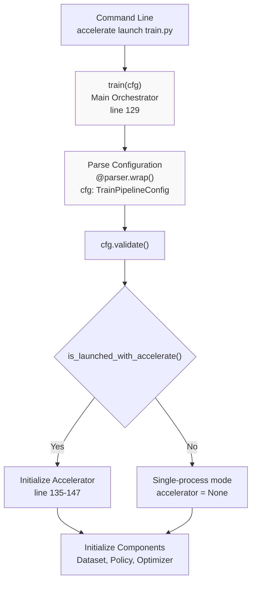
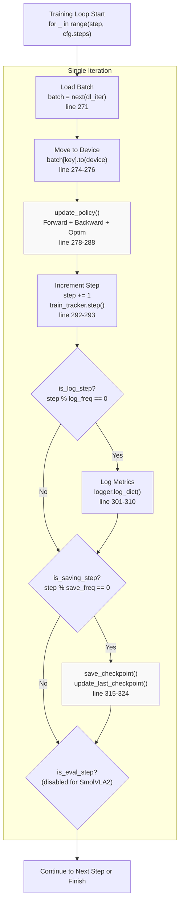
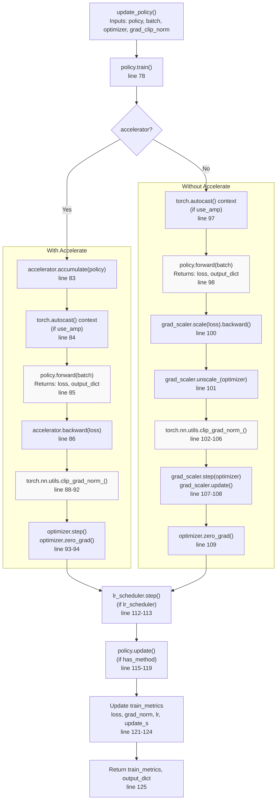
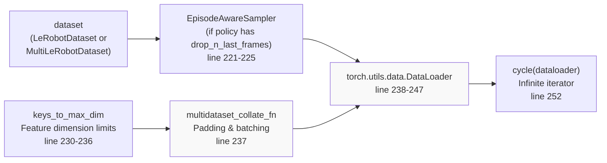
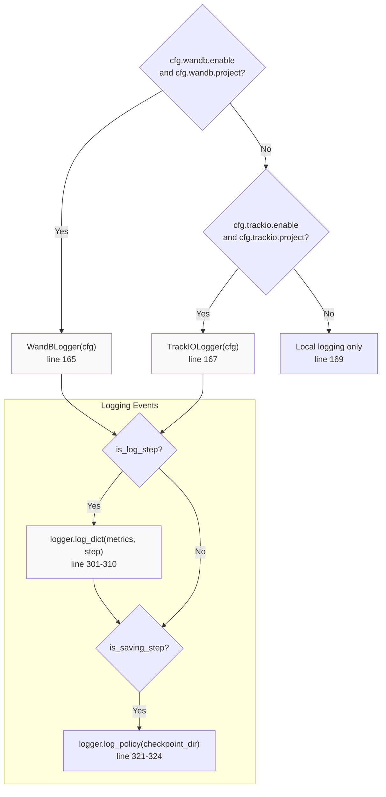
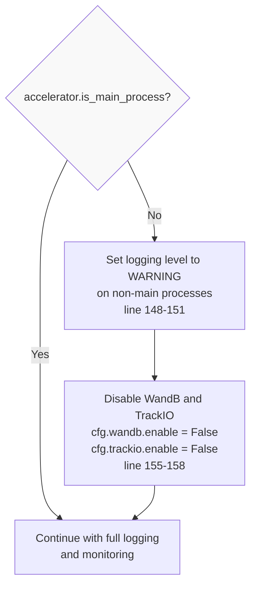
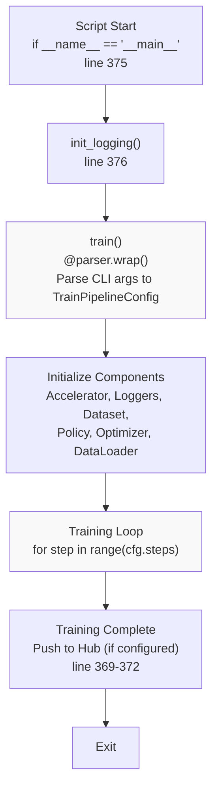

<!-- source: DeepWiki mcp.deepwiki.com · repo huggingface/VLAb · page 7.1 Training Script Overview · fetched 2026-10-26 -->

# Training Script Overview

<details>
<summary>Relevant source files</summary>

The following files were used as context for generating this wiki page:

- [LICENSE](LICENSE)
- [README.md](README.md)
- [src/lerobot/scripts/train.py](src/lerobot/scripts/train.py)

</details>


This page documents the main training orchestrator located at [src/lerobot/scripts/train.py](). This script serves as the central entry point for all VLAb training runs, coordinating dataset loading, policy initialization, optimization, and the training loop. For details on distributed training configuration, see [Distributed Training with Accelerate](#7.2). For checkpoint management, see [Checkpointing and Resumption](#7.3). For configuration details, see [TrainPipelineConfig](#6.1).

**Sources:** [src/lerobot/scripts/train.py:1-378]()

## Script Entry Point

The training script is invoked via the `train()` function, which serves as the main orchestrator. This function is decorated with `@parser.wrap()`, enabling command-line argument parsing that automatically populates a `TrainPipelineConfig` object.

The script can be launched in two modes:
1. **Single-process mode**: Direct Python execution without Accelerate
2. **Multi-process mode**: Via `accelerate launch` for distributed training

The script detects its launch mode by checking for the `ACCELERATE_MIXED_PRECISION` environment variable set by Accelerate.



**Sources:** [src/lerobot/scripts/train.py:61-62](), [src/lerobot/scripts/train.py:128-151]()

## Component Initialization Sequence

The training script follows a strict initialization sequence to set up all required components. Each component depends on the previous ones being properly configured.

```mermaid
graph TB
    subgraph "Initialization Phase"
        Config["TrainPipelineConfig<br/>Master Configuration"]
        
        Accelerator["Accelerator Setup<br/>(optional)<br/>line 134-151"]
        
        Loggers["Logger Initialization<br/>WandBLogger or TrackIOLogger<br/>line 161-169"]
        
        Seed["Set Random Seed<br/>set_seed(cfg.seed)<br/>line 171-172"]
        
        Device["Device Configuration<br/>get_safe_torch_device()<br/>line 175-177"]
        
        Dataset["Dataset Creation<br/>make_dataset(cfg)<br/>line 180"]
        
        Policy["Policy Creation<br/>make_policy(cfg.policy, ds_meta)<br/>line 191-195"]
        
        OptimSched["Optimizer & Scheduler<br/>make_optimizer_and_scheduler(cfg, policy)<br/>line 198"]
        
        GradScaler["Gradient Scaler<br/>GradScaler(device.type, enabled=use_amp)<br/>line 199"]
        
        Resume{"cfg.resume?"}
        LoadState["load_training_state()<br/>line 204"]
        
        DataLoader["DataLoader Setup<br/>with custom collate_fn<br/>line 238-247"]
        
        PrepareAccel["Accelerate Prepare<br/>Wrap policy, optimizer, dataloader<br/>line 248-251"]
    end
    
    Config --> Accelerator
    Accelerator --> Loggers
    Loggers --> Seed
    Seed --> Device
    Device --> Dataset
    Dataset --> Policy
    Policy --> OptimSched
    OptimSched --> GradScaler
    GradScaler --> Resume
    Resume -->|"Yes"| LoadState
    Resume -->|"No"| DataLoader
    LoadState --> DataLoader
    DataLoader --> PrepareAccel
    
    style Config fill:#f9f9f9
    style Dataset fill:#f9f9f9
    style Policy fill:#f9f9f9
```



**Sources:** [src/lerobot/scripts/train.py:129-252]()

### Key Initialization Steps

| Step | Function/Class | Location | Purpose |
|------|----------------|----------|---------|
| Configuration | `TrainPipelineConfig` | line 129 | Master configuration object |
| Accelerator | `accelerate.Accelerator()` | line 147 | Distributed training setup (optional) |
| Logger | `WandBLogger` or `TrackIOLogger` | line 165-167 | Experiment tracking |
| Seed | `set_seed()` | line 172 | Reproducibility |
| Device | `get_safe_torch_device()` | line 175 | GPU/CPU selection |
| Dataset | `make_dataset()` | line 180 | Load training data |
| Policy | `make_policy()` | line 192 | Initialize model |
| Optimizer | `make_optimizer_and_scheduler()` | line 198 | Create optimization components |
| DataLoader | `torch.utils.data.DataLoader` | line 238 | Batch iteration |

**Sources:** [src/lerobot/scripts/train.py:129-252]()

## Training Loop Structure

The main training loop iterates for `cfg.steps` updates, executing data loading, forward/backward passes, optimization, and periodic logging/checkpointing.



**Sources:** [src/lerobot/scripts/train.py:269-362]()

### Loop Variables and Tracking

The training loop maintains several key variables:

- **`step`**: Global training step counter (number of optimizer updates performed)
- **`dl_iter`**: Cyclic iterator over the DataLoader created by `cycle(dataloader)` at line 252
- **`train_tracker`**: `MetricsTracker` object accumulating training metrics
- **`is_log_step`**: Boolean flag for logging (line 294)
- **`is_saving_step`**: Boolean flag for checkpointing (line 295)
- **`is_eval_step`**: Boolean flag for evaluation (line 296, disabled for pretraining)

**Sources:** [src/lerobot/scripts/train.py:201](), [src/lerobot/scripts/train.py:252](), [src/lerobot/scripts/train.py:264-266](), [src/lerobot/scripts/train.py:269-296]()

## Training Step: `update_policy`

The `update_policy()` function encapsulates a single training step, including forward pass, loss computation, backward pass, gradient clipping, and optimization.



**Sources:** [src/lerobot/scripts/train.py:64-125]()

### Key Features

1. **Dual-path execution**: Separate code paths for Accelerate (distributed) vs standard (single-process) training
2. **Gradient accumulation**: When using Accelerate, gradient accumulation is handled via `accelerator.accumulate()` context (line 83)
3. **Mixed precision**: Optional automatic mixed precision (AMP) via `torch.autocast()` when `use_amp=True`
4. **Gradient scaling**: `GradScaler` prevents underflow in mixed precision training (line 100-108)
5. **Gradient clipping**: `clip_grad_norm_()` with max norm specified by `cfg.optimizer.grad_clip_norm` (line 88-92, 102-106)
6. **Per-batch scheduler**: Learning rate scheduler steps after every batch, not every epoch (line 112-113)
7. **Policy update hook**: Optional `policy.update()` method called after optimization for custom logic (line 115-119)

**Sources:** [src/lerobot/scripts/train.py:64-125]()

## DataLoader Configuration

The training script uses a custom DataLoader setup to handle multi-dataset training with variable-dimension features.



**Sources:** [src/lerobot/scripts/train.py:218-252]()

### DataLoader Parameters

| Parameter | Value | Purpose |
|-----------|-------|---------|
| `collate_fn` | `partial(multidataset_collate_fn, keys_to_max_dim=...)` | Custom batching with padding |
| `num_workers` | `cfg.num_workers` | Parallel data loading |
| `batch_size` | `cfg.batch_size` | Samples per batch |
| `shuffle` | `True` (if no sampler) | Random sample ordering |
| `sampler` | `EpisodeAwareSampler` (optional) | Episode-aware sampling |
| `pin_memory` | `True` (if GPU) | Faster host-to-device transfer |
| `drop_last` | `False` | Include incomplete final batch |

The `keys_to_max_dim` dictionary specifies maximum dimensions for each feature type, enabling the collate function to pad tensors to a common shape across heterogeneous datasets:

```python
keys_to_max_dim = {
    "action": (32,),
    "observation.state": (32,),
    "observation.images.image": (3, 1080, 1920),
    "observation.images.image2": (3, 1080, 1920),
}
```

**Sources:** [src/lerobot/scripts/train.py:230-247]()

## Logging and Monitoring

The training script supports dual logging backends with conditional activation based on configuration.



**Sources:** [src/lerobot/scripts/train.py:161-169](), [src/lerobot/scripts/train.py:301-324]()

### Logged Metrics

The `train_tracker` maintains running averages of key training metrics:

- **`loss`**: Training loss value
- **`grad_norm`**: Gradient norm after clipping
- **`lr`**: Current learning rate
- **`update_s`**: Time per training step (seconds)
- **`dataloading_s`**: Time per data loading operation (seconds)

Additional metrics from `output_dict` returned by `policy.forward()` are also logged if available.

**Sources:** [src/lerobot/scripts/train.py:256-262](), [src/lerobot/scripts/train.py:301-310]()

## Multi-Process Coordination

When launched with Accelerate, the script includes special logic to prevent duplicate logging and ensure proper coordination across processes.



**Key behaviors:**
- Only the main process (rank 0) performs logging to WandB/TrackIO
- Non-main processes have logging level set to WARNING to reduce clutter
- All processes participate in training and gradient synchronization
- Checkpoint saving is coordinated through Accelerate's mechanisms

**Sources:** [src/lerobot/scripts/train.py:148-158]()

## Key Configuration Parameters

The following configuration parameters directly control the training script's behavior:

| Parameter | Type | Purpose | Default/Example |
|-----------|------|---------|-----------------|
| `cfg.steps` | int | Total number of training updates | 200000 |
| `cfg.batch_size` | int | Samples per batch | 8 |
| `cfg.num_workers` | int | DataLoader worker processes | 4 |
| `cfg.log_freq` | int | Steps between logging | 100 |
| `cfg.save_freq` | int | Steps between checkpoints | 10000 |
| `cfg.eval_freq` | int | Steps between evaluations (disabled) | 0 |
| `cfg.resume` | bool | Resume from checkpoint | False |
| `cfg.checkpoint_path` | Path | Path to checkpoint for resumption | None |
| `cfg.output_dir` | Path | Directory for outputs | "./outputs" |
| `cfg.seed` | int | Random seed | None |
| `cfg.save_checkpoint` | bool | Enable checkpoint saving | True |
| `cfg.optimizer.grad_clip_norm` | float | Gradient clipping threshold | 1.0 |
| `cfg.policy.use_amp` | bool | Use automatic mixed precision | False |
| `cfg.gradient_accumulation_steps` | int | Gradient accumulation steps | 1 |
| `cfg.nccl_timeout` | int | NCCL timeout in seconds | 1800 |

**Sources:** [src/lerobot/scripts/train.py:129-373]()

## Script Execution Flow Summary



**Sources:** [src/lerobot/scripts/train.py:375-377](), [src/lerobot/scripts/train.py:129-373]()

---

