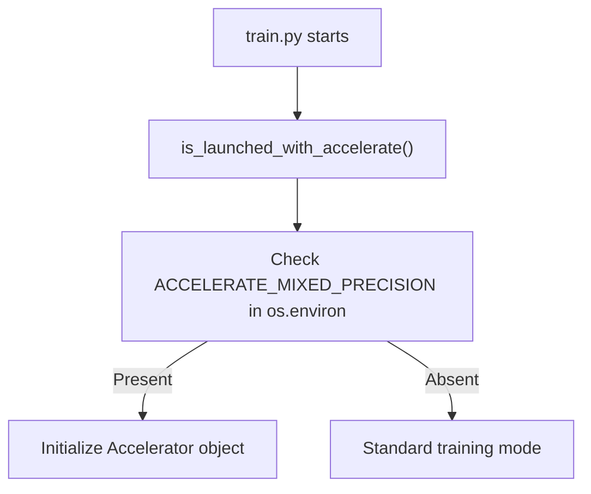
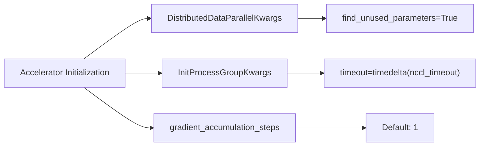
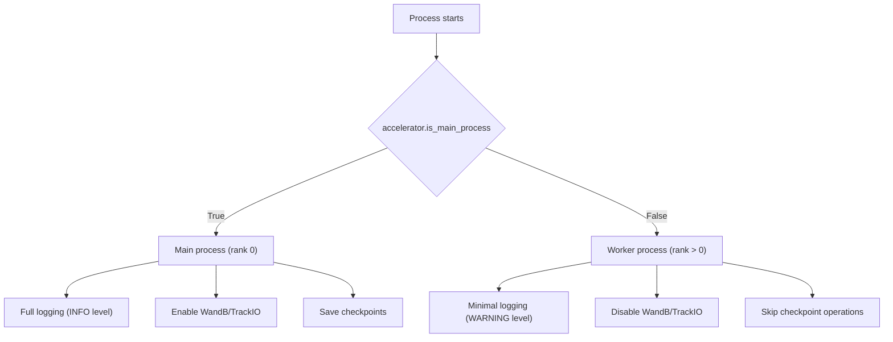
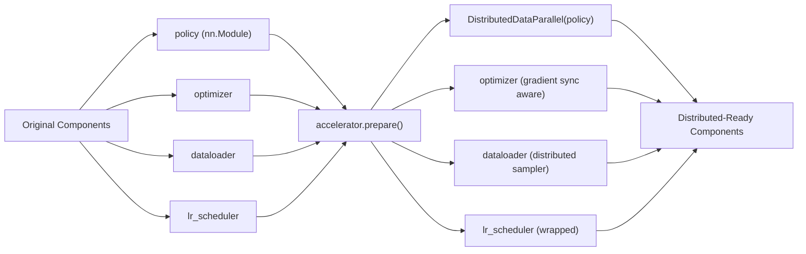
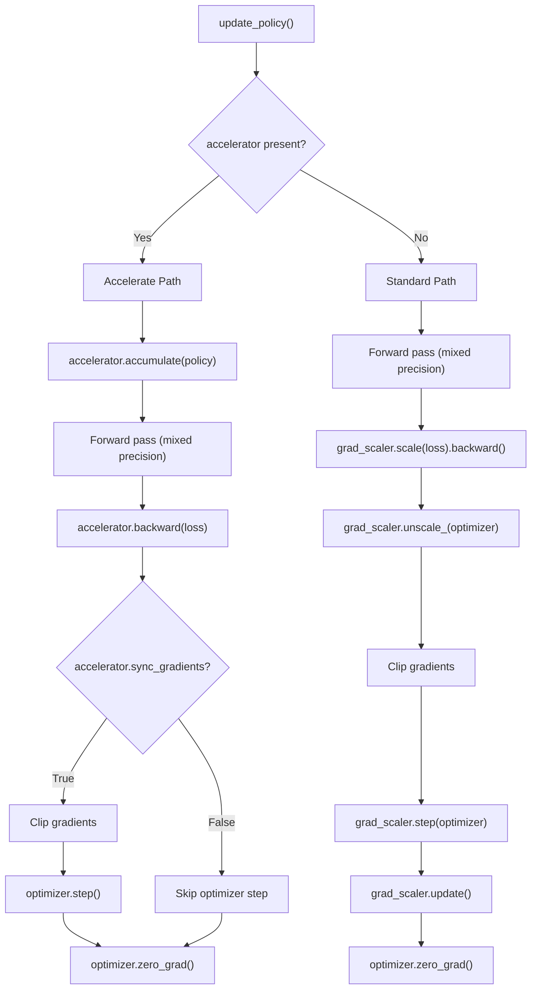
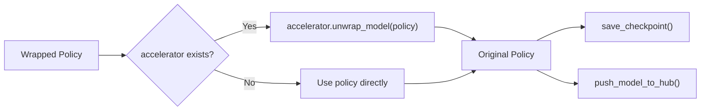
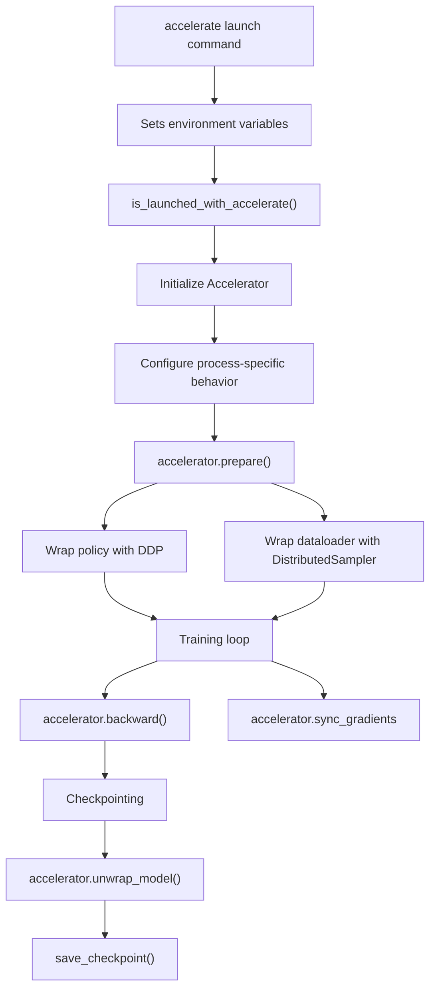

<!-- source: DeepWiki mcp.deepwiki.com · repo huggingface/VLAb · page 7.2 Distributed Training with Accelerate · fetched 2026-10-26 -->

# Distributed Training with Accelerate

<details>
<summary>Relevant source files</summary>

The following files were used as context for generating this wiki page:

- [LICENSE](LICENSE)
- [README.md](README.md)
- [accelerate_configs/multi_gpu.yaml](accelerate_configs/multi_gpu.yaml)
- [src/lerobot/scripts/train.py](src/lerobot/scripts/train.py)

</details>


## Purpose and Scope

This document explains how VLAb uses the HuggingFace Accelerate library to enable distributed training across single GPUs, multi-GPU setups, and SLURM clusters. It covers the Accelerate configuration system, integration points in the training script, and how distributed training is orchestrated.

For information about the overall training script structure, see [Training Script Overview](#7.1). For SLURM-specific cluster execution, see [SLURM Cluster Training](#8.2).

## Overview of Accelerate

Accelerate is HuggingFace's library that abstracts distributed training complexity, providing a unified API across different hardware configurations. VLAb leverages Accelerate to enable:

- **Multi-GPU training** on a single machine using `DistributedDataParallel`
- **Multi-node training** on SLURM clusters
- **Gradient accumulation** for effective large batch sizes
- **Mixed precision training** with automatic gradient scaling
- **Process synchronization** for logging and checkpointing

The key advantage is that the same training code works across all configurations without manual device placement or communication primitives.

**Sources:** [README.md:1-309](), [src/lerobot/scripts/train.py:1-378]()

## Accelerate Configuration Files

VLAb provides pre-configured Accelerate YAML files for common setups:

### Single GPU Configuration

The `single_gpu.yaml` configuration is used for training on a single GPU:

```yaml
compute_environment: LOCAL_MACHINE
distributed_type: NO
use_cpu: false
```

### Multi-GPU Configuration

The `multi_gpu.yaml` configuration enables data-parallel training across multiple GPUs on a single machine:

| Parameter | Value | Description |
|-----------|-------|-------------|
| `compute_environment` | `LOCAL_MACHINE` | Training on local machine |
| `distributed_type` | `MULTI_GPU` | Use DistributedDataParallel |
| `num_processes` | `2` | Number of GPU processes (customize based on available GPUs) |
| `gpu_ids` | `all` | Use all available GPUs |
| `mixed_precision` | `no` | Controlled via `--policy.use_amp` instead |
| `num_machines` | `1` | Single machine |

**Sources:** [accelerate_configs/multi_gpu.yaml:1-19]()

## Launching Training with Accelerate

Training is launched using the `accelerate launch` command wrapper:

```bash
# Single GPU
accelerate launch --config_file accelerate_configs/single_gpu.yaml \
    src/lerobot/scripts/train.py \
    --policy.type=smolvla2 \
    --batch_size=8

# Multi-GPU
accelerate launch --config_file accelerate_configs/multi_gpu.yaml \
    src/lerobot/scripts/train.py \
    --policy.type=smolvla2 \
    --batch_size=8
```

The `accelerate launch` command sets environment variables that the training script detects to enable distributed training mode.

**Sources:** [README.md:96-111](), [README.md:162-196]()

## Detecting Accelerate Launch

The training script detects whether it was launched with Accelerate by checking for environment variables:



**Detection Function**

The `is_launched_with_accelerate()` function checks for Accelerate-specific environment variables:

[src/lerobot/scripts/train.py:61-62]()

This simple check determines whether to initialize the `Accelerator` object and use distributed training features.

**Sources:** [src/lerobot/scripts/train.py:61-62](), [src/lerobot/scripts/train.py:134-147]()

## Accelerator Initialization

When launched with Accelerate, the training script initializes an `Accelerator` object with specialized configurations:



**Initialization Code**

[src/lerobot/scripts/train.py:134-147]()

### Key Configuration Parameters

| Parameter | Default | Purpose |
|-----------|---------|---------|
| `find_unused_parameters` | `True` | Required for SmolVLA2 which has unused parameters (e.g., last LLM block in pi0) |
| `nccl_timeout` | `1800` seconds | NCCL communication timeout for multi-node training |
| `gradient_accumulation_steps` | `1` | Number of batches to accumulate before optimizer step |
| `step_scheduler_with_optimizer` | `False` | Manual scheduler stepping in training loop |

**Sources:** [src/lerobot/scripts/train.py:134-147]()

## Process Management and Logging

Accelerate manages multiple processes in distributed training. VLAb ensures only the main process performs logging and I/O operations:



**Process-Specific Configuration**

[src/lerobot/scripts/train.py:148-158]()

This ensures:
- Only one process writes checkpoints (avoiding conflicts)
- Only one process logs to WandB/TrackIO (avoiding duplicate metrics)
- Worker processes have minimal logging overhead

**Sources:** [src/lerobot/scripts/train.py:148-158]()

## Component Preparation

The `accelerator.prepare()` method wraps PyTorch objects for distributed training:



**Preparation Code**

[src/lerobot/scripts/train.py:248-251]()

The `prepare()` method:
- Wraps the policy model with `DistributedDataParallel` for gradient synchronization
- Distributes data loading across processes with `DistributedSampler`
- Ensures optimizer steps are synchronized across GPUs
- Handles device placement automatically

**Sources:** [src/lerobot/scripts/train.py:248-251]()

## Training Loop Integration

The `update_policy()` function adapts its behavior based on whether Accelerate is active:



**Accelerate Training Path**

[src/lerobot/scripts/train.py:82-94]()

Key differences in the Accelerate path:
- Uses `accelerator.accumulate(policy)` context for gradient accumulation
- Uses `accelerator.backward(loss)` instead of `loss.backward()`
- Only clips gradients when `accelerator.sync_gradients` is `True`
- Gradient scaling is handled automatically by Accelerate

**Standard Training Path**

[src/lerobot/scripts/train.py:96-109]()

The standard path uses PyTorch's native gradient scaler for mixed precision.

**Sources:** [src/lerobot/scripts/train.py:64-125]()

## Model Unwrapping

When checkpointing or evaluating, the model must be unwrapped from the DistributedDataParallel wrapper:



**Unwrapping for Checkpointing**

[src/lerobot/scripts/train.py:316-318]()

**Unwrapping for Hub Push**

[src/lerobot/scripts/train.py:370-372]()

Unwrapping is necessary because:
- Checkpoint state dicts should contain the original model parameters, not DDP wrapper state
- HuggingFace Hub expects unwrapped models for upload
- Evaluation may require access to model methods obscured by DDP wrapper

**Sources:** [src/lerobot/scripts/train.py:316-324](), [src/lerobot/scripts/train.py:369-372]()

## Gradient Accumulation

Gradient accumulation enables training with larger effective batch sizes by accumulating gradients over multiple forward passes:

| Configuration | Location | Default |
|---------------|----------|---------|
| `gradient_accumulation_steps` | `TrainPipelineConfig` attribute | `1` |
| Accelerator initialization | `src/lerobot/scripts/train.py:146` | Read from config |

**How It Works**

1. The `accelerator.accumulate(policy)` context manager tracks accumulation steps
2. Gradients are accumulated without synchronization until the final step
3. `accelerator.sync_gradients` becomes `True` only on the final accumulation step
4. Optimizer step and gradient clipping occur only when synchronization happens

**Effective Batch Size**

```
effective_batch_size = batch_size × num_gpus × gradient_accumulation_steps
```

For example:
- `batch_size=8`
- `num_processes=4` (4 GPUs)
- `gradient_accumulation_steps=2`
- Effective batch size = 8 × 4 × 2 = 64

**Sources:** [src/lerobot/scripts/train.py:146-147](), [src/lerobot/scripts/train.py:82-94]()

## Distributed Training Modes

### Single GPU Mode

No special configuration required. Either:
1. Don't use `accelerate launch` (standard PyTorch training)
2. Use `accelerate launch` with `single_gpu.yaml` (Accelerate manages device placement)

### Multi-GPU Mode (Single Node)

Uses `DistributedDataParallel` to parallelize training across GPUs on one machine:

```bash
accelerate launch --config_file accelerate_configs/multi_gpu.yaml \
    src/lerobot/scripts/train.py \
    --batch_size=8
```

Each GPU processes `batch_size` samples independently, and gradients are synchronized across all GPUs before the optimizer step.

### Multi-Node Mode (SLURM)

For SLURM clusters, Accelerate automatically detects the distributed environment from SLURM environment variables:

```bash
srun accelerate launch --config_file accelerate_configs/multi_gpu.yaml \
    src/lerobot/scripts/train.py \
    --batch_size=8
```

SLURM sets variables like `SLURM_PROCID`, `SLURM_NNODES`, and `SLURM_NTASKS` that Accelerate uses to configure distributed training.

**Sources:** [README.md:162-218]()

## Advanced Configuration Options

### NCCL Timeout

For multi-node training, increase the NCCL timeout to handle slow network communication:

```python
# In TrainPipelineConfig or command line
nccl_timeout = 3600  # seconds (default: 1800)
```

[src/lerobot/scripts/train.py:143-144]()

### DDP Find Unused Parameters

Required for architectures with conditional computation paths:

```python
ddp_kwargs = DistributedDataParallelKwargs(find_unused_parameters=True)
```

[src/lerobot/scripts/train.py:138-139]()

This is essential for SmolVLA2, which has unused parameters in certain training modes (e.g., when training only the expert model).

**Sources:** [src/lerobot/scripts/train.py:138-144]()

## Summary: Accelerate Integration Points



The key integration points are:
1. **Detection**: [src/lerobot/scripts/train.py:61-62]()
2. **Initialization**: [src/lerobot/scripts/train.py:134-147]()
3. **Process Management**: [src/lerobot/scripts/train.py:148-158]()
4. **Component Preparation**: [src/lerobot/scripts/train.py:248-251]()
5. **Training Loop**: [src/lerobot/scripts/train.py:82-94]()
6. **Model Unwrapping**: [src/lerobot/scripts/train.py:316-318](), [src/lerobot/scripts/train.py:370-372]()

**Sources:** [src/lerobot/scripts/train.py:61-378]()

---

