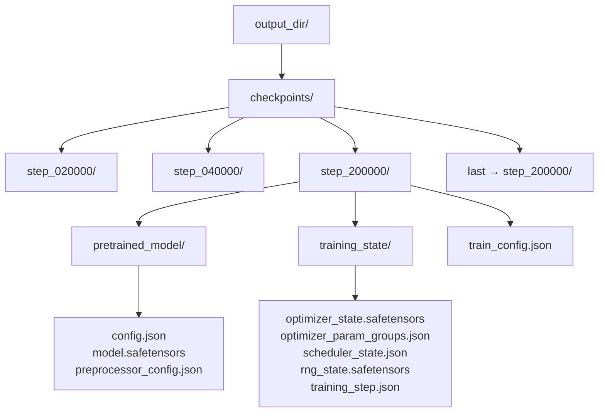
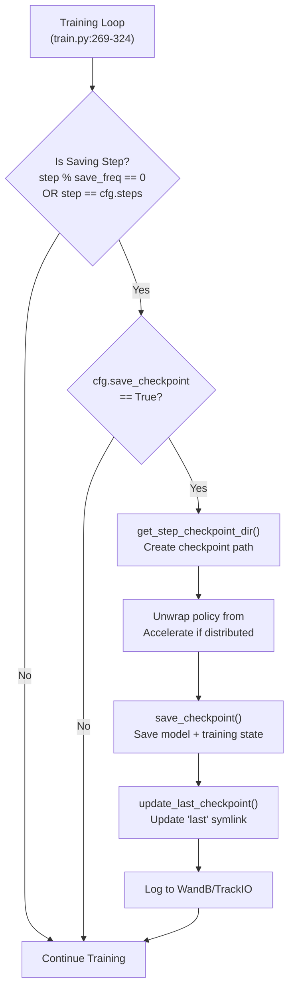
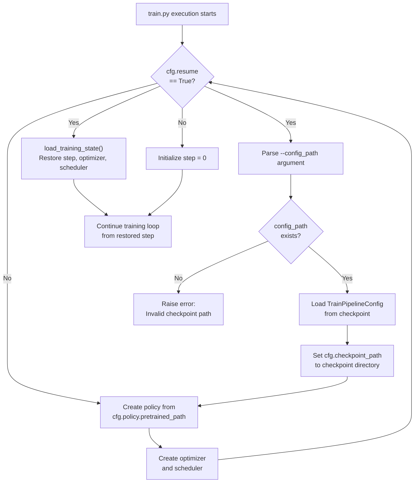
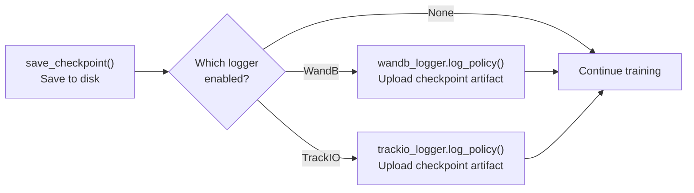

<!-- source: DeepWiki mcp.deepwiki.com · repo huggingface/VLAb · page 7.3 Checkpointing and Resumption · fetched 2026-10-26 -->

# Checkpointing and Resumption

<details>
<summary>Relevant source files</summary>

The following files were used as context for generating this wiki page:

- [LICENSE](LICENSE)
- [README.md](README.md)
- [src/lerobot/configs/train.py](src/lerobot/configs/train.py)
- [src/lerobot/constants.py](src/lerobot/constants.py)
- [src/lerobot/scripts/train.py](src/lerobot/scripts/train.py)

</details>


This document covers VLAb's checkpointing system for saving training progress and resuming interrupted training runs. For information about the overall training loop that uses checkpointing, see [Training Script Overview](#7.1). For distributed training considerations, see [Distributed Training with Accelerate](#7.2).

## Purpose and Scope

VLAb implements a comprehensive checkpointing system that periodically saves:
- Model weights (policy parameters)
- Optimizer state (Adam momentum, variance statistics)
- Learning rate scheduler state
- Training step counter
- Random number generator states

This enables long-running pretraining jobs to survive interruptions, hardware failures, or deliberate pauses without losing progress. The system is designed to work seamlessly with both local multi-GPU training and SLURM cluster environments.

## Checkpoint Directory Structure

VLAb organizes checkpoints in a hierarchical directory structure under the configured `output_dir`:



Sources: [src/lerobot/constants.py:35-44](), [src/lerobot/scripts/train.py:315-319]()

### Directory Structure Components

| Component | Purpose | Content |
|-----------|---------|---------|
| `checkpoints/` | Root checkpoint directory | Contains all checkpoint steps |
| `step_NNNNNN/` | Individual checkpoint at step N | Complete training state at that step |
| `last` | Symlink to most recent checkpoint | Enables easy resumption without specifying step |
| `pretrained_model/` | Model weights and configuration | Policy parameters in safetensors format |
| `training_state/` | Optimizer and scheduler state | Complete state for exact resumption |
| `train_config.json` | Training configuration | Full training pipeline config at checkpoint time |

**Constants defining checkpoint structure:**

[src/lerobot/constants.py:36-44]():
```python
CHECKPOINTS_DIR = "checkpoints"
LAST_CHECKPOINT_LINK = "last"
PRETRAINED_MODEL_DIR = "pretrained_model"
TRAINING_STATE_DIR = "training_state"
RNG_STATE = "rng_state.safetensors"
TRAINING_STEP = "training_step.json"
OPTIMIZER_STATE = "optimizer_state.safetensors"
OPTIMIZER_PARAM_GROUPS = "optimizer_param_groups.json"
SCHEDULER_STATE = "scheduler_state.json"
```

## Checkpoint Contents

Each checkpoint contains two primary components: the pretrained model and the training state.

### Pretrained Model Directory

The `pretrained_model/` subdirectory contains everything needed to load the model for inference or fine-tuning:

| File | Content | Format |
|------|---------|--------|
| `config.json` | Model architecture configuration | JSON |
| `model.safetensors` | Model weights | SafeTensors |
| `preprocessor_config.json` | Image preprocessing configuration | JSON |

These files follow the HuggingFace Hub model format, making the checkpoint directly compatible with `Policy.from_pretrained()`.

### Training State Directory

The `training_state/` subdirectory contains everything needed to resume training from the exact point:

| File | Content | Purpose |
|------|---------|---------|
| `training_step.json` | Current training step number | Track progress |
| `optimizer_state.safetensors` | Adam momentum and variance buffers | Exact optimizer state |
| `optimizer_param_groups.json` | Learning rate and hyperparameters | Optimizer configuration |
| `scheduler_state.json` | LR scheduler internal state | Exact schedule position |
| `rng_state.safetensors` | PyTorch, NumPy, Python RNG states | Reproducible sampling |

The training state ensures that resumed training continues with identical optimization dynamics to non-interrupted training.

Sources: [src/lerobot/scripts/train.py:315-319](), [src/lerobot/constants.py:36-44]()

## Checkpoint Saving Flow

The checkpoint saving process is triggered periodically during training based on the `save_freq` configuration parameter.



Sources: [src/lerobot/scripts/train.py:313-324]()

### Checkpoint Trigger Logic

Checkpoints are saved when either condition is met:
1. **Periodic saving**: `step % cfg.save_freq == 0`
2. **Final step**: `step == cfg.steps`

**Configuration parameters:**

[src/lerobot/configs/train.py:60-62]():
```python
save_checkpoint: bool = True
# Checkpoint is saved every `save_freq` training iterations and after the last training step.
save_freq: int = 20_000
```

### Distributed Training Considerations

When training with Accelerate, the policy must be unwrapped before saving to extract the raw model parameters without distributed training wrappers:

[src/lerobot/scripts/train.py:317]():
```python
unwrapped_policy = accelerator.unwrap_model(policy) if accelerator else policy
```

This ensures checkpoints are portable across different distributed training configurations.

### Checkpoint Save Implementation

The `save_checkpoint` function (imported from `lerobot.utils.train_utils`) performs the actual save operation:

[src/lerobot/scripts/train.py:318]():
```python
save_checkpoint(checkpoint_dir, step, cfg, unwrapped_policy, optimizer, lr_scheduler)
```

This function:
1. Creates the checkpoint directory structure
2. Saves model weights to `pretrained_model/`
3. Saves training state to `training_state/`
4. Saves the training configuration as `train_config.json`

### Last Checkpoint Link

After saving, the `last` symlink is updated to point to the most recent checkpoint:

[src/lerobot/scripts/train.py:319]():
```python
update_last_checkpoint(checkpoint_dir)
```

This enables resumption without knowing the exact step number:
```bash
--checkpoint_path=outputs/training/checkpoints/last
```

Sources: [src/lerobot/scripts/train.py:313-324](), [src/lerobot/configs/train.py:60-62]()

## Resuming Training

VLAb supports seamless training resumption from any saved checkpoint. The resume process restores the complete training state, ensuring continued training is identical to uninterrupted training.



Sources: [src/lerobot/configs/train.py:81-95](), [src/lerobot/scripts/train.py:203-204]()

### Resume Configuration

To resume training, set two command-line arguments:

```bash
accelerate launch --config_file accelerate_configs/multi_gpu.yaml \
    src/lerobot/scripts/train.py \
    --resume=true \
    --config_path="outputs/training/checkpoints/last/train_config.json"
```

**Key parameters:**

| Parameter | Type | Purpose |
|-----------|------|---------|
| `--resume` | `bool` | Enable resume mode |
| `--config_path` | `Path` | Path to `train_config.json` in checkpoint |

[src/lerobot/configs/train.py:50]():
```python
resume: bool = False
```

### Resume Validation Logic

The `TrainPipelineConfig.validate()` method handles resume logic:

[src/lerobot/configs/train.py:81-95]():
```python
elif self.resume:
    # The entire train config is already loaded, we just need to get the checkpoint dir
    config_path = parser.parse_arg("config_path")
    if not config_path:
        raise ValueError(
            f"A config_path is expected when resuming a run. Please specify path to {TRAIN_CONFIG_NAME}"
        )
    if not Path(config_path).resolve().exists():
        raise NotADirectoryError(
            f"{config_path=} is expected to be a local path. "
            "Resuming from the hub is not supported for now."
        )
    policy_path = Path(config_path).parent
    self.policy.pretrained_path = policy_path
    self.checkpoint_path = policy_path.parent
```

This logic:
1. Requires `--config_path` when `--resume=true`
2. Validates the checkpoint path exists locally
3. Sets `pretrained_path` to the checkpoint's `pretrained_model/` directory
4. Sets `checkpoint_path` to the checkpoint's `training_state/` directory

### Training State Restoration

After policy and optimizer creation, the training state is restored:

[src/lerobot/scripts/train.py:203-204]():
```python
if cfg.resume:
    step, optimizer, lr_scheduler = load_training_state(cfg.checkpoint_path, optimizer, lr_scheduler)
```

The `load_training_state` function (from `lerobot.utils.train_utils`) restores:
- Training step counter
- Optimizer state (momentum, variance buffers)
- Learning rate scheduler state
- Random number generator states

This ensures the resumed training continues with identical:
- Optimization dynamics (same Adam statistics)
- Learning rate schedule position
- Data sampling order (via RNG restoration)

### Resume from Last Checkpoint

The `last` symlink enables resumption without specifying the exact step:

```bash
--config_path="outputs/training/checkpoints/last/train_config.json"
```

This automatically resolves to the most recent checkpoint.

Sources: [src/lerobot/scripts/train.py:203-204](), [src/lerobot/configs/train.py:50, 81-95]()

## SLURM Resume Scripts

VLAb provides example SLURM scripts for cluster training with resumption support. These scripts are located in `examples/scripts/`:

| Script | Purpose |
|--------|---------|
| `train_smolvla_optimized_fresh.slurm` | Start training from scratch |
| `train_smolvla_resume.slurm` | Resume from checkpoint |

### Resume Script Example

The resume script demonstrates proper checkpoint path configuration for SLURM environments:

[README.md:206-218]():
```bash
# Submit resume job
sbatch examples/scripts/train_smolvla_resume.slurm
```

The resume script should:
1. Set the `--config_path` to point to a saved checkpoint
2. Set `--resume=true`
3. Optionally clean cache if resuming after significant time gaps
4. Use the same accelerate configuration as the original run

### Checkpoint Path Management

When resuming on SLURM, use absolute paths to avoid confusion with relative paths across different execution contexts:

```bash
--config_path="/absolute/path/to/outputs/training/checkpoints/last/train_config.json"
```

Sources: [README.md:206-218]()

## Integration with Experiment Tracking

Checkpoint saving integrates with both WandB and TrackIO experiment tracking:



Sources: [src/lerobot/scripts/train.py:320-324]()

### Checkpoint Upload

After saving locally, checkpoints can be uploaded to experiment tracking platforms:

[src/lerobot/scripts/train.py:320-324]():
```python
# Log checkpoint to enabled logger
if wandb_logger:
    wandb_logger.log_policy(checkpoint_dir)
elif trackio_logger:
    trackio_logger.log_policy(checkpoint_dir)
```

This provides:
- Cloud backup of checkpoints
- Checkpoint versioning in experiment tracking
- Easy sharing of checkpoints across team members

For more details on experiment tracking configuration, see [Experiment Tracking](#9.2).

Sources: [src/lerobot/scripts/train.py:320-324]()

## Migration to LeRobot

VLAb checkpoints may require conversion before use with the latest LeRobot library due to updates in normalization formats.

### Checkpoint Compatibility

VLAb checkpoints are not directly compatible with LeRobot for:
- Fine-tuning on specific robot tasks
- Real-world inference deployments

This is due to normalization format changes in LeRobot's updated codebase.

### Migration Process

To use VLAb pretrained models with LeRobot:

1. **Convert checkpoint using migration script:**
   ```python
   # From LeRobot repository
   from lerobot.processor.migrate_policy_normalization import migrate_policy
   
   migrate_policy(
       input_checkpoint="vlab_checkpoint/",
       output_checkpoint="lerobot_checkpoint/"
   )
   ```

2. **Fine-tune with LeRobot:**
   Follow the [LeRobot fine-tuning guide](https://huggingface.co/docs/lerobot/smolvla)

3. **Deploy for inference:**
   Use LeRobot's updated inference pipeline

### Migration Script Reference

The migration script is maintained in the LeRobot repository:

[README.md:224]():
```
https://github.com/huggingface/lerobot/blob/f6b16f6d97155e3ce34ab2a1ec145e9413588197/src/lerobot/processor/migrate_policy_normalization.py#L4
```

For complete migration details, see [Migration to LeRobot](#9.3).

Sources: [README.md:220-227]()

## Checkpoint Storage Considerations

### Disk Space Requirements

Each checkpoint contains the full model weights and training state. For SmolVLA2-500M:

| Component | Approximate Size |
|-----------|-----------------|
| Model weights (`model.safetensors`) | ~1 GB |
| Optimizer state (`optimizer_state.safetensors`) | ~2 GB |
| Other files (config, scheduler, RNG) | ~1 MB |
| **Total per checkpoint** | **~3 GB** |

With default `save_freq=20_000` and `steps=200_000`, this results in:
- 10 checkpoints
- ~30 GB total disk usage

### Storage Optimization Strategies

1. **Increase save frequency:**
   ```bash
   --save_freq=50000  # Fewer checkpoints
   ```

2. **Delete old checkpoints manually:**
   ```bash
   # Keep only last 3 checkpoints
   ls -t outputs/training/checkpoints/step_* | tail -n +4 | xargs rm -rf
   ```

3. **Use shared filesystem on SLURM:**
   Configure `output_dir` to point to high-capacity shared storage.

### Checkpoint Cleanup

VLAb does not automatically delete old checkpoints to prevent accidental data loss. Users should implement their own retention policies based on disk space constraints.

Sources: [src/lerobot/configs/train.py:60-62]()

## Troubleshooting Resume Issues

### Common Resume Errors

| Error | Cause | Solution |
|-------|-------|----------|
| `config_path is expected when resuming` | Missing `--config_path` | Specify path to checkpoint's `train_config.json` |
| `config_path is expected to be a local path` | Checkpoint not found | Verify checkpoint exists and path is correct |
| `Mismatched optimizer state` | Optimizer config changed | Use original optimizer configuration |
| `Checkpoint not found` | Symlink broken | Verify `last` symlink points to valid checkpoint |

### Verifying Checkpoint Integrity

Before resuming, verify checkpoint completeness:

```bash
# Check directory structure
ls outputs/training/checkpoints/last/
# Should contain: pretrained_model/ training_state/ train_config.json

# Check pretrained model
ls outputs/training/checkpoints/last/pretrained_model/
# Should contain: config.json model.safetensors preprocessor_config.json

# Check training state
ls outputs/training/checkpoints/last/training_state/
# Should contain: optimizer_state.safetensors optimizer_param_groups.json
#                 scheduler_state.json rng_state.safetensors training_step.json
```

### Resume from Specific Step

To resume from a specific step instead of the last checkpoint:

```bash
--config_path="outputs/training/checkpoints/step_040000/train_config.json"
```

This is useful when the most recent checkpoint is corrupted or represents an undesired training state.

Sources: [src/lerobot/configs/train.py:81-95]()

---

