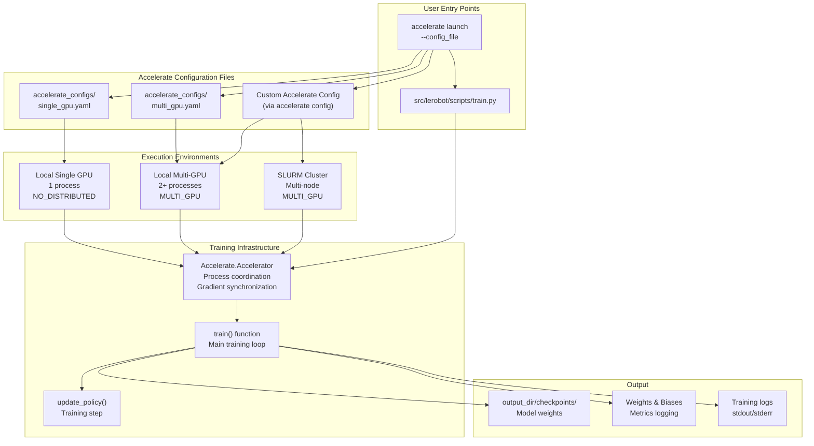
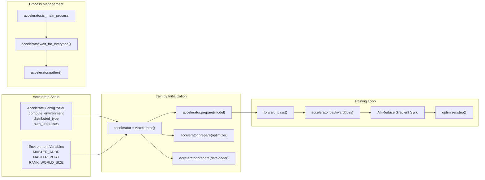
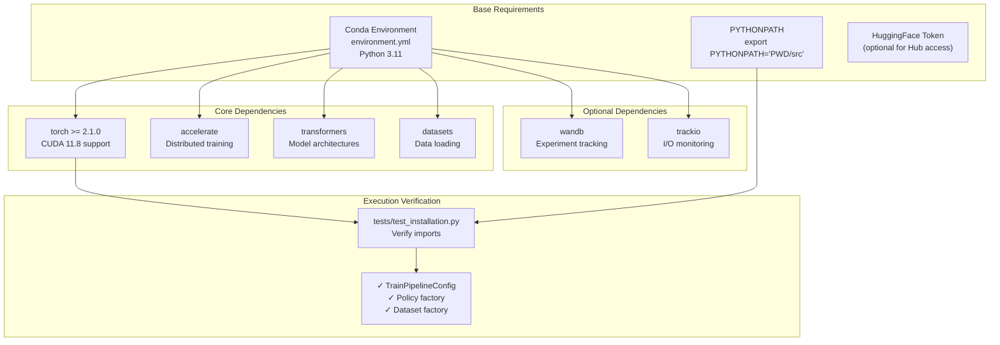
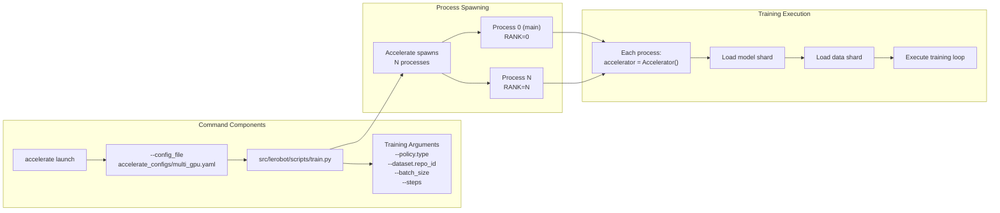
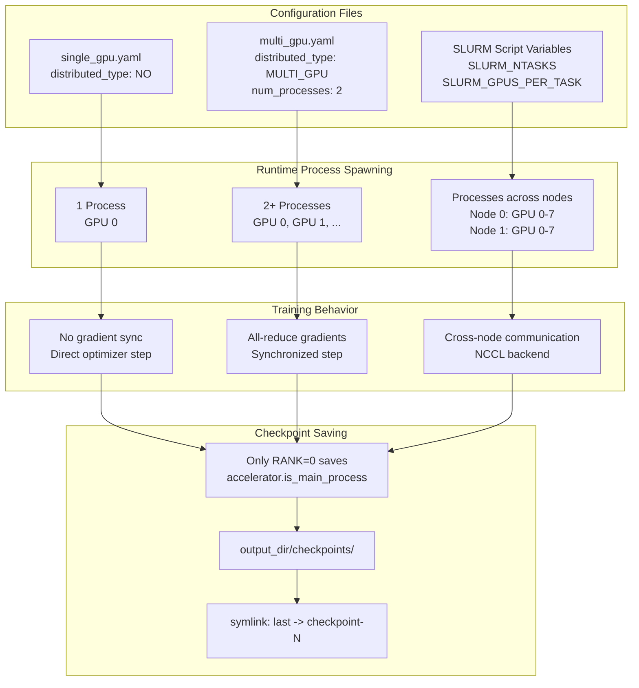
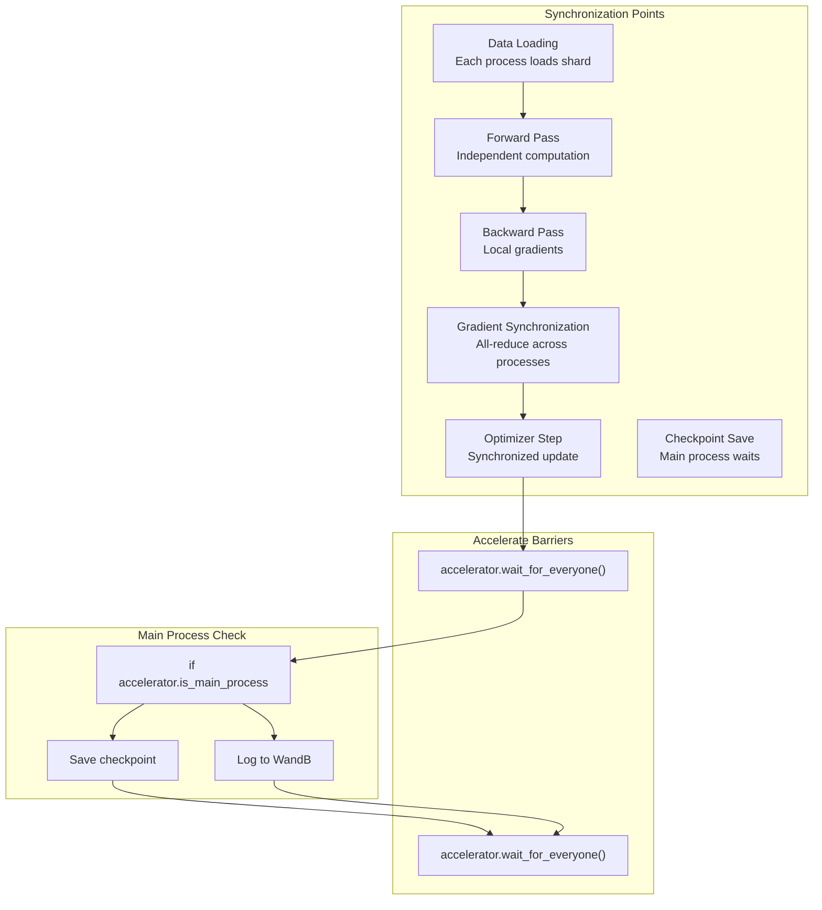

<!-- source: DeepWiki mcp.deepwiki.com · repo huggingface/VLAb · page 8 Execution Environments · fetched 2026-10-26 -->

# Execution Environments

<details>
<summary>Relevant source files</summary>

The following files were used as context for generating this wiki page:

- [LICENSE](LICENSE)
- [README.md](README.md)
- [accelerate_configs/multi_gpu.yaml](accelerate_configs/multi_gpu.yaml)
- [examples/README.md](examples/README.md)

</details>


This document describes the execution environments available for training VLA models in VLAb, including configuration requirements, hardware options, and the infrastructure that enables distributed training across different compute setups.

VLAb supports two primary execution environments:
- **Local execution**: Single-machine training with one or multiple GPUs
- **SLURM cluster execution**: Multi-node distributed training on HPC clusters

For detailed instructions on using these environments, see [Local Multi-GPU Training](#8.1) and [SLURM Cluster Training](#8.2). For information about the training script itself and the training loop, see [Training Execution](#7).

## Overview of Execution Options

VLAb uses the HuggingFace Accelerate library to abstract distributed training complexity, providing a unified training interface regardless of the underlying hardware configuration. The same `train.py` script runs across all execution environments, with behavior controlled by Accelerate configuration files.

### Execution Environment Mapping



**Sources:** [README.md:96-111](), [README.md:163-174](), [README.md:202-218](), [examples/README.md:14-43]()

### Supported Configurations

| Configuration | Hardware | Process Count | Backend | Use Case |
|--------------|----------|---------------|---------|----------|
| Single GPU | 1 GPU | 1 | `NO_DISTRIBUTED` | Development, small-scale experiments |
| Multi-GPU | 2-8 GPUs (local) | 2-8 | `MULTI_GPU` | Full-scale local training |
| SLURM Multi-Node | Multiple nodes | 2+ (across nodes) | `MULTI_GPU` | Large-scale cluster training |

**Sources:** [README.md:163-174](), [accelerate_configs/multi_gpu.yaml:1-19]()

## Accelerate Integration

VLAb uses the HuggingFace Accelerate library as its distributed training engine. Accelerate handles process spawning, gradient synchronization, model parallelism, and mixed precision training.

### Core Components



**Sources:** [README.md:163-174](), [accelerate_configs/multi_gpu.yaml:1-19]()

### Accelerate Configuration Structure

The `accelerate_configs/multi_gpu.yaml` file defines the distributed training setup:

```yaml
compute_environment: LOCAL_MACHINE
distributed_type: MULTI_GPU
num_processes: 2
gpu_ids: all
machine_rank: 0
num_machines: 1
mixed_precision: 'no'
```

Key parameters:
- **`compute_environment`**: Specifies execution context (`LOCAL_MACHINE` or `CLUSTER`)
- **`distributed_type`**: Training backend (`NO`, `MULTI_GPU`, `MULTI_CPU`, `DEEPSPEED`, etc.)
- **`num_processes`**: Number of parallel processes (typically equals number of GPUs)
- **`gpu_ids`**: GPU selection (`all` or comma-separated list)
- **`num_machines`**: Number of nodes in multi-node setup
- **`machine_rank`**: Node rank in multi-node setup (0 for main node)
- **`mixed_precision`**: Precision mode (`no`, `fp16`, `bf16`)

**Sources:** [accelerate_configs/multi_gpu.yaml:1-19]()

## Environment Setup Requirements

All execution environments require the same base environment setup. The training infrastructure expects certain environment variables and package installations.

### Required Environment Configuration



**Sources:** [README.md:47-86]()

### Environment Setup Commands

```bash
# Create conda environment
conda env create -f environment.yml
conda activate vlab

# Set PYTHONPATH (required)
export PYTHONPATH="${PWD}/src:${PYTHONPATH}"

# Verify installation
python tests/test_installation.py

# Optional: Login to HuggingFace Hub
huggingface-cli login
```

**Sources:** [README.md:47-93]()

## Command Execution Patterns

VLAb training is launched using the `accelerate launch` command, which spawns the appropriate number of processes based on the configuration file.

### Command Structure



**Sources:** [README.md:96-111](), [README.md:163-195]()

### Example Commands by Environment

#### Local Single GPU
```bash
accelerate launch --config_file accelerate_configs/single_gpu.yaml \
    src/lerobot/scripts/train.py \
    --policy.type=smolvla2 \
    --policy.repo_id=HuggingFaceTB/SmolVLM2-500M-Video-Instruct \
    --dataset.repo_id="dataset1,dataset2" \
    --batch_size=8 \
    --steps=10000
```

#### Local Multi-GPU
```bash
accelerate launch --config_file accelerate_configs/multi_gpu.yaml \
    src/lerobot/scripts/train.py \
    --policy.type=smolvla2 \
    --policy.repo_id=HuggingFaceTB/SmolVLM2-500M-Video-Instruct \
    --dataset.repo_id="dataset1,dataset2" \
    --dataset.root="/path/to/local/datasets" \
    --batch_size=8 \
    --steps=200000 \
    --wandb.enable=true
```

#### SLURM Cluster
```bash
sbatch examples/scripts/reproduce_smolvla.slurm
```

**Sources:** [README.md:96-111](), [README.md:163-195](), [examples/README.md:27-30]()

## Configuration vs Runtime Behavior

The relationship between Accelerate configuration and actual execution behavior:



**Sources:** [accelerate_configs/multi_gpu.yaml:1-19](), [README.md:115-120]()

## Output and Logging in Distributed Environments

VLAb handles output and logging differently depending on the process rank:

| Output Type | Behavior | Details |
|------------|----------|---------|
| **Checkpoints** | Main process only | Only `RANK=0` writes to `output_dir/checkpoints/` |
| **WandB Logging** | Main process only | Only `RANK=0` logs metrics to Weights & Biases |
| **Console Output** | All processes | All processes can print, but typically main process logs |
| **Symlinks** | Main process only | `last` symlink points to latest checkpoint |

### Checkpoint Directory Structure

```
output_dir/
├── checkpoints/
│   ├── checkpoint-1000/
│   │   ├── model.safetensors
│   │   └── optimizer.pt
│   ├── checkpoint-2000/
│   │   ├── model.safetensors
│   │   └── optimizer.pt
│   └── last -> checkpoint-2000/  # Symlink to latest
├── config.json  # Training configuration
└── wandb/       # WandB logs (if enabled)
```

**Sources:** [README.md:115-120]()

## Process Coordination and Synchronization

Accelerate provides several utilities for coordinating processes during training:



**Sources:** [README.md:163-174]()

## Environment-Specific Considerations

### Local Execution
- Limited to single machine GPU count (typically 1-8 GPUs)
- Fast iteration for debugging and development
- Direct access to local datasets via `--dataset.root`
- Console output visible immediately
- Manual process management via terminal

### SLURM Cluster Execution
- Scales to multiple nodes with dozens of GPUs
- Requires SLURM job submission and queuing
- Environment variables set by SLURM (`SLURM_PROCID`, `SLURM_LOCALID`, etc.)
- Output captured in SLURM log files (`slurm-JOBID.out`)
- Resource allocation managed by cluster scheduler

**Sources:** [README.md:202-218](), [examples/README.md:14-43]()

## Common Configuration Scenarios

### Scenario 1: Development on Single GPU
- **Config**: `accelerate_configs/single_gpu.yaml` (or create via `accelerate config`)
- **Processes**: 1
- **Batch Size**: Small (4-8)
- **Use Case**: Code development, quick iteration

### Scenario 2: Full Training on Local Workstation
- **Config**: `accelerate_configs/multi_gpu.yaml`
- **Processes**: 2-8 (number of available GPUs)
- **Batch Size**: Larger (8-16 per GPU)
- **Use Case**: Complete training runs on powerful workstation

### Scenario 3: Large-Scale Cluster Training
- **Config**: Custom config or SLURM environment variables
- **Processes**: 16+ (across multiple nodes)
- **Batch Size**: Maximum possible (8-32 per GPU)
- **Use Case**: Production training, SmolVLA reproduction

**Sources:** [README.md:96-111](), [README.md:163-195](), [examples/README.md:14-43]()

## Troubleshooting Execution Environments

### Common Issues

| Issue | Symptom | Solution |
|-------|---------|----------|
| **PYTHONPATH not set** | `ModuleNotFoundError: No module named 'lerobot'` | `export PYTHONPATH="${PWD}/src:${PYTHONPATH}"` |
| **Wrong GPU count** | Training uses fewer GPUs than expected | Check `num_processes` in Accelerate config |
| **Port conflict** | `RuntimeError: Address already in use` | Change `main_process_port` in config or wait |
| **NCCL errors** | `NCCL error: unhandled system error` | Check CUDA/NCCL compatibility, network config |
| **Out of memory** | `CUDA out of memory` | Reduce `--batch_size` or enable gradient accumulation |

**Sources:** [README.md:228-248]()

### Verification Steps

1. **Verify environment**: `python tests/test_installation.py`
2. **Check GPU availability**: `nvidia-smi`
3. **Test Accelerate**: `accelerate test`
4. **Dry run training**: Run with `--steps=10` to verify setup

**Sources:** [README.md:69-85]()

## Next Steps

For detailed instructions on using specific execution environments:
- [Local Multi-GPU Training](#8.1) - Setup and execution for local machines
- [SLURM Cluster Training](#8.2) - Job submission and cluster configuration

For information about the training script and loop:
- [Training Script Overview](#7.1) - Understanding `train.py`
- [Distributed Training with Accelerate](#7.2) - Deep dive into Accelerate features

For configuration options:
- [TrainPipelineConfig](#6.1) - Master configuration
- [Optimization Configuration](#6.4) - Optimizer and scheduler settings

**Sources:** [README.md:1-309](), [examples/README.md:1-90]()

---

