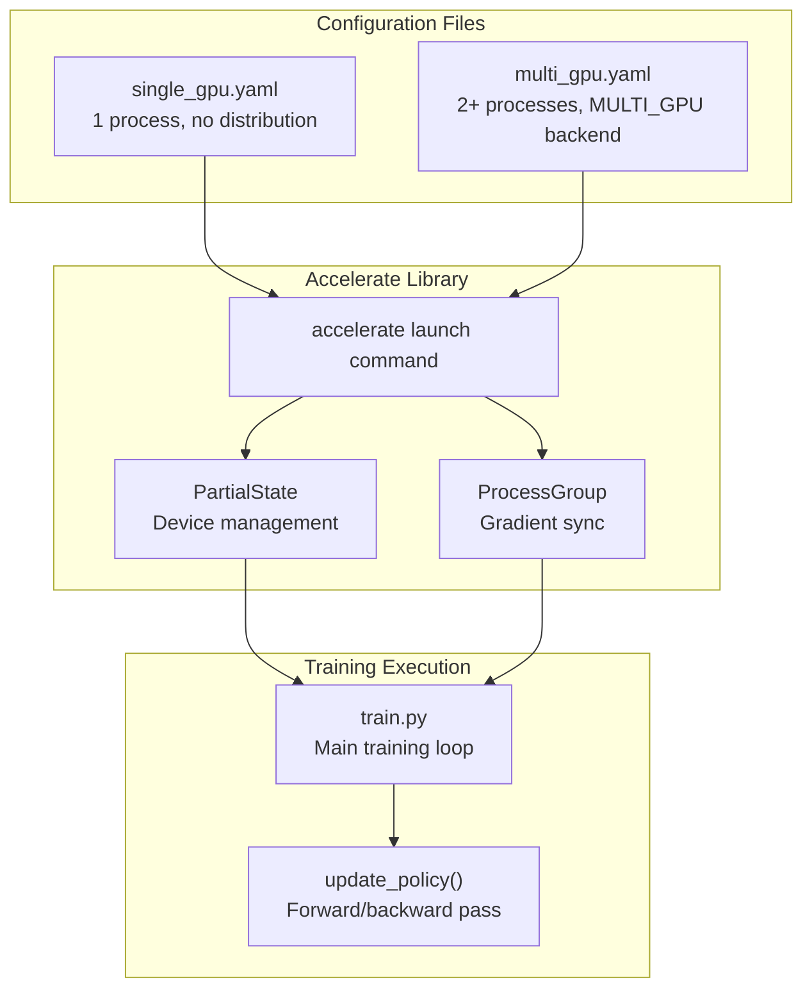
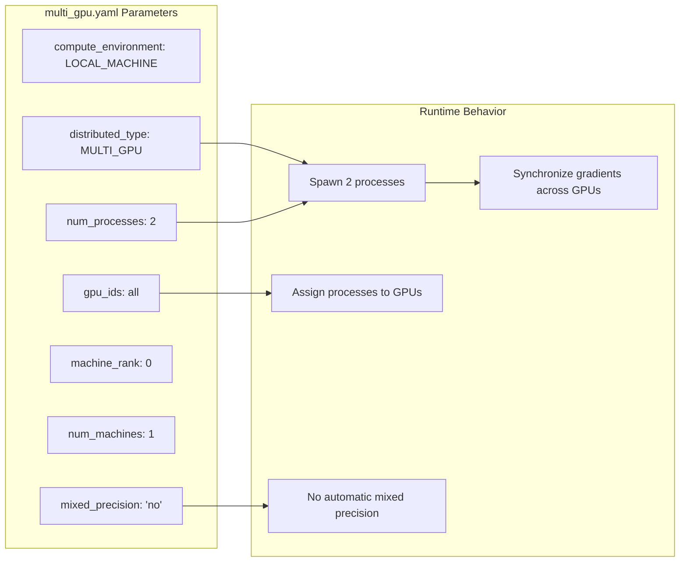
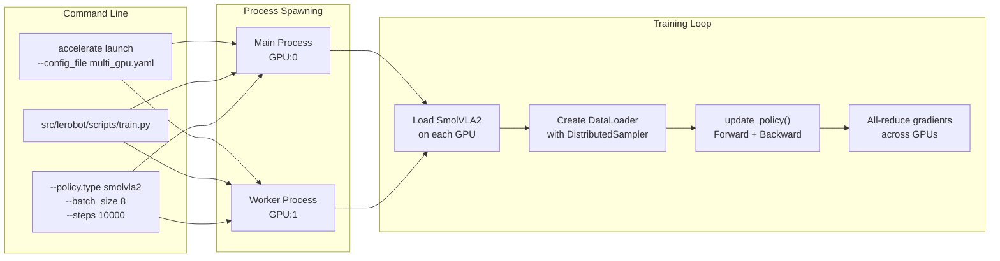
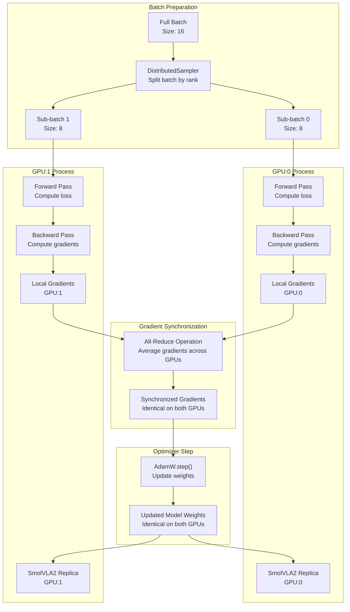

<!-- source: DeepWiki mcp.deepwiki.com · repo huggingface/VLAb · page 8.1 Local Multi-GPU Training · fetched 2026-10-26 -->

# Local Multi-GPU Training

<details>
<summary>Relevant source files</summary>

The following files were used as context for generating this wiki page:

- [LICENSE](LICENSE)
- [README.md](README.md)
- [accelerate_configs/multi_gpu.yaml](accelerate_configs/multi_gpu.yaml)

</details>


## Purpose and Scope

This page documents how to execute VLAb training on local machines with single or multiple GPUs using the Accelerate library. It covers Accelerate configuration files, command-line invocation, and process distribution strategies for local hardware setups.

For cluster-based multi-node training on SLURM, see [SLURM Cluster Training](#8.2). For details on how Accelerate integrates with the training loop, see [Distributed Training with Accelerate](#7.2).

---

## Overview

VLAb supports local training in two configurations:

| Configuration | Processes | Use Case | Config File |
|--------------|-----------|----------|-------------|
| **Single GPU** | 1 | Development, small models, quick experiments | `accelerate_configs/single_gpu.yaml` |
| **Multi-GPU** | 2+ | Production pretraining, faster convergence, larger batches | `accelerate_configs/multi_gpu.yaml` |

Both configurations use the same training script [src/lerobot/scripts/train.py]() orchestrated by the Accelerate library, which handles process spawning, gradient synchronization, and device placement.

**Sources:** [README.md:95-175]()

---

## Accelerate Configuration System

### Configuration Files

VLAb provides pre-configured YAML files for local training located in the `accelerate_configs/` directory:



**Sources:** [README.md:163-174](), [accelerate_configs/multi_gpu.yaml:1-19]()

### Multi-GPU Configuration Parameters

The [accelerate_configs/multi_gpu.yaml]() file contains the following key parameters:



**Parameter Descriptions:**

| Parameter | Value | Description |
|-----------|-------|-------------|
| `compute_environment` | `LOCAL_MACHINE` | Indicates training on local hardware (not cloud or cluster) |
| `distributed_type` | `MULTI_GPU` | Enables data-parallel training across multiple GPUs |
| `num_processes` | `2` | Number of parallel processes to spawn (typically 1 per GPU) |
| `gpu_ids` | `all` | Uses all available GPUs; can specify subset like `0,1,2` |
| `machine_rank` | `0` | Machine identifier for multi-node setups (always 0 for local) |
| `num_machines` | `1` | Number of machines (always 1 for local training) |
| `mixed_precision` | `'no'` | Whether to use automatic mixed precision (FP16/BF16) |
| `same_network` | `true` | Assumes all GPUs on same network for communication |
| `rdzv_backend` | `static` | Rendezvous backend for process coordination |

**Sources:** [accelerate_configs/multi_gpu.yaml:1-19]()

---

## Launching Training

### Command Structure

Training is launched using the `accelerate launch` command with the following structure:

```bash
accelerate launch \
    --config_file <path/to/config.yaml> \
    src/lerobot/scripts/train.py \
    <training arguments>
```

The command consists of three parts:

1. **Accelerate launcher**: `accelerate launch --config_file <config>`
2. **Training script**: `src/lerobot/scripts/train.py`
3. **Training arguments**: Configuration overrides and parameters



**Sources:** [README.md:99-111](), [README.md:180-195]()

### Single GPU Example

```bash
accelerate launch --config_file accelerate_configs/single_gpu.yaml \
    src/lerobot/scripts/train.py \
    --policy.type=smolvla2 \
    --policy.repo_id=HuggingFaceTB/SmolVLM2-500M-Video-Instruct \
    --dataset.repo_id="Beegbrain/pick_lemon_and_drop_in_bowl,Chojins/chess_game_000_white_red" \
    --dataset.video_backend=pyav \
    --output_dir="./outputs/training" \
    --batch_size=8 \
    --steps=10000 \
    --wandb.enable=true \
    --wandb.project="smolvla2-quickstart"
```

This configuration:
- Spawns a single process on GPU:0
- Loads the SmolVLM2-500M-Video-Instruct base model
- Trains on 2 datasets with batch size 8
- Saves checkpoints to `./outputs/training`
- Logs metrics to Weights & Biases

**Sources:** [README.md:97-120]()

### Multi-GPU Example with Local Datasets

```bash
accelerate launch --config_file accelerate_configs/multi_gpu.yaml \
    src/lerobot/scripts/train.py \
    --policy.type=smolvla2 \
    --policy.repo_id=HuggingFaceTB/SmolVLM2-500M-Video-Instruct \
    --dataset.repo_id="community_dataset_v2/airthebear/so100_GL,community_dataset_v2/acrampette/third_arm_01" \
    --dataset.root="/path/to/datasets" \
    --dataset.video_backend=pyav \
    --dataset.features_version=2 \
    --output_dir="./outputs/training" \
    --batch_size=8 \
    --steps=200000 \
    --wandb.enable=true \
    --wandb.project="smolvla2-training"
```

This configuration:
- Spawns 2 processes (1 per GPU based on `num_processes: 2`)
- Uses locally downloaded datasets via `--dataset.root`
- Effective batch size is `8 * 2 = 16` (batch size per GPU × number of GPUs)
- Synchronizes gradients across both GPUs after each backward pass

**Important:** When using `--dataset.root`, the `--dataset.repo_id` paths are relative to the root directory. For example:
- Root: `/path/to/datasets`
- Repo ID: `community_dataset_v2/airthebear/so100_GL`
- Full path: `/path/to/datasets/community_dataset_v2/airthebear/so100_GL`

**Sources:** [README.md:176-201]()

---

## Process Distribution and Data Parallelism

### How Multi-GPU Training Works

Multi-GPU training uses **data parallelism**: each GPU receives a subset of the batch, computes gradients independently, then synchronizes gradients before the optimizer step.



**Key Points:**
1. **Model replication**: Each GPU has an identical copy of the model
2. **Batch splitting**: `DistributedSampler` ensures each process gets different data
3. **Independent forward/backward**: Each GPU computes gradients on its sub-batch
4. **Gradient synchronization**: All-reduce averages gradients across GPUs
5. **Synchronized update**: All GPUs update with the same averaged gradients

**Sources:** Inferred from multi-GPU training principles and [accelerate_configs/multi_gpu.yaml]()

### Effective Batch Size

The effective batch size in multi-GPU training is:

```
Effective Batch Size = batch_size × num_processes
```

For example, with `--batch_size=8` and `num_processes: 2`:
- Each GPU processes 8 samples per step
- Effective batch size is 16 samples per optimizer step

**Memory Considerations:**
- Each GPU must fit `batch_size` samples in memory
- Total GPU memory requirement scales linearly with `num_processes`
- Gradient synchronization adds communication overhead

**Sources:** Inferred from distributed training principles

---

## Configuration Customization

### Creating Custom Accelerate Configs

Instead of using the provided configs, you can generate a custom configuration:

```bash
accelerate config
```

This interactive command will prompt you for:
1. Compute environment (LOCAL_MACHINE, AWS, etc.)
2. Distributed type (NO, MULTI_GPU, MULTI_CPU, etc.)
3. Number of processes
4. GPU selection
5. Mixed precision settings

The configuration is saved to `~/.cache/huggingface/accelerate/default_config.yaml` and can be used without the `--config_file` flag:

```bash
accelerate launch src/lerobot/scripts/train.py <args>
```

**Sources:** [README.md:167-174]()

### Modifying GPU Selection

To train on a specific subset of GPUs, modify the `gpu_ids` parameter:

**Use first 2 GPUs:**
```yaml
gpu_ids: 0,1
```

**Use specific GPUs:**
```yaml
gpu_ids: 0,2
```

**Use all GPUs:**
```yaml
gpu_ids: all
```

You can also control GPU visibility via environment variables:

```bash
CUDA_VISIBLE_DEVICES=0,1 accelerate launch --config_file accelerate_configs/multi_gpu.yaml \
    src/lerobot/scripts/train.py <args>
```

**Sources:** [accelerate_configs/multi_gpu.yaml:7]()

### Mixed Precision Training

To enable mixed precision (FP16 or BF16) for faster training and reduced memory usage:

```yaml
mixed_precision: 'fp16'  # or 'bf16'
```

Mixed precision:
- Reduces memory usage by ~50%
- Increases training speed on modern GPUs (A100, H100)
- May require gradient scaling to prevent underflow

**Note:** VLAb also supports mixed precision via the `--policy.use_amp` flag, which provides finer control over AMP settings. The Accelerate `mixed_precision` setting and policy-level AMP can be used together.

**Sources:** [accelerate_configs/multi_gpu.yaml:10]()

---

## Best Practices

### Choosing Number of Processes

| Scenario | Recommended `num_processes` |
|----------|----------------------------|
| Single GPU development | 1 |
| Multi-GPU local machine | Number of GPUs (e.g., 2, 4, 8) |
| Testing distributed logic | 2 (even with 1 GPU, for debugging) |

**Rule of thumb:** Set `num_processes` equal to the number of GPUs you want to use.

### Batch Size Tuning

1. **Start conservative**: Begin with a small batch size per GPU (e.g., 4 or 8)
2. **Monitor GPU memory**: Check `nvidia-smi` during training
3. **Increase gradually**: Double the batch size if GPU memory usage is below 80%
4. **Consider gradient accumulation**: For larger effective batch sizes without OOM

### Monitoring Multi-GPU Training

Check process distribution and GPU utilization:

```bash
# Monitor GPU usage in real-time
watch -n 1 nvidia-smi

# Check process assignment
ps aux | grep train.py
```

Expected output with `num_processes: 2`:
- 2 Python processes running `train.py`
- Each process utilizing a different GPU
- Roughly equal GPU memory usage across GPUs

**Sources:** General distributed training best practices

---

## Troubleshooting

### Common Issues

#### Issue: "No CUDA devices available"

**Symptoms:** Training fails immediately with CUDA error

**Solutions:**
1. Verify GPU availability: `nvidia-smi`
2. Check CUDA installation: `nvcc --version`
3. Ensure correct PyTorch CUDA version: `python -c "import torch; print(torch.cuda.is_available())"`

#### Issue: "Out of memory" on one GPU

**Symptoms:** One GPU runs out of memory while others have headroom

**Causes:**
- Uneven data distribution (some episodes longer than others)
- Main process has additional overhead

**Solutions:**
1. Reduce `--batch_size`
2. Enable gradient checkpointing in policy config
3. Use mixed precision: `mixed_precision: 'fp16'`

#### Issue: Slow training with multiple GPUs

**Symptoms:** Multi-GPU training not significantly faster than single GPU

**Causes:**
- Communication overhead dominates computation
- Small batch size per GPU
- Slow data loading (CPU bottleneck)

**Solutions:**
1. Increase `--batch_size` to utilize GPUs more fully
2. Increase `num_workers` in DataLoader configuration
3. Reduce model size or use gradient checkpointing
4. Check if data loading is the bottleneck via profiling

#### Issue: Processes stuck at initialization

**Symptoms:** Training hangs after "Launching training" message

**Causes:**
- NCCL communication issues
- Incorrect `num_processes` setting
- Firewall blocking inter-process communication

**Solutions:**
1. Set environment variables:
   ```bash
   export NCCL_DEBUG=INFO
   export NCCL_P2P_DISABLE=1  # Disable peer-to-peer if issues
   ```
2. Verify `num_processes` matches available GPUs
3. Check firewall settings for localhost communication

**Sources:** Common distributed training issues and [README.md:228-247]()

---

## Performance Optimization

### Optimal Configuration for Different Hardware

**2 GPUs (e.g., 2× RTX 3090):**
```yaml
num_processes: 2
gpu_ids: all
mixed_precision: 'fp16'
```
Recommended batch size: 8-16 per GPU

**4 GPUs (e.g., 4× A100):**
```yaml
num_processes: 4
gpu_ids: all
mixed_precision: 'bf16'  # A100 supports BF16
```
Recommended batch size: 16-32 per GPU

**8 GPUs (e.g., 8× H100):**
```yaml
num_processes: 8
gpu_ids: all
mixed_precision: 'bf16'
```
Recommended batch size: 32-64 per GPU

### Data Loading Optimization

Ensure data loading doesn't bottleneck training:

1. **Set appropriate `num_workers`**: Typically 4-8 per GPU
2. **Enable persistent workers**: Reduces worker startup overhead
3. **Use fast video backend**: `--dataset.video_backend=pyav` (default)
4. **Pre-download datasets**: Use `--dataset.root` for local datasets

**Sources:** General performance optimization principles

---

## Summary

Local multi-GPU training in VLAb is configured through:

1. **Accelerate config files** (`accelerate_configs/multi_gpu.yaml`) defining process distribution
2. **Command-line invocation** using `accelerate launch` to spawn processes
3. **Training arguments** passed to `train.py` for model/data configuration

Key parameters:
- `num_processes`: Number of parallel processes (typically 1 per GPU)
- `batch_size`: Samples per GPU per step (effective batch = batch_size × num_processes)
- `gpu_ids`: GPU selection (use `all` or specify subset)

For cluster-based multi-node training with job scheduling, see [SLURM Cluster Training](#8.2).

**Sources:** [README.md:95-201](), [accelerate_configs/multi_gpu.yaml:1-19]()

---

