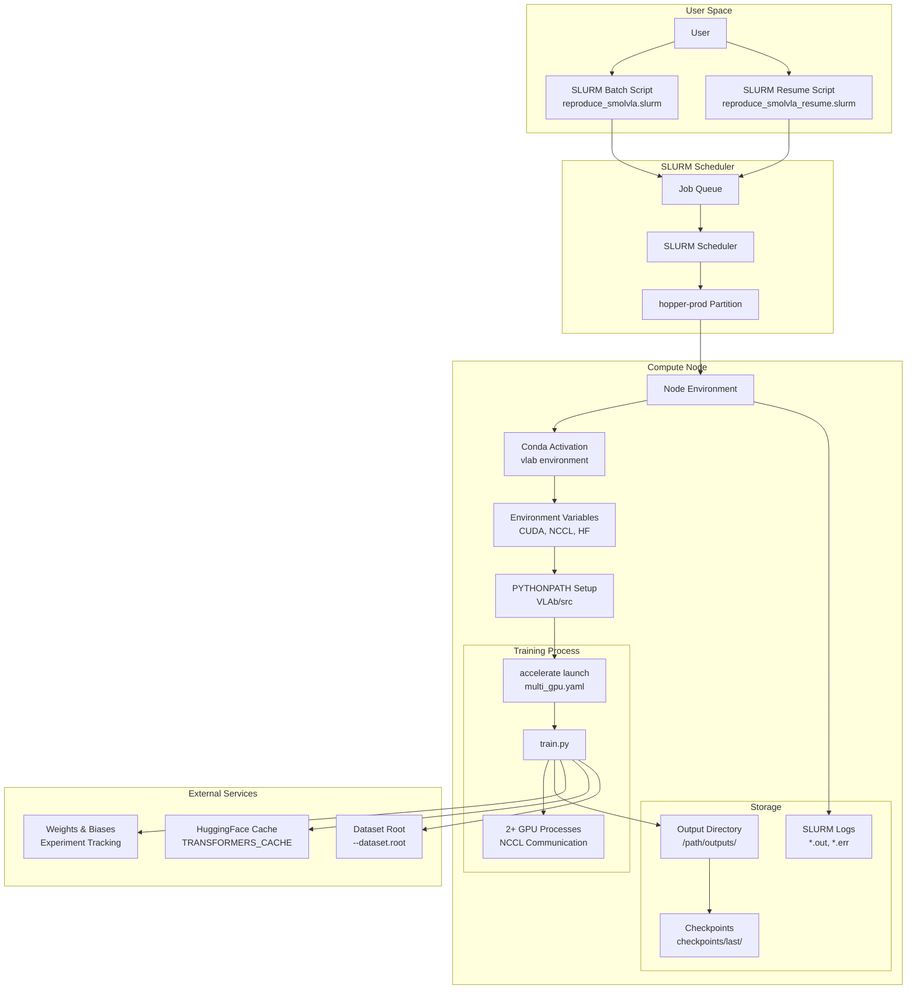
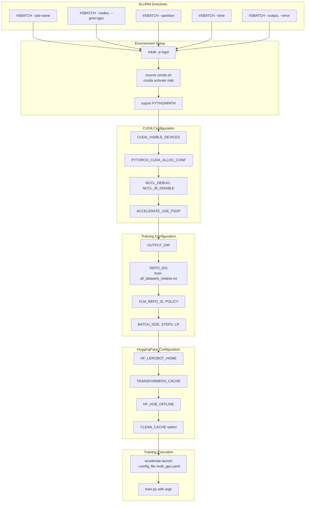
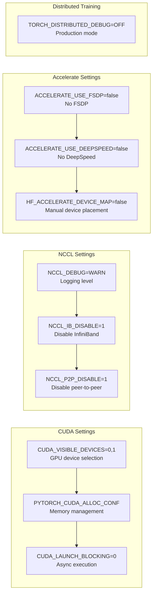
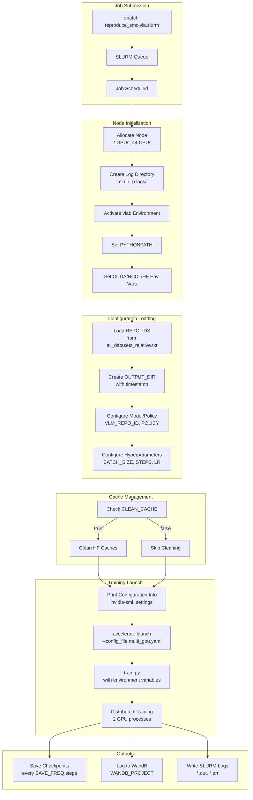
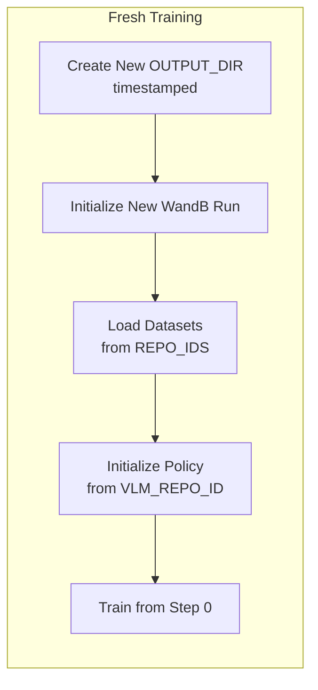
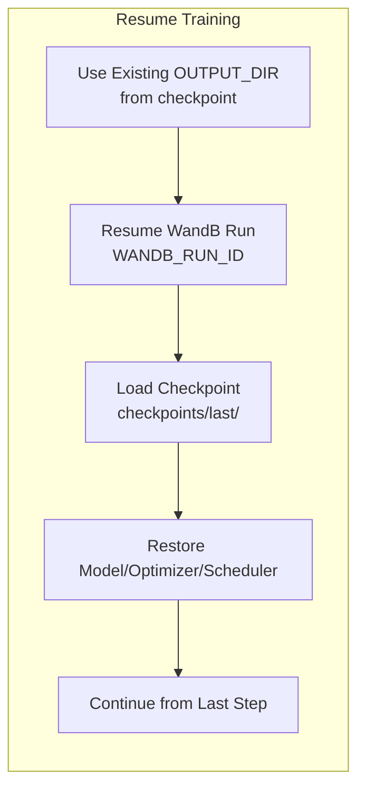

<!-- source: DeepWiki mcp.deepwiki.com · repo huggingface/VLAb · page 8.2 SLURM Cluster Training · fetched 2026-10-26 -->

# SLURM Cluster Training

<details>
<summary>Relevant source files</summary>

The following files were used as context for generating this wiki page:

- [LICENSE](LICENSE)
- [README.md](README.md)
- [examples/README.md](examples/README.md)
- [examples/scripts/reproduce_smolvla.slurm](examples/scripts/reproduce_smolvla.slurm)
- [examples/scripts/reproduce_smolvla_resume.slurm](examples/scripts/reproduce_smolvla_resume.slurm)
- [src/lerobot/datasets/video_utils.py](src/lerobot/datasets/video_utils.py)

</details>


This document covers how to execute VLAb training on SLURM clusters for large-scale, multi-GPU distributed training. It explains SLURM job configuration, resource allocation, environment setup, and the workflow for both fresh and resumed training runs.

For local multi-GPU training without SLURM, see [Local Multi-GPU Training](#8.1). For general distributed training concepts with Accelerate, see [Distributed Training with Accelerate](#7.2).

## Overview

VLAb provides SLURM batch scripts for training on compute clusters. The SLURM integration handles job scheduling, resource allocation, environment configuration, and distributed training setup across multiple nodes and GPUs.

### SLURM Training Architecture



**Sources:** [examples/scripts/reproduce_smolvla.slurm:1-218](), [examples/scripts/reproduce_smolvla_resume.slurm:1-225](), [examples/README.md:1-90]()

## SLURM Job Scripts

VLAb provides two main SLURM batch scripts located in `examples/scripts/`:

| Script | Purpose | Use Case |
|--------|---------|----------|
| `reproduce_smolvla.slurm` | Fresh training | Start new training from scratch |
| `reproduce_smolvla_resume.slurm` | Resume training | Continue from checkpoint |

Both scripts configure a 2-GPU training setup optimized for the SmolVLA2 pretraining workflow.

### Job Script Structure



**Sources:** [examples/scripts/reproduce_smolvla.slurm:1-218](), [examples/scripts/reproduce_smolvla_resume.slurm:1-225]()

## SLURM Directives

SLURM directives at the top of batch scripts control job scheduling and resource allocation:

### Resource Allocation

```bash
#SBATCH --job-name=smolvla_reproduce
#SBATCH --nodes=1
#SBATCH --ntasks-per-node=1
#SBATCH --cpus-per-task=44
#SBATCH --gres=gpu:2
#SBATCH --mem=0
#SBATCH --time=2:00:00
#SBATCH --partition=hopper-prod
#SBATCH --exclusive
```

| Directive | Value | Purpose |
|-----------|-------|---------|
| `--nodes` | `1` | Number of compute nodes |
| `--ntasks-per-node` | `1` | Number of tasks per node |
| `--cpus-per-task` | `44` | CPU cores per task |
| `--gres=gpu` | `2` | Number of GPUs requested |
| `--mem` | `0` | Memory (0 = all available) |
| `--time` | `2:00:00` | Maximum runtime (2 hours) |
| `--partition` | `hopper-prod` | Target partition |
| `--exclusive` | - | Exclusive node access |

**Sources:** [examples/scripts/reproduce_smolvla.slurm:1-12](), [examples/scripts/reproduce_smolvla_resume.slurm:1-12]()

### Log Output

```bash
#SBATCH --output=/fsx/dana_aubakirova/vla/logs/smolvla_reproduce_%j.out
#SBATCH --error=/fsx/dana_aubakirova/vla/logs/smolvla_reproduce_%j.err
```

The `%j` token is replaced with the job ID at runtime. The script creates the log directory if it doesn't exist:

```bash
mkdir -p /fsx/dana_aubakirova/vla/logs
```

**Sources:** [examples/scripts/reproduce_smolvla.slurm:10-15]()

## Environment Setup

### Conda Environment Activation

The SLURM script activates the VLAb conda environment:

```bash
source /fsx/dana_aubakirova/miniconda3/etc/profile.d/conda.sh
conda activate vlab
```

**Sources:** [examples/scripts/reproduce_smolvla.slurm:17-19]()

### Python Path Configuration

VLAb source must be added to `PYTHONPATH`:

```bash
export PYTHONPATH="/fsx/dana_aubakirova/vla/VLAb/src:$PYTHONPATH"
```

This allows the training script to import VLAb modules. The path should point to the `src` directory within the VLAb repository.

**Sources:** [examples/scripts/reproduce_smolvla.slurm:21-22]()

### CUDA Environment Configuration



**Key environment variables:**

```bash
# GPU Configuration
export CUDA_VISIBLE_DEVICES=0,1

# PyTorch Memory Management
export PYTORCH_CUDA_ALLOC_CONF=max_split_size_mb:512,expandable_segments:True,garbage_collection_threshold:0.8

# Distributed Training
export TORCH_DISTRIBUTED_DEBUG=OFF
export NCCL_DEBUG=WARN
export CUDA_LAUNCH_BLOCKING=0

# Disable Advanced Features
export ACCELERATE_USE_FSDP=false
export ACCELERATE_USE_DEEPSPEED=false
export HF_ACCELERATE_DEVICE_MAP=false

# NCCL Communication
export NCCL_IB_DISABLE=1
export NCCL_P2P_DISABLE=1
```

| Variable | Value | Purpose |
|----------|-------|---------|
| `CUDA_VISIBLE_DEVICES` | `0,1` | Specify GPUs 0 and 1 |
| `PYTORCH_CUDA_ALLOC_CONF` | Multiple options | Memory allocator optimization |
| `NCCL_DEBUG` | `WARN` | Reduce NCCL logging verbosity |
| `NCCL_IB_DISABLE` | `1` | Disable InfiniBand (cluster-specific) |
| `NCCL_P2P_DISABLE` | `1` | Disable peer-to-peer GPU communication |
| `ACCELERATE_USE_FSDP` | `false` | Disable Fully Sharded Data Parallel |
| `ACCELERATE_USE_DEEPSPEED` | `false` | Disable DeepSpeed integration |

**Sources:** [examples/scripts/reproduce_smolvla.slurm:24-35]()

### HuggingFace Cache Configuration

```bash
export HF_LEROBOT_HOME="/fsx/dana_aubakirova/vla"
export TRANSFORMERS_CACHE="/fsx/dana_aubakirova/vla/.cache/huggingface"
export HF_HUB_OFFLINE=0
export TRANSFORMERS_OFFLINE=0
```

These variables control where HuggingFace libraries cache downloaded models and datasets. Setting offline mode to `0` enables online downloads.

**Sources:** [examples/scripts/reproduce_smolvla.slurm:95-103]()

### Optional Cache Cleaning

The scripts include an optional cache cleaning mechanism:

```bash
CLEAN_CACHE=false
if [ "$CLEAN_CACHE" = true ]; then
    echo "🧹 Cleaning HuggingFace cache..."
    rm -rf "$HF_HOME/datasets" 2>/dev/null || true
    rm -rf "$HF_HUB_CACHE/hub" 2>/dev/null || true
    rm -rf "$TRANSFORMERS_CACHE" 2>/dev/null || true
    echo "✅ Cache cleaning completed"
fi
```

Set `CLEAN_CACHE=true` to clear cached files before training. This is useful for resolving corrupted cache issues or forcing re-downloads.

**Sources:** [examples/scripts/reproduce_smolvla.slurm:105-118]()

## Training Configuration

### Dataset Configuration

The scripts load dataset IDs from `all_datasets_relative.txt`:

```bash
export REPO_IDS=$(cat /fsx/dana_aubakirova/vla/VLAb/examples/all_datasets_relative.txt)
```

This file contains comma-separated relative paths to all datasets in the Community Dataset collections. The script also shows a commented alternative for testing with a small subset:

```bash
#export REPO_IDS="AndrejOrsula/lerobot_double_ball_stacking_random,koenvanwijk/orange50-variation-2"
```

**Dataset parameters:**

```bash
export USE_IMAGENET_STATS=false
export ENABLE_IMG_TRANSFORM=true
export MAX_NUM_IMAGES=2
export MAX_IMAGE_DIM=256
export TRAIN_ON_ALL_FEATURES=true
export FEATURES_VERSION=2
export FPS_MIN=30
export FPS_MAX=30
```

**Sources:** [examples/scripts/reproduce_smolvla.slurm:42-77](), [examples/README.md:10-10]()

### Model and Policy Configuration

```bash
export VLM_REPO_ID=HuggingFaceTB/SmolVLM2-500M-Video-Instruct
export POLICY=smolvla2
export LOAD_VLM_WEIGHTS=true
export MAX_ACTION_DIM=32
export MAX_STATE_DIM=32

# PEFT Configuration
export PEFT_METHOD=lora
export LORA_R=32
export LORA_TARGET_MODULES=q_proj,v_proj

# Architecture Parameters
export VLM_LAYERS=16
export EXPERT_WIDTH_MULTIPLIER=0.75
export ATTENTION_MODE=cross_attn
export SELF_ATTN_EVERY_N_LAYERS=2
export CAUSAL_ACTION_ATTENTION=true
export PREFIX_LENGTH=0
```

**Sources:** [examples/scripts/reproduce_smolvla.slurm:47-87]()

### Training Hyperparameters

```bash
export STEPS=100000
export BATCH_SIZE=8  # Per GPU (global = 16 with 2 GPUs)
export GRADIENT_ACCUMULATION_STEPS=1
export EVAL_FREQ=-1  # Disabled
export SAVE_FREQ=10000
export NUM_WORKERS=4

# Optimization
export USE_AMP=true
export OPTIMIZER_LR=5e-4
export LR_VLM=1e-4
export WARMUP_STEPS=1000
export DECAY_LR=1e-6
export DECAY_STEPS=50000
```

**Sources:** [examples/scripts/reproduce_smolvla.slurm:49-93]()

### Logging Configuration

```bash
export LOGGING_BACKEND="wandb"
export WANDB_PROJECT="smolvla2-training"
export WANDB_NOTES="VLAb training FRESH START - all datasets from all_datasets_relative.txt"
export WANDB_MODE="online"
```

For resume training, additional WandB configuration is used:

```bash
export WANDB_RUN_ID=""  # Set to existing run ID
export WANDB_RESUME="must"  # Resume existing run
```

**Sources:** [examples/scripts/reproduce_smolvla.slurm:120-126](), [examples/scripts/reproduce_smolvla_resume.slurm:125-130]()

## Job Submission

### Fresh Training

Submit a fresh training job:

```bash
sbatch examples/scripts/reproduce_smolvla.slurm
```

The script creates a timestamped output directory:

```bash
export OUTPUT_DIR="/fsx/dana_aubakirova/vla/outputs/train_smolvla_fresh_$(date +%Y%m%d_%H%M%S)"
```

**Sources:** [examples/README.md:28-30](), [examples/scripts/reproduce_smolvla.slurm:41-41]()

### Resume Training

To resume from a checkpoint:

1. Edit `reproduce_smolvla_resume.slurm` and set the checkpoint path:

```bash
export RESUME_FROM_CHECKPOINT="/fsx/dana_aubakirova/vla/outputs/your_training_run"
export OUTPUT_DIR="$RESUME_FROM_CHECKPOINT"
```

2. Submit the resume job:

```bash
sbatch examples/scripts/reproduce_smolvla_resume.slurm
```

The resume script passes the `--resume` flag and loads configuration from the checkpoint:

```bash
accelerate launch --config_file /path/to/multi_gpu.yaml \
    VLAb/src/lerobot/scripts/train.py \
    --resume=true \
    --config_path="$RESUME_FROM_CHECKPOINT/checkpoints/last/pretrained_model/train_config.json" \
    ...
```

**Sources:** [examples/README.md:38-43](), [examples/scripts/reproduce_smolvla_resume.slurm:40-167]()

## Training Execution Flow



**Sources:** [examples/scripts/reproduce_smolvla.slurm:1-218](), [examples/scripts/reproduce_smolvla_resume.slurm:1-225]()

## Accelerate Configuration

The SLURM scripts invoke `accelerate launch` with a configuration file:

```bash
accelerate launch --config_file /fsx/dana_aubakirova/vla/VLAb/accelerate_configs/multi_gpu.yaml \
    VLAb/src/lerobot/scripts/train.py \
    ...
```

The `multi_gpu.yaml` configuration defines distributed training parameters. For details on Accelerate configuration, see [Distributed Training with Accelerate](#7.2).

**Sources:** [examples/scripts/reproduce_smolvla.slurm:160-160](), [README.md:172-173]()

## Training Command Arguments

The training script receives configuration through command-line arguments:

```bash
VLAb/src/lerobot/scripts/train.py \
    --policy.type=$POLICY \
    --dataset.repo_id="$REPO_IDS" \
    --dataset.root="/fsx/dana_aubakirova/vla" \
    --dataset.use_imagenet_stats=$USE_IMAGENET_STATS \
    --dataset.image_transforms.enable=$ENABLE_IMG_TRANSFORM \
    --dataset.train_on_all_features=$TRAIN_ON_ALL_FEATURES \
    --dataset.features_version=$FEATURES_VERSION \
    --policy.max_action_dim=$MAX_ACTION_DIM \
    --policy.max_state_dim=$MAX_STATE_DIM \
    --output_dir=$OUTPUT_DIR \
    --batch_size=$BATCH_SIZE \
    --steps=$STEPS \
    --eval_freq=$EVAL_FREQ \
    --save_freq=$SAVE_FREQ \
    --policy.use_amp=$USE_AMP \
    --policy.optimizer_lr=$OPTIMIZER_LR \
    --policy.optimizer_lr_vlm=$LR_VLM \
    --policy.scheduler_decay_lr=$DECAY_LR \
    --policy.scheduler_decay_steps=$DECAY_STEPS \
    --policy.scheduler_warmup_steps=$WARMUP_STEPS \
    --policy.peft_method=$PEFT_METHOD \
    --policy.peft_config.r=$LORA_R \
    --policy.peft_config.target_modules=$LORA_TARGET_MODULES \
    --policy.load_vlm_weights=$LOAD_VLM_WEIGHTS \
    --policy.repo_id=$VLM_REPO_ID \
    --dataset.max_num_images=$MAX_NUM_IMAGES \
    --dataset.max_image_dim=$MAX_IMAGE_DIM \
    --dataset.video_backend=pyav \
    --num_workers=$NUM_WORKERS \
    --wandb.enable=true \
    --wandb.project=$WANDB_PROJECT \
    --dataset.min_fps=$FPS_MIN \
    --dataset.max_fps=$FPS_MAX \
    --policy.num_vlm_layers=$VLM_LAYERS \
    --policy.expert_width_multiplier=$EXPERT_WIDTH_MULTIPLIER \
    --policy.causal_action_attention_mask=$CAUSAL_ACTION_ATTENTION \
    --policy.self_attn_every_n_layers=$SELF_ATTN_EVERY_N_LAYERS \
    --policy.attention_mode=$ATTENTION_MODE \
    --policy.prefix_length=$PREFIX_LENGTH
```

**Sources:** [examples/scripts/reproduce_smolvla.slurm:161-203]()

## Fresh vs Resume Training

### Fresh Training Workflow



Fresh training starts from scratch:
- Creates a new timestamped output directory
- Initializes a new WandB run
- Loads pretrained VLM weights from `VLM_REPO_ID`
- Trains from step 0

**Sources:** [examples/scripts/reproduce_smolvla.slurm:40-41](), [examples/README.md:16-31]()

### Resume Training Workflow



Resume training continues from a checkpoint:
- Uses existing output directory
- Resumes WandB run with `WANDB_RUN_ID`
- Loads checkpoint from `checkpoints/last/`
- Restores model weights, optimizer state, and scheduler state
- Continues training from the last completed step

**Key differences:**

| Aspect | Fresh Training | Resume Training |
|--------|---------------|-----------------|
| Output Directory | New timestamped dir | Existing checkpoint dir |
| `--resume` flag | Not set | `--resume=true` |
| `--config_path` | Not set | Path to saved config |
| WandB Mode | New run | `WANDB_RESUME="must"` |
| WandB Run ID | Auto-generated | Set to existing run |
| Starting Step | 0 | Last checkpoint step |

**Sources:** [examples/scripts/reproduce_smolvla_resume.slurm:40-167](), [examples/README.md:33-43]()

## Monitoring and Debugging

### SLURM Job Status

Check job status with standard SLURM commands:

```bash
# List your jobs
squeue -u $USER

# View job details
scontrol show job <job_id>

# Cancel a job
scancel <job_id>
```

### Log Files

SLURM writes stdout and stderr to separate files:

```bash
/fsx/dana_aubakirova/vla/logs/smolvla_reproduce_<job_id>.out
/fsx/dana_aubakirova/vla/logs/smolvla_reproduce_<job_id>.err
```

Monitor training progress in real-time:

```bash
tail -f /fsx/dana_aubakirova/vla/logs/smolvla_reproduce_<job_id>.out
```

**Sources:** [examples/scripts/reproduce_smolvla.slurm:10-11]()

### Configuration Info Output

The scripts print comprehensive configuration information:

```bash
echo "🚀 =============================================="
echo "🚀 VLAb FRESH START TRAINING CONFIGURATION"
echo "🚀 =============================================="
echo "🆕 FRESH START - No resume, new output directory"
echo "📊 Datasets: ALL datasets from all_datasets_relative.txt"
echo "📁 Output directory: $OUTPUT_DIR"
echo "📊 Number of datasets: $(echo "$REPO_IDS" | tr ',' '\n' | wc -l)"
echo "🎯 Policy: $POLICY"
echo "🔧 Batch size per GPU: $BATCH_SIZE (GLOBAL: $((BATCH_SIZE * 2)))"
...
```

This output appears at the start of the `.out` log file.

**Sources:** [examples/scripts/reproduce_smolvla.slurm:128-153]()

### GPU Information

The scripts print GPU availability:

```bash
echo "🖥️  GPU Information:"
nvidia-smi --list-gpus
```

**Sources:** [examples/scripts/reproduce_smolvla.slurm:156-157]()

### WandB Dashboard

View training metrics in real-time at https://wandb.ai. The dashboard shows:
- Training loss
- Learning rate schedule
- Gradient norms
- GPU utilization
- Custom metrics

**Sources:** [examples/scripts/reproduce_smolvla.slurm:124-126](), [README.md:119-119]()

## Advanced Configurations

### Multi-Node Training

To scale to multiple nodes, modify SLURM directives:

```bash
#SBATCH --nodes=2  # Use 2 nodes
#SBATCH --ntasks-per-node=1
#SBATCH --gres=gpu:4  # 4 GPUs per node
```

Ensure the Accelerate configuration file supports multi-node training with proper address and port settings.

**Sources:** [examples/scripts/reproduce_smolvla.slurm:3-3]()

### Memory Optimization

Adjust memory allocation for different cluster configurations:

```bash
#SBATCH --mem=0  # Use all available memory
# or
#SBATCH --mem=256G  # Request specific amount
```

Configure PyTorch memory allocator:

```bash
export PYTORCH_CUDA_ALLOC_CONF=max_split_size_mb:512,expandable_segments:True,garbage_collection_threshold:0.8
```

**Sources:** [examples/scripts/reproduce_smolvla.slurm:7-26]()

### Dataset Subsetting for Testing

For quick testing, use a small subset of datasets:

```bash
export REPO_IDS="AndrejOrsula/lerobot_double_ball_stacking_random,koenvanwijk/orange50-variation-2"
```

Comment out the full dataset loading line:

```bash
#export REPO_IDS=$(cat /fsx/dana_aubakirova/vla/VLAb/examples/all_datasets_relative.txt)
```

**Sources:** [examples/scripts/reproduce_smolvla.slurm:43-45]()

### Partition Configuration

Different clusters have different partition names. Update the partition directive:

```bash
#SBATCH --partition=hopper-prod  # Update to your cluster's partition
```

Common partition names: `gpu`, `compute`, `prod`, `dev`, `debug`.

**Sources:** [examples/scripts/reproduce_smolvla.slurm:9-9](), [examples/README.md:89-89]()

### Time Limits

Adjust the time limit based on training duration:

```bash
#SBATCH --time=2:00:00   # 2 hours for testing
#SBATCH --time=48:00:00  # 48 hours for full training
#SBATCH --time=7-00:00:00  # 7 days maximum
```

**Sources:** [examples/scripts/reproduce_smolvla.slurm:8-8]()

## Dataset List File

The `all_datasets_relative.txt` file contains comma-separated relative paths to all datasets:

```
community_dataset_v1/contributor1/dataset_name_1,
community_dataset_v1/contributor2/dataset_name_2,
community_dataset_v2/contributor3/dataset_name_3,
...
```

Generate this file dynamically with a script:

```bash
DATASET_LIST=$(python -c "
import os
datasets = []
for root, dirs, files in os.walk('/path/to/datasets'):
    if 'data.parquet' in files:
        rel_path = os.path.relpath(root, '/path/to/datasets')
        datasets.append(rel_path)
print(','.join(datasets))
")
```

**Sources:** [examples/README.md:46-74](), [examples/scripts/reproduce_smolvla.slurm:43-43]()

## Troubleshooting SLURM Jobs

### Common Issues

| Issue | Symptom | Solution |
|-------|---------|----------|
| Job pending | `PENDING` status | Check partition availability, resource limits |
| Out of memory | `CUDA out of memory` | Reduce `BATCH_SIZE` or `NUM_WORKERS` |
| NCCL errors | `NCCL failure` | Check `NCCL_IB_DISABLE` and `NCCL_P2P_DISABLE` |
| Cache corruption | Dataset loading fails | Set `CLEAN_CACHE=true` |
| Module import errors | `ModuleNotFoundError` | Verify `PYTHONPATH` is set correctly |
| GPU not detected | Training fails | Check `CUDA_VISIBLE_DEVICES` |

### Debug Mode

Enable verbose logging for troubleshooting:

```bash
export NCCL_DEBUG=INFO
export TORCH_DISTRIBUTED_DEBUG=DETAIL
```

Warning: This generates very verbose output.

**Sources:** [examples/scripts/reproduce_smolvla.slurm:24-35](), [README.md:228-248]()

### Cache Issues

If encountering corrupted cache or outdated metadata, enable cache cleaning:

```bash
CLEAN_CACHE=true
```

This removes:
- `$HF_HOME/datasets` - Dataset cache
- `$HF_HUB_CACHE/hub` - Model downloads
- `$TRANSFORMERS_CACHE` - Transformers cache

**Sources:** [examples/scripts/reproduce_smolvla.slurm:105-118](), [README.md:230-245]()

---

