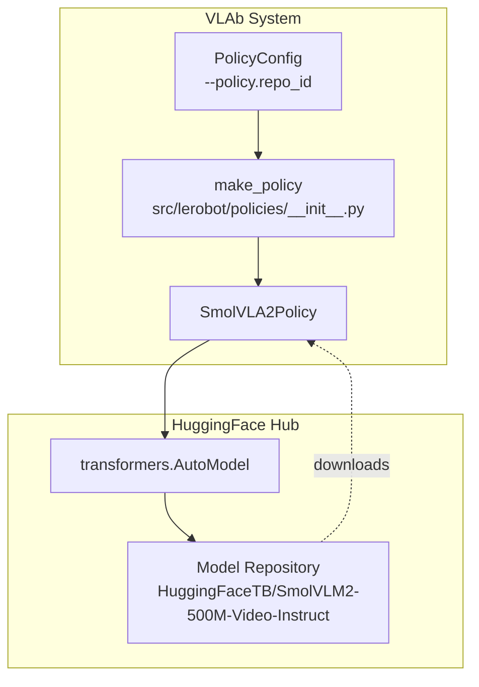
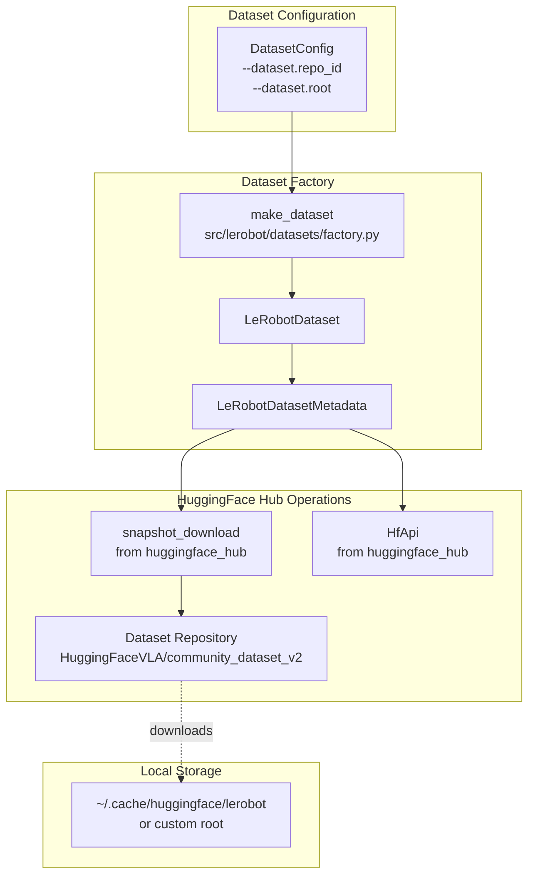
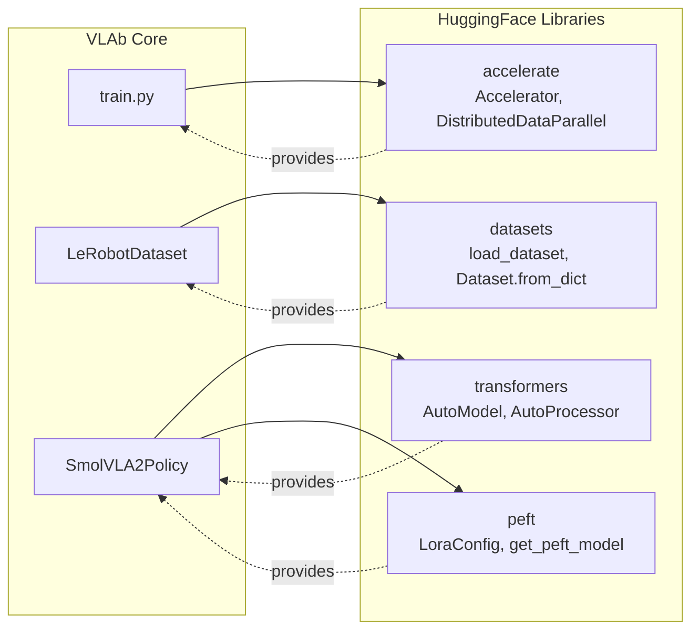
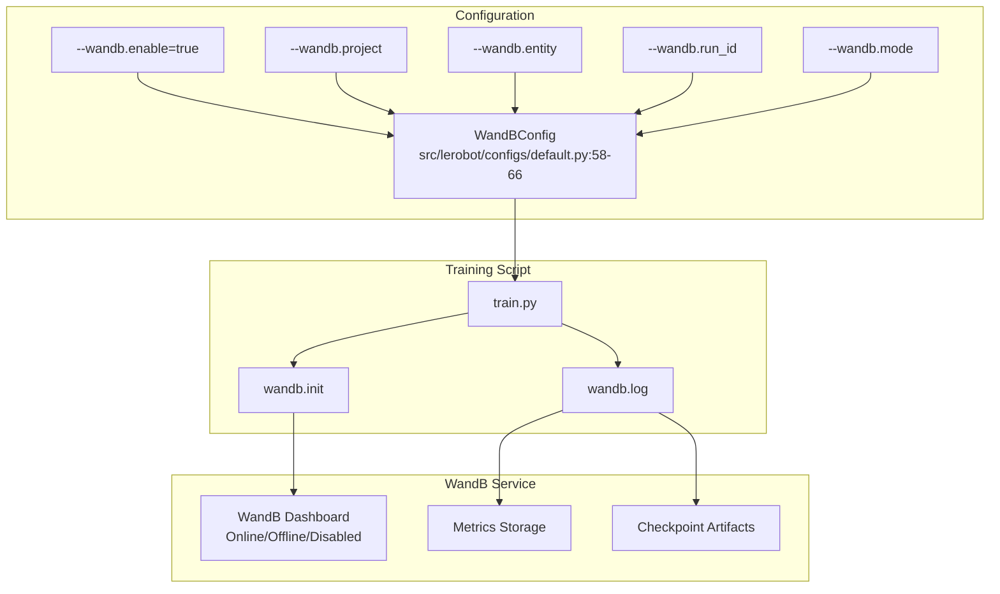
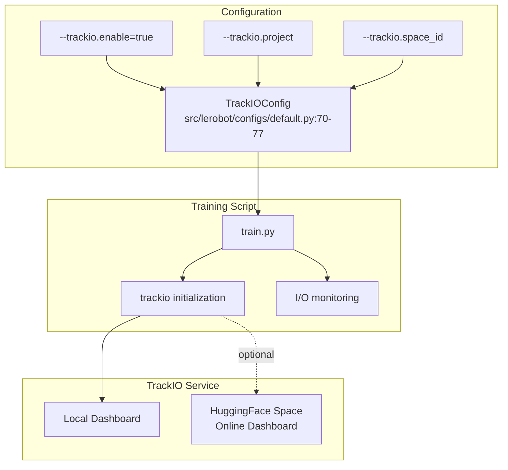
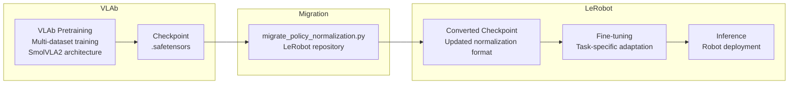
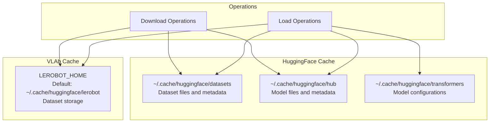
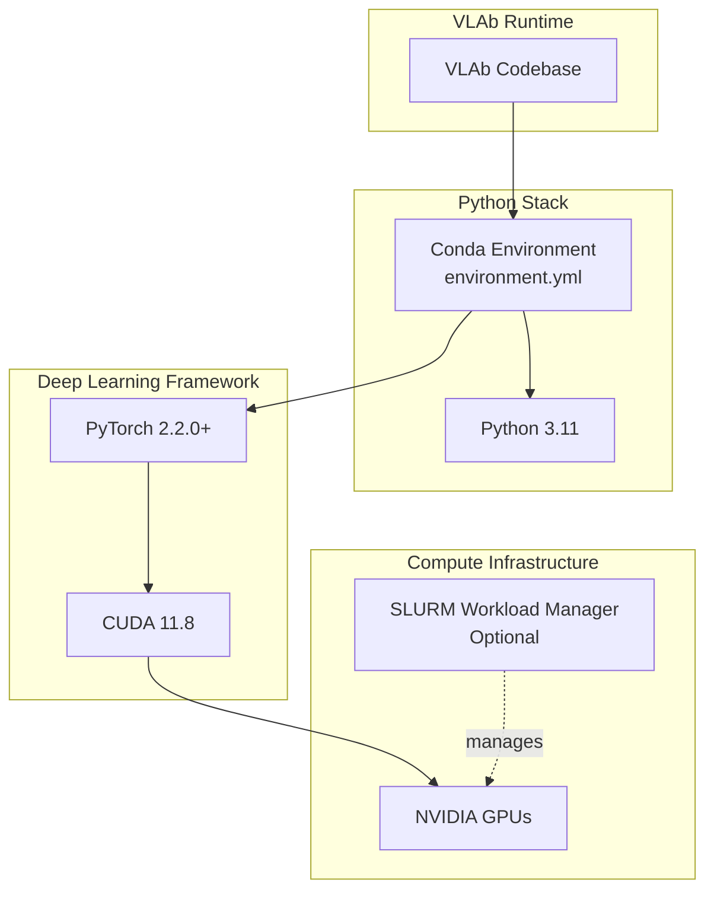

<!-- source: DeepWiki mcp.deepwiki.com · repo huggingface/VLAb · page 9 External Integrations · fetched 2026-10-26 -->

# External Integrations

<details>
<summary>Relevant source files</summary>

The following files were used as context for generating this wiki page:

- [LICENSE](LICENSE)
- [README.md](README.md)
- [src/lerobot/configs/default.py](src/lerobot/configs/default.py)
- [src/lerobot/datasets/lerobot_dataset.py](src/lerobot/datasets/lerobot_dataset.py)

</details>


## Purpose and Scope

This document describes VLAb's integrations with external services, libraries, and ecosystems. VLAb is deeply embedded in the HuggingFace ecosystem and relies on several external services for model storage, dataset management, distributed training, and experiment tracking. 

For configuration of these integrations, see [Configuration System](#6). For execution environments and SLURM cluster setup, see [Execution Environments](#8). For the relationship between VLAb and LeRobot, see [Overview](#1).

---

## HuggingFace Ecosystem

VLAb is built on top of the HuggingFace ecosystem and leverages multiple HuggingFace libraries to provide its functionality.

### HuggingFace Hub Integration

The HuggingFace Hub serves as the central repository for both models and datasets in VLAb. The system uses the `huggingface_hub` library to download and upload artifacts.

**Model Repository Access**

Models are accessed through the `repo_id` parameter in policy configuration. The SmolVLA2 policy loads pretrained vision-language models from the Hub:



Sources: [README.md:100-113](), [src/lerobot/configs/default.py]()

**Dataset Repository Access**

Datasets are downloaded from the Hub using `snapshot_download` and stored locally. The `LeRobotDatasetMetadata` class manages dataset discovery and downloading:



Sources: [src/lerobot/datasets/lerobot_dataset.py:166-178](), [src/lerobot/datasets/lerobot_dataset.py:719-746]()

**Key Hub Operations**

| Operation | Function | File Location | Purpose |
|-----------|----------|---------------|---------|
| Download datasets | `snapshot_download` | [src/lerobot/datasets/lerobot_dataset.py:171-178]() | Downloads dataset files from Hub to local cache |
| Upload datasets | `HfApi.upload_folder` | [src/lerobot/datasets/lerobot_dataset.py:703-706]() | Pushes local datasets to Hub |
| Create repositories | `HfApi.create_repo` | [src/lerobot/datasets/lerobot_dataset.py:680-685]() | Creates new dataset repositories |
| Manage tags/revisions | `HfApi.create_tag` | [src/lerobot/datasets/lerobot_dataset.py:717]() | Version control for datasets |

**Authentication**

Hub access requires authentication for private repositories or uploads:

```bash
huggingface-cli login
```

The authentication token is stored in `~/.cache/huggingface/token` and used automatically by the `huggingface_hub` library.

Sources: [README.md:89-93](), [src/lerobot/datasets/lerobot_dataset.py:30-32]()

### HuggingFace Libraries Integration

VLAb integrates with multiple HuggingFace libraries:



**datasets Library**

The `datasets` library provides efficient data loading through Apache Arrow and Parquet:

- `load_dataset`: Loads datasets from Parquet files [src/lerobot/datasets/lerobot_dataset.py:765]()
- `Dataset.from_dict`: Creates datasets from dictionaries [src/lerobot/datasets/lerobot_dataset.py:777]()
- `concatenate_datasets`: Merges multiple datasets [src/lerobot/datasets/lerobot_dataset.py:29]()
- `set_transform`: Applies on-the-fly transformations [src/lerobot/datasets/lerobot_dataset.py:771]()

**transformers Library**

The `transformers` library provides vision-language model architectures. VLAb uses it to load SmolVLM models, which are then extended with expert layers.

**peft Library**

The `peft` library enables parameter-efficient fine-tuning through LoRA (Low-Rank Adaptation):

- Configuration via `PolicyConfig.peft_method` and `PolicyConfig.peft_config`
- Supports training only adapter weights while freezing base model parameters
- See [Training Strategies](#5.2) for more details

**accelerate Library**

The `accelerate` library handles distributed training:

- Configuration files in `accelerate_configs/` directory
- Abstracts single-GPU, multi-GPU, and multi-node training
- See [Distributed Training with Accelerate](#7.2) for details

Sources: [src/lerobot/datasets/lerobot_dataset.py:23-32](), [README.md:250-254]()

---

## Experiment Tracking

VLAb supports two experiment tracking platforms: Weights & Biases and TrackIO. Both can be enabled simultaneously.

### Weights & Biases Integration

Weights & Biases (WandB) is the primary experiment tracking platform, providing real-time metrics, logs, and artifacts.

**Configuration**



**Configuration Parameters**

| Parameter | Type | Default | Purpose |
|-----------|------|---------|---------|
| `enable` | bool | False | Enable/disable WandB tracking |
| `project` | str | "lerobot" | WandB project name |
| `entity` | str | None | WandB team/username |
| `run_id` | str | None | Resume existing run |
| `mode` | str | None | "online", "offline", or "disabled" |
| `notes` | str | None | Run description |
| `disable_artifact` | bool | False | Disable checkpoint artifact uploads |

**Usage Example**

```bash
accelerate launch --config_file accelerate_configs/multi_gpu.yaml \
    src/lerobot/scripts/train.py \
    --policy.type=smolvla2 \
    --dataset.repo_id="dataset1,dataset2" \
    --wandb.enable=true \
    --wandb.project="smolvla2-training" \
    --wandb.entity="my-team" \
    --wandb.mode="online"
```

**Logged Metrics**

The training script logs the following to WandB:
- Training loss per step
- Learning rate per step
- Gradient norm per step
- Steps per second (throughput)
- Training throughput (samples/sec)
- Validation metrics (if enabled)

Sources: [src/lerobot/configs/default.py:58-66](), [README.md:109-119]()

### TrackIO Integration

TrackIO provides I/O monitoring and can optionally host dashboards on HuggingFace Spaces.

**Configuration**



**Configuration Parameters**

| Parameter | Type | Default | Purpose |
|-----------|------|---------|---------|
| `enable` | bool | False | Enable/disable TrackIO |
| `project` | str | "smolvla2-training" | TrackIO project name |
| `space_id` | str | None | HuggingFace Space for online dashboard |
| `notes` | str | None | Project notes |
| `disable_artifact` | bool | False | Disable artifact uploads |

**Space ID Format**

If hosting the dashboard online, provide the Space ID in format `"username/space-name"`.

Sources: [src/lerobot/configs/default.py:70-77]()

---

## LeRobot Ecosystem Integration

VLAb is derived from LeRobot but specializes in pretraining. The two systems have complementary roles in the VLA training pipeline.

### System Relationship



**Division of Responsibilities**

| System | Purpose | Key Features |
|--------|---------|--------------|
| VLAb | Pretraining | Multi-dataset support, SLURM cluster training, SmolVLA2 architecture, large-scale data handling |
| LeRobot | Fine-tuning & Inference | Task-specific adaptation, robot environment integration, real-time inference, evaluation tools |

Sources: [README.md:25](), [README.md:220-226]()

### Checkpoint Migration

VLAb checkpoints require conversion before use in LeRobot due to updated normalization formats.

**Migration Process**

1. **Generate VLAb Checkpoint**: Train a model in VLAb and save checkpoint to `output_dir/checkpoints/`

2. **Convert Checkpoint**: Use LeRobot's migration script
   ```bash
   # In LeRobot repository
   python src/lerobot/processor/migrate_policy_normalization.py \
       --checkpoint_path /path/to/vlab/checkpoint.safetensors \
       --output_path /path/to/converted/checkpoint.safetensors
   ```

3. **Fine-tune in LeRobot**: Load the converted checkpoint in LeRobot
   ```bash
   # In LeRobot repository
   python lerobot/scripts/train.py \
       --policy.pretrained_policy_path=/path/to/converted/checkpoint.safetensors \
       --env_name=aloha \
       --num_episodes=50
   ```

4. **Deploy for Inference**: Use LeRobot's inference pipeline

**Normalization Format Changes**

The migration script updates statistics format from VLAb's training format to LeRobot's inference format. This includes:
- Reorganization of normalization statistics keys
- Update of tensor shapes for compatibility
- Conversion of metadata fields

Sources: [README.md:220-226]()

**Related Resources**

- LeRobot GitHub: https://github.com/huggingface/lerobot
- LeRobot Installation Guide: https://huggingface.co/docs/lerobot/en/installation
- SmolVLA Fine-tuning Guide: https://huggingface.co/docs/lerobot/smolvla

Sources: [README.md:249-254]()

---

## Cache Management

VLAb uses HuggingFace's caching system to store downloaded models and datasets locally.

**Cache Locations**



**Manual Cache Cleanup**

If encountering corrupted files or persistent errors:

```bash
rm -rf ~/.cache/huggingface/datasets
rm -rf ~/.cache/huggingface/hub
rm -rf ~/.cache/huggingface/transformers
```

**Automatic Cache Cleanup in SLURM**

SLURM scripts support automatic cache cleanup via environment variable:

```bash
CLEAN_CACHE=true sbatch examples/scripts/reproduce_smolvla.slurm
```

**Cache Environment Variables**

| Variable | Default | Purpose |
|----------|---------|---------|
| `LEROBOT_HOME` | `~/.cache/huggingface/lerobot` | VLAb dataset storage location |
| `HF_HOME` | `~/.cache/huggingface` | HuggingFace cache root |

Sources: [README.md:230-246](), [src/lerobot/datasets/lerobot_dataset.py:107]()

---

## Infrastructure Dependencies

VLAb relies on several infrastructure components beyond Python libraries.

**Core Dependencies**



**Environment Specification**

The Conda environment is defined in `environment.yml` and includes:
- Python 3.11
- PyTorch 2.2.0+ with CUDA 11.8 support
- HuggingFace libraries (transformers, datasets, accelerate, peft)
- Video processing libraries (pyav, opencv)
- Experiment tracking clients (wandb)

**Installation**

```bash
conda env create -f environment.yml
conda activate vlab
export PYTHONPATH="${PWD}/src:${PYTHONPATH}"
```

Sources: [README.md:49-67](), [README.md:250-254]()

**SLURM Integration**

For cluster execution, VLAb integrates with SLURM through:
- Job submission scripts in `examples/scripts/`
- Environment setup in job prologue
- Multi-node coordination through Accelerate
- See [SLURM Cluster Training](#8.2) for detailed configuration

Sources: [README.md:203-218]()

---

