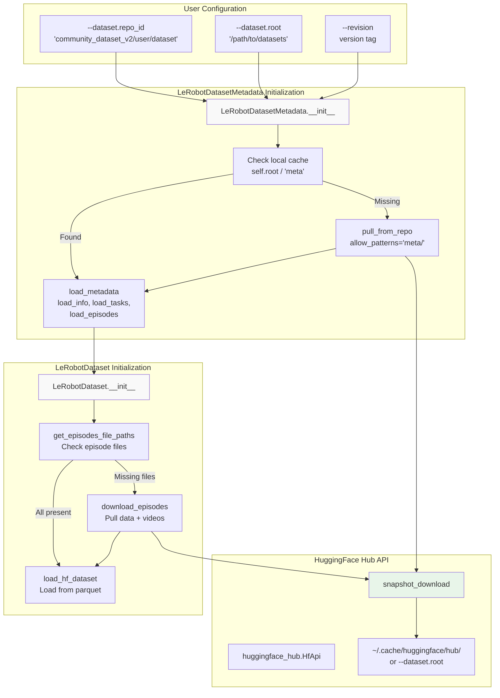
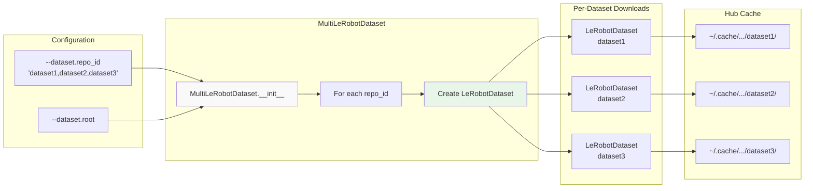
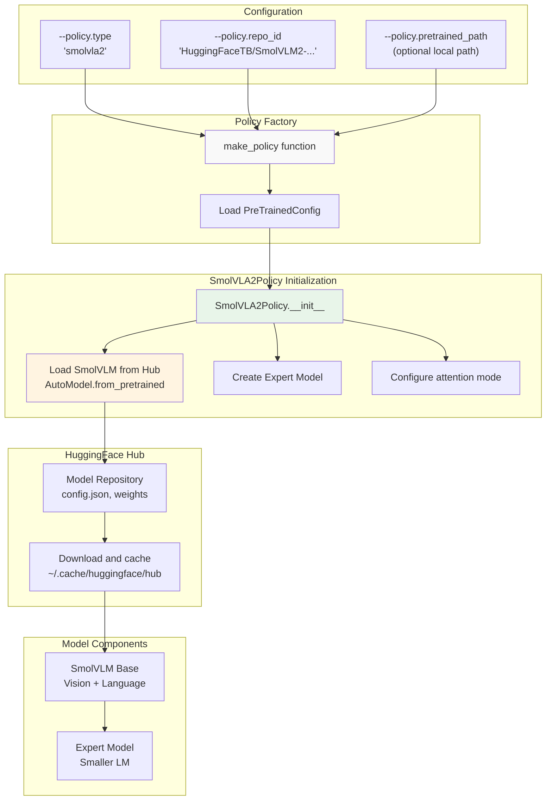

<!-- source: DeepWiki mcp.deepwiki.com · repo huggingface/VLAb · page 9.1 HuggingFace Hub Integration · fetched 2026-10-26 -->

# HuggingFace Hub Integration

<details>
<summary>Relevant source files</summary>

The following files were used as context for generating this wiki page:

- [LICENSE](LICENSE)
- [README.md](README.md)
- [src/lerobot/datasets/lerobot_dataset.py](src/lerobot/datasets/lerobot_dataset.py)

</details>


## Purpose and Scope

This document explains how VLAb integrates with the HuggingFace Hub for dataset and model management. VLAb uses the Hub as its primary repository for both community datasets and pre-trained vision-language models. This integration enables downloading, caching, versioning, and uploading of datasets and model checkpoints.

For information about experiment tracking integrations (Weights & Biases and TrackIO), see [Experiment Tracking](#9.2). For details on migrating checkpoints to the LeRobot ecosystem, see [Migration to LeRobot](#9.3).

---

## Overview of Hub Integration

VLAb's HuggingFace Hub integration spans three main areas:

1. **Dataset Management**: Downloading and loading robotics datasets from community collections
2. **Model Loading**: Initializing policies with pre-trained vision-language models from the Hub
3. **Artifact Publishing**: Uploading trained models and datasets back to the Hub

The integration is built primarily on the `huggingface_hub` library, which provides utilities for authentication, downloading, caching, and uploading.

---

## Authentication

### HuggingFace CLI Login

VLAb uses the standard HuggingFace authentication mechanism. Users authenticate once, and credentials are stored for all subsequent operations.

**Command:**
```bash
huggingface-cli login
```

Authentication is **required** for:
- Downloading private datasets or models
- Uploading datasets or models to your account
- Accessing gated models or datasets

Authentication is **optional** for:
- Downloading public datasets
- Local-only training without Hub downloads

**Storage:** Credentials are stored in `~/.cache/huggingface/token` and automatically used by the `huggingface_hub` library.

Sources: [README.md:88-93]()

---

## Dataset Integration

### Dataset Repository Structure

HuggingFace Hub datasets follow a hierarchical structure. Community datasets use nested directories for organization:

```
community_dataset_v2/
├── contributor1/
│   ├── dataset_name_1/
│   │   ├── data/
│   │   │   ├── chunk-000/
│   │   │   │   └── episode_000000.parquet
│   │   ├── videos/
│   │   │   ├── chunk-000/
│   │   │   │   └── observation.images.*/
│   │   │   │       └── episode_000000.mp4
│   │   └── meta/
│   │       ├── info.json
│   │       ├── episodes.jsonl
│   │       └── stats.json
```

Sources: [README.md:134-145]()

---

### Dataset Download and Loading Flow



Sources: [src/lerobot/datasets/lerobot_dataset.py:118-178](), [src/lerobot/datasets/lerobot_dataset.py:392-597]()

---

### Key Classes and Methods for Dataset Loading

#### `LeRobotDatasetMetadata`

The `LeRobotDatasetMetadata` class handles all Hub interactions for dataset metadata.

**Initialization Parameters:**
- `repo_id` (str): HuggingFace Hub repository identifier (e.g., `"community_dataset_v2/user/dataset"`)
- `root` (Path): Local cache directory (defaults to `~/.cache/huggingface/lerobot/{repo_id}`)
- `revision` (str): Git revision (branch, tag, or commit hash)
- `local_files_only` (bool): If True, only use local cache without Hub access
- `force_cache_sync` (bool): If True, force re-download from Hub

**Key Method: `pull_from_repo`**

```python
def pull_from_repo(
    self,
    allow_patterns: list[str] | str | None = None,
    ignore_patterns: list[str] | str | None = None,
) -> None:
    snapshot_download(
        self.repo_id,
        repo_type="dataset",
        revision=self.revision,
        local_dir=self.root,
        allow_patterns=allow_patterns,
        ignore_patterns=ignore_patterns,
    )
```

This method wraps `huggingface_hub.snapshot_download` to selectively download files from the Hub repository.

Sources: [src/lerobot/datasets/lerobot_dataset.py:118-149](), [src/lerobot/datasets/lerobot_dataset.py:166-178]()

---

#### `LeRobotDataset`

The main dataset class coordinates Hub downloads and local caching.

**Initialization Flow:**

1. **Create metadata object** with `LeRobotDatasetMetadata`
2. **Check for local files** using `get_episodes_file_paths()`
3. **Download missing files** via `download_episodes()` if needed
4. **Load parquet data** with `load_hf_dataset()`

**Key Method: `download_episodes`**

```python
def download_episodes(self, download_videos: bool = True) -> None:
    files = None
    ignore_patterns = None if download_videos else "videos/"
    if self.episodes is not None:
        files = self.get_episodes_file_paths()
    
    self.pull_from_repo(allow_patterns=files, ignore_patterns=ignore_patterns)
```

This enables **selective episode downloading** by specifying which episode indices to download via the `episodes` parameter. Only the required parquet and video files are downloaded.

Sources: [src/lerobot/datasets/lerobot_dataset.py:733-746]()

---

### Dataset Repository ID Resolution

When using `--dataset.root`, the repository ID is interpreted as a **relative path** from the root:

| Configuration | Resolution |
|--------------|------------|
| `--dataset.repo_id="community_dataset_v2/user/dataset"` | `{HF_LEROBOT_HOME}/community_dataset_v2/user/dataset` |
| `--dataset.root="/data" --dataset.repo_id="community_dataset_v2/user/dataset"` | `/data/community_dataset_v2/user/dataset` |
| `--dataset.repo_id="Beegbrain/pick_lemon"` (no root) | `{HF_LEROBOT_HOME}/Beegbrain/pick_lemon` |

The constant `HF_LEROBOT_HOME` defaults to `~/.cache/huggingface/lerobot`.

Sources: [README.md:196-200](), [src/lerobot/datasets/lerobot_dataset.py:34-38]()

---

### Version Control and Revisions

VLAb supports Git-based version control for datasets through the `revision` parameter.

**Revision Types:**
- **Tags**: Semantic versions (e.g., `"v2.0"`, `"v2.1"`)
- **Branches**: Named branches (e.g., `"main"`, `"dev"`)
- **Commits**: Full commit hashes

**Default Behavior:**

The `CODEBASE_VERSION` constant (currently `"v2.1"`) is used as the default revision. When loading a dataset, VLAb:

1. Checks if the requested revision is valid
2. Falls back to a safe version via `get_safe_version()` if needed
3. Verifies compatibility between dataset version and codebase version

**Version Compatibility Check:**

```python
check_version_compatibility(self.repo_id, self._version, CODEBASE_VERSION)
```

This ensures that the dataset format matches the expected structure for the current VLAb version.

Sources: [src/lerobot/datasets/lerobot_dataset.py:106](), [src/lerobot/datasets/lerobot_dataset.py:153-155]()

---

### Multi-Dataset Loading

VLAb supports loading multiple datasets simultaneously via `MultiLeRobotDataset`. Each dataset is downloaded and cached independently.



**Example Configuration:**

```bash
--dataset.repo_id="community_dataset_v2/user1/dataset1,community_dataset_v2/user2/dataset2"
--dataset.root="/data"
```

Each dataset is downloaded to its own subdirectory and loaded independently. Failed downloads are logged but don't prevent other datasets from loading.

Sources: [src/lerobot/datasets/lerobot_dataset.py:1316-1395]()

---

## Model Integration

### Loading Pre-trained Models from Hub

VLAb loads vision-language models (specifically SmolVLM) from the HuggingFace Hub via the `--policy.repo_id` configuration parameter.

**Example:**
```bash
--policy.repo_id="HuggingFaceTB/SmolVLM2-500M-Video-Instruct"
```

This parameter specifies the **base vision-language model** that will be used to initialize the policy. The SmolVLA2 architecture then adds an expert model on top of this base.

Sources: [README.md:103-113]()

---

### Model Loading Flow



**Model Configuration Priority:**

1. If `--policy.pretrained_path` is specified, load from local path
2. Otherwise, download from `--policy.repo_id` on HuggingFace Hub
3. Cache downloaded models in `~/.cache/huggingface/hub/`

The `AutoModel.from_pretrained()` method from the `transformers` library handles the actual download and caching logic.

---

## Uploading to Hub

### Dataset Upload with `push_to_hub`

VLAb datasets can be uploaded to the HuggingFace Hub using the `push_to_hub` method.

**Method Signature:**

```python
def push_to_hub(
    self,
    branch: str | None = None,
    tags: list | None = None,
    license: str | None = "apache-2.0",
    tag_version: bool = True,
    push_videos: bool = True,
    private: bool = False,
    allow_patterns: list[str] | str | None = None,
    upload_large_folder: bool = False,
    **card_kwargs,
) -> None
```

**Key Parameters:**

| Parameter | Description |
|-----------|-------------|
| `branch` | Git branch to upload to (creates if doesn't exist) |
| `tags` | List of tags for dataset categorization |
| `license` | License identifier (default: Apache 2.0) |
| `tag_version` | Whether to create a version tag (e.g., "v2.1") |
| `push_videos` | Whether to include video files in upload |
| `private` | Whether to create a private repository |
| `upload_large_folder` | Use chunked upload for large datasets |

**Upload Process:**

1. **Create repository** on Hub (if doesn't exist) via `HfApi.create_repo()`
2. **Create branch** (if specified) via `HfApi.create_branch()`
3. **Upload files** using either:
   - `HfApi.upload_folder()` for normal datasets
   - `HfApi.upload_large_folder()` for large datasets (>5GB)
4. **Generate dataset card** if missing via `create_lerobot_dataset_card()`
5. **Create version tag** (if `tag_version=True`) via `HfApi.create_tag()`

**Ignore Patterns:**

- Always ignores `images/` directory (temporary storage during recording)
- Ignores `videos/` directory if `push_videos=False`

Sources: [src/lerobot/datasets/lerobot_dataset.py:663-717]()

---

### Dataset Card Generation

When uploading a dataset without an existing README, VLAb automatically generates a dataset card with metadata:

**Card Contents:**
- Dataset description and statistics (episodes, frames, fps)
- Feature schema (actions, observations, etc.)
- Robot type information
- License information
- Usage examples
- Tags for discoverability

The card is created by `create_lerobot_dataset_card()` and pushed via the `huggingface_hub` dataset card API.

Sources: [src/lerobot/datasets/lerobot_dataset.py:709-712]()

---

## Caching and Local Storage

### Cache Directory Structure

VLAb uses a hierarchical cache structure for datasets and models:

```
~/.cache/huggingface/
├── lerobot/                    # Dataset cache
│   └── {repo_id}/
│       ├── data/
│       ├── videos/
│       └── meta/
├── hub/                        # Model cache
│   └── models--{org}--{model}/
│       ├── snapshots/
│       │   └── {commit_hash}/
│       │       ├── config.json
│       │       └── pytorch_model.bin
└── datasets/                   # Datasets library cache
    └── {repo_id}/
```

**Environment Variables:**

| Variable | Purpose | Default |
|----------|---------|---------|
| `LEROBOT_HOME` | Dataset cache root | `~/.cache/huggingface/lerobot` |
| `HF_HOME` | HuggingFace cache root | `~/.cache/huggingface` |

---

### Cache Management

**Manual Cache Cleanup:**

```bash
rm -rf ~/.cache/huggingface/datasets
rm -rf ~/.cache/huggingface/hub
rm -rf ~/.cache/huggingface/transformers
```

**Automatic Cleanup in SLURM:**

SLURM scripts can set `CLEAN_CACHE=true` to automatically clean cache before training. This is useful for:
- Recovering from corrupted downloads
- Forcing re-download of updated datasets
- Freeing disk space on shared clusters

**Note:** After cache cleanup, datasets and models will be re-downloaded on first use.

Sources: [README.md:230-245]()

---

### Local-Only Mode

For offline training or when datasets are pre-downloaded, use `local_files_only=True`:

```python
dataset = LeRobotDataset(
    repo_id="community_dataset_v2/user/dataset",
    root="/path/to/local/datasets",
    local_files_only=True,
)
```

This prevents any Hub API calls and only uses files already present in the `root` directory.

Sources: [src/lerobot/datasets/lerobot_dataset.py:404]()

---

## Hub API Reference

### Key Functions from `huggingface_hub`

VLAb uses several core functions from the `huggingface_hub` library:

**`snapshot_download`**
```python
snapshot_download(
    repo_id: str,
    repo_type: str = "dataset",  # or "model"
    revision: str | None = None,
    local_dir: Path,
    allow_patterns: list[str] | None = None,
    ignore_patterns: list[str] | None = None,
)
```
Downloads an entire repository or specific files based on patterns.

**`HfApi.create_repo`**
```python
api.create_repo(
    repo_id: str,
    repo_type: str = "dataset",  # or "model"
    private: bool = False,
    exist_ok: bool = True,
)
```
Creates a new repository on the Hub.

**`HfApi.upload_folder`**
```python
api.upload_folder(
    repo_id: str,
    folder_path: Path,
    repo_type: str = "dataset",
    revision: str | None = None,
    allow_patterns: list[str] | None = None,
    ignore_patterns: list[str] | None = None,
)
```
Uploads a local directory to the Hub.

Sources: [src/lerobot/datasets/lerobot_dataset.py:30](), [src/lerobot/datasets/lerobot_dataset.py:679-706]()

---

## Common Configuration Patterns

### Pattern 1: Download from Hub

```bash
accelerate launch --config_file accelerate_configs/multi_gpu.yaml \
    src/lerobot/scripts/train.py \
    --policy.type=smolvla2 \
    --policy.repo_id=HuggingFaceTB/SmolVLM2-500M-Video-Instruct \
    --dataset.repo_id="Beegbrain/pick_lemon,Chojins/chess_game" \
    --batch_size=8
```

- Datasets downloaded to `~/.cache/huggingface/lerobot/{repo_id}`
- Model downloaded to `~/.cache/huggingface/hub/`

### Pattern 2: Use Local Datasets

```bash
accelerate launch --config_file accelerate_configs/multi_gpu.yaml \
    src/lerobot/scripts/train.py \
    --policy.type=smolvla2 \
    --policy.repo_id=HuggingFaceTB/SmolVLM2-500M-Video-Instruct \
    --dataset.repo_id="community_dataset_v2/user1/dataset1,community_dataset_v2/user2/dataset2" \
    --dataset.root="/data/datasets"
```

- Datasets loaded from `/data/datasets/community_dataset_v2/{user}/{dataset}`
- Model still downloaded from Hub

### Pattern 3: Offline Training

```bash
# Pre-download everything first
python -c "
from lerobot.datasets import LeRobotDataset
ds = LeRobotDataset('repo_id', root='/data')
"

# Train offline
accelerate launch --config_file accelerate_configs/multi_gpu.yaml \
    src/lerobot/scripts/train.py \
    --policy.pretrained_path=/models/smolvlm \
    --dataset.repo_id="dataset1,dataset2" \
    --dataset.root="/data"
```

Sources: [README.md:99-110](), [README.md:176-195]()

---

## Error Handling and Troubleshooting

### Common Issues

**Issue 1: Missing HuggingFace Token**
```
Error: Repository not found or authentication required
```
**Solution:** Run `huggingface-cli login` to authenticate.

**Issue 2: Corrupted Cache**
```
Error: Failed to load dataset metadata
```
**Solution:** Clear cache and re-download:
```bash
rm -rf ~/.cache/huggingface/datasets/{repo_id}
```

**Issue 3: Video Key Mismatch**
```
FileNotFoundError: Video directory names don't match image keys in metadata
```
**Solution:** This occurs when video files exist but keys don't match metadata. Usually resolved by clearing cache and re-downloading.

**Issue 4: Revision Not Found**
```
RevisionNotFoundError: Revision 'v2.1' does not exist
```
**Solution:** The dataset may not have the requested version tag. Use default revision or specify an existing branch/tag.

Sources: [src/lerobot/datasets/lerobot_dataset.py:564-591](), [README.md:230-246]()

---

## Summary

VLAb's HuggingFace Hub integration provides:

1. **Seamless dataset access** to 340+ community robotics datasets
2. **Pre-trained model loading** for vision-language models like SmolVLM
3. **Version control** via Git revisions for reproducible experiments
4. **Intelligent caching** to minimize redundant downloads
5. **Publishing capabilities** for sharing trained models and datasets

The integration is transparent to users—datasets and models are automatically downloaded when specified by `repo_id`, cached locally for reuse, and can be versioned for reproducibility.

---

