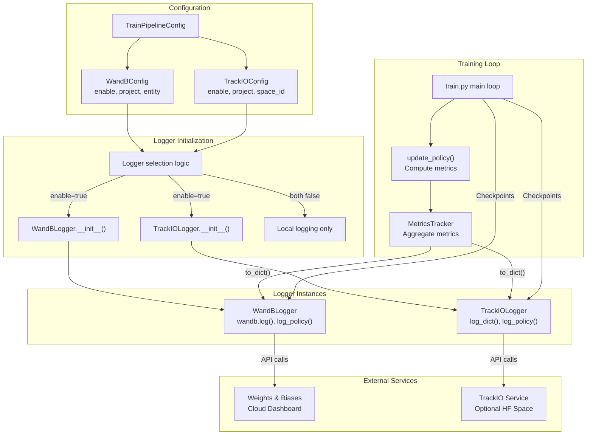
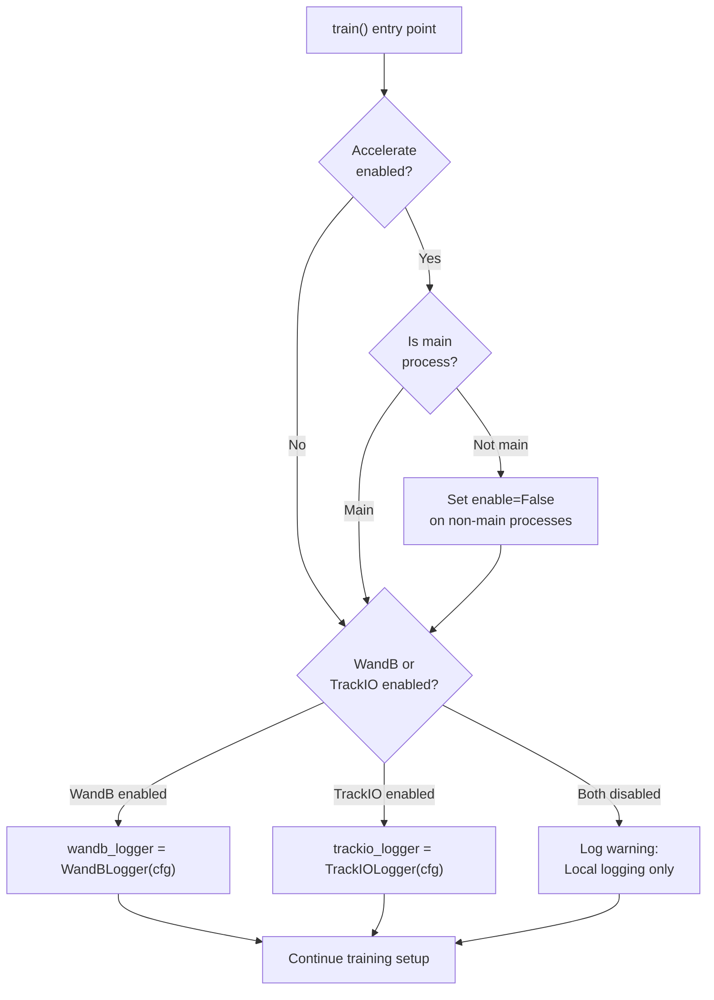
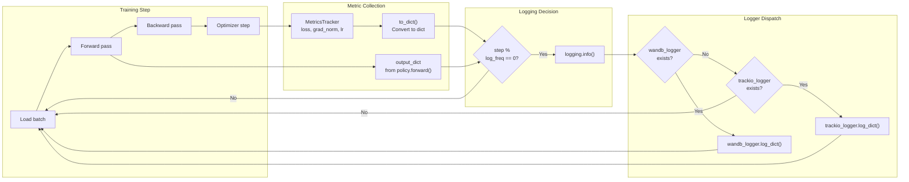
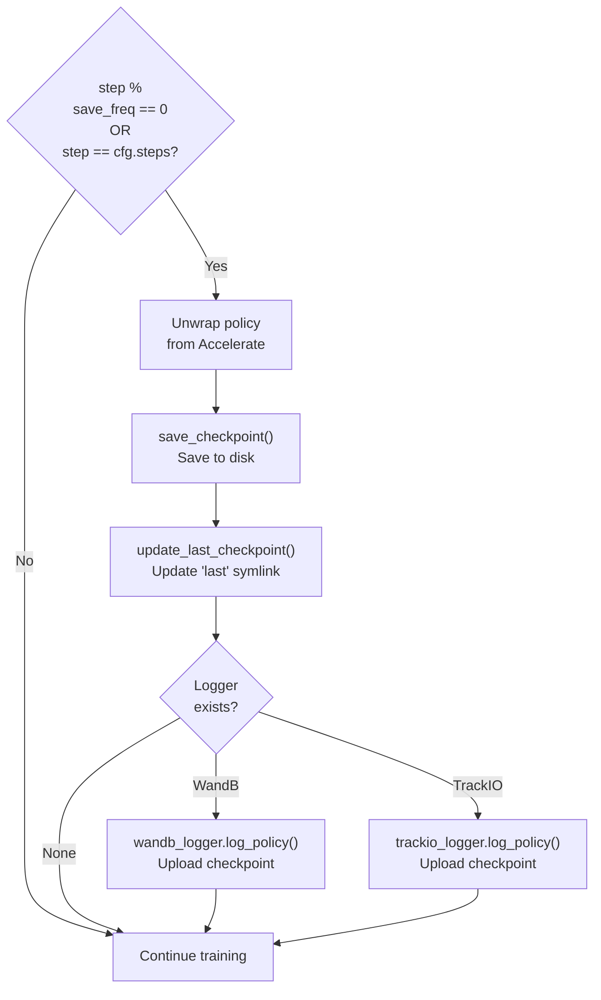
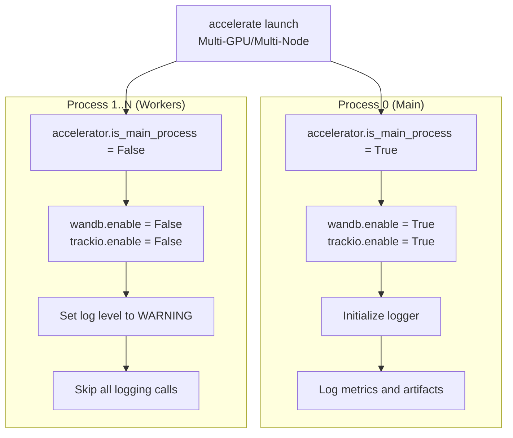
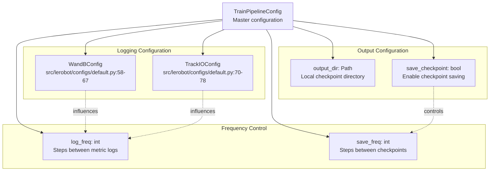

<!-- source: DeepWiki mcp.deepwiki.com · repo huggingface/VLAb · page 9.2 Experiment Tracking · fetched 2026-10-26 -->

# Experiment Tracking

<details>
<summary>Relevant source files</summary>

The following files were used as context for generating this wiki page:

- [LICENSE](LICENSE)
- [README.md](README.md)
- [src/lerobot/configs/default.py](src/lerobot/configs/default.py)
- [src/lerobot/scripts/train.py](src/lerobot/scripts/train.py)

</details>


## Purpose and Scope

This page documents VLAb's experiment tracking system for logging training metrics, checkpoints, and artifacts. VLAb supports two logging backends: **Weights & Biases (WandB)** and **TrackIO**. The tracking system captures training loss, learning rate, gradient norms, and optionally saves model checkpoints as artifacts.

For information about the training loop that generates these metrics, see [Training Script Overview](#7.1). For checkpoint saving mechanisms, see [Checkpointing and Resumption](#7.3).

---

## Overview

VLAb's experiment tracking system provides real-time monitoring of training runs through external services. The system is designed to:

- Log training metrics at configurable intervals
- Upload model checkpoints as artifacts
- Support multiple concurrent logging backends
- Operate in distributed training scenarios
- Gracefully disable on non-main processes

The tracking system is optional and disabled by default. When neither WandB nor TrackIO is enabled, training logs are saved locally only.

**Sources:** [src/lerobot/scripts/train.py:161-169]()

---

## Supported Backends

### Weights & Biases (WandB)

WandB is a popular experiment tracking platform that provides dashboards, hyperparameter sweeps, and artifact management. VLAb integrates with WandB through the `WandBLogger` class.

**Key Features:**
- Real-time metric visualization
- Checkpoint artifact storage
- Run resumption with existing run IDs
- Team collaboration through entity/project organization
- Online, offline, and disabled modes

### TrackIO

TrackIO is an alternative tracking backend that can optionally host dashboards on HuggingFace Spaces. It provides similar functionality to WandB but with tighter integration into the HuggingFace ecosystem.

**Key Features:**
- Metric logging and visualization
- Optional HuggingFace Space hosting
- Checkpoint artifact management
- I/O performance monitoring

**Sources:** [src/lerobot/configs/default.py:58-78](), [src/lerobot/scripts/train.py:58-59]()

---

## Architecture

### Logging System Flow



**Sources:** [src/lerobot/scripts/train.py:128-169](), [src/lerobot/scripts/train.py:298-324]()

---

## Configuration

### WandBConfig

The `WandBConfig` dataclass defines all parameters for Weights & Biases integration:

| Parameter | Type | Default | Description |
|-----------|------|---------|-------------|
| `enable` | `bool` | `False` | Enable WandB logging |
| `disable_artifact` | `bool` | `False` | Disable checkpoint artifact uploads |
| `project` | `str` | `"lerobot"` | WandB project name |
| `entity` | `str \| None` | `None` | WandB team/entity name |
| `notes` | `str \| None` | `None` | Run notes/description |
| `run_id` | `str \| None` | `None` | Existing run ID for resumption |
| `mode` | `str \| None` | `None` | Logging mode: `'online'`, `'offline'`, or `'disabled'` |

**Configuration Location:** [src/lerobot/configs/default.py:58-67]()

### TrackIOConfig

The `TrackIOConfig` dataclass defines parameters for TrackIO integration:

| Parameter | Type | Default | Description |
|-----------|------|---------|-------------|
| `enable` | `bool` | `False` | Enable TrackIO logging |
| `disable_artifact` | `bool` | `False` | Disable checkpoint artifact uploads |
| `project` | `str` | `"smolvla2-training"` | TrackIO project name |
| `notes` | `str \| None` | `None` | Run notes/description |
| `space_id` | `str \| None` | `None` | HuggingFace Space ID for hosted dashboard (e.g., `"username/space-name"`) |

**Configuration Location:** [src/lerobot/configs/default.py:70-78]()

---

## Integration with Training Loop

### Logger Initialization

Logger initialization occurs early in the training script, after distributed training setup:



The initialization logic ensures that:
1. Only the main process logs in distributed training
2. Exactly one backend is active (WandB takes precedence)
3. Training continues normally if logging is disabled

**Implementation:** [src/lerobot/scripts/train.py:155-169]()

**Sources:** [src/lerobot/scripts/train.py:134-169]()

---

### Metric Logging Flow

Metrics are logged at regular intervals controlled by `cfg.log_freq`:



**Key Code Sections:**
- Metric collection: [src/lerobot/scripts/train.py:64-125]()
- Logging decision: [src/lerobot/scripts/train.py:294-311]()
- Logger dispatch: [src/lerobot/scripts/train.py:301-310]()

**Sources:** [src/lerobot/scripts/train.py:278-311]()

---

### Checkpoint Artifact Logging

When checkpoints are saved, they are optionally uploaded as artifacts:



**Implementation Notes:**
- Checkpoints are first saved locally via `save_checkpoint()`
- The `last` symlink is updated to point to the most recent checkpoint
- Artifact upload happens asynchronously and doesn't block training
- If `disable_artifact=True`, checkpoints are saved locally but not uploaded

**Sources:** [src/lerobot/scripts/train.py:313-324]()

---

## Logged Metrics

### Core Training Metrics

The following metrics are tracked during every training step and logged at `log_freq` intervals:

| Metric | Key | Description | Unit |
|--------|-----|-------------|------|
| Loss | `loss` | Training loss from `policy.forward()` | Float |
| Gradient Norm | `grad_norm` | L2 norm of gradients after clipping | Float |
| Learning Rate | `lr` | Current learning rate from optimizer | Float |
| Update Time | `update_s` | Time for forward + backward + optimizer step | Seconds |
| Data Loading Time | `dataloading_s` | Time to load and prepare batch | Seconds |

These metrics are collected by the `MetricsTracker` class, which uses `AverageMeter` instances to compute running averages over the logging window.

**Sources:** [src/lerobot/scripts/train.py:256-266]()

### Policy-Specific Metrics

Policies can return additional metrics through the `output_dict` from `policy.forward()`. These metrics are merged with core training metrics before logging:

```python
# From train.py logging section
wandb_log_dict = train_tracker.to_dict()
if output_dict:
    wandb_log_dict.update(output_dict)
wandb_logger.log_dict(wandb_log_dict, step)
```

**Sources:** [src/lerobot/scripts/train.py:302-305]()

### Metadata and Configuration

At the start of training, loggers typically record:
- Training configuration (all `cfg` parameters)
- Dataset metadata (number of frames, episodes)
- Model architecture details (number of parameters)
- Execution environment (device, distributed setup)

---

## Usage Examples

### Basic WandB Configuration

Enable WandB logging with minimal configuration:

```bash
accelerate launch src/lerobot/scripts/train.py \
    --policy.type=smolvla2 \
    --dataset.repo_id="example/dataset" \
    --wandb.enable=true \
    --wandb.project="my-vla-project" \
    --log_freq=100
```

This will:
1. Log metrics every 100 steps
2. Create a new run in the "my-vla-project" WandB project
3. Use the default entity (your WandB username)

**Sources:** [README.md:99-111]()

### WandB with Team Entity

Log to a team workspace:

```bash
accelerate launch src/lerobot/scripts/train.py \
    --wandb.enable=true \
    --wandb.project="vla-research" \
    --wandb.entity="robotics-lab" \
    --wandb.notes="Experiment with new dataset v2"
```

### Resume Existing WandB Run

Continue logging to an existing run:

```bash
accelerate launch src/lerobot/scripts/train.py \
    --resume=true \
    --checkpoint_path="outputs/training/checkpoints/last" \
    --wandb.enable=true \
    --wandb.run_id="unique-run-id-123"
```

### TrackIO with HuggingFace Space

Enable TrackIO with hosted dashboard:

```bash
accelerate launch src/lerobot/scripts/train.py \
    --trackio.enable=true \
    --trackio.project="smolvla2-experiments" \
    --trackio.space_id="username/vla-dashboard" \
    --log_freq=50
```

### Disable Artifact Uploads

Log metrics but skip checkpoint uploads to save bandwidth:

```bash
accelerate launch src/lerobot/scripts/train.py \
    --wandb.enable=true \
    --wandb.project="quick-test" \
    --wandb.disable_artifact=true
```

**Sources:** [src/lerobot/configs/default.py:58-78]()

---

## Distributed Training Behavior

In distributed training scenarios with Accelerate, logging is automatically configured to avoid duplication:



**Key Implementation:**
1. Non-main processes disable both WandB and TrackIO: [src/lerobot/scripts/train.py:155-158]()
2. Logging level is set to WARNING on workers: [src/lerobot/scripts/train.py:148-151]()
3. Logger existence checks prevent errors when loggers are `None`

**Sources:** [src/lerobot/scripts/train.py:134-158]()

---

## Logger Implementation Details

### WandBLogger Class

The `WandBLogger` class (defined in `src/lerobot/utils/wandb_utils.py`) provides:

- **Initialization:** Sets up WandB run with project, entity, and run ID
- **log_dict(data, step, mode="train"):** Logs dictionary of metrics at given step
- **log_policy(checkpoint_dir):** Uploads checkpoint directory as WandB artifact
- **log_video(video_path, step, mode="eval"):** Logs video files (used in evaluation)

### TrackIOLogger Class

The `TrackIOLogger` class (defined in `src/lerobot/utils/trackio_utils.py`) provides:

- **Initialization:** Sets up TrackIO project with optional HuggingFace Space
- **log_dict(data, step):** Logs dictionary of metrics at given step
- **log_policy(checkpoint_dir):** Uploads checkpoint directory as TrackIO artifact

Both classes follow a similar interface to enable easy swapping between backends.

**Sources:** [src/lerobot/scripts/train.py:58-59]()

---

## Configuration Hierarchy



**Sources:** [src/lerobot/configs/default.py:26-98]()

---

## Troubleshooting

### No Metrics Appearing in Dashboard

**Symptoms:** Training runs but no metrics appear in WandB/TrackIO dashboard.

**Possible Causes:**
1. Logging is disabled in configuration
2. Running on non-main process in distributed setup
3. `log_freq` is too high (metrics haven't been logged yet)

**Solutions:**
- Check `cfg.wandb.enable` or `cfg.trackio.enable` is `True`
- Verify you're checking the correct project/entity
- Lower `log_freq` for more frequent updates
- Check console output for logger initialization messages

### Checkpoint Artifacts Not Uploaded

**Symptoms:** Checkpoints are saved locally but not appearing in artifact storage.

**Possible Causes:**
1. `disable_artifact=True` in configuration
2. Network connectivity issues
3. Insufficient storage quota

**Solutions:**
- Verify `cfg.wandb.disable_artifact` is `False`
- Check WandB/TrackIO account has sufficient storage
- Review console for upload error messages

### Multiple Runs Created on Resume

**Symptoms:** Resuming training creates a new run instead of continuing the old one.

**Possible Causes:**
1. `run_id` not specified in resume configuration
2. Invalid or expired run ID

**Solutions:**
- When using `--resume=true`, also specify `--wandb.run_id=<existing-run-id>`
- Verify the run ID exists in your WandB project
- Check that the run wasn't deleted or archived

**Sources:** [src/lerobot/configs/default.py:58-78]()

---

## Best Practices

1. **Choose Appropriate log_freq:** For pretraining with hundreds of thousands of steps, use `log_freq=100` or higher to avoid excessive API calls

2. **Use Notes for Experiment Tracking:** Add meaningful notes to distinguish experiments:
   ```bash
   --wandb.notes="Testing expert_width_multiplier=0.5 on community_dataset_v2"
   ```

3. **Disable Artifacts for Quick Tests:** When iterating on code, disable artifact uploads to speed up iteration:
   ```bash
   --wandb.disable_artifact=true
   ```

4. **Monitor Both Core and Policy Metrics:** Core metrics (loss, learning rate) track training health, while policy-specific metrics provide domain insights

5. **Use run_id for Long Training Runs:** Save the run ID when starting long training jobs to enable proper resumption if interrupted

**Sources:** [README.md:99-111](), [src/lerobot/scripts/train.py:298-324]()

---

