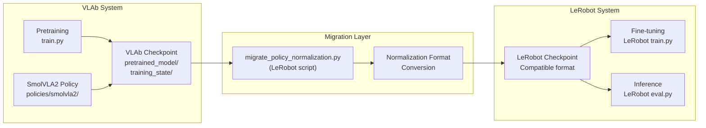
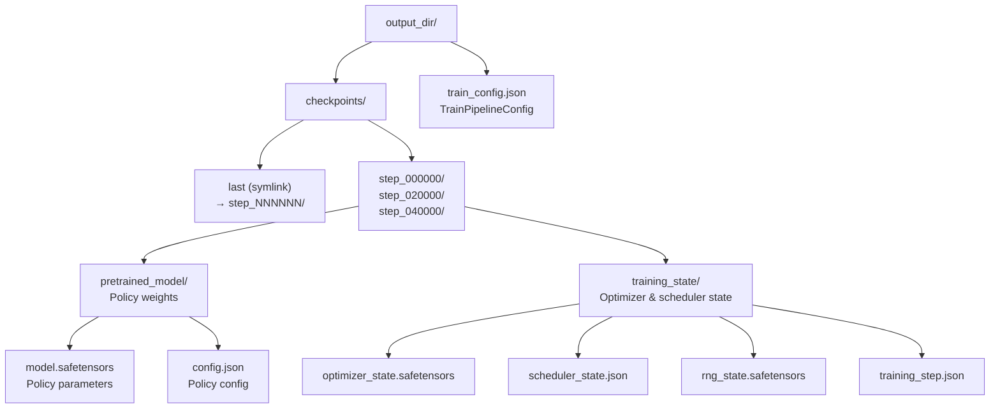
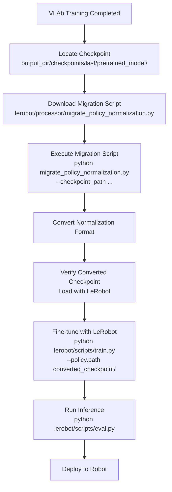
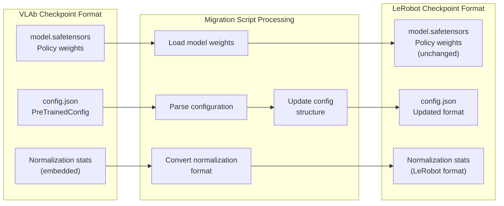
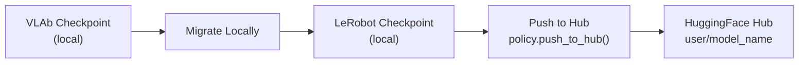

<!-- source: DeepWiki mcp.deepwiki.com · repo huggingface/VLAb · page 9.3 Migration to LeRobot · fetched 2026-10-26 -->

# Migration to LeRobot

<details>
<summary>Relevant source files</summary>

The following files were used as context for generating this wiki page:

- [LICENSE](LICENSE)
- [README.md](README.md)
- [src/lerobot/configs/train.py](src/lerobot/configs/train.py)
- [src/lerobot/constants.py](src/lerobot/constants.py)

</details>


## Purpose and Scope

This document explains how to migrate pretrained VLAb checkpoints to the LeRobot format for fine-tuning and inference. VLAb is optimized for pretraining Vision-Language-Action models on large-scale robotics datasets, while LeRobot provides the infrastructure for fine-tuning and deployment. Due to differences in normalization formats between the two systems, a migration step is required to use VLAb pretrained models with LeRobot.

For information about VLAb's training process, see [Training Execution](#7). For information about checkpointing during training, see [Checkpointing and Resumption](#7.3).

**Sources:** [README.md:220-227]()

## VLAb and LeRobot Ecosystem Relationship



**VLAb** specializes in pretraining VLA models on diverse robotics datasets using efficient multi-GPU and cluster training. **LeRobot** provides the complete robotics learning framework including fine-tuning on task-specific data and real-time inference for robot control. The migration script bridges these two systems by converting checkpoint normalization formats.

**Sources:** [README.md:11-25](), [README.md:220-227]()

## Checkpoint Compatibility Issues

VLAb and LeRobot use different normalization formats for policy inputs and outputs. This incompatibility arises from:

| Aspect | VLAb | LeRobot |
|--------|------|---------|
| **Primary Use Case** | Large-scale pretraining | Task-specific fine-tuning and inference |
| **Normalization Storage** | Embedded in checkpoint during pretraining | Updated format for runtime flexibility |
| **Configuration Format** | TrainPipelineConfig snapshot | Latest LeRobot config structure |

The migration script updates the normalization statistics and configuration structure to match LeRobot's expectations without retraining the model weights.

**Sources:** [README.md:220-227]()

## VLAb Checkpoint Structure



VLAb saves checkpoints in a hierarchical structure within the `output_dir`:

- **`checkpoints/`**: Contains timestamped checkpoint directories
  - **`step_NNNNNN/`**: Individual checkpoint at step N
    - **`pretrained_model/`**: Policy model weights and configuration
      - `model.safetensors`: Model parameters in safetensors format
      - `config.json`: Policy configuration
    - **`training_state/`**: Training state for resumption
      - `optimizer_state.safetensors`: Optimizer state
      - `scheduler_state.json`: Learning rate scheduler state
      - `rng_state.safetensors`: Random number generator state
      - `training_step.json`: Current training step
  - **`last`**: Symlink pointing to the most recent checkpoint

The `pretrained_model/` subdirectory contains the policy that needs migration to LeRobot format.

**Sources:** [src/lerobot/constants.py:36-44](), [README.md:116-119]()

## Migration Workflow



The migration process follows these steps:

1. **Complete VLAb pretraining** and identify the checkpoint directory
2. **Obtain the migration script** from the LeRobot repository
3. **Execute the migration script** on the VLAb checkpoint
4. **Verify the converted checkpoint** loads correctly in LeRobot
5. **Fine-tune the converted model** on task-specific datasets using LeRobot
6. **Run inference** and deploy to physical robots

**Sources:** [README.md:220-227]()

## Using the Migration Script

### Prerequisites

```bash
# Install LeRobot (separate from VLAb environment)
git clone https://github.com/huggingface/lerobot.git
cd lerobot
pip install -e .
```

### Migration Command

The migration script is located in the LeRobot repository at `src/lerobot/processor/migrate_policy_normalization.py`. Execute it with:

```bash
python lerobot/processor/migrate_policy_normalization.py \
    --checkpoint_path /path/to/vlab/outputs/training/checkpoints/last/pretrained_model \
    --output_path /path/to/converted_checkpoint
```

### Parameters

| Parameter | Description | Example |
|-----------|-------------|---------|
| `--checkpoint_path` | Path to VLAb's `pretrained_model/` directory | `outputs/training/checkpoints/last/pretrained_model` |
| `--output_path` | Destination for converted checkpoint | `outputs/converted_checkpoints/smolvla2_migrated` |

### Verification

After migration, verify the checkpoint loads correctly:

```python
from lerobot.policies import make_policy

policy = make_policy(
    policy_type="smolvla2",
    pretrained_path="/path/to/converted_checkpoint"
)
print("✓ Checkpoint loaded successfully")
```

**Sources:** [README.md:220-227]()

## Checkpoint Contents Mapping



The migration script preserves model weights while updating configuration and normalization formats:

| Component | VLAb Format | Migration Action | LeRobot Format |
|-----------|-------------|------------------|----------------|
| **Model Weights** | `model.safetensors` | Copy unchanged | `model.safetensors` |
| **Configuration** | `PreTrainedConfig` snapshot | Update structure | Latest LeRobot config schema |
| **Normalization Stats** | Embedded format | Convert to LeRobot format | Runtime-compatible stats |
| **Policy Type** | `smolvla2` | Preserve | `smolvla2` |

**Sources:** [README.md:220-227](), [src/lerobot/configs/policies.py]()

## Post-Migration Fine-Tuning

After migration, use LeRobot for task-specific fine-tuning:

### Fine-Tuning Command

```bash
python lerobot/scripts/train.py \
    --policy.path=/path/to/converted_checkpoint \
    --dataset.repo_id=user/task_specific_dataset \
    --env.type=your_robot_env \
    --batch_size=32 \
    --steps=50000 \
    --output_dir=outputs/finetuning
```

### Configuration Differences

| Aspect | VLAb Pretraining | LeRobot Fine-Tuning |
|--------|------------------|---------------------|
| **Dataset** | Multi-dataset aggregation | Single task-specific dataset |
| **Environment** | Not required (offline pretraining) | Real or simulated robot environment |
| **Batch Size** | Large (8-64 for GPU efficiency) | Smaller (task-dependent) |
| **Training Steps** | High (100k-200k) | Lower (10k-50k) |
| **Evaluation** | Periodic checkpointing | Environment rollouts |

**Sources:** [README.md:250-254]()

## Post-Migration Inference

LeRobot provides inference capabilities for robot control:

```bash
# Evaluate policy in environment
python lerobot/scripts/eval.py \
    --policy.path=/path/to/finetuned_checkpoint \
    --env.type=your_robot_env \
    --eval.n_episodes=10
```

The inference pipeline:
1. Loads the fine-tuned policy checkpoint
2. Initializes the robot environment
3. Runs episodes collecting observations and executing actions
4. Reports success rates and metrics

**Sources:** [README.md:250-254]()

## Common Migration Issues

| Issue | Symptom | Solution |
|-------|---------|----------|
| **Normalization mismatch** | Runtime errors loading policy | Ensure migration script completed successfully |
| **Config version mismatch** | Missing configuration keys | Update to latest LeRobot version |
| **Path not found** | Checkpoint loading fails | Verify `--checkpoint_path` points to `pretrained_model/` directory |
| **Memory errors** | OOM during migration | Reduce batch size or use CPU-only migration |

**Sources:** [README.md:228-247]()

## Integration with HuggingFace Hub

Both VLAb and LeRobot support pushing checkpoints to HuggingFace Hub:



After migration and fine-tuning, share models on the Hub:

```python
from lerobot.policies import make_policy

policy = make_policy(
    policy_type="smolvla2",
    pretrained_path="/path/to/finetuned_checkpoint"
)

policy.push_to_hub(
    repo_id="username/smolvla2-finetuned-task",
    commit_message="Fine-tuned SmolVLA2 for pick-and-place"
)
```

**Sources:** [README.md:250-254](), [src/lerobot/configs/train.py:149-152]()

## Summary

The migration process connects VLAb's pretraining capabilities with LeRobot's fine-tuning and inference infrastructure. Key points:

1. **VLAb checkpoints** require format conversion due to normalization differences
2. **Migration script** (`migrate_policy_normalization.py`) handles the conversion automatically
3. **Converted checkpoints** are compatible with LeRobot's training and evaluation pipelines
4. **Post-migration workflow** involves task-specific fine-tuning and robot deployment

This separation allows VLAb to optimize for large-scale pretraining while LeRobot handles the complexities of robot interaction and real-time control.

**Sources:** [README.md:220-227](), [README.md:250-254]()

---

