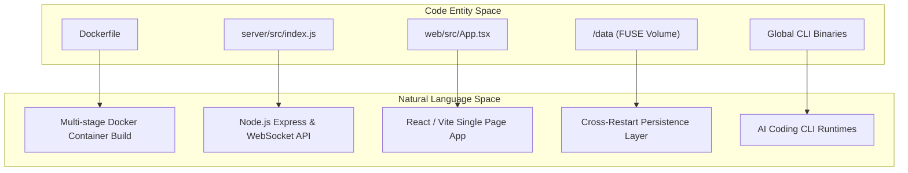
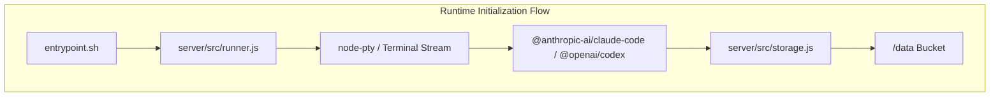

<!-- source: DeepWiki mcp.deepwiki.com · repo huggingface/agent-manager · page 1 Overview · fetched 2026-10-26 -->

# Overview

Relevant source files

The following files were used as context for generating this wiki page:

- [Dockerfile](Dockerfile)
- [README.md](README.md)
- [package.json](package.json)

Agent Manager is a containerized multi-session workspace designed to host, manage, and interact with AI coding CLI tools (such as Claude Code, Codex, Gemini CLI, opencode, openclaw, and fx) from a browser interface hosted on a Hugging Face Space [README.md:14-20](). It provides a persistent backend runtime, split terminal/reader views, project grouping, and multi-device session continuity backed by a private storage volume mounted at `/data` [README.md:55-60]().

For details on setting up and duplicating the template Space, see [Getting Started and Development Setup](#1.1). For details on the directory layout and configuration files, see [Repository Layout and Conventions](#1.2).

## High-Level Architecture

The repository is structured into distinct top-level modules handling backend services, frontend application components, standalone demonstration views, and administrative scripts. 

*Figure 1: High-level architectural mapping between natural language system concepts and codebase entities.*

Sources: `Dockerfile:1-118` [Dockerfile:1-118](), `README.md:14-80` [README.md:14-80](), `package.json:1-10` [package.json:1-10]()

### Core Subsystems

The codebase is organized around four primary directories at the repository root:

| Directory / Entity | Role and Responsibility | Code Pointer |
| :--- | :--- | :--- |
| `server/` | Node.js Express & WebSocket backend handling PTY spawning, session runtimes, traces, and storage. | `package.json:4` [package.json:4]() |
| `web/` | React and Vite single-page application providing the workspace UI, reader view, and settings. | `Dockerfile:1-7` [Dockerfile:1-7]() |
| `demo/` | Standalone static Space implementation for the read-only conversation demo. | `README.md:1-12` [README.md:1-12]() |
| `scripts/` | Maintenance utilities, test suite runners, and deployment helpers. | `package.json:8` [package.json:8]() |

Sources: `Dockerfile:1-7` [Dockerfile:1-7](), `package.json:4-8` [package.json:4-8]()

## Key Concepts and Runtime Environment

Agent Manager bridges the gap between headless AI CLI utilities and interactive browser environments. It runs inside a Docker container based on Node 24 (`node:24-bookworm`), embedding pre-pinned versions of coding assistants and necessary helper binaries [Dockerfile:10-90]().

*Figure 2: Session execution and persistence pipeline linking runner routines to storage subsystems.*

### Key Architectural Concepts
- **Multi-Session Workspaces**: Users can spawn, group, and run multiple AI CLI instances simultaneously without process collision [README.md:32-37]().
- **Trace Parsing**: The backend parses raw terminal byte streams and conversation logs into structured states for the reader UI [README.md:36-38]().
- **Privacy Lock & Admission Control**: Built without internal username/password authentication, safety relies on Space visibility controls, request origin admission policies, and security verification loops [README.md:79-82]().
- **`/data` Bucket Integration**: Ensures that workspace files, git configurations, session history, and credentials survive container restarts via a mounted FUSE storage volume [README.md:55-60]().

Sources: `Dockerfile:10-90` [Dockerfile:10-90](), `README.md:32-82` [README.md:32-82]()

## Links to Child Pages

- [Getting Started and Development Setup](#1.1) — Covers template duplication, mounting the `/data` bucket, local development workflows, npm scripts, CLI installations, and dev space deployments.
- [Repository Layout and Conventions](#1.2) — Covers top-level directory maps, configuration files, `.gitignore`, `.dockerignore`, license files, and asset inventories.

Sources: `README.md:55-155` [README.md:55-155]()

---

