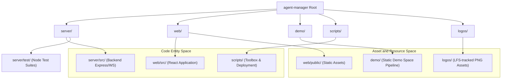
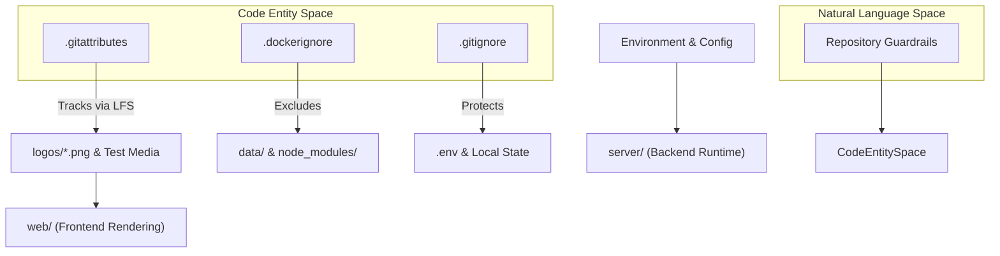

<!-- source: DeepWiki mcp.deepwiki.com · repo huggingface/agent-manager · page 1.2 Repository Layout and Conventions · fetched 2026-10-26 -->

# Repository Layout and Conventions

Relevant source files

The following files were used as context for generating this wiki page:

- [.dockerignore](.dockerignore)
- [.gitattributes](.gitattributes)
- [.gitignore](.gitignore)
- [LICENSE](LICENSE)
- [logos/claude-logo-png_seeklogo-554534.png](logos/claude-logo-png_seeklogo-554534.png)
- [logos/shell.png](logos/shell.png)

## Purpose and Scope

This page provides a technical map of the top-level directory structure, repository configuration files, exclusions, and asset conventions in the `agent-manager` codebase. It outlines how the repository organizes its backend server, frontend client, demo apps, utility scripts, and binary assets under version control and containerization boundaries.

Sources: `[.gitignore:1-13]`, `[.dockerignore:1-9]`, `[.gitattributes:1-40]`

---

## Top-Level Directory Layout

The repository is organized into distinct top-level directories separating backend logic, frontend web views, container tooling, fixtures, and brand assets.

| Directory / File | Code Role & Responsibility |
| :--- | :--- |
| `server/` | Node.js Express & WebSocket backend implementing agent runtimes, trace parsers, storage, and feature subsystems. |
| `web/` | React/Vite single-page application providing conversation readers, terminal panes, workspace navigation, and settings. |
| `demo/` | Static demo Space showcasing fixture API byte-window emulations and reader pipelines. |
| `scripts/` | Utility toolbox containing maintenance, deployment, test harnesses, and CLI installation scripts. |
| `logos/` | Brand assets and logo graphics managed via Git LFS for CLI tools and integrations. |
| `.gitignore` | Git exclusion patterns preventing tracking of build artifacts, local data stores, and environment secrets. |
| `.dockerignore` | Build context exclusions optimizing Docker image layers. |
| `.gitattributes` | Git configuration defining large file storage (LFS) rules for binary files, models, and recordings. |
| `LICENSE` | Open-source licensing terms (Apache License 2.0). |

### Diagram: Repository Architecture and Directory Space

Sources: `[.gitignore:1-13]`, `[.dockerignore:1-9]`, `[.gitattributes:1-40]`, `[LICENSE:1-125]`

---

## Repository Configuration Files

### Git Exclusions (`.gitignore`)
The `.gitignore` file prevents local configuration, build products, and ephemeral volumes from entering version control. Crucially, it omits trailing slashes on `node_modules` to catch symlinked dependencies that could otherwise be checked into the main branch as pointers or blobs `[.gitignore:1-4]`.

Key ignored patterns:
* Dependency directories: `node_modules` `[.gitignore:4]`
* Build outputs: `dist/` `[.gitignore:5]`
* Runtime data buckets: `data/` `[.gitignore:6]`
* Log files and OS metadata: `*.log`, `.DS_Store` `[.gitignore:7-8]`
* Local environment variables: `.env`, `.env.local` `[.gitignore:9-10]`
* Python bytecode and caches: `__pycache__/`, `*.pyc` `[.gitignore:11-12]`

Sources: `[.gitignore:1-13]`

### Docker Build Exclusions (`.dockerignore`)
The `.dockerignore` file mirrors `.gitignore` constraints to minimize the Docker build context transferred to the daemon `[.dockerignore:1-9]`. It excludes `**/node_modules`, `**/dist`, local `data` storage, `.git`, log files, `.DS_Store`, local environment files (`**/.env*`), and scratchpads `[.dockerignore:1-8]`.

Sources: `[.dockerignore:1-9]`

### Git Attributes and Large File Storage (`.gitattributes`)
Binary assets, compressed archives, ML weights, model files, and test recordings are offloaded to Git LFS (`git-lfs`). The `.gitattributes` configuration configures filter, diff, and merge handlers for these extensions `[.gitattributes:1-40]`.

Tracked LFS extensions and paths include:
* Archives and data dumps: `*.7z`, `*.tar.gz`, `*.zip`, `*.parquet`, `*.arrow`, `*.bin`, `*.safetensors` `[.gitattributes:1-35]`
* Test fixtures and media: `web/test/fixtures/*.webm`, `web/test/fixtures/*.ogg` `[.gitattributes:38-39]`
* Documentation and installation images: `web/public/install/mount-bucket.png`, `docs/images/*.png` `[.gitattributes:36-37]`

Sources: `[.gitattributes:1-40]`

### Licensing (`LICENSE`)
The repository is licensed under the Apache License, Version 2.0, providing explicit grants of copyright and patent licenses for contributors and users `[LICENSE:1-125]`.

Sources: `[LICENSE:1-125]`

---

## Asset Management (`logos/`)

Brand assets, CLI icons, and provider logos are maintained in the `logos/` directory. For example, Claude and shell integration logos are stored as binary PNG graphics (`[logos/claude-logo-png_seeklogo-554534.png:1-41]`, `[logos/shell.png:1-14]`). Because these files are binary graphics rendered in UI components or documentation, they are managed directly under asset pipelines.

### Diagram: Asset and Configuration Flow

Sources: `[.gitattributes:1-40]`, `[.dockerignore:1-9]`, `[.gitignore:1-13]`, `[logos/claude-logo-png_seeklogo-554534.png:1-41]`, `[logos/shell.png:1-14]`

---

