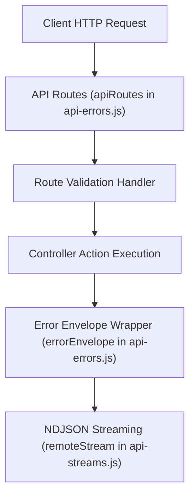
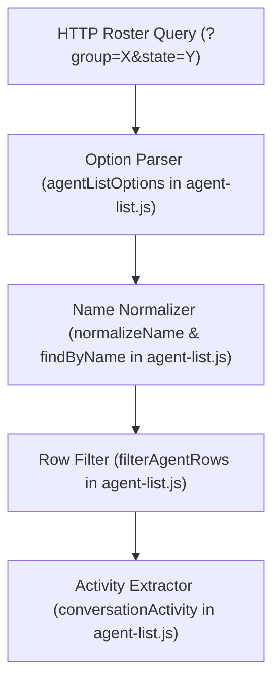

<!-- source: DeepWiki mcp.deepwiki.com · repo huggingface/agent-manager · page 2 Backend Server · fetched 2026-10-26 -->

# Backend Server

Relevant source files

The following files were used as context for generating this wiki page:

- [server/package.json](server/package.json)
- [server/src/agent-list.js](server/src/agent-list.js)
- [server/src/api-errors.js](server/src/api-errors.js)
- [server/src/api-streams.js](server/src/api-streams.js)

## Purpose and Scope

The backend server is a Node.js application built using Express, `ws` (WebSockets), `node-pty`, and `@coder/libghostty-vt-node`, located in `server/src`. Its primary responsibility is managing isolated terminal PTY sessions for AI coding CLI tools, hosting an HTTP/WebSocket API layer, parsing terminal conversation traces, ensuring safe persistence against the `/data` storage bucket, and driving auxiliary features like scheduled crons, skill management, and session sharing. 

This is a parent overview page. Detailed technical implementations are delegated to dedicated child pages.

---

## Architecture and Sub-Modules

The backend server coordinates incoming HTTP requests, WebSocket control streams, terminal processes, and background workers. 

### Diagram: API Routing and Error Handling Pipeline

Sources: [server/src/api-errors.js:60-68](), [server/src/api-errors.js:72-89](), [server/src/api-streams.js:6-53]()

### Diagram: Agent Roster and Query Filtering Architecture

Sources: [server/src/agent-list.js:14-17](), [server/src/agent-list.js:26-34](), [server/src/agent-list.js:54-80](), [server/src/agent-list.js:81-91]()

---

## Sub-Topic Overview and Child Page Links

### 2.1 HTTP/WebSocket API Layer
The server exposes REST endpoints and real-time WebSocket communication channels configured via `index.js`. Request admission policies protect resources against untrusted cross-origin frames, while uniform input validation and structured error handling (`apiRoutes`, `errorEnvelope`, `apiErrorHandler`) guarantee predictable API responses. Real-time logging and NDJSON streaming (`remoteStream`) handle live output feeds.
* For details, see [HTTP/WebSocket API Layer](#2.1).

Sources: [server/src/api-errors.js:60-124](), [server/src/api-streams.js:6-53]()

### 2.2 Session and Terminal Runtime
AI coding CLI agents (such as Claude Code, Codex, OpenCode, and Gemini) run inside isolated PTY instances spawned via `node-pty` and processed through terminal emulators. This layer handles lifecycle routines including resize commands, restarts, run-state tracking, safety checkpoints, watchdogs, and specialized process integrations.
* For details, see [Session and Terminal Runtime](#2.2).

Sources: [server/package.json:25-32](), [server/src/agent-list.js:14-91]()

### 2.3 Traces and Conversation Parsing
Conversation traces are captured under a strict byte-window contract and processed by dedicated workers. This subsystem manages trace revisions, activity metrics, subagent rosters, and conversation adapters to transform raw terminal text streams into structured conversational models.
* For details, see [Traces and Conversation Parsing](#2.3).

Sources: [server/src/agent-list.js:43-53]()

### 2.4 Storage, Persistence and the `/data` Bucket
All workspace state, history stores, configuration snapshots, and backups are stored reliably through storage wrappers. The persistence layer includes safeguards like safe-write primitives, slow-file-system probing, and FUSE phantom directory mitigation to prevent data loss on shared or network-backed volumes.
* For details, see [Storage, Persistence and the /data Bucket](#2.4).

Sources: [server/package.json:21-23]()

### 2.5 Features: Skills, Crons, Delegation, Sharing, Remote Agents
Built on top of the base runtime, several feature subsystems provide advanced capabilities: managed skills, scheduled prompts via `cron-parser`, agent delegation and dispatch, session sharing with redaction rules, remote agent streaming, and resource usage accounting.
* For details, see [Features: Skills, Crons, Delegation, Sharing, Remote Agents](#2.5).

Sources: [server/package.json:26-30](), [server/src/agent-list.js:36-41]()

---

