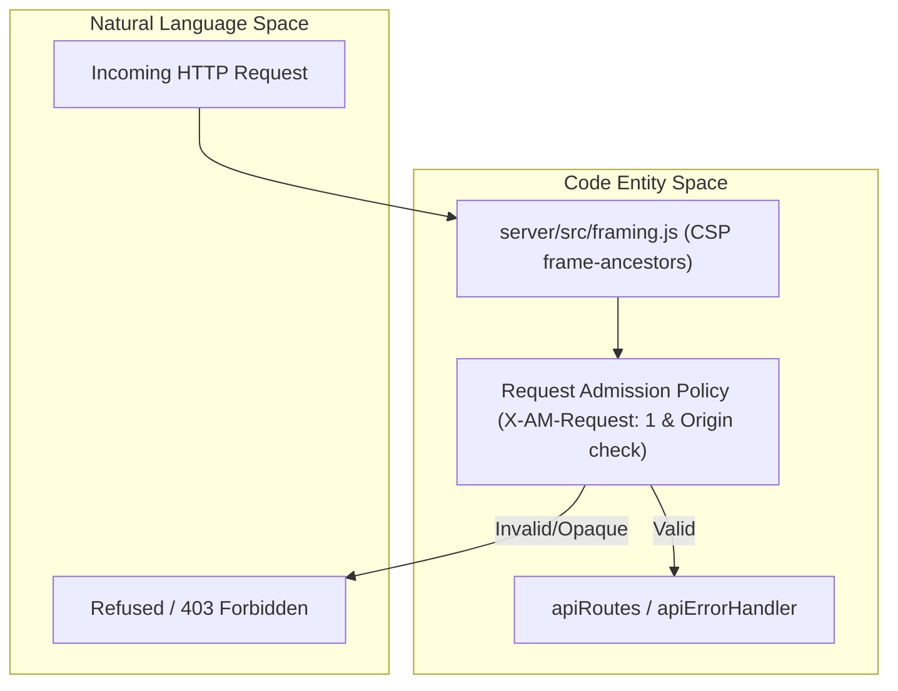
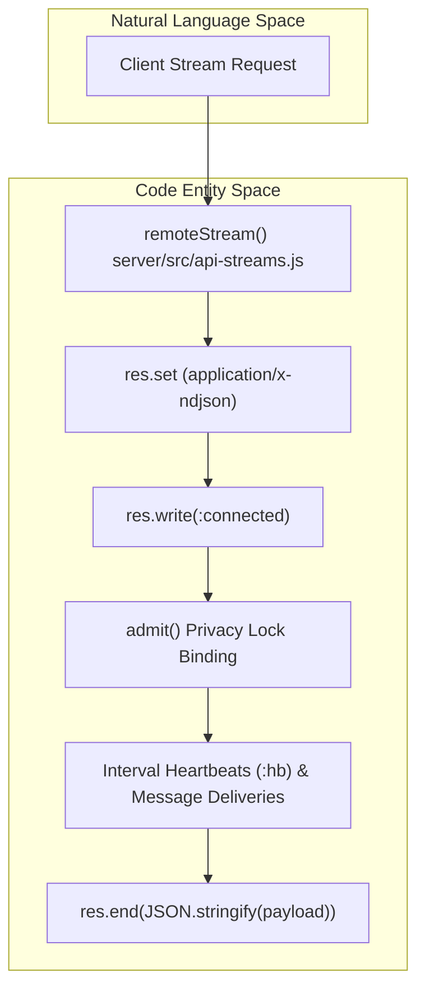

<!-- source: DeepWiki mcp.deepwiki.com · repo huggingface/agent-manager · page 2.1 HTTP/WebSocket API Layer · fetched 2026-10-26 -->

# HTTP/WebSocket API Layer

Relevant source files

The following files were used as context for generating this wiki page:

- [docs/api-audit-log.md](docs/api-audit-log.md)
- [docs/api-errors.md](docs/api-errors.md)
- [docs/browser-request-protection.md](docs/browser-request-protection.md)
- [server/src/api-errors.js](server/src/api-errors.js)
- [server/src/api-streams.js](server/src/api-streams.js)

## Purpose and Scope
This section details the HTTP and WebSocket API layer implemented in the backend server. It governs route registration (`server/src/api-errors.js` [server/src/api-errors.js:60-68]), request admission and browser protection policies (`docs/browser-request-protection.md`), request validation and safe error envelope wrapping (`server/src/api-errors.js` [server/src/api-errors.js:72-89]), real-time streaming implementations (`server/src/api-streams.js` [server/src/api-streams.js:1-54]), and the sensitive private API audit log (`docs/api-audit-log.md`).

---

## 1. Route Structure and Registration
Routes are registered onto the Express application using an explicit registration facade `apiRoutes` rather than global monkey-patching [server/src/api-errors.js:58-68]. Global JSON parsing, privacy lock verification, and operation attribution execute in a fixed sequence [docs/api-errors.md:57-59]. 

Validation runs after route-specific body/query parsers and immediately preceding the final route action [docs/api-errors.md:57-60]. Successful request bodies and binary data streams are returned directly without generic JSON wrapping [server/src/api-errors.js:58-59].

Sources: [server/src/api-errors.js:58-68](), [docs/api-errors.md:54-60]()

---

## 2. Request Admission and Browser Protection
Agent Manager enforces request admission hardening to defend against unauthorized cross-site requests within its single-owner private deployment model [docs/browser-request-protection.md:3-6]. 

### Admission Policy and Markers
Protected mutating requests and browser fetches must present an exact configured `Origin` header (when applicable) alongside a non-secret, non-safelisted protocol header: `X-AM-Request: 1` [docs/browser-request-protection.md:13-24]. The application grants no API CORS permissions, and `OPTIONS` preflight requests return `204` without `Access-Control-Allow-Origin` headers [docs/browser-request-protection.md:24-26]. Fetch Metadata headers (`Sec-Fetch-Site`, `Sec-Fetch-Mode`, `Sec-Fetch-Dest`) serve as defense-in-depth, verifying that browser-initiated API calls stem from `cors` or `same-origin` modes [docs/browser-request-protection.md:35-39].

### Framing and CSP
To regulate how the application can be embedded, every response (`/api/*`, static assets, SPA fallback, errors) is injected with a `Content-Security-Policy` header containing `frame-ancestors 'self'`, combined with `https://huggingface.co` whenever `SPACE_ID` is configured [docs/browser-request-protection.md:73-76]. Additional custom embedding origins can be configured via `AM_FRAME_ANCESTORS` [docs/browser-request-protection.md:85].

*Diagram 1: Request Admission & Framing Flow from Network Edge to Express Routing*

Sources: [docs/browser-request-protection.md:1-97]()

---

## 3. Validation, Error Envelopes, and HTTP Failures
Request validation and failure handling are standardized through `ApiError` exceptions and middleware wrappers defined in `server/src/api-errors.js` [server/src/api-errors.js:10-124].

### Error Classes and Envelopes
* **`ApiError`**: The standard exception class carrying an HTTP status code, machine-readable error `code`, user-facing message, and optional extra structured `data` [server/src/api-errors.js:10-17].
* **`asyncHandler`**: Wraps asynchronous Express route handlers to catch rejected promises and forward them safely to `next()` [server/src/api-errors.js:44-56].
* **`errorEnvelope`**: Intercepts `res.json` responses carrying status `>= 400`. For `5xx` internal errors, it sanitizes outputs to return a safe generic message, a server-generated `requestId`, and optional bounded file path details while shielding raw stack traces [server/src/api-errors.js:72-89, docs/api-errors.md:13-17].
* **`apiErrorHandler`**: Maps raw body-parser errors (such as `entity.parse.failed` or `entity.too.large`) and URI malformations into well-typed `ApiError` instances [server/src/api-errors.js:96-124].

Sources: [server/src/api-errors.js:1-124](), [docs/api-errors.md:1-51]()

---

## 4. Streaming Endpoints
Real-time streaming and long-polling endpoints (such as remote agent message queues) are managed via specialized streaming utilities like `remoteStream` in `server/src/api-streams.js` [server/src/api-streams.js:6-54].

### NDJSON and Heartbeat Contracts
The `remoteStream` function establishes an NDJSON response stream (`application/x-ndjson`), writing an initial `:connected` comment line, followed by periodic heartbeat comments (`:hb`), pending message payloads, and closing JSON event lines [server/src/api-streams.js:34-51]. It integrates directly with the privacy lock via an `admit` callback, ensuring that lock engagements gracefully terminate the stream with a stop protocol message rather than abruptly severing the TCP socket [server/src/api-streams.js:3-5, 36-39].

*Diagram 2: Streaming Architecture and Lifecycle in `server/src/api-streams.js`*

Sources: [server/src/api-streams.js:1-53]()

---

## 5. The API Audit Log
Mutating API operations and resolved agent waits are logged to `operations.jsonl` under the private data directory [docs/api-audit-log.md:3-4]. 

### Credential Filtering (`credentials-v1`)
Version 2 audit records include an `audit.credentialFilter` metadata block [docs/api-audit-log.md:13-19]. Before serialization and disk append, a detached representation passes through the `credentials-v1` filtering policy, which scrubs sensitive information [docs/api-audit-log.md:21-23]:
* **Structured Fields**: Replaces values under keys such as `authorization`, `password`, `token`, `api_key`, `clientSecret`, and `private_key` with `[redacted]` [docs/api-audit-log.md:27].
* **Provider Token Shapes**: Detects and redacts standard token prefixes (e.g., Hugging Face `hf_...`, Anthropic `sk-ant-...`, OpenAI `sk-...`, GitHub tokens, AWS access keys, and JWT formats) [docs/api-audit-log.md:28].
* **Private Key Blocks**: Scrubs full `BEGIN ... PRIVATE KEY` through `END ... PRIVATE KEY` blocks [docs/api-audit-log.md:30].
* **Configured Secrets**: Matches exact values (at least 8 characters long) from the Space's injected-secret catalog [docs/api-audit-log.md:31].

If sanitization throws an error, a minimal diagnostic audit failure entry is written without exposing raw file paths or exceptions [docs/api-audit-log.md:80-82].

Sources: [docs/api-audit-log.md:1-89]()

---

