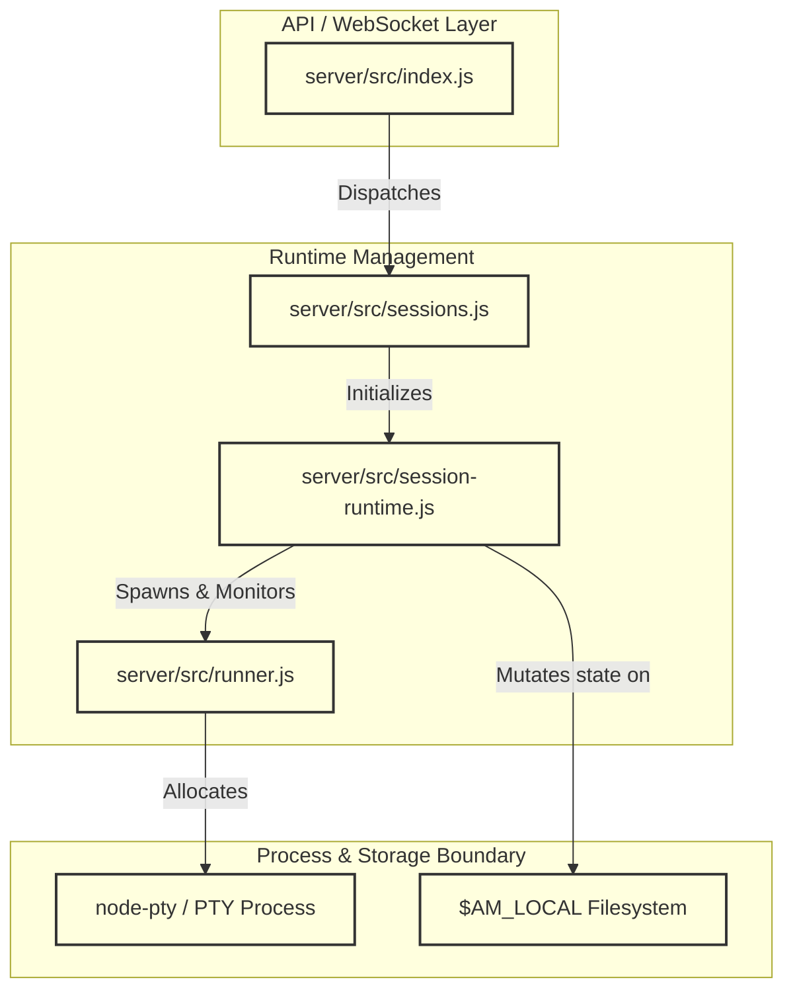
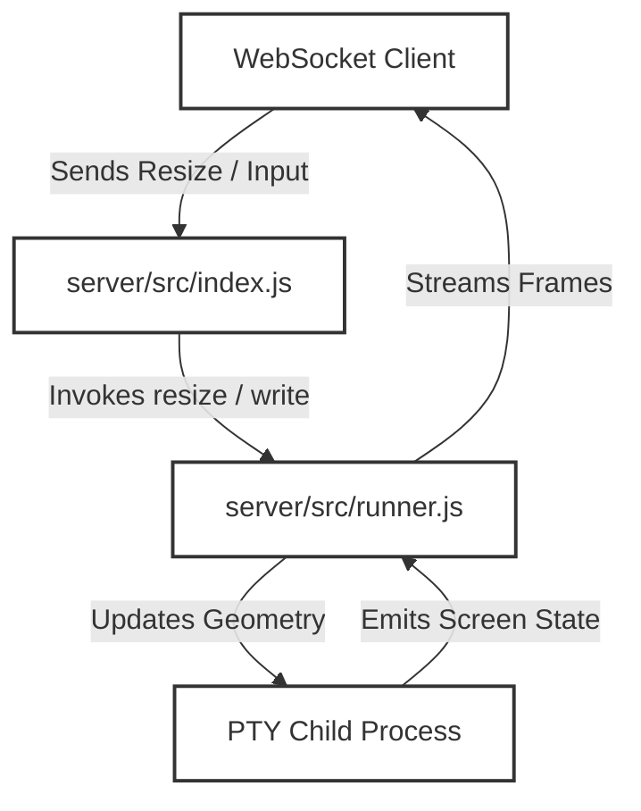

<!-- source: DeepWiki mcp.deepwiki.com · repo huggingface/agent-manager · page 2.2 Session and Terminal Runtime · fetched 2026-10-26 -->

# Session and Terminal Runtime

Relevant source files

The following files were used as context for generating this wiki page:

- [docs/agent-state-checkpoints.md](docs/agent-state-checkpoints.md)
- [docs/tui-input-required.md](docs/tui-input-required.md)
- [scripts/agent-state.sh](scripts/agent-state.sh)
- [scripts/am-input-required-hook.sh](scripts/am-input-required-hook.sh)
- [server/resize.test.mjs](server/resize.test.mjs)

## Purpose and Scope

The Session and Terminal Runtime subsystem handles the end-to-end lifecycle of CLI agent sessions within the Agent Manager environment. It is responsible for spawning pseudo-terminal (PTY) processes, managing terminal modes, translating resize commands, supervising process execution states, and synchronizing durable state checkpoints to the underlying storage bucket. 

This is a parent page providing a high-level architectural overview of the runtime modules located in `server/src/`. For per-CLI integration specifics, see [Agent Integrations and Hooks](#2.2.1). For specialized multi-client Codex support, see [Codex Shared Sessions](#2.2.2).

Sources: `docs/agent-state-checkpoints.md:1-12`, `docs/tui-input-required.md:1-18`

---

## Runtime Architecture and Core Modules

The runtime backend coordinates session processes through a hierarchy of modules that manage process routing, state tracking, and PTY I/O streaming.

*Figure 1: Control flow from API entry points down to PTY execution and local file mutations.*

- **`sessions.js`**: Manages the collection of active session records, mapping session identifiers to their respective runtime contexts and configuration profiles.
- **`session-runtime.js`**: Controls the per-session execution environment, handling spawn parameters, environment variables, lifecycle state transitions, and coordination with persistence triggers.
- **`runner.js`**: Manages low-level PTY attachment, raw byte streaming, terminal mode configurations, and repaint archive synchronization (`server/resize.test.mjs:19`).

Sources: `server/resize.test.mjs:1-21`, `docs/agent-state-checkpoints.md:1-15`

---

## PTY and Terminal Modes

Agent Manager treats terminal interfaces explicitly rather than relying purely on heuristic text scraping. Shell outputs use standard reflow behavior, while primary-screen agent TUIs settle their `SIGWINCH` repaint events inside designated terminal boundaries so that presentation bytes do not pollute output history (`server/resize.test.mjs:1-7`).

- **Geometry & Resize**: Client-initiated resize events flow through WebSocket control messages (`{ t: 'r', cols, rows }`), triggering PTY dimension adjustments and scratch terminal synchronization (`server/resize.test.mjs:73-83`).
- **Interactive TUI Dialog Detection**: Companion scripts monitor native CLI lifecycle events (such as permission prompts and planning states) to surface advisory input requirements without mutating stream availability (`docs/tui-input-required.md:1-25`, `scripts/am-input-required-hook.sh:1-45`).

*Figure 2: Terminal session communication loop between client and PTY process.*

Sources: `server/resize.test.mjs:1-120`, `docs/tui-input-required.md:1-45`, `scripts/am-input-required-hook.sh:1-71`

---

## Run State, Checkpoints, and Watchdog

Because the backing `/data` storage volume operates as a FUSE view over mutable object storage rather than a standard POSIX filesystem, active agents execute exclusively against local disk paths (`$AM_LOCAL`), while durable states are synchronized via explicit checkpointing routines (`docs/agent-state-checkpoints.md:1-13`).

- **Local Execution vs. Bucket Sync**: Agent harnesses mutate ordinary files locally. Periodic routines execute online database backups (such as SQLite `PRAGMA quick_check` validated operations) and rsync-based tree syncs to move closed writes into the bucket (`docs/agent-state-checkpoints.md:14-28`, `scripts/agent-state.sh:1-15`).
- **Watchdog & Budgets**: Restores and checkpoints operate under strict time budgets (`AGENT_STATE_BUDGET`), with automated watchdogs enforcing cleanup and failing closed if operations exceed allocated durations (`docs/agent-state-checkpoints.md:98-115`).

Sources: `docs/agent-state-checkpoints.md:1-119`, `scripts/agent-state.sh:1-120`

---

## Child Pages

For more detailed technical specifications, refer to the following child documentation:
- [Agent Integrations and Hooks](#2.2.1) — Per-CLI integration details: Claude Code statusline/repin hook, Codex launch policy and context repin, opencode plugin, Gemini system defaults, Hermes, fx process.
- [Codex Shared Sessions](#2.2.2) — Codex-specific shared session architecture: bindings, observation client, rollout migration, reconnect, and shared preview; plus design proposals.

Sources: `docs/agent-state-checkpoints.md:1-5`, `docs/tui-input-required.md:1-15`

---

