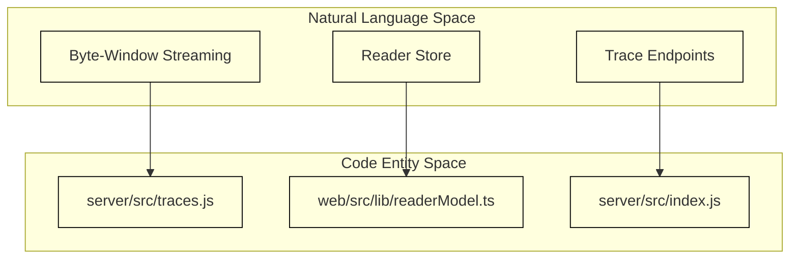
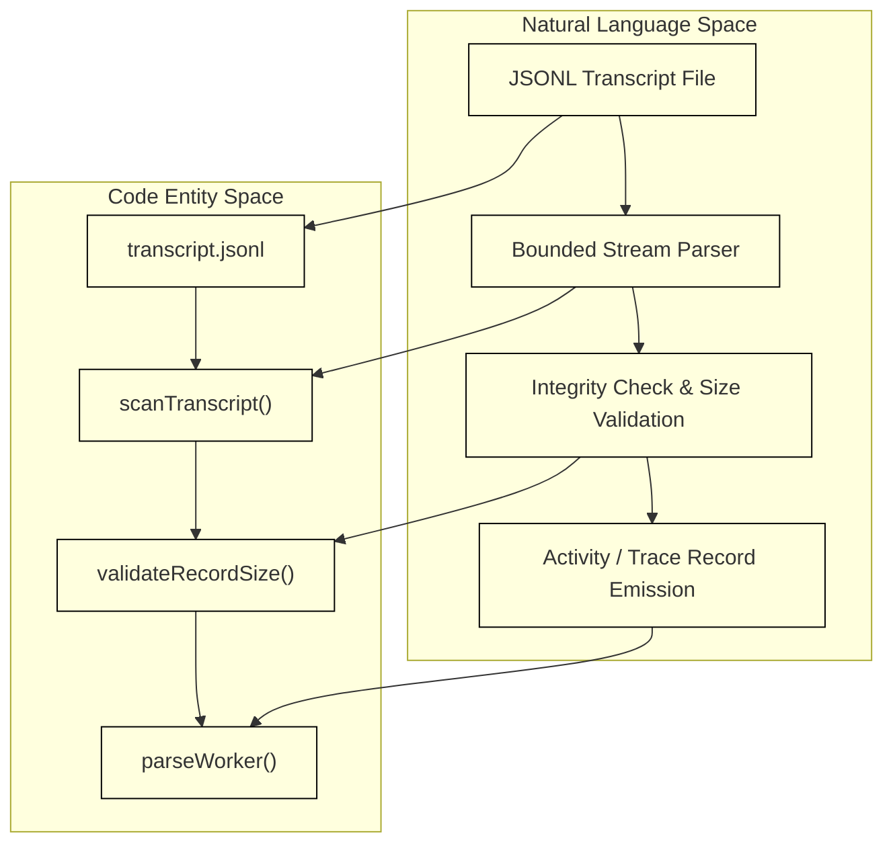

<!-- source: DeepWiki mcp.deepwiki.com · repo huggingface/agent-manager · page 2.3 Traces and Conversation Parsing · fetched 2026-10-26 -->

# Traces and Conversation Parsing

Relevant source files

The following files were used as context for generating this wiki page:

- [docs/agent-activity.md](docs/agent-activity.md)
- [docs/conversation-adapter.md](docs/conversation-adapter.md)
- [docs/reader-architecture.md](docs/reader-architecture.md)
- [scripts/codex-writer.py](scripts/codex-writer.py)
- [server/reader-info.test.mjs](server/reader-info.test.mjs)

This page covers the technical architecture of conversation tracing, byte-window streaming contracts, asynchronous log parsing workers, activity timestamp extraction, and the conversation adapter model in Agent Manager (`agent-manager`).

---

## 1. The Trace Byte-Window Contract (`traces.js`)

The server manages conversation logs as append-only source streams (such as JSONL files) and exposes them through bounded, continuous transport windows [docs/reader-architecture.md:9-11](). Rather than loading entire conversation transcripts into memory, the backend employs a byte-window contract that serves paginated chunks indexed by byte offsets or message counts.

Key components of the trace streaming model include:
- **Source Identity & Cursors**: Byte cursors include source generation markers to protect against file replacement, truncation, or same-size rewrites [docs/agent-activity.md:23-24](), [docs/reader-architecture.md:28-29]().
- **Forward & Backward Catch-up**: Clients request windows using pagination boundaries (`bytes` or message counts), avoiding memory starvation on large files [docs/reader-architecture.md:28-30]().
- **Reconciliation**: Message fragments and tool results are reconciled by unique identifiers across both prepend and append operations [docs/reader-architecture.md:30-31]().

### Diagram: Trace Byte-Window to Code Entities
The following diagram maps the natural language concept of conversation reading and trace windows to their concrete backend and frontend code counterparts.

*Sources: [docs/reader-architecture.md:9-21](), [server/reader-info.test.mjs:112-128]()*

---

## 2. Trace Parse Worker and Bounded Memory Scanning

To prevent runaway memory consumption when parsing multi-megabyte agent logs (such as Claude Code and Codex transcripts), the backend utilizes bounded-memory streaming scans.

- **Append Cursors**: The scanner maintains an append cursor over JSONL transcripts so that long tool outputs do not obscure or invalidate earlier exchanges [docs/agent-activity.md:18-20]().
- **Size Safeguards**: Individual records exceeding 16 MiB, malformed records, and incomplete final records trigger specific warning classifications (`activity-incomplete`, `activity-unavailable`) without crashing the parser [docs/agent-activity.md:20-22]().
- **Transcript Integrity**: File replacement, truncation, and same-size rewrites are detected dynamically during the scan phase [docs/agent-activity.md:23-24]().

### Diagram: Parse Worker Execution Flow

*Sources: [docs/agent-activity.md:18-24]()*

---

## 3. Trace Revision and Activity Tracking

Agent inventory activity (`GET /api/agents` and `GET /api/agents/:id`) exposes temporal markers (`lastPromptAt`, `lastAnswerAt`, `lastActivityAt`) as ISO UTC timestamps or `null` [docs/agent-activity.md:3-4]().

- **Exchange Classification**: `activityKind` is categorized as `prompt`, `answer`, or `null`. Assistant progress text is classified as an exchange, whereas terminal refreshes, tool executions, and completion markers are excluded [docs/agent-activity.md:5-6]().
- **Independent Scanning**: Codex and Claude exchange dates are scanned independently of the display digest. Stored caching layers ensure that observed exchange times are preserved across server reloads [docs/agent-activity.md:18-28]().
- **Query Filters**: List parameters such as `group`, `state`, `cli`, `active_within_minutes`, and `include_archived` allow precise filtering of agent execution states [docs/agent-activity.md:36-41]().

| Option | Contract / Type |
| --- | --- |
| `group` | Case-insensitive, Unicode-normalized group name [docs/agent-activity.md:36]() |
| `state` | Comma-separated `working,waiting,idle,stopped,unknown` [docs/agent-activity.md:37]() |
| `cli` | Comma-separated registered CLI IDs [docs/agent-activity.md:38]() |
| `active_within_minutes` | Integer 0–52560000; includes known activity at or after the cutoff [docs/agent-activity.md:39]() |
| `sort` | `recent_conversation`, `recent_answer`, `recent_prompt`, `created` descending, or `name` ascending [docs/agent-activity.md:41]() |

*Sources: [docs/agent-activity.md:1-53]*

---

## 4. Subagent Rosters and Session Integration

Subagents and shared sessions participate in the conversation model by projecting their execution states into standard AM contracts.
- **Shared Thread Verification**: Shared Codex entries rely on bound thread transcripts and process locks inspected via helper utilities [docs/agent-activity.md:10-12](), [scripts/codex-writer.py:6-40]().
- **Activity Errors**: When shared sources cannot be verified, dates and traces evaluate to null while `activityErrors` preserves warning details for downstream API consumers [docs/agent-activity.md:12-16]().

*Sources: [docs/agent-activity.md:1-16](), [scripts/codex-writer.py:1-40]*

---

## 5. The Conversation Adapter Model

The conversation adapter model decouples execution backends (such as raw TUI processes or shared Codex daemons) from Agent Manager's standardized UI contracts (`ConversationView`, `ReaderStore`) [docs/conversation-adapter.md:1-14]().

- **Backend Routing**: The execution selector is hosted in `server/src/session-runtime.js`, while protocol translation for alternative engines resides in dedicated modules like `codex-view.js` [docs/conversation-adapter.md:16-18]().
- **Input & Trace Bridging**: Routes like `/api/sessions/:id/input` verify operator intent and resolve attachments into native turns, while `/api/trace/:id` serves verified paged rollouts combined with bounded live snapshots [docs/conversation-adapter.md:7-10]().
- **Lifecycle & Recovery**: Ephemeral transport failures or daemon crashes discard live deltas, allowing the client to re-establish observations via binding verification and restore the last persisted turn [docs/conversation-adapter.md:91-106]().

### Sources
- [docs/agent-activity.md:1-52]()
- [docs/conversation-adapter.md:1-107]()
- [docs/reader-architecture.md:1-109]()
- [scripts/codex-writer.py:1-58]()
- [server/reader-info.test.mjs:1-147]()

---

